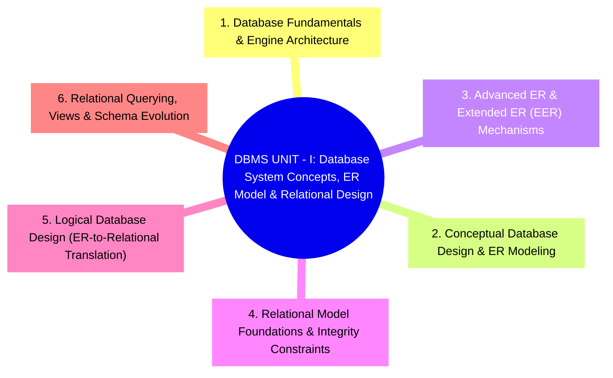

# DBMS UNIT - I: Macro Syllabus Mindmap (L-0, L-1 Architecture)

## 1. Visual Macro Architecture (Mermaid)

---

## 2. Primary Modules Architectural Blueprint

| Module ID | Module Title | Core University Focus Areas | Syllabus Level |
|---|---|---|:---:|
| **MOD-01** | **Database Fundamentals & Engine Architecture** | File Systems vs. DBMS drawbacks, Three-Schema Architecture, Data Independence, DBMS engine components (Query Processor, Storage Manager, Transaction Manager). | L-1 |
| **MOD-02** | **Conceptual Database Design & ER Modeling** | Entity sets, Attributes (simple, composite, multivalued, derived), Keys (Super, Candidate, Primary), Relationship Sets, Mapping Cardinalities (1:1, 1:N, M:N), Participation Constraints. | L-1 |
| **MOD-03** | **Advanced ER & Extended ER (EER) Mechanisms** | Weak Entity Sets and identifying relationships, Specialization & Generalization hierarchies, Attribute inheritance, Disjoint vs. Overlapping, Total vs. Partial completeness constraints. | L-1 |
| **MOD-04** | **Relational Model Foundations & Integrity Constraints** | Relations, Tuples, Attributes, Domains, Degree, Cardinality, Relational Integrity Constraints (Domain constraints, Entity integrity, Referential integrity with foreign keys and cascade actions). | L-1 |
| **MOD-05** | **Logical Database Design (ER-to-Relational Translation)** | Algorithmic reduction of ER/EER constructs to relational schemas: Strong entities, Weak entities, Binary relationships (1:1, 1:N, M:N), Multivalued attributes, and EER Specialization tables. | L-1 |
| **MOD-06** | **Relational Querying, Views & Schema Evolution** | Relational Algebra fundamental and additional operations, SQL DDL (`CREATE`, `ALTER`, `DROP`), SQL DML (`SELECT`, `INSERT`, `UPDATE`, `DELETE`), View semantics, updatability, and physical storage. | L-1 |
