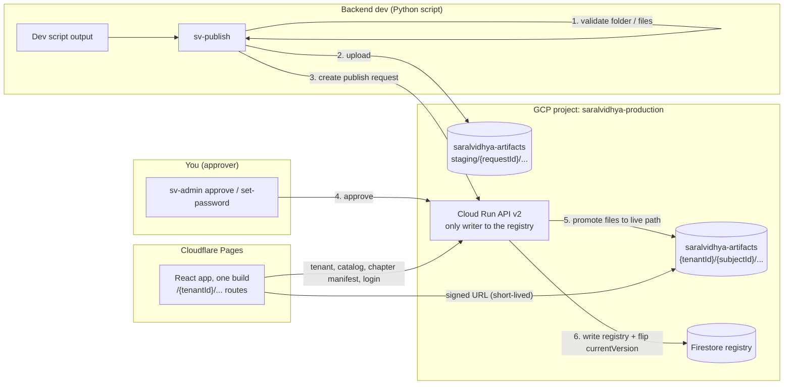
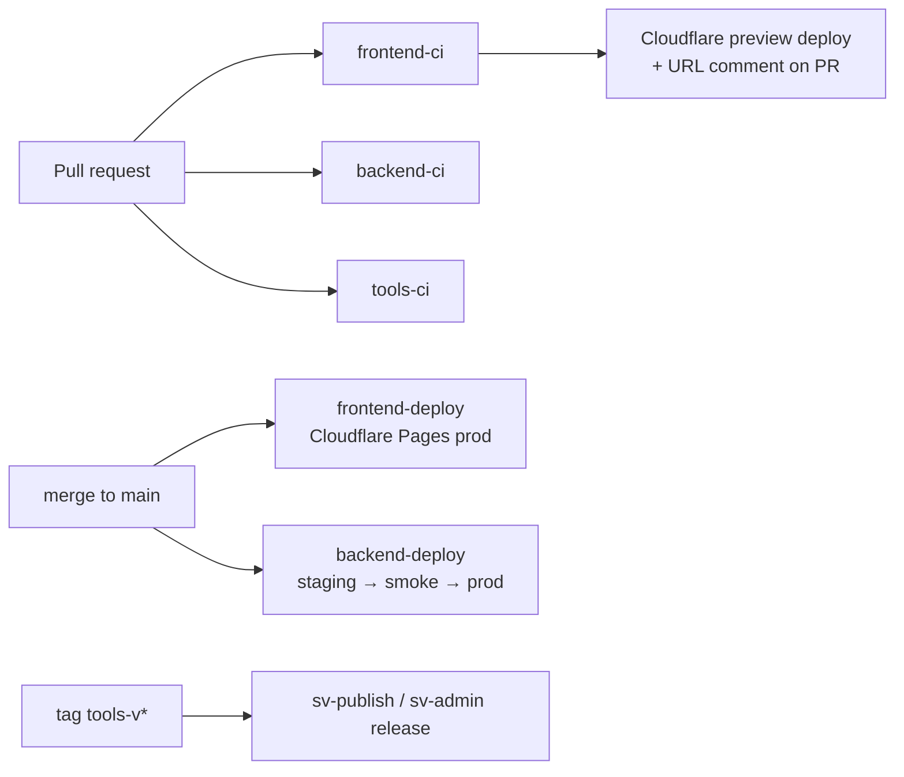

# Plan v2: DB-driven multi-tenant platform + approval-gated artifact publishing

**Status:** awaiting your review. Nothing implemented yet.
**Decisions locked (v2):** GCP project `saralvidhya-production` · bucket `saralvidhya-artifacts` (one folder per client) · **Firestore enabled** as the registry · publishing needs **your approval** · one shared password per client · frontend on **Cloudflare Pages** · custom domain later · legacy boards stay as they are · GitHub Actions CI/CD for the monorepo `sarallabs/Production_grade`.

---

## The rule

> No client ID, subject ID, path, name, logo, password or artifact list is written in frontend or backend code.
> All of it lives in the **Firestore registry** and the **bucket**. Code holds only *tool types* (the React components for Read, Podcast, Mindmap and so on). New tool types need code + build + deploy, and that is expected.

**Enforced by CI:** `check-no-tenant-literals` fails the build if non-legacy code contains client or subject identifiers. Onboarding MLRIT, or any new client, needs **zero code changes and zero redeploys**.

---

## 1. What's wrong today (audit summary)

| Problem | Where |
|---|---|
| Client/subject IDs hardcoded | `StudyTable.tsx` (`ANGRAU_CHAPTER_CONFIG`, `isAngrau = subjectId === 'ento_131'`), `ClassSubjectSelection.tsx`, `ChapterList.tsx`, `manifestService.ts` (`GCS_SUBJECT_MAP`, `DEFAULT_SUBJECT_PATHS`, `return 'angrau'`), `assessmentService.ts`, `MarkdownView.tsx`, `FlashcardsView.tsx`, `PYQView.tsx`, `PodcastsView.tsx`, `flashcardService.ts` |
| Content hardcoded in code | `chapterTopics.ts`, `angrauPlaceholderPyqs.ts`, `ExaminerConsole.tsx` `SUBJECT_METADATA`, `PreviousYearQuestions.tsx` mock sets |
| Static catalog | `public/generated_resources/catalog.json` + `manifest.json` from `scripts/generate-manifest.js` |
| Tenant baked in at build time | `branding.json`, `university_config.json`, `.env.angrau` (`VITE_VISIBLE_BOARDS`), `index.html` |
| **Password inside the JS bundle** | `VITE_DEFAULT_PASSWORD` (`credentialsStore.ts`). Visible in DevTools |
| **Content is public** | `/api/content/*` on Cloud Run needs no login. Anyone who guesses a path can download any client's files |
| **Still wired to the old project** | `saralvidhya-mvp/.env` sets `ekam-expert-prod`, so student progress (`useAudioProgress.ts`, `ResumePodcastToast.tsx`) goes there. Old-project leftovers: `scripts/upload-audio-to-firebase.cjs`, `firebaseAudioService.ts`, `googleDrive*.ts`, `firebase-service-account.json` |
| Backend assumes Firebase | `config/firebase.ts`, `verifyToken` middleware and `routes/users.ts` use Firebase Admin/Firestore. Likely non-functional in the new project today |
| Messy artifact folders | `angrau/` has `missing artifacts/`, both `Prepare/` and `Preparation/`, both `medium/` and `intermediate/` … No enforced schema |
| No CI/CD | No `.github/workflows`. The MVP has an nginx `Dockerfile` that Cloudflare Pages makes unnecessary |

---

## 2. Target architecture



**Key properties**
- **The backend is the only writer to the registry.** The dev's credentials can upload to `staging/` and create requests, nothing else. The approval step cannot be bypassed.
- **Live after approval without a redeploy.** The frontend fetches everything at runtime. Changes appear within about 60s (backend cache TTL).
- **Paths are dev-driven, not content-addressed hashes.** Files sit at human-readable paths (e.g. `{tenantId}/{subjectId}/chapter_NN/...`), and the registry maps each tool to its relative GCS path. ANGRAU already sits at `angrau/entomology/` and requires zero re-upload or hash conversion.
- **Private bucket + signed URLs.** The API gives a logged-in student short-lived (e.g. 15 min) signed URLs for their own client's files only. Audio streams directly from GCS with byte-range support.
- **Billing Note:** Ensure the GCP free trial (credits) is upgraded to standard pay-as-you-go before expiry so Firestore and Cloud Run quotas are uninterrupted.

**Tenant routing (until the domain exists): path prefix**
- `https://<project>.pages.dev/angrau/...`, `https://<project>.pages.dev/mlrit/...`
- The first path segment is the tenant ID. Unknown IDs show a "client not found" page.
- Later, the domain only adds a lookup: `mlrit.saralvidhya.in` → `mlrit`, via `tenant.domains[]`. No refactor needed.

**Legacy boards** (CBSE, NEB, MANUU, Master Minds, Telangana, ANU) are left untouched on the old static path. The frontend reads the registry first and falls back to the static catalog only for legacy board IDs. Legacy files sit on a CI allowlist (§9).

---

## 3. Firestore registry schema (Native mode, `asia-south1`; the location can't be changed later)

```
tenants/{tenantId}                         "angrau", "mlrit"
  name, shortName, status: active|suspended
  domains: []                              // filled once the domain exists
  branding: { appName, logoBlob, faviconBlob, primaryColor, programLabel }
  storage:  { bucket: "saralvidhya-artifacts", prefix: "tenants/{tenantId}" }
  features: { examinerConsole, expertPanel, pyq, ask, toolOrder?: [...] }
  hierarchy: ["program", "subject"]        // grouping levels; configurable (MLRIT TBD)
  auth: { passwordHash, sessionVersion, updatedAt }   // never readable via the public API
  createdAt, updatedAt

tenants/{t}/nodes/{nodeId}                 generic grouping (program / branch / semester…)
  type, name, parentId, order

tenants/{t}/subjects/{subjectId}
  parentNodeId, name, code, iconBlob, order, status
  faculty: { name, title, avatarBlob }, units: [...]

tenants/{t}/subjects/{s}/chapters/{chapterId}
  number, title, status: draft|published|archived
  currentVersion, topics: [{ id, label, order }]
  tools: { "read.quick": { personas: [...] }, "practice.mcq": { difficulties: [...] }, ... }

tenants/{t}/subjects/{s}/chapters/{c}/versions/{v}
  files: { "read/quick/beginner.md": { path: "read/quick/beginner.md", size, contentType } , ... }
  requestId, approvedBy, approvedAt

publishRequests/{requestId}
  tenantId, scope, status: pending|approved|rejected|failed
  diff summary (new/changed/removed per chapter), validationReport
  submittedBy, submittedAt, decidedBy, decidedAt, note

users/{sessionId or uid}/progress/{tenantId:subjectId:chapterId:tool}
auditLog/{autoId}
```

**Why `nodes` instead of fixed programs:** MLRIT's structure isn't decided yet. `hierarchy` + `nodes` lets a client have Program → Subject (ANGRAU) or Branch → Semester → Subject (likely MLRIT) without code changes. The CLI derives nodes from folders.

---

## 4. Canonical publish folder (contract with the backend dev)

```
mlrit/
|-- tenant.json                <- id, name, branding, features, hierarchy (NO password)
|-- assets/{logo,favicon}.png
`-- <node>/[<node>/...]/subjects/<subjectId>/
        |-- subject.json
        `-- chapters/chapter_NN/
              |-- chapter.json                       <- number, title, topics[]
              |-- read/quick/{beginner,intermediate,advanced}.md
              |-- read/detailed/{beginner,intermediate,advanced}.md
              |-- read/key_takeaways.md
              |-- learn/mindmap.json, learn/study_plan.md
              |-- learn/topics/{topicId}/{quick,detailed}.md, podcast.m4a
              |-- practice/flashcards/{persona}.json
              |-- practice/{mcq,msq}/{easy,medium,hard}.json
              |-- practice/question_bank.json
              |-- prepare/{previous_year,pre_final_exam,certification_exam}.json
              |-- podcasts/{short,long}_podcast.{m4a,md}, microcast_NN.{m4a,md}
              `-- media/...                          <- images, relative links from markdown
```

- Persona and difficulty are **filenames, never folders**.
- Tools are **detected from the files present**. Nobody maintains a "completed" list.
- The node depth matches `tenant.json → hierarchy`. MLRIT's exact layout is deferred, and the schema already supports it.

> [!WARNING]
> **Dependency on the backend dev:** his generator must emit this layout. If it can't, `sv-publish` gets an `--adapter` mapping file (old name → canonical path). This needs confirming with him before Phase 2.

---

## 5. Tools

### `sv-publish` (backend dev)
```bash
sv-publish validate ./mlrit                 # offline: schemas, naming, links, audio checks
sv-publish submit   ./mlrit [--only cs_201/chapter_03]   # uploads changed blobs to staging, creates request
sv-publish status   <requestId>             # pending / approved / rejected (+ note)
```
- Uploads only blobs that are missing from the bucket (MD5 check).
- Nothing is submitted if validation fails. Errors are listed per file.

### `sv-admin` (you only)
```bash
sv-admin requests                           # list pending, with diff summary
sv-admin show <requestId>                   # per-chapter changes + preview link
sv-admin approve <requestId> | reject <requestId> --note "..."
sv-admin rollback <tenant> <subject> <chapter> --to <v>
sv-admin set-password <tenant> [--generate] [--logout-all]
sv-admin tenant suspend|resume <tenant>
sv-admin unpublish <tenant> <subject> [<chapter>]
```

**Preview before approving:** `/{tenant}/...?preview=<requestId>` renders the pending version. It works only with an admin session.

### Passwords (answer to Q7)
- `sv-admin set-password mlrit --generate` creates a passphrase such as `Mlrit-Harbor-4821`, shows it **once**, and stores only a **bcrypt hash** in `tenants/mlrit.auth`.
- `--logout-all` bumps `sessionVersion`, which invalidates existing sessions.
- ANGRAU: the existing password is hashed during migration, so students see no change. Rotating it later is recommended, because it has been exposed in the public bundle.
- Login is **rate limited** per IP + tenant (e.g. 10 attempts / 15 min).

### Identities (IAM)
| Identity | Permissions |
|---|---|
| `sv-publisher@` (backend dev) | `storage.objectCreator` on `saralvidhya-artifacts`, with an IAM condition limiting it to `staging/` · `run.invoker` / API publisher token for `submit` |
| `sv-api@` (Cloud Run runtime) | `storage.objectAdmin` on bucket · `datastore.user` · `iam.serviceAccountTokenCreator` on itself (signed URLs) · Secret Manager accessor |
| You | Approver role checked by the API (Google identity token from `gcloud`, email allowlisted in Secret Manager) |
| `sv-deployer@` (GitHub Actions) | Cloud Run deploy, Artifact Registry writer, Firestore indexes. Via **Workload Identity Federation**, no JSON keys |

---

## 6. Backend changes (`saralvidhya-production/backend`)

| File | Change |
|---|---|
| **[NEW]** `src/services/registry.ts` | Firestore reads with 60s cache, and transactional writes (approve, rollback) |
| **[NEW]** `src/services/storage.ts` | Blob paths from the tenant doc, signed URLs, staging → live promotion |
| **[NEW]** `src/services/session.ts` | Signs/verifies session JWTs (`tenantId`, `sessionVersion`, `role`). Secret in Secret Manager |
| **[NEW]** `src/middleware/tenant.ts`, `requireSession.ts`, `requireApprover.ts` | Tenant from path param / header. Session must match the tenant. Approver check |
| **[NEW]** `src/routes/v2/public.ts` | `GET /v2/t/:tenant` (branding only), `POST /v2/t/:tenant/login` |
| **[NEW]** `src/routes/v2/content.ts` | `GET /v2/t/:tenant/catalog`, `GET /v2/t/:tenant/subjects/:s/chapters/:c` (manifest + signed URLs), progress endpoints |
| **[NEW]** `src/routes/v2/publish.ts` | `POST /v2/publish-requests` (publisher), `GET/POST …/:id/approve|reject` (approver), rollback, set-password, suspend |
| [REMOVE] `config/firebase.ts` Firebase-Auth usage, `verifyToken` | Replaced by `session.ts`. Firestore access stays via `@google-cloud/firestore` |
| [MODIFY] `routes/content.ts` (v1) | Kept read-only for ANGRAU until the frontend switches, then deleted |
| [MODIFY] `index.ts`, `.env.example`, `infra/README.md` | CORS for `*.pages.dev` + configured origins. New project. No hardcoded bucket |

---

## 7. Frontend changes (`saralvidhya-mvp`)

**New core**
| File | Purpose |
|---|---|
| `src/tenant/TenantProvider.tsx`, `useTenant()` | Reads `:tenantId` from the route, loads `/v2/t/:tenant`, applies branding/theme/title/favicon |
| `src/data/registryClient.ts` | The only data layer: `getCatalog`, `getChapter`, `fileUrl` (signed), `saveProgress` |
| `src/tools/toolRegistry.ts` | Tool type → component/label/icon/section. Product code only |
| `src/routes.tsx` | All routes under `/:tenantId/*`. `/` shows a neutral landing / "enter your institution link" page |
| `public/_redirects` | `/* /index.html 200` (Cloudflare Pages SPA fallback) |
| `scripts/check-no-tenant-literals.mjs` + `tenant-literals.allowlist` | CI gate (legacy files allowlisted, shrinking over time) |

**Refactor:** `StudyTable.tsx` (delete `ANGRAU_CHAPTER_CONFIG`, `buildAngrauMermaid`, `angrauTopicCache`, every `isAngrau`/`neb_nepal` branch; toolbar from `chapter.tools`) · `manifestService.ts` (gutted → removed) · `assessmentService.ts`, `flashcardService.ts`, `markdownService.ts` (via `registryClient`) · `ClassSubjectSelection.tsx`, `ChapterList.tsx` (render `nodes`/subjects from catalog) · `ExaminerConsole.tsx` (faculty/units from registry) · `PreviousYearQuestions.tsx`, `PYQView.tsx` (from `previous_year.json`) · `MarkdownView.tsx`, `FlashcardsView.tsx` (relative media via manifest; drop `PHYSICS_REAL_INFOGRAPHICS`) · `PodcastsView.tsx`, `useAudioProgress.ts`, `ResumePodcastToast.tsx` (progress via API, tenant-scoped) · `Login.tsx`, `credentialsStore.ts` (API login, remove `VITE_DEFAULT_PASSWORD`) · `App.tsx`, `index.html` (generic).

**Delete:** `config/branding.json`, `config/university_config.json`, `data/chapterTopics.ts`, `data/angrauPlaceholderPyqs.ts`, `.env.angrau`, `services/firebase.ts` + Firebase SDK (frontend no longer talks to Firebase), `firebaseAudioService.ts`, `googleDrive*.ts`, `scripts/upload-audio-to-firebase.cjs`, `scripts/generate-manifest.js`, `Dockerfile` + `nginx.conf` (Cloudflare replaces them), `public/generated_resources/angrau/**` (after migration), `FlashcardsView.tsx.orig`.

**Safe switch-over:** build-time flag `VITE_DATA_SOURCE=v1|v2` (environment config, not tenant data) lets ANGRAU be flipped back instantly if v2 has a regression. It is removed after a stable period.

**Frontend env vars (per environment, never per tenant):** `VITE_API_BASE` only.

---

## 8. Environments

| | Staging | Production |
|---|---|---|
| Frontend | Cloudflare Pages **preview** deployments (every PR + `develop`) | Cloudflare Pages production (`main`) |
| API | Cloud Run `saralvidhya-api-staging` (scales to zero) | Cloud Run `saralvidhya-api` |
| Firestore | Named database `staging` | `(default)` database |
| Bucket | `saralvidhya-artifacts`, prefix `env/staging/` | `saralvidhya-artifacts`, prefix `tenants/` |

Same project, no extra fixed cost. The dev can run `sv-publish submit --env staging` to try a new client end-to-end before production.

---

## 9. CI/CD pipeline (GitHub Actions, `sarallabs/Production_grade`)



All workflows use **path filters** (`saralvidhya-mvp/**`, `saralvidhya-production/backend/**`, `saralvidhya-production/tools/**`), so only affected parts run.

### `.github/workflows/frontend-ci.yml` (PRs)
1. `npm ci` (cached), Node 20
2. `npm run lint`
3. `npx tsc --noEmit`
4. `npm run test` (Vitest)
5. `npm run check:tenant-literals`
6. `npm run build` with `VITE_API_BASE=<staging API>`
7. **Bundle secret scan:** fails if `dist/` contains password-like env values or service-account markers
8. Deploy `dist/` to a Cloudflare Pages preview (`cloudflare/wrangler-action`) and comment the preview URL on the PR

### `.github/workflows/frontend-deploy.yml` (push to `main`)
- Same steps 1–7 with the prod API URL, then `wrangler pages deploy dist --branch=main`
- Cloudflare keeps previous deployments, so rollback is one click or `wrangler pages deployment rollback`

### `.github/workflows/backend-ci.yml` (PRs)
1. `npm ci`, lint, `tsc --noEmit`
2. Unit tests: session signing, tenant middleware, publish state machine, manifest builder
3. **Integration tests against the Firestore emulator + a fake GCS** (`fake-gcs-server` service container): submit → approve → read catalog → rollback
4. `docker build` (no push) to prove the image builds

### `.github/workflows/backend-deploy.yml` (push to `main`)
1. Auth via **Workload Identity Federation** (`google-github-actions/auth`), with no stored keys
2. Build + push the image to Artifact Registry `asia-south1-docker.pkg.dev/saralvidhya-production/sv/api:<sha>`
3. Deploy to **staging** Cloud Run → smoke tests (`/health`, `GET /v2/t/<smoke-tenant>`, login with a test tenant)
4. GitHub **environment `production` with required reviewer = you** (manual approval gate)
5. Deploy to prod with `--no-traffic`, smoke-test the tagged revision URL, then shift 100% traffic
6. On smoke failure: traffic stays on the previous revision (automatic rollback)

### `.github/workflows/tools-ci.yml` + release
- `pytest` for `sv-publish` / `sv-admin`: schema validation fixtures (good/broken folders), MD5 diffing, adapter mapping
- JSON Schemas in `tools/schemas/` are the **single source of truth**, and backend tests validate against the same files
- On tag `tools-v*`: build the wheel and attach it to a GitHub Release. The backend dev installs with `pip install <release-url>`

### `.github/workflows/infra.yml` (manual / on change)
- Deploys `firestore.indexes.json`, the bucket lifecycle rule (auto-delete `staging/` objects older than 14 days), and CORS config for signed-URL range requests

### Content is *not* in CI
Artifacts never go through Git. The dev's `submit` → your `approve` is the content pipeline. CI only guarantees the code that serves the content.

### GitHub settings needed (you, one-time)
- Branch protection on `main`: required checks `frontend-ci`, `backend-ci`, `tools-ci`, plus 1 review
- Secrets: `CLOUDFLARE_API_TOKEN`, `CLOUDFLARE_ACCOUNT_ID`; variables: `GCP_WIF_PROVIDER`, `GCP_DEPLOYER_SA`, API URLs
- Environment `production` with you as the required reviewer

---

## 10. Phases

| # | Phase | Output | Who |
|---|---|---|---|
| 0 | GCP setup | Enable Firestore (Native, `asia-south1`) + named DB `staging`, Artifact Registry, Secret Manager. Create `sv-api@`, `sv-publisher@`, `sv-deployer@` + WIF. Bucket lifecycle/CORS. All as a reviewed script `infra/setup.ps1` | I write, you review and run (or approve me running it) |
| 1 | CI skeleton | All workflows, lint/typecheck/test on the current code, Cloudflare preview deploys | Me |
| 2 | Backend v2 | Registry, storage, sessions, publish/approve API, emulator tests | Me |
| 3 | Tools | `sv-publish`, `sv-admin`, schemas, sample `mlrit/` skeleton | Me |
| 4 | Frontend core | `/:tenantId` routing, `TenantProvider`, `registryClient`, `toolRegistry`, literal check | Me |
| 5 | Frontend refactor | Everything in §7, behind `VITE_DATA_SOURCE` | Me |
| 6 | ANGRAU registration | In-place registration of existing `angrau/entomology` assets into Firestore registry. Parity check | Me, you approve and verify |
| 7 | Cleanup | Delete old-project files, remove v1 route + flag, switch progress off `ekam-expert-prod`, **revoke the old service-account key** | Me + you (console) |
| 8 | Handoff | `docs/BACKEND_DEV_GUIDE.md`: access, install, folder contract, submit flow, troubleshooting | Me writes, you hand over |

---

## 11. Verification checklist (you)

**Pipeline**
- [ ] A PR touching only `saralvidhya-mvp/` runs only `frontend-ci` and posts a preview URL
- [ ] A PR that adds `'mlrit'` to `src/` fails `check:tenant-literals`
- [ ] A merge to `main` deploys the backend to staging, waits for your approval, then goes to prod
- [ ] A forced smoke-test failure leaves prod on the old revision

**Publishing**
- [ ] `sv-publish validate` rejects a broken folder with per-file errors
- [ ] `submit` creates a pending request. Nothing changes on the live site
- [ ] `sv-publisher@` **cannot** write outside `staging/` or touch Firestore (try it)
- [ ] `?preview=<id>` shows the pending content to you only
- [ ] `approve` makes it appear at `/mlrit/...` within ~60s, with no redeploy
- [ ] `rollback` restores the previous version

**Security**
- [ ] A signed URL for MLRIT can't be obtained with an ANGRAU session
- [ ] A direct `https://storage.googleapis.com/saralvidhya-artifacts/...` request is denied
- [ ] `dist/` contains no password. Login is blocked after repeated wrong attempts
- [ ] Nothing in the repo references `ekam-expert-prod`

**Parity**
- [ ] ANGRAU chapters 1–4: every toolbar tool renders as it does today, under `/angrau/...`
- [ ] Legacy boards still work unchanged

---

## 12. Remaining open items (non-blocking)

- **Cloudflare Pages project name / account access** for the deploy token (needed in Phase 1)
- **MLRIT folder structure:** deferred. `hierarchy` + `nodes` absorbs it
- **Backend dev's generator output** vs the canonical layout: confirm before Phase 3, or the adapter is used
- **Custom domain:** later. It only adds `tenant.domains[]` + a hostname lookup
- **ANGRAU password rotation** after the v2 switch (your call)
