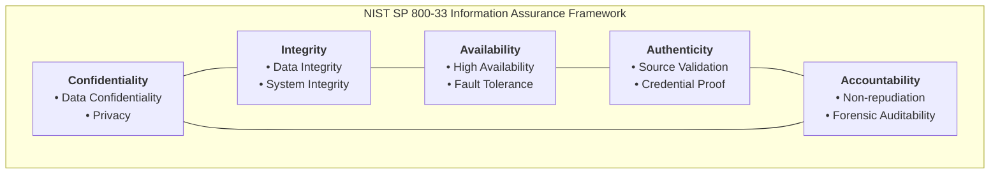
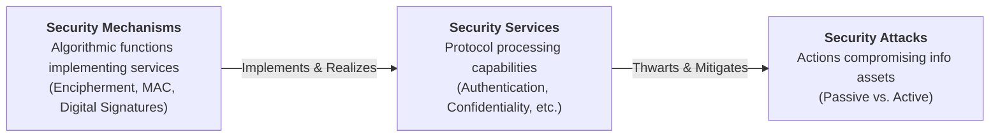
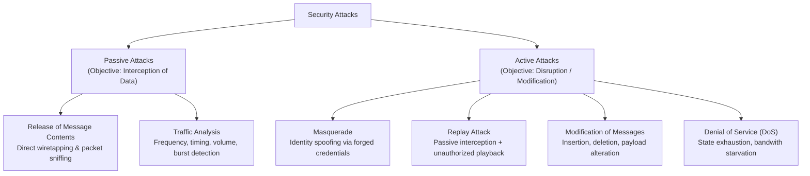
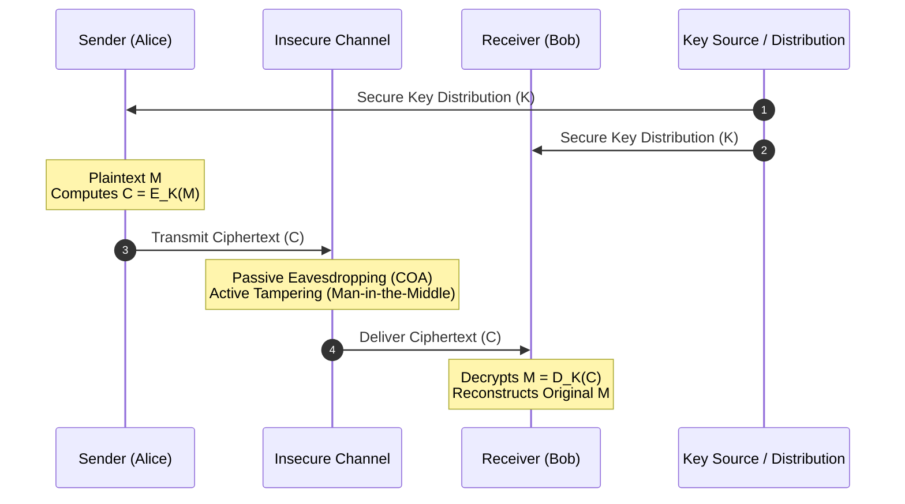
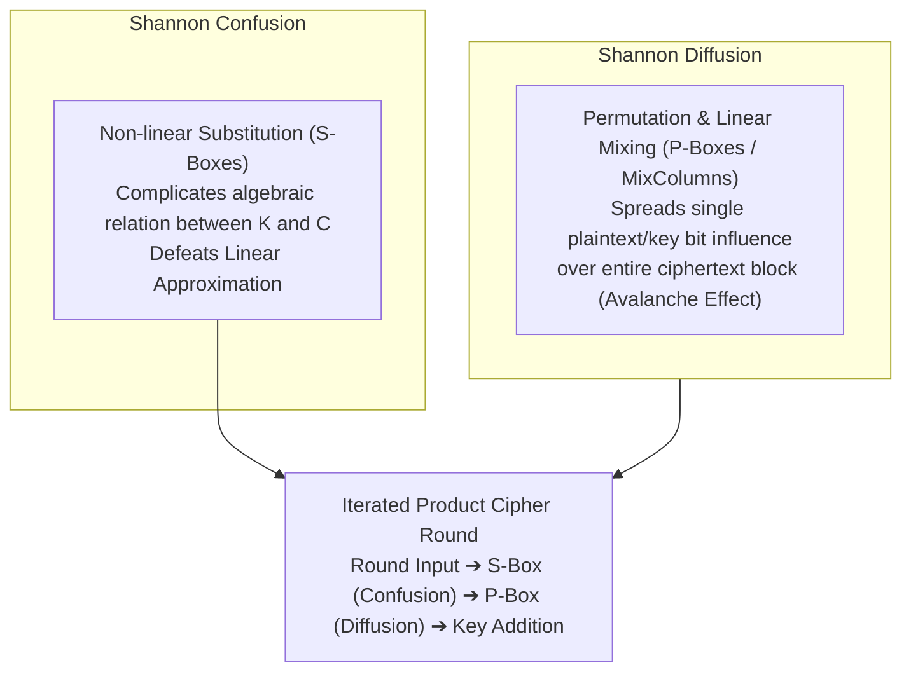

# Chapter 1: Comprehensive Treatise on Security Concepts and Classical Encryption Techniques (Advanced Level)

**Discipline:** Cryptography and Network Security (CNS)  
**Academic Tier:** Advanced / Postgraduate Research Rigor  
**Institutional Standard:** Chalapathi University Curriculum Framework  
**Authoritative Sources:** RFC 2828, NIST SP 800-33, ITU-T X.800, Shannon (1949), Stallings (Cryptography and Network Security)  

---

## 1. Formal Foundations of Information Security & The CIA Triad

### 1.1 Canonical Definitions (Preserved Verbatim)
To preserve authoritative academic standards, the foundational definitions established by NIST SP 800-33 and RFC 2828 are maintained verbatim:

1. **Computer Security:**  
   > *"The protection afforded to an automated information system in order to attain the applicable objectives of preserving the integrity, availability, and confidentiality of information system resources (includes hardware, software, firmware, information/data, and telecommunications)."*

2. **Network Security:**  
   > *"Measures taken to protect data during their transmission over networked systems and communication links, preventing unauthorized interception, alteration, or disruption."*

3. **Information Security:**  
   > *"The overarching discipline and practices of protecting information and information systems from unauthorized access, use, disclosure, disruption, modification, or destruction in order to provide confidentiality, integrity, and availability."*

---

### 1.2 Mathematical Formalization of the CIA Triad & Extensions



#### A. Confidentiality
Preserving authorized restrictions on information access and disclosure, including means for protecting personal privacy and proprietary information:
- **Data Confidentiality:** Assures that confidential information is not made available or disclosed to unauthorized individuals. Formally, for a message $M$ and ciphertext $C$, the mutual information satisfies:
  $$I(M; C) = H(M) - H(M \mid C) = 0 \quad \text{(Perfect Secrecy)}$$
  or in computational complexity settings, any polynomial-time distinguisher $\mathcal{A}$ has negligible advantage:
  $$\mathbf{Adv}^{\text{priv}}_{\mathcal{A}}(\lambda) = \left| \Pr[\mathcal{A}(E_K(M_0)) = 1] - \Pr[\mathcal{A}(E_K(M_1)) = 1] \right| \le \text{negl}(\lambda)$$
- **Privacy:** Assures that individuals control or influence what information related to them may be collected and stored and by whom and to whom that information may be disclosed.

#### B. Integrity
Guarding against improper information modification or destruction, including ensuring information non-repudiation and authenticity:
- **Data Integrity:** Assures that information and programs are changed only in a specified and authorized manner. Formally, given a message $M$ and a cryptographic authentication tag $\tau = \text{MAC}_K(M)$, the probability of an existential forgery against an active adversary $\mathcal{A}$ with access to an authentication oracle is negligible:
  $$\Pr[(\tilde{M}, \tilde{\tau}) \leftarrow \mathcal{A}^{\text{MAC}_K(\cdot)} : \text{Verify}_K(\tilde{M}, \tilde{\tau}) = 1 \land \tilde{M} \notin \mathcal{Q}] \le \text{negl}(\lambda)$$
- **System Integrity:** Assures that a system performs its intended function in an unimpaired manner, free from deliberate or inadvertent unauthorized manipulation of the system.

#### C. Availability
Ensuring timely and reliable access to and use of information and system resources. In formal terms, for any request $R$ issued by an authorized client $U$ at time $t$, the response time $T_{\text{service}}$ satisfies:
$$T_{\text{service}} \le T_{\text{threshold}} \quad \text{with probability } \ge 1 - \epsilon$$

#### D. Authenticity & Accountability
- **Authenticity:** The property of being genuine and able to be verified and trusted; confidence in the validity of a transmission, a message, or message originator.
- **Accountability:** The security goal that requires that the actions of an entity be traced uniquely to that entity, enabling non-repudiation, deterrence, fault isolation, and post-incident forensics.

---

## 2. Security Architecture for Open Systems (ITU-T Recommendation X.800)

ITU-T Recommendation X.800 provides the formal framework defining the tripartite taxonomy of **Security Attacks**, **Security Mechanisms**, and **Security Services**.



### 2.1 The Five Major Security Services (X.800)
1. **Authentication:** Assures communicating entities of the validity of claims regarding peer identities:
   - *Peer Entity Authentication:* Verifies the identity of a peer entity during connection establishment.
   - *Data Origin Authentication:* Verifies the source of individual data units in connectionless transmissions.
2. **Access Control:** Prevention of unauthorized use of a resource (enforces Mandatory/Discretionary/Role-Based Access Control).
3. **Data Confidentiality:** Protection of data from unauthorized disclosure:
   - *Connection Confidentiality:* Protects all user data on a connection.
   - *Connectionless Confidentiality:* Protects all user data in single, independent packets.
   - *Selective-Field Confidentiality:* Confines protection to designated fields within a packet.
   - *Traffic Flow Confidentiality:* Masks traffic volume, direction, and communication patterns.
4. **Data Integrity:** Assurance that data received is identical to data sent without unauthorized insertion, deletion, modification, or replay:
   - *Connection Integrity with Recovery:* Recovers from detected tampering via automated retransmission.
   - *Connection Integrity without Recovery:* Detects alteration without automatic recovery.
   - *Connectionless Integrity:* Detects modification in single data units.
5. **Non-Repudiation:** Prevents communicating parties from denying involvement in a transmission:
   - *Non-Repudiation with Proof of Origin:* Proves that the specified sender transmitted the message.
   - *Non-Repudiation with Proof of Delivery:* Proves that the specified receiver received the message.

---

### 2.2 Security Mechanisms & Formal Mapping Matrix

$$\begin{array}{|l|c|c|c|c|c|c|c|c|}
\hline
\textbf{X.800 Security Service} & \textbf{Encipherment} & \textbf{Digital Sig.} & \textbf{Access Ctrl} & \textbf{Data Integ.} & \textbf{Auth. Exch.} & \textbf{Traffic Pad.} & \textbf{Route Ctrl} & \textbf{Notarization} \\
\hline
\textbf{Peer Entity Authentication} & \checkmark & \checkmark & & & \checkmark & & & \\
\textbf{Data Origin Authentication} & \checkmark & \checkmark & & & & & & \\
\textbf{Access Control Service} & & & \checkmark & & & & & \\
\textbf{Connection Confidentiality} & \checkmark & & & & & & \checkmark & \\
\textbf{Connectionless Confidentiality} & \checkmark & & & & & & \checkmark & \\
\textbf{Selective-Field Confidentiality} & \checkmark & & & & & & & \\
\textbf{Traffic Flow Confidentiality} & \checkmark & & & & & \checkmark & \checkmark & \\
\textbf{Connection Integrity (Recovery)} & \checkmark & & & \checkmark & & & & \\
\textbf{Connection Integrity (No Recovery)} & \checkmark & \checkmark & & \checkmark & & & & \\
\textbf{Selective-Field Integrity} & \checkmark & \checkmark & & \checkmark & & & & \\
\textbf{Connectionless Integrity} & \checkmark & \checkmark & & \checkmark & & & & \\
\textbf{Non-Repudiation (Origin)} & & \checkmark & & \checkmark & & & & \checkmark \\
\textbf{Non-Repudiation (Destination)} & & \checkmark & & \checkmark & & & & \checkmark \\
\hline
\end{array}$$

---

## 3. Formal Threat Models & Cryptanalysis Classifications

### 3.1 Taxonomy of Attacks



### 3.2 Formal Adversary Capabilities Hierarchy

In cryptographic security proofs, adversary capabilities are formally structured as an inclusion chain:
$$\text{COA} \subset \text{KPA} \subset \text{CPA} \subset \text{CCA1} \subset \text{CCA2}$$

```
+---------------------------------------------------------------------------------------------------+
| Adversary Model                 | Adversary Access & Oracle Capabilities                          |
+---------------------------------+-----------------------------------------------------------------+
| Ciphertext-Only Attack (COA)    | Adversary observes: {C_1, C_2, ..., C_n}                        |
|                                 | Goal: Determine plaintext M_i or recovery of key K.             |
+---------------------------------+-----------------------------------------------------------------+
| Known-Plaintext Attack (KPA)    | Adversary possesses: {(M_1, C_1), (M_2, C_2), ..., (M_k, C_k)}  |
|                                 | where C_i = E_K(M_i) under target key K.                        |
+---------------------------------+-----------------------------------------------------------------+
| Chosen-Plaintext Attack (CPA)   | Adversary possesses an encryption oracle O_E: M ↦ E_K(M).       |
|                                 | Adversary dynamically queries M_j and observes C_j.             |
+---------------------------------+-----------------------------------------------------------------+
| Chosen-Ciphertext Attack (CCA)  | Adversary possesses encryption O_E and decryption oracle O_D:   |
| (Adaptive CCA / CCA2)           | C ↦ D_K(C). Adversary can query O_D on any C ≠ C* (challenge).  |
+---------------------------------+-----------------------------------------------------------------+
```

---

## 4. Mathematical Model of Symmetric Cryptosystems

A symmetric cipher is defined as a 5-tuple:
$$\mathcal{S} = (\mathcal{M}, \mathcal{C}, \mathcal{K}, \mathcal{E}, \mathcal{D})$$
- $\mathcal{M}$: Plaintext space over alphabet $\Sigma$.
- $\mathcal{C}$: Ciphertext space over alphabet $\Gamma$.
- $\mathcal{K}$: Key space.
- $\mathcal{E}$: Encryption transformation family $\{\mathcal{E}_K : K \in \mathcal{K}\}$, where $\mathcal{E}_K: \mathcal{M} \to \mathcal{C}$.
- $\mathcal{D}$: Decryption transformation family $\{\mathcal{D}_K : K \in \mathcal{K}\}$, where $\mathcal{D}_K: \mathcal{C} \to \mathcal{M}$.

### Correctness Invariant:
$$\forall K \in \mathcal{K}, \quad \forall M \in \mathcal{M}: \quad \mathcal{D}_K(\mathcal{E}_K(M)) = M$$



### 4.1 Kerckhoffs's Principle (1883)
> *"The design of a cryptosystem must not require secrecy, and compromise of the system should not inconvenience the correspondents; only the key must remain confidential."*

Formally, let $\Pi = (\mathcal{E}, \mathcal{D})$ be the cryptosystem. Kerckhoffs's principle requires that the security reduction holds under public knowledge of the algorithm:
$$\Pr[\mathcal{A}^{\mathcal{E}, \mathcal{D}}(C) \to M] \le \text{negl}(\lambda) \quad \text{conditioned on } K \xleftarrow{\$} \mathcal{K} \text{ remaining secret}$$

### 4.2 Shannon's Theorem of Perfect Secrecy (1949)
A cryptosystem achieves **unconditional security (perfect secrecy)** if the a posteriori probability of a plaintext message $M$, given the ciphertext $C$, is identically equal to the a priori probability of $M$:
$$P(M = m \mid C = c) = P(M = m) \quad \forall m \in \mathcal{M}, \forall c \in \mathcal{C}$$

By Bayes' Theorem:
$$P(M = m \mid C = c) = \frac{P(C = c \mid M = m) P(M = m)}{P(C = c)} = P(M = m) \iff P(C = c \mid M = m) = P(C = c)$$
This condition proves that $M$ and $C$ are statistically independent random variables:
$$I(M; C) = 0 \implies H(M \mid C) = H(M)$$

**Shannon's Fundamental Bound:**
To achieve perfect secrecy, the entropy of the key space must be at least as large as the entropy of the message space:
$$H(K) \ge H(M) \implies |\mathcal{K}| \ge |\mathcal{M}|$$
If all messages of length $N$ are possible, the secret key must be at least $N$ bits long and can never be reused.

---

## 5. Classical Substitution Techniques: Formalisms & Cryptanalysis

### 5.1 Caesar Cipher (Affine Special Case with $a = 1$)
The Caesar cipher is an additive group shift in the ring $\mathbb{Z}_{26}$:
$$\mathcal{E}_k(p) = (p + k) \pmod{26}, \quad \mathcal{D}_k(c) = (c - k) \pmod{26}$$
- Key Space: $|\mathcal{K}| = 25$ nontrivial shifts.
- Attack Complexity: Exhaustive search takes $O(1)$ operations ($25$ trial shifts).

### 5.2 General Monoalphabetic Substitution Cipher
An arbitrary bijection $\pi: \mathbb{Z}_{26} \to \mathbb{Z}_{26}$ belonging to the symmetric group $S_{26}$:
- Key Space: $|\mathcal{K}| = 26! = 403,291,461,126,605,635,584,000,000 \approx 2^{88.4}$ bits.
- **Cryptanalysis via Frequency Statistics:**
  Although immune to exhaustive key search, the transformation preserves the probability density function of natural language unigrams, digrams, and trigrams:
  $$\lim_{N \to \infty} \frac{f_C(\pi(\alpha))}{N} = P_M(\alpha)$$
  By computing Chi-Square goodness-of-fit statistics across the ciphertext frequencies $f_i$ against standard English probabilities $p_i$:
  $$\chi^2(s) = \sum_{i=0}^{25} \frac{(f_{i+s} - N \cdot p_i)^2}{N \cdot p_i}$$
  the permutation $\pi$ is fully reconstructed with $N \ge 100$ characters.

---

### 5.3 Playfair Cipher: Digraph Substitution
Developed by Charles Wheatstone (promoted by Lord Playfair), this was the first practical polygraphic substitution cipher.

#### Matrix Construction Algorithm:
1. Form a $5 \times 5$ matrix over an alphabet of 25 symbols (combining `'I'` and `'J'`).
2. Insert unique keyword characters sequentially, followed by remaining unused alphabet characters in lexicographical order.

#### Digraph Parsing & Transformation Rules:
1. **Preprocessing:** Split plaintext into digraphs: $m_1 m_2, m_3 m_4, \dots$. If $m_{2k-1} = m_{2k}$, inject filler character `'X'`. If total length is odd, append `'Z'`.
2. **Horizontal Rule (Same Row):**
   $$c_1 = \mathbf{M}[\text{row}(m_1)][(\text{col}(m_1) + 1) \pmod 5], \quad c_2 = \mathbf{M}[\text{row}(m_2)][(\text{col}(m_2) + 1) \pmod 5]$$
3. **Vertical Rule (Same Column):**
   $$c_1 = \mathbf{M}[(\text{row}(m_1) + 1) \pmod 5][\text{col}(m_1)], \quad c_2 = \mathbf{M}[(\text{row}(m_2) + 1) \pmod 5][\text{col}(m_2)]$$
4. **Rectangle Rule (Disjoint Row & Column):**
   $$c_1 = \mathbf{M}[\text{row}(m_1)][\text{col}(m_2)], \quad c_2 = \mathbf{M}[\text{row}(m_2)][\text{col}(m_1)]$$

#### Cryptanalytic Vulnerability:
The Playfair cipher flattens single-letter frequencies because the basic unit of substitution is a digraph ($25 \times 25 = 625$ possibilities). However, digraph frequency statistics are still preserved. Digraphs like `TH`, `HE`, `IN`, `ER` produce distinct high-frequency ciphertext digraph signatures, allowing matrix reconstruction via simulated annealing or frequency mapping.

---

### 5.4 Hill Cipher: Polygraphic Linear Algebra over Ring $\mathbb{Z}_{26}$

Developed by Lester S. Hill (1929), the cipher encrypts blocks of $m$ plaintext letters using a linear transformation.

#### Mathematical Formulation:
Let $\mathbf{P} = (p_1, p_2, \dots, p_m)^T \in \mathbb{Z}_{26}^m$ and key matrix $K \in \mathbb{Z}_{26}^{m \times m}$.
$$\mathbf{C} \equiv K \mathbf{P} \pmod{26}$$
$$\mathbf{P} \equiv K^{-1} \mathbf{C} \pmod{26}$$

#### Formal Invertibility Theorem:
A square matrix $K \in \mathbb{Z}_{26}^{m \times m}$ is invertible in the general linear group $GL(m, \mathbb{Z}_{26})$ if and only if:
$$\gcd(\det(K), 26) = 1$$
Since $26 = 2 \times 13$, this requires:
$$\det(K) \pmod 2 \neq 0 \quad \land \quad \det(K) \pmod{13} \neq 0$$

#### Inversion Algorithm via Adjugate Matrix:
$$K^{-1} \equiv (\det(K))^{-1} \cdot \text{adj}(K) \pmod{26}$$
where $(\det(K))^{-1}$ is the modular multiplicative inverse of $\det(K)$ in $\mathbb{Z}_{26}$, computed via the Extended Euclidean Algorithm:
$$\det(K) \cdot x + 26 \cdot y = \gcd(\det(K), 26) = 1 \implies x \equiv (\det(K))^{-1} \pmod{26}$$

#### Complete Mathematical Walkthrough ($2 \times 2$ Block):
Let $K = \begin{pmatrix} 9 & 4 \\ 5 & 7 \end{pmatrix}$.
1. Compute determinant:
   $$\det(K) = (9 \times 7 - 4 \times 5) = 63 - 20 = 43 \equiv 17 \pmod{26}$$
2. Check coprimality:
   $$\gcd(17, 26) = 1 \quad \implies \quad K \in GL(2, \mathbb{Z}_{26})$$
3. Compute modular inverse of determinant:
   $$17 \cdot x \equiv 1 \pmod{26} \implies 17 \times 23 = 391 = 15 \times 26 + 1 \implies 17^{-1} \equiv 23 \pmod{26}$$
4. Compute adjugate matrix:
   $$\text{adj}(K) = \begin{pmatrix} 7 & -4 \\ -5 & 9 \end{pmatrix} \equiv \begin{pmatrix} 7 & 22 \\ 21 & 9 \end{pmatrix} \pmod{26}$$
5. Compute $K^{-1} \pmod{26}$:
   $$K^{-1} \equiv 23 \cdot \begin{pmatrix} 7 & 22 \\ 21 & 9 \end{pmatrix} = \begin{pmatrix} 161 & 506 \\ 483 & 207 \end{pmatrix} \equiv \begin{pmatrix} 5 & 12 \\ 15 & 25 \end{pmatrix} \pmod{26}$$
6. Verification check:
   $$K \cdot K^{-1} = \begin{pmatrix} 9 & 4 \\ 5 & 7 \end{pmatrix} \begin{pmatrix} 5 & 12 \\ 15 & 25 \end{pmatrix} = \begin{pmatrix} 45+60 & 108+100 \\ 25+105 & 60+175 \end{pmatrix} = \begin{pmatrix} 105 & 208 \\ 130 & 235 \end{pmatrix} \equiv \begin{pmatrix} 1 & 0 \\ 0 & 1 \end{pmatrix} \pmod{26}$$

#### Known-Plaintext Cryptanalysis of Hill Cipher:
The Hill cipher is entirely linear. If an adversary captures $m$ linearly independent plaintext vectors $\mathbf{p}_1, \dots, \mathbf{p}_m$ and their matching ciphertexts $\mathbf{c}_1, \dots, \mathbf{c}_m$:
$$Y = [\mathbf{c}_1 \; \dots \; \mathbf{c}_m], \quad X = [\mathbf{p}_1 \; \dots \; \mathbf{p}_m]$$
$$Y \equiv K \cdot X \pmod{26}$$
If $X$ is invertible in $GL(m, \mathbb{Z}_{26})$ ($\gcd(\det(X), 26) = 1$):
$$K \equiv Y \cdot X^{-1} \pmod{26}$$
The adversary completely recovers the secret key $K$ in $O(m^3)$ field operations.

---

## 6. Polyalphabetic Ciphers: Theoretical Rigor & Cryptanalysis

### 6.1 Vigenère Cipher Formalism
Let the keyword $K = (k_0, k_1, \dots, k_{m-1})$ define a periodic sequence of Caesar shifts:
$$c_i = (p_i + k_{i \pmod m}) \pmod{26}$$
$$\mathcal{D}(c_i) = (c_i - k_{i \pmod m}) \pmod{26}$$

---

### 6.2 The Kasiski Examination (1863)
Identifies repeating substrings of length $L \ge 3$ in ciphertext.
- If a sequence of plaintext letters occurs at distance $d$, and if $d$ is a multiple of $m$, the ciphertext strings are identical.
- Let repeated occurrences of a trigram appear at indices $pos_1, pos_2, \dots, pos_r$.
- Distance set: $D = \{ pos_{j+1} - pos_j \mid 1 \le j < r \}$.
- The keyword length $m$ divides the greatest common divisor:
  $$m \mid \gcd(D)$$

---

### 6.3 The Friedman Test & Index of Coincidence ($I_c$)
Introduced by William F. Friedman (1922), the Index of Coincidence ($I_c$) is the probability that two randomly chosen characters from a ciphertext string of length $N$ are identical:
$$I_c = \sum_{i=0}^{25} \frac{f_i(f_i - 1)}{N(N - 1)}$$
where $f_i$ is the observed occurrence count of the $i$-th letter of the alphabet.

#### Theoretical Expectations:
- **Monoalphabetic / Natural English:**
  $$I_{\text{English}} = \sum_{i=0}^{25} p_i^2 \approx 0.068$$
- **Completely Uniform Random Stream (Maximum Entropy):**
  $$I_{\text{Random}} = \sum_{i=0}^{25} \left(\frac{1}{26}\right)^2 = 26 \times \frac{1}{676} = \frac{1}{26} \approx 0.0385$$

#### Derivation of Period Estimation Formula:
Suppose ciphertext is divided into $m$ columns, each of length approximately $N/m$. Two letters chosen at random from the ciphertext have probability $1/m$ of coming from the same column (with $I \approx 0.068$) and probability $(1 - 1/m)$ of coming from different columns (with $I \approx 0.0385$):
$$I_c \approx \frac{1}{m}(0.068) + \left(1 - \frac{1}{m}\right)(0.0385) = 0.0385 + \frac{0.0295}{m}$$
Solving for period length $m$:
$$m \approx \frac{0.027 \cdot N}{(N - 1) \cdot I_c - 0.038 \cdot N + 0.065}$$

Once $m$ is determined, the ciphertext is partitioned into $m$ distinct slices $S_0, S_1, \dots, S_{m-1}$ where:
$$S_j = \{ c_i \mid i \equiv j \pmod m \}$$
Each slice $S_j$ is a simple Caesar cipher broken via mutual index of coincidence or unigram frequency correlation:
$$M(s) = \sum_{i=0}^{25} \frac{f_i \cdot p_{(i-s) \pmod{26}}}{N_j}$$

---

### 6.4 The Vernam Cipher (One-Time Pad): Shannon Proof of Unconditional Secrecy
Proposed by Gilbert Vernam (1917) and proved by Claude Shannon (1949).
Let plaintext $M = (m_1, \dots, m_N) \in \{0, 1\}^N$, key $K = (k_1, \dots, k_N) \in \{0, 1\}^N$, and ciphertext $C = (c_1, \dots, c_N) \in \{0, 1\}^N$ where:
$$c_i = m_i \oplus k_i$$

#### Formal Proof of Perfect Secrecy:
Assume $K$ is uniformly distributed: $P(K = k) = 2^{-N}$ for all $k \in \{0, 1\}^N$.
For any fixed message $m \in \{0, 1\}^N$ and ciphertext $c \in \{0, 1\}^N$:
$$P(C = c \mid M = m) = P(M \oplus K = c \mid M = m) = P(K = m \oplus c) = 2^{-N}$$
By law of total probability:
$$P(C = c) = \sum_{m' \in \{0, 1\}^N} P(C = c \mid M = m') P(M = m') = 2^{-N} \sum_{m'} P(M = m') = 2^{-N}$$
Applying Bayes' Theorem:
$$P(M = m \mid C = c) = \frac{P(C = c \mid M = m) P(M = m)}{P(C = c)} = \frac{2^{-N} P(M = m)}{2^{-N}} = P(M = m)$$
The posterior probability equals the prior probability for every plaintext. The ciphertext yields zero Shannon information regarding $M$:
$$H(M \mid C) = H(M)$$

#### Fatal Flaw: Two-Time Pad Vulnerability ($K$ Reuse):
If key $K$ is reused to encrypt messages $M_1$ and $M_2$:
$$C_1 = M_1 \oplus K, \quad C_2 = M_2 \oplus K$$
$$C_1 \oplus C_2 = (M_1 \oplus K) \oplus (M_2 \oplus K) = M_1 \oplus M_2$$
The key cancels out entirely. The XOR difference of two natural language texts can be solved completely using statistical n-gram relaxation or crib dragging.

---

## 7. Classical Transposition Techniques & Rotor Mechanics

### 7.1 Transposition Permutation Formulation
In a transposition cipher, the alphabet symbols remain invariant while their positions undergo a permutation $\sigma \in S_N$:
$$c_i = p_{\sigma(i)}$$
- **Invariant:** Unigram histogram $H(C) = H(P)$.
- **Rail Fence Cipher:** Coordinate map $(x_k, y_k)$ follows a periodic triangle wave of period $2(d - 1)$.
- **Row Transposition Cipher:** Plaintext written into matrix of width $m$; column positions permuted via key $\pi \in S_m$.
- **Anagramming Attack:** Since unigram frequencies are unaltered, the cryptanalyst computes adjacent column digram transition scores:
  $$\text{Score}(\pi) = \sum_{r=1}^{L} \log P(\text{Col}_{\pi(j)}[r] \parallel \text{Col}_{\pi(j+1)}[r])$$
  Maximizing the total digram log-likelihood recovers the correct column permutation $\pi$.

---

### 7.2 Rotor Machines: Permutation Group Theory & Enigma


#### Group-Theoretic Formulation of Enigma:
Let rotor $i$ define a permutation $\pi_i \in S_{26}$. When rotated by offset $t_i \in \{0, \dots, 25\}$, its effective permutation conjugate is:
$$P_i(t_i) = \rho^{-t_i} \circ \pi_i \circ \rho^{t_i}$$
where $\rho$ is the cyclic shift permutation $(0 \; 1 \; 2 \; \dots \; 25)$.

Let $R$ denote the reflector permutation, and $S$ denote the plugboard involution ($S = S^{-1}$).
The complete end-to-end transformation is:
$$\Pi_{\text{Enigma}} = S \circ P_1^{-1} \circ P_2^{-1} \circ P_3^{-1} \circ R \circ P_3 \circ P_2 \circ P_1 \circ S$$

#### Fundamental Architectural Invariants & Vulnerabilities:
1. **Involution Property:**
   $$\Pi_{\text{Enigma}}^{-1} = (S \circ P_1^{-1} \dots R \dots P_1 \circ S)^{-1} = S^{-1} \circ P_1^{-1} \dots R^{-1} \dots P_1 \circ S^{-1} = \Pi_{\text{Enigma}}$$
   Because $R = R^{-1}$ and $S = S^{-1}$, the machine is self-inverting ($\mathcal{E} = \mathcal{D}$).
2. **The Derangement Property ($\Pi(x) \neq x$):**
   The reflector $R$ is constructed without fixed points: $\forall x, R(x) \neq x$.
   Because transposition by bijective conjugation preserves fixed-point structure, **no letter in Enigma can ever encrypt to itself**:
   $$\forall x \in \mathbb{Z}_{26}, \quad \Pi_{\text{Enigma}}(x) \neq x$$
   This single mathematical flaw allowed Alan Turing and the Bletchley Park team to eliminate billions of rotor combinations instantly when testing known-plaintext cribs in the Bombe machines.

---

## 8. Information Hiding: Steganography & Steganalysis

### 8.1 Information-Theoretic Comparison

| Dimension | Cryptography | Steganography |
| :--- | :--- | :--- |
| **Objective** | Conceals plaintext semantics: $H(M \mid C) = 0$ | Conceals communication existence: $D_{\text{KL}}(P_C \parallel P_S) \approx 0$ |
| **Artifact** | High entropy, statistically random pseudotext | Natural carrier media (JPEG, PNG, WAV, MP4) |
| **Security Failure** | Decryption of $M$ by unauthorized adversary | Detection of hidden payload existence by steganalyst |
| **Primary Standard** | Kerckhoffs's Principle | Cachin's $\epsilon$-Security Model |

### 8.2 Least Significant Bit (LSB) Digital Image Embedding
Let cover image $C$ consist of 24-bit RGB pixels: $p_k = (R_k, G_k, B_k)$.
Each color channel byte is represented in binary:
$$x = \sum_{b=0}^{7} x_b 2^b$$
The secret bit stream $s_j \in \{0, 1\}$ replaces bit $0$:
$$x' = (x \ \& \ \text{0xFE}) \ | \ s_j$$

#### Maximum Theoretical Capacity:
$$\text{Capacity}_{\text{max}} = \frac{W \times H \times 3 \times k}{8} \text{ bytes}$$
where $W, H$ are image dimensions, $3$ is the color channel multiplier, and $k$ is the number of LSB bits used per channel (typically $k=1$).

### 8.3 Steganalysis: Detection via Chi-Square ($\chi^2$) Analysis
LSB embedding pairs consecutive even and odd values $(2k, 2k+1)$ into **Pairs of Values (PoVs)**:
- Embedding transforms $2k \leftrightarrow 2k+1$ with equal probability.
- As embedding approaches $100\%$ capacity, the empirical frequencies $n_{2k}$ and $n_{2k+1}$ converge to their arithmetic mean:
  $$n_{2k}^* = \frac{n_{2k} + n_{2k+1}}{2}$$
- The degree of embedding is measured via Chi-Square statistic across $k = 0, \dots, 127$:
  $$\chi^2 = \sum_{k=0}^{127} \frac{(n_{2k} - n_{2k}^*)^2}{n_{2k}^*}$$
- If $\chi^2$ drops below the threshold for natural unmanipulated image noise, the presence of steganographic data is proven with $p > 0.999$.

---

## 9. Synthesis: Shannon's Confusion and Diffusion in Modern Ciphers

Claude Shannon identified the two fundamental structural building blocks required to defeat statistical cryptanalysis:



1. **Confusion:** Makes the mathematical relationship between the ciphertext statistics and the key values as complex and involved as possible (modern implementation: S-Boxes in AES / DES).
2. **Diffusion:** Spreads the statistical properties of individual plaintext symbols across the entire ciphertext space, ensuring that changing one bit in the plaintext alters roughly $50\%$ of the ciphertext bits (the **Avalanche Effect**; modern implementation: ShiftRows and MixColumns in AES).

