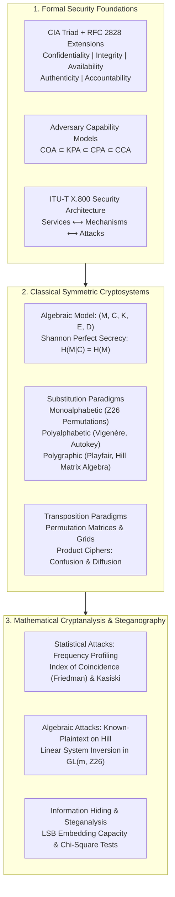
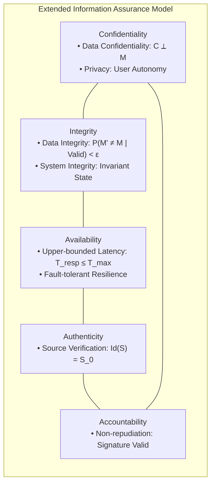
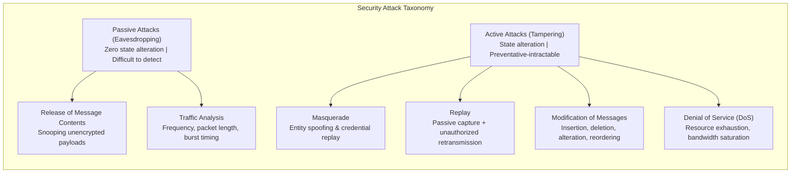
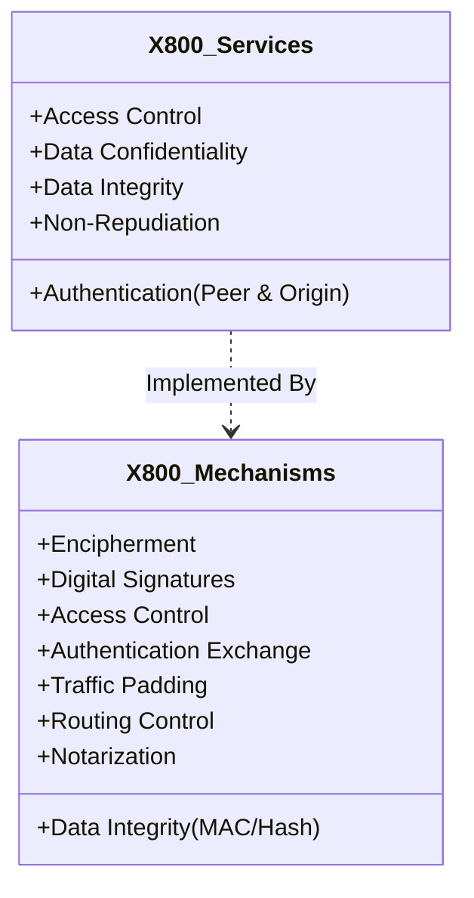
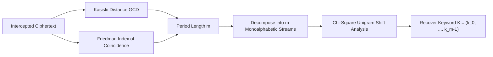

# Chapter 1: Security Concepts & Classical Encryption Techniques (Advanced Level)

**Course:** Cryptography and Network Security (CNS)  
**Academic Level:** Advanced / Postgraduate & Research Rigor  
**Target Institution:** Chalapathi University  
**Subject Code:** CNS-01  

---

## Executive Architectural Summary & Formal Taxonomy

This advanced reference module synthesizes the theoretical foundations of information assurance, standard security architectures (ITU-T X.800 / RFC 2828), and classical cryptosystems through the lens of abstract algebra, discrete mathematics, and formal cryptanalysis.



---

## 1. Formal Security Disciplines & Canonical Definitions

To maintain absolute academic integrity, the formal standardized definitions from NIST SP 800-33 and RFC 2828 are preserved verbatim, contextualized by formal mathematical metrics:

1. **Computer Security:**  
   > *"The protection afforded to an automated information system in order to attain the applicable objectives of preserving the integrity, availability, and confidentiality of information system resources (includes hardware, software, firmware, information/data, and telecommunications)."*

2. **Network Security:**  
   > *"Measures taken to protect data during their transmission over networked systems and communication links, preventing unauthorized interception, alteration, or disruption."*

3. **Information Security:**  
   > *"The overarching discipline and practices of protecting information and information systems from unauthorized access, use, disclosure, disruption, modification, or destruction in order to provide confidentiality, integrity, and availability."*

### Mathematical Formalization of the CIA Triad



- **Confidentiality:** Mutual information $I(M; C) = 0$ in the information-theoretic sense; computational indistinguishability under chosen-ciphertext attack (IND-CCA2) in practical systems.
- **Integrity:** Message Authentication Codes (MACs) guaranteeing that for message $M$ and tag $\tau = S_K(M)$, the probability of an existential forgery $\tau^*$ for $M^* \neq M$ is negligibly bounded: $\Pr[\text{Forge}] \le \text{negl}(\lambda)$.
- **Availability:** Resource accessibility bound: the probability of denial of service $P(\text{Timeout}) \le 1 - \alpha$ over service lifetime.

---

## 2. Attack Taxonomy & Threat Vectors

### Passive vs. Active Threat Dynamics



### Comprehensive Threat Vector Matrix

| Attack Category | Specific Attack Type | Cryptographic Impact | State Alteration | Primary Countermeasure Mechanism |
| :--- | :--- | :--- | :---: | :--- |
| **Passive** | **Release of Message Contents** | Breach of Confidentiality | No | End-to-end Encipherment (AES-GCM, RSA/ECC) |
| **Passive** | **Traffic Analysis** | Breach of Anonymity / Operational Security | No | Traffic Padding, Onion Routing, Tor Network, Dummy Packets |
| **Active** | **Masquerade** | Breach of Authentication & Access Control | Yes | Mutual Cryptographic Authentication (X.509, Kerberos) |
| **Active** | **Replay** | Breach of Authenticity & Freshness | Yes | Nonces, Timestamps, Sequence Numbers, TLS Ephemeral Handshakes |
| **Active** | **Modification of Messages** | Breach of Data Integrity | Yes | Cryptographic Hashes (SHA-256/3), HMAC, Digital Signatures |
| **Active** | **Denial of Service (DoS)** | Breach of System Availability | Yes | SYN Cookies, Rate Limiting, Anycast BGP Scrubbing, Resource Quotas |

---

## 3. ITU-T Recommendation X.800 Security Architecture

The X.800 architecture provides the international standard framework defining the exact orthogonality between **Security Services**, **Security Mechanisms**, and protocol layers.

### Service-to-Mechanism Formal Mapping Matrix



$$\begin{array}{|l|c|c|c|c|c|c|c|c|}
\hline
\textbf{Security Service} & \textbf{Enciph.} & \textbf{Dig. Sig.} & \textbf{Access Ctrl} & \textbf{Data Integ.} & \textbf{Auth Exch.} & \textbf{Traf. Pad.} & \textbf{Route Ctrl} & \textbf{Notary} \\
\hline
\text{Peer Entity Auth.} & \bullet & \bullet & & & \bullet & & & \\
\text{Data Origin Auth.} & \bullet & \bullet & & & & & & \\
\text{Access Control} & & & \bullet & & & & & \\
\text{Connection Confid.} & \bullet & & & & & & \bullet & \\
\text{Connectionless Confid.} & \bullet & & & & & & \bullet & \\
\text{Selective-Field Confid.} & \bullet & & & & & & & \\
\text{Traffic Flow Confid.} & \bullet & & & & & \bullet & \bullet & \\
\text{Connection Integ. (Recovery)} & \bullet & & & \bullet & & & & \\
\text{Connection Integ. (No Recov.)}& \bullet & \bullet & & \bullet & & & & \\
\text{Selective-Field Integ.} & \bullet & \bullet & & \bullet & & & & \\
\text{Connectionless Integ.} & \bullet & \bullet & & \bullet & & & & \\
\text{Non-Repudiation (Origin)} & & \bullet & & \bullet & & & & \bullet \\
\text{Non-Repudiation (Dest.)} & & \bullet & & \bullet & & & & \bullet \\
\hline
\end{array}$$

---

## 4. Symmetric Cryptography: Formal Foundations & Shannon Secrecy

### Five Critical Ingredients of Symmetric Encryption
A symmetric cryptosystem is a 5-tuple $(\mathcal{M}, \mathcal{C}, \mathcal{K}, \mathcal{E}, \mathcal{D})$:
1. **Plaintext Space ($\mathcal{M}$):** Set of cleartext strings over alphabet $\Sigma$.
2. **Encryption Algorithm ($\mathcal{E}$):** Deterministic or randomized mapping $\mathcal{E}: \mathcal{K} \times \mathcal{M} \to \mathcal{C}$.
3. **Secret Key Space ($\mathcal{K}$):** Parameter space sampled from a uniform distribution $K \xleftarrow{\$} \mathcal{K}$.
4. **Ciphertext Space ($\mathcal{C}$):** Set of encrypted strings over alphabet $\Gamma$.
5. **Decryption Algorithm ($\mathcal{D}$):** Deterministic mapping $\mathcal{D}: \mathcal{K} \times \mathcal{C} \to \mathcal{M}$ satisfying the correctness invariant:
   $$\forall K \in \mathcal{K}, \forall X \in \mathcal{M}: \quad \mathcal{D}_K(\mathcal{E}_K(X)) = X$$

### Kerckhoffs's Principle & Security Models
- **Kerckhoffs's Principle (1883):** The security of a cryptosystem must depend solely on the secrecy of the key $K$, not on the secrecy of the algorithm $(\mathcal{E}, \mathcal{D})$.
- **Shannon's Perfect Secrecy (1949):** A cipher attains unconditional information-theoretic security if and only if:
  $$P(M = m \mid C = c) = P(M = m) \quad \forall m \in \mathcal{M}, c \in \mathcal{C}$$
  Equivalently, the conditional entropy $H(M \mid C) = H(M)$, which mathematically requires $|\mathcal{K}| \ge |\mathcal{M}|$.

### Adversarial Cryptanalytic Hierarchy

```
       +-------------------------------------------------------+
       |   Chosen-Ciphertext Attack (CCA / IND-CCA2)           |
       |   Oracle: E_K(·) and D_K(·) [except challenge c*]     |
       +-------------------------------------------------------+
                                  ▲
                                  │ Strictly Stronger
       +-------------------------------------------------------+
       |   Chosen-Plaintext Attack (CPA / IND-CPA)             |
       |   Oracle: E_K(·) for adversary-chosen plaintexts      |
       +-------------------------------------------------------+
                                  ▲
                                  │ Strictly Stronger
       +-------------------------------------------------------+
       |   Known-Plaintext Attack (KPA)                        |
       |   Access: Pairs (m_1, c_1), (m_2, c_2), ..., (m_k, c_k)|
       +-------------------------------------------------------+
                                  ▲
                                  │ Strictly Stronger
       +-------------------------------------------------------+
       |   Ciphertext-Only Attack (COA)                        |
       |   Access: Only intercepted ciphertexts c_1, ..., c_k  |
       +-------------------------------------------------------+
```

---

## 5. Classical Substitution Techniques & Cryptanalysis

### 1. Caesar & Monoalphabetic Ciphers
- **Caesar Cipher:** Defined over $\mathbb{Z}_{26}$ by $C = (P + k) \pmod{26}$.
  - Key space: $|\mathcal{K}| = 25$. Exhaustive search requires at most 25 trials.
- **Monoalphabetic Substitution:** Arbitrary permutation $\pi \in S_{26}$.
  - Key space: $|\mathcal{K}| = 26! \approx 4.0329 \times 10^{26} \approx 2^{88.4}$ bits.
  - **Cryptanalysis:** Completely broken by unigram frequency profiling, digram analysis (e.g., `TH`, `HE`, `IN`), and trigrams (`THE`, `ING`).

### 2. Playfair Cipher (Digraph Substitution)
- Uses a $5 \times 5$ matrix filled via keyword with `I/J` combined.
- Digraph space: $25 \times 25 = 625$ pairs.
- Rules: Same row $\implies$ right shift; Same column $\implies$ down shift; Rectangle $\implies$ swap columns.
- **Cryptanalytic Vulnerability:** Leaves digram frequency structure intact. In English text of length $N$, digram distribution is highly non-uniform, allowing reconstruction of the $5 \times 5$ grid via 200–300 ciphertext digraphs.

### 3. Hill Cipher (Linear Algebra over $\mathbb{Z}_{26}$)
- **Encryption:**
  $$\mathbf{C} \equiv K \mathbf{P} \pmod{26}, \quad K \in \mathbb{Z}_{26}^{m \times m}$$
- **Decryption:**
  $$\mathbf{P} \equiv K^{-1} \mathbf{C} \pmod{26}$$
- **Invertibility Criterion:** $K \in GL(m, \mathbb{Z}_{26}) \iff \gcd(\det(K), 26) = 1$.
  $$\det(K)^{-1} \pmod{26} \text{ exists} \iff \det(K) \text{ is odd and } \det(K) \not\equiv 0 \pmod{13}$$
- **Decryption Matrix Formula:**
  $$K^{-1} \equiv (\det(K))^{-1} \cdot \text{adj}(K) \pmod{26}$$
- **Vulnerability to Known-Plaintext Attack (KPA):**
  Given $m$ linearly independent plaintext vectors $X = [p_1 \dots p_m]$ and their ciphertexts $Y = [c_1 \dots c_m]$:
  $$Y \equiv K X \pmod{26} \implies K \equiv Y X^{-1} \pmod{26}$$
  Break complexity: $O(m^3)$ arithmetic operations in $\mathbb{Z}_{26}$ via Gaussian elimination.

---

## 6. Polyalphabetic Ciphers & Cryptanalysis

### 1. Vigenère Cipher
- Periodic Caesar shift with keyword of length $m$:
  $$c_i = (p_i + k_{i \pmod m}) \pmod{26}$$

### 2. Kasiski Examination
Identifies repetitions of $L$-grams ($L \ge 3$) in ciphertext occurring at indices $i_1, i_2, \dots, i_r$:
$$\text{Distances } d_j = i_{j+1} - i_j \implies m \mid \gcd(d_1, d_2, \dots, d_{r-1})$$

### 3. Friedman Test & Index of Coincidence ($I_c$)
The Index of Coincidence measures the probability that two randomly selected characters from ciphertext $C$ are identical:
$$I_c(C) = \frac{\sum_{i=0}^{25} f_i (f_i - 1)}{N (N - 1)}$$
- For natural English text: $I_{\text{English}} \approx 0.068$.
- For uniform random text: $I_{\text{Random}} = \frac{1}{26} \approx 0.0385$.
- **Keyword Length Estimation Formula:**
  $$m \approx \frac{0.027 \cdot N}{(N - 1) \cdot I_c - 0.038 \cdot N + 0.065}$$



---

## 7. Transposition Techniques, Rotor Machines & Steganography

### 1. Transposition Paradigms
- **Rail Fence Cipher:** Depth-$d$ zig-zag write-in, row-wise read-out. Linear permutation.
- **Row Transposition:** Rectangular block matrix of width $m$; column-order permutation $\pi \in S_m$.
- **Distinguishing Characteristic:** Unigram character frequencies are completely preserved; $n$-gram continuity is disrupted.

### 2. Rotor Machines (Enigma Architecture)
- Rotor bank composed of wired permutation discs $\pi_1, \pi_2, \dots, \pi_k$.
- Stepping rotation by $t$ steps introduces conjugate permutation:
  $$\pi_{t}(x) = (\pi(x + t) - t) \pmod{26}$$
- Complete circuit with reflector $\rho$ ($\rho = \rho^{-1}$ and $\rho(x) \neq x$):
  $$\Pi_{\text{total}} = \pi_1^{-1} \circ \pi_2^{-1} \circ \rho \circ \pi_2 \circ \pi_1$$
- **Flaw exploited by Turing/Rejewski:** $\Pi_{\text{total}}(x) \neq x$ (no letter ever encrypts to itself).

### 3. Steganography vs. Cryptography
- **Cryptography:** Conceals message semantics ($H(M|C) > 0$).
- **Steganography:** Conceals message presence ($D_{\text{KL}}(P_{\text{cover}} \parallel P_{\text{stego}}) \approx 0$).
- **Least Significant Bit (LSB) Capacity:** For image dimensions $W \times H$ in 24-bit RGB:
  $$\text{Capacity} = \frac{W \times H \times 3 \times b}{8} \text{ bytes (where } b \text{ is bits/channel)}$$
- **Steganalysis:** Detected via Chi-Square ($\chi^2$) analysis of Pairs of Values (PoVs) and Sample Pair Analysis.

---

## Summary Comparison of Classical Encryption Schemes

| Cipher Scheme | Cipher Type | Key Space ($|\mathcal{K}|$) | Core Mathematical Mechanism | Primary Cryptanalytic Vulnerability |
| :--- | :--- | :--- | :--- | :--- |
| **Caesar** | Monoalphabetic Substitution | $25$ | $C = (P + k) \pmod{26}$ | Brute force (25 tests) |
| **Monoalphabetic** | Monoalphabetic Substitution | $26! \approx 2^{88.4}$ | Arbitrary permutation $\pi \in S_{26}$ | Unigram / Digram frequency profiling |
| **Playfair** | Polygraphic Substitution ($2 \times 2$) | $\approx 25! \approx 2^{83.7}$ | $5 \times 5$ digraph geometric mapping | Digram frequency analysis |
| **Hill ($m \times m$)** | Polygraphic Linear Substitution | $|GL(m, \mathbb{Z}_{26})|$ | $\mathbf{C} \equiv K \mathbf{P} \pmod{26}$ | Known-Plaintext Attack via $K = Y X^{-1} \pmod{26}$ |
| **Vigenère** | Periodic Polyalphabetic | $26^m$ | $c_i = (p_i + k_{i \pmod m}) \pmod{26}$ | Kasiski examination & Friedman $I_c$ test |
| **Autokey** | Non-periodic Polyalphabetic | $26^m$ | Key stream $K' = \text{seed} \parallel P$ | Plaintext language redundancy & crib dragging |
| **One-Time Pad** | Unconditional Polyalphabetic | $2^N$ ($N = |P|$) | $C = P \oplus K$ ($K$ uniform random) | **Unbreakable** (if key never reused) |
| **Rail Fence** | Transposition | $d$ ($2 \le d \le N$) | Zig-zag diagonal coordinate mapping | Combinatorial brute force |
| **Row Transposition** | Transposition | $m!$ | Rectangular matrix column permutation | Anagramming & digram continuity metrics |
| **Rotor Machine** | Polyalphabetic Poly-rotor | $\approx 10^{16}$ (Enigma) | Stepped permutation composition | Reflector invariant $\Pi(x) \neq x$ & known cribs |
