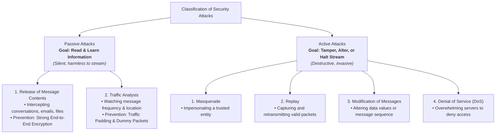
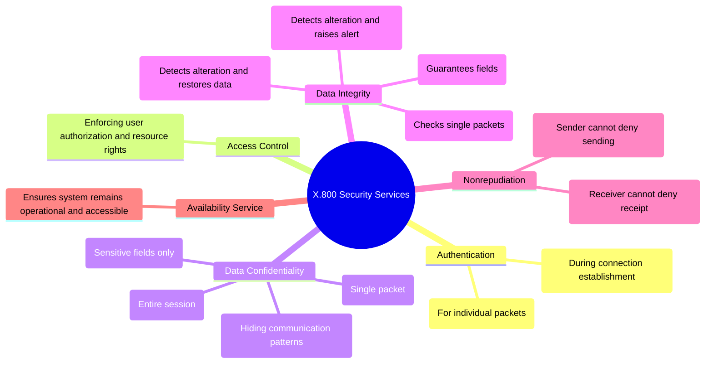
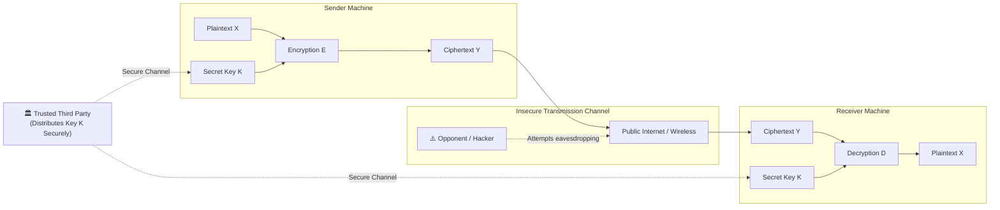

# Detailed Study Guide: Introduction to Security & Classical Encryption Techniques

**Subject:** Cryptography and Network Security (CNS)  
**Chapter:** 1 - Security Concepts & Classical Encryption Techniques  
**Academic Reference:** Department of Computer Science & Engineering, Chalapathi University / KL University (Notes.pdf Pages 1–15)  
**Audience Level:** Beginner (Foundational & Concept-First Scaffolded Learning)  
**Target Bloom's Levels:** Remembering (L-1) & Understanding (L-2)  

---

## 1. Introduction & The Need for Information Security

Imagine sending a confidential postcard through the mail. Anyone who sorts, delivers, or touches that postcard along the route could read your message, alter the words, or throw it away. In modern computer networks, millions of digital "postcards" (data packets) traverse shared cables, wireless routers, and public switches every millisecond. Without security, any eavesdropper or hacker can intercept or manipulate that data.

```
       [ Local Computer ]              [ Transmission Channel ]             [ Corporate Server ]
       ┌─────────────────┐             ┌──────────────────────┐             ┌──────────────────┐
       │ Computer Security│════════════>│   Network Security   │════════════>│Information Security│
       │ (Defends system)│             │ (Protects in-transit)│             │(Guards enterprise)│
       └─────────────────┘             └──────────────────────┘             └──────────────────┘
```

### 📌 Formal Textbook Definitions
* **Computer Security:** Generic name for the collection of tools designed to protect data and to thwart hackers.
* **Network Security:** Measures to protect data during their transmission.
* **Information Security:** Safeguarding an organization's data from unauthorized access or modification.

### Consider 3 Aspects of Information Security:
1. **Security Attacks:** Any action that compromises the security of information owned by an organization.
2. **Security Mechanisms:** Mechanisms designed to detect, prevent, or recover from a security attack.
3. **Security Services:** Processing or communication services that enhance the security of data systems and data transfers.

---

## 2. Types of Security Attacks

Security threats are fundamentally split into two broad categories depending on whether they merely observe data or actively tamper with it.



### A. Passive Attacks
Passive attacks are in the nature of eavesdropping on, or monitoring of, transmissions. The goal of the opponent is to obtain information that is being transmitted.
* **1. Release of Message Contents:** An opponent intercepts telephone calls, emails, or confidential files. 
  * *Analogy:* Someone secretly steaming open an envelope to read a private letter before delivering it.
* **2. Traffic Analysis:** Even if the text is encrypted so an attacker cannot read it, they can still observe packet lengths, transmission bursts, sender-receiver identity, and frequency.
  * *Analogy:* An observer outside a military base noticing a sudden spike in radio traffic right before an operation begins.
* **Crucial Rule:** Passive attacks are very difficult to detect because they cause no physical alteration to the data stream. Therefore, the primary defense is **prevention** (encryption).

### B. Active Attacks
Active attacks involve some modification of the data stream or the creation of a false stream.
* **1. Masquerade:** An attacker pretends to be someone else to gain unauthorized privileges (e.g. spoofing an employee login).
* **2. Replay:** An attacker passively captures valid encrypted authentication data and replays it later to repeat an action (e.g. resubmitting a wire transfer request).
* **3. Modification of Messages:** Some portion of a legitimate message is altered, or messages are delayed or reordered.
* **4. Denial of Service (DoS):** Prevents or inhibits the normal use or management of communications facilities (e.g. crashing a web server by flooding it with millions of fake requests).
* **Crucial Rule:** Active attacks have a wide variety of causes, making absolute prevention difficult. Thus, security systems focus on **detection, containment, and recovery**.

---

## 3. ITU-T Recommendation X.800 Security Services

The International Telecommunication Union defines a structured catalog of security services across five major categories:



### Summary Breakdown for Beginners:
1. **Authentication:** Confirms who you are talking to.
2. **Access Control:** Like a bouncer checking your ticket before entering a room.
3. **Data Confidentiality:** Keeping your message secret so only the intended recipient can read it.
4. **Data Integrity:** Ensuring no one has altered a single letter or number during transmission.
5. **Nonrepudiation:** Making sure nobody can say "I never sent that!" or "I never received that!" (like a registered delivery signature).

---

## 4. Security Mechanisms & Network Models



### 4 Essential Tasks in Designing a Security Service:
1. **Design an Algorithm:** Create an algorithm that performs the security transformation (scrambling/unscrambling).
2. **Generate Secret Keys:** Create unpredictable, secret keys to use with the algorithm.
3. **Develop Key Distribution Methods:** Find a safe way to share keys with the receiver.
4. **Specify a Protocol:** Detail the exact rules and sequence both parties follow to communicate safely.

### Network Access Security Model
To defend corporate servers from outside hackers and software threats (viruses and worms), systems place a **Gatekeeper** (login screens and firewalls) at the entrance and run **Internal Security Controls** (antivirus, memory monitors, and audit logs) on the inside.

---

## 5. Symmetric Cipher Model & Cryptanalysis

In a **symmetric cipher** (also called secret-key, single-key, or conventional encryption), the sender and receiver use the **same secret key**.

```
                ┌────────────────────────────────────────────────────────┐
                │          Model of Symmetric Cryptosystem               │
                └────────────────────────────────────────────────────────┘

    Plaintext X ──> [ Encryption E ] ──> Ciphertext Y ──> [ Decryption D ] ──> Plaintext X
                          ▲                                     ▲
                          │                                     │
                    Secret Key K                          Secret Key K
```

### The 5 Ingredients:
1. **Plaintext ($X$):** The original message in readable form.
2. **Encryption Algorithm ($E$):** Scrambles the plaintext using mathematical substitutions and transpositions.
3. **Secret Key ($K$):** The secret password or parameter that guides the algorithm.
4. **Ciphertext ($Y$):** The scrambled message:
   $$Y = E_K(X)$$
5. **Decryption Algorithm ($D$):** The algorithm run in reverse using the secret key to recover the message:
   $$X = D_K(Y)$$

### Two Basic Requirements for Secure Use:
1. A **strong encryption algorithm:** An opponent who knows the algorithm and has intercepted the ciphertext should still be unable to decipher it or discover the key.
2. **Secure key exchange:** Sender and receiver must obtain and maintain the secret key in total secrecy.

### Cryptanalysis Attack Types:
* **Ciphertext Only:** Attacker has only the scrambled ciphertext.
* **Known Plaintext:** Attacker has some plaintext and its matching ciphertext.
* **Chosen Plaintext:** Attacker can pick plaintexts and see what ciphertext the machine produces.
* **Chosen Ciphertext:** Attacker can pick ciphertexts and see the decrypted results.
* **Brute-Force Attack:** Trying every possible key one by one until readable text appears.

---

## 6. Classical Substitution Techniques

Substitution means replacing plaintext letters or bits with different letters, numbers, or symbols.

### 1) Caesar Cipher (The Alphabet Shift)
Julius Caesar encrypted military messages by shifting each letter forward by 3 places:

```
Alphabet:  a  b  c  d  e  f  g  h  i  j  k  l  m  n  o  p  q  r  s  t  u  v  w  x  y  z
Shift +3:  D  E  F  G  H  I  J  K  L  M  N  O  P  Q  R  S  T  U  V  W  X  Y  Z  A  B  C
```

* **Encryption Formula:** $c = (p + k) \pmod{26}$ (where $k = 3$)
* **Decryption Formula:** $p = (c - k) \pmod{26}$
* **Example:** "meet me" becomes `PHHW PH`.
* **Weakness:** There are only 25 possible keys! A computer can test all 25 keys in a fraction of a millisecond.

---

### 2) Monoalphabetic Cipher & Frequency Analysis
Instead of shifting by a fixed number, we can shuffle all 26 letters randomly. This creates $26! \approx 4 \times 10^{26}$ possible keys—far too many for brute force!

**The Catch:** In English, letters do not appear equally often. **E** is the most common letter ($12.7\%$), followed by **T** ($9.1\%$) and **A** ($8.2\%$). If you encrypt a long English text, whichever ciphertext symbol appears most often is almost certainly replacing **E**!

```
English Relative Letter Frequencies:
E: ■■■■■■■■■■■■■ 12.7%
T: ■■■■■■■■■ 9.1%
A: ■■■■■■■■ 8.2%
O: ■■■■■■■■ 7.5%
I: ■■■■■■■ 7.0%
N: ■■■■■■■ 6.7%
```

---

### 3) Playfair Cipher (Encrypting Letter Pairs)
Invented in 1854, the Playfair cipher encrypts **two letters at a time** (digraphs) using a $5 \times 5$ square matrix filled with a secret keyword:

#### Step 1: Matrix Construction
Keyword: **MONARCHY** (I and J share a cell)

| M | O | N | A | R |
|---|---|---|---|---|
| **C** | **H** | **Y** | **B** | **D** |
| **E** | **F** | **G** | **I/J** | **K** |
| **L** | **P** | **Q** | **S** | **T** |
| **U** | **V** | **W** | **X** | **Z** |

#### Step 2: The 4 Rules for Letter Pairs
1. **Repeating letters:** If a pair has repeating letters, insert a filler letter (like 'x'). So `balloon` becomes `ba lx lo on`.
2. **Same Row:** Replace each letter with the one to its immediate right (wrapping around). Example: `ar` $\to$ **RM**.
3. **Same Column:** Replace each letter with the one immediately beneath it (wrapping around). Example: `mu` $\to$ **CM**.
4. **Rectangle Rule:** If letters are in different rows and columns, replace each with the letter in its own row and the other's column. Example: `ea` $\to$ **IM** (or **JM**).

---

### 4) Hill Cipher (Matrix Math)
Developed by Lester Hill in 1929, this block cipher converts letters into numbers ($A=0, B=1, \dots, Z=25$) and uses matrix multiplication:

$$\begin{pmatrix} C_1 \\ C_2 \end{pmatrix} = \begin{pmatrix} k_{11} & k_{12} \\ k_{21} & k_{22} \end{pmatrix} \begin{pmatrix} P_1 \\ P_2 \end{pmatrix} \pmod{26}$$

Because it encrypts blocks of letters simultaneously, it completely disguises single-letter frequency patterns!

---

### 5) Polyalphabetic & One-Time Pad
* **Vigenère Cipher:** Uses a repeating secret keyword. Each letter of the keyword tells you how many places to shift the matching message letter.
* **Vernam Cipher (1918):** Operates on binary 1s and 0s using the **XOR** ($\oplus$) operation:
  $$C_i = P_i \oplus K_i \quad \text{and} \quad P_i = C_i \oplus K_i$$
* **One-Time Pad (Joseph Mauborgne):** If the key is **truly random**, **as long as the message**, and **used only once**, the ciphertext is **mathematically impossible to break**! Even with infinite computing power, an attacker cannot crack it because any plausible message is equally likely.

---

## 7. Transposition Techniques, Rotors & Steganography

While substitution replaces letters, **transposition** scrambles their positions without changing their identity.

### 1) Rail Fence Cipher
Write the message in a zigzag diagonal across a set number of rails (depth $d$), then read off row by row:

```
Message: "meet me after the toga party" (Depth = 2)

Rail 1:  m . . . e . . . m . . . a . . . t . . . r . . . h . . . t . . . g . . . p . . . r . . . y
Rail 2:  . e . t . e . f . e . t . e . o . a . a . t . . . . . . . . . . . . . . . . . . . . . .

Ciphertext: MEMATRHTGPRY ETEFETEOAAT
```

---

### 2) Rectangular Columnar Transposition
Write the message into a grid row by row, and read it out column by column according to a numerical key:

```
Key:        3  4  2  1  5  6  7
Row 1:      a  t  t  a  c  k  p
Row 2:      o  s  t  p  o  n  e
Row 3:      d  u  n  t  i  l  t
Row 4:      w  o  a  m  x  y  z

Read Column 1 (a p t m), Column 2 (t t n a), Column 3 (a o d w), etc.
Ciphertext: TTNAAPTMTSUOAODWCOIXKNLYPETZ
```

---

### 3) Rotor Machines (The Enigma Machine)
Before computers, military forces used mechanical rotor machines. Each rotor had 26 input pins and 26 output pins connected by internal wires. With every key pressed, the rotor stepped forward one notch, creating a brand new substitution alphabet for every single keystroke!

```
[Keyboard Pin A] ──> [ Rotor 1 (Steps every key) ] ──> [ Rotor 2 ] ──> [ Rotor 3 ] ──> [Lamp Y]
```

### 4) Steganography (Secret Hiding)
* **Distinction:** Cryptography hides the *meaning* of a message; Steganography hides the *existence* of the communication.
* **Techniques:**
  1. Invisible ink.
  2. Pin punctures above specific letters in a printed book.
  3. Digital Media: Replacing the Least Significant Bit (LSB) of RGB image pixels to hide secret files inside harmless JPEG/PNG photos!

