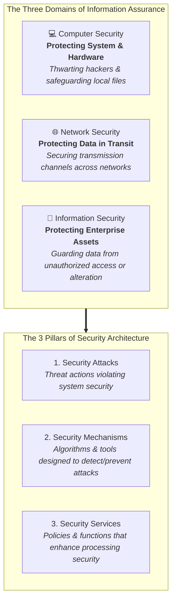
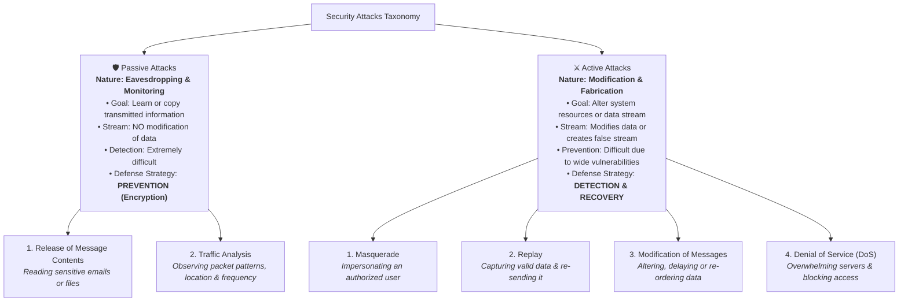
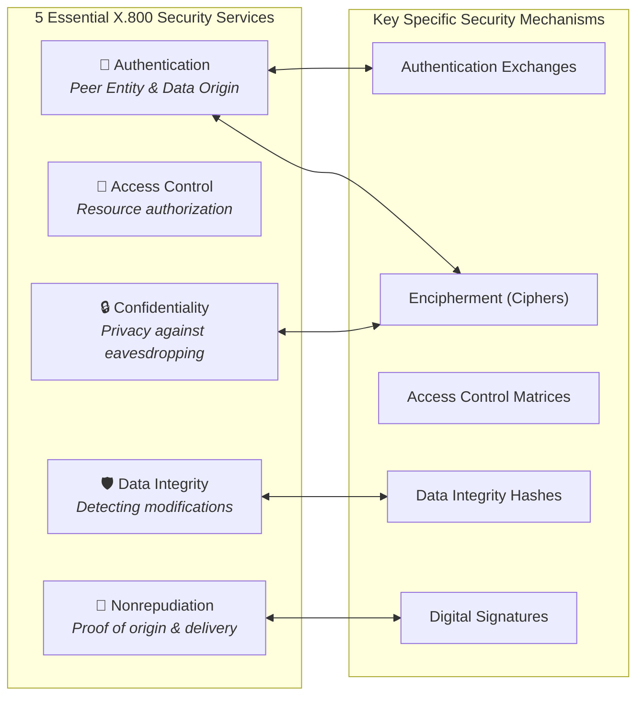
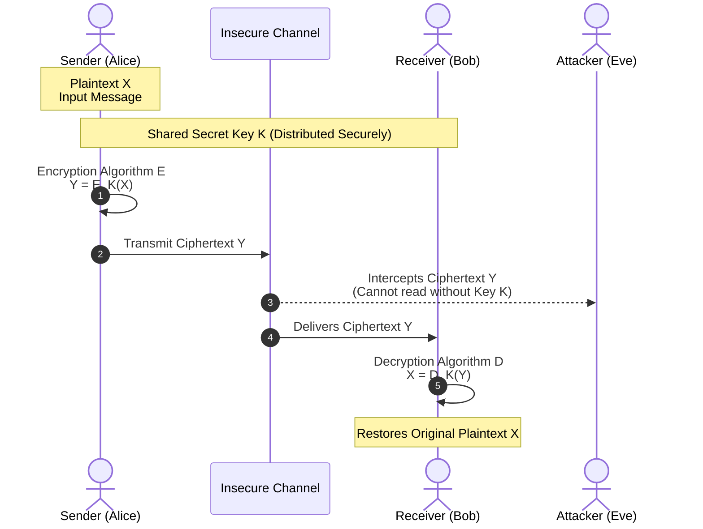
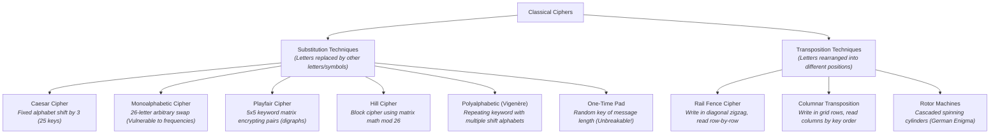

# Quick Study Guide & Summary: Security Concepts & Classical Encryption

**Subject:** Cryptography and Network Security (CNS) | **Unit:** Chapter 1  
**Audience Level:** Beginner (Foundational & Visual Learner Focus)  
**Target Bloom's Levels:** Remembering (L-1) & Understanding (L-2)  
**Institution:** Chalapathi Institute of Engineering & Technology / Chalapathi University  

---

## 🖼️ 1. Master Security Architecture Infographic

Understand the three foundational disciplines of cyber defense and how security flows across systems:

### 📌 Core Textbook Definitions (Kept Intact)
* **Computer Security:** Generic name for the collection of tools designed to protect data and to thwart hackers.
* **Network Security:** Measures to protect data during their transmission.
* **Information Security:** Safeguarding an organization's data from unauthorized access or modification.

---

## 🖼️ 2. Security Attacks: Passive vs. Active Infographic

### Comparison Matrix: Passive vs. Active Attacks

| Characteristic | Passive Attacks | Active Attacks |
| :--- | :--- | :--- |
| **Primary Intent** | Obtain/listen to private information | Alter data or disrupt system operations |
| **Data Stream Impact** | **No alteration** (Silent reading) | **Alters, delays, replays, or halts data** |
| **System Detection** | Virtually impossible without stream telemetry | Readily detectable through audits, checksums, logs |
| **Primary Defense** | **Prevention via strong encryption** | **Detection, containment, and state recovery** |
| **Typical Examples** | Wiretapping, packet sniffing, traffic analysis | Masquerading, replaying bank requests, DoS flooding |

---

## 🖼️ 3. ITU-T X.800 Security Services & Mechanisms Overview

---

## 🖼️ 4. Symmetric Cryptosystem Model (5 Ingredients)

### The 5 Ingredients Formula Summary:
1. **Plaintext ($X$):** Original intelligible message fed into algorithm.
2. **Encryption Algorithm ($E$):** Performs substitutions and transpositions.
3. **Secret Key ($K$):** Independent input dictating exact transformations.
4. **Ciphertext ($Y$):** Scrambled, unintelligible output:
   $$Y = E_K(X)$$
5. **Decryption Algorithm ($D$):** Reverse algorithm restoring plaintext:
   $$X = D_K(Y)$$

---

## 🖼️ 5. Classical Encryption Techniques at a Glance

### Beginner Quick Takeaways on Classical Ciphers:
- **Caesar Cipher:** Shift every letter forward by 3 ($A \to D, B \to E$). Easily cracked by checking all 25 shifts!
- **Monoalphabetic Cipher:** Scrambles alphabet arbitrarily ($26! \approx 4 \times 10^{26}$ keys). But letters like **E** ($12.7\%$) and **T** ($9.1\%$) still show up most often!
- **Playfair Cipher:** Encrypts two letters at a time using a $5 \times 5$ square. If letters are in the same row, shift right; same column, shift down; otherwise form a rectangle!
- **Rail Fence:** Writes letters in a zigzag pattern across rails and reads off rows.
- **One-Time Pad:** Uses a truly random key as long as the message, used once and burned. It is the **only mathematically unbreakable cipher**!
- **Steganography:** Hides the *existence* of the secret message (e.g. invisible ink, hiding data inside image pixels).

