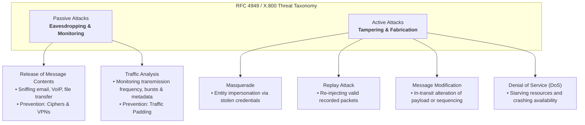
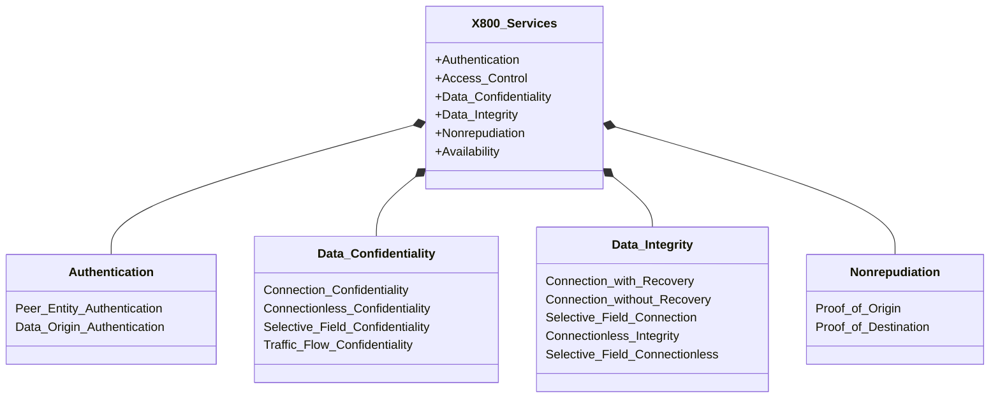

# Comprehensive Academic Guide: Security Architecture & Classical Cryptographic Systems

**Subject:** Cryptography and Network Security (CNS)  
**Chapter:** 1 - Security Concepts & Classical Encryption Techniques  
**Academic Reference:** Department of Computer Science & Engineering, Chalapathi University / KL University (Notes.pdf Pages 1–15)  
**Audience Level:** Intermediate (Undergraduate Academic & Applied Rigor)  
**Target Bloom's Levels:** Understanding (L-2), Applying (L-3) & Analyzing (L-4)  

---

## 1. Security Concepts, Need & The Three Aspects

Information assurance within modern telecommunication infrastructures encompasses three overlapping engineering domains:

```
+---------------------------------------------------------------------------------------+
|                                  INFORMATION SECURITY                                  |
|         "Safeguarding an organization's data from unauthorized access or modification"  |
+-------------------------------------------+-------------------------------------------+
                                            |
                                            V
+-------------------------------------------+-------------------------------------------+
|                                    NETWORK SECURITY                                   |
|                  "Measures to protect data during their transmission"                 |
+-------------------------------------------+-------------------------------------------+
                                            |
                                            V
+-------------------------------------------+-------------------------------------------+
|                                   COMPUTER SECURITY                                   |
|       "Generic name for the collection of tools designed to protect data and to        |
|                                     thwart hackers"                                   |
+---------------------------------------------------------------------------------------+
```

### The Three Operational Pillars of Security Architecture:
1. **Security Attacks:** Any action that compromises the security of information owned by an organization. Attacks exploit system vulnerabilities.
2. **Security Mechanisms:** Processes or algorithms designed to detect, prevent, or recover from a security attack.
3. **Security Services:** Processing or communication services provided by a system layer to enhance data and resource security (formally defined in ITU-T X.800).

---

## 2. Classification of Security Attacks: Threat Dynamics



### 1. Passive Attacks
* **Definition:** Passive attacks are in the nature of eavesdropping on, or monitoring of, transmissions. The goal of the opponent is to obtain information that is being transmitted.
* **Characteristics:** 
  - The communication stream is completely unaltered.
  - Neither sender nor receiver detects any delay, packet loss, or corruption.
  - Real-time detection is practically impossible.
* **Defense Strategy:** Strict **prevention** through strong cryptographic encipherment.

### 2. Active Attacks
* **Definition:** Active attacks involve some modification of the data stream or the creation of a false stream.
* **Characteristics:**
  - Directly tampers with system state, message integrity, or service availability.
  - Can cause immediate financial, operational, or legal liability.
* **Subcategories:**
  1. *Masquerade:* An entity pretends to be a different entity (e.g. forging an administrative Kerberos ticket).
  2. *Replay:* Capturing legitimate data transmission sequences and playing them back maliciously.
  3. *Modification of Messages:* Changing message payloads (e.g. altering bank account routing numbers) or reordering sequential packets.
  4. *Denial of Service (DoS):* Flooding target bandwidth or exhaustively consuming processing threads to render services unavailable to legitimate users.
* **Defense Strategy:** **Detection, containment, and recovery** (via Message Authentication Codes, digital signatures, sequence numbers, and audit trails).

---

## 3. ITU-T Recommendation X.800 Security Services

ITU-T X.800 defines a security service as a protocol capability provided by an Open Systems Interconnection (OSI) layer to ensure adequate security of systems or data transfers.



### Detailed Functional Taxonomy:
1. **Authentication:**
   - *Peer Entity Authentication:* Corroborates the identity of a peer entity during the connection establishment phase.
   - *Data Origin Authentication:* Confirms the source of an individual connectionless data unit (does not protect against duplication or replay).
2. **Access Control:**
   - Enforces authorization limits preventing unauthorized entities from utilizing host processors, application memory, or network transmission routes.
3. **Data Confidentiality:**
   - Protects data against unauthorized reading or disclosure.
   - Subtypes: Connection, Connectionless, Selective-Field, and Traffic-Flow confidentiality.
4. **Data Integrity:**
   - Ensures data arrives exactly as transmitted, with no alteration, insertion, deletion, or replay.
   - Subtypes: Connection with recovery (auto retransmission), Connection without recovery (alert only), Selective-field, Connectionless integrity.
5. **Nonrepudiation:**
   - *Proof of Origin:* Originator cannot deny dispatching the message.
   - *Proof of Destination:* Recipient cannot deny receiving the message.

---

## 4. Security Mechanisms & Network Models

### X.800 Service-to-Mechanism Mapping Matrix

| Security Service | Encipherment | Digital Signature | Access Control | Data Integrity | Authentication Exchange | Traffic Padding | Routing Control | Notarization |
| :--- | :---: | :---: | :---: | :---: | :---: | :---: | :---: | :---: |
| **Peer Entity Authentication** | Y | Y | - | - | Y | - | - | - |
| **Data Origin Authentication** | Y | Y | - | - | - | - | - | - |
| **Access Control** | - | - | Y | - | - | - | - | - |
| **Connection Confidentiality** | Y | - | - | - | - | - | Y | - |
| **Traffic-Flow Confidentiality**| Y | - | - | - | - | Y | Y | - |
| **Connection Integrity (w/ Recovery)** | Y | - | - | Y | - | - | - | - |
| **Connectionless Integrity** | Y | Y | - | Y | - | - | - | - |
| **Nonrepudiation (Origin)** | - | Y | - | Y | - | - | - | Y |
| **Nonrepudiation (Destination)** | - | Y | - | Y | - | - | - | Y |

### Model for Network Security & Four Engineering Tasks

```
   [ Sender Principal ]                                         [ Receiver Principal ]
   Plaintext X ───────> [ Security Transformation E ] ──────> Ciphertext Y ───────> [ Reverse Transform D ] ───────> Plaintext X
                               ▲                                                          ▲
                               │                                                          │
                         Secret Key K                                               Secret Key K
                               └───────────────[ Trusted Third Party ]────────────────────┘
```

#### Four Basic Design Tasks for Any Security Service:
1. **Design an Algorithm:** Create an algorithm to perform the security-related transformation (must make unauthorized inversion computationally infeasible).
2. **Generate Secret Information:** Generate the secret keys or parameters to be utilized in conjunction with the algorithm.
3. **Develop Distribution Mechanisms:** Engineer secure methods to distribute and synchronize secret keys between communicating principals.
4. **Specify a Communication Protocol:** Formulate the sequence of message exchanges and handshakes used by both entities to accomplish the security objective.

---

## 5. Symmetric Cipher Model & Cryptanalysis

### Five Fundamental Ingredients
A symmetric encryption scheme operates through five discrete functional components:

$$\text{Plaintext } X \xrightarrow{\quad E_K \quad} \text{Ciphertext } Y \xrightarrow{\quad D_K \quad} \text{Plaintext } X$$

1. **Plaintext ($X$):** The original intelligible message or data input fed into the algorithm.
2. **Encryption Algorithm ($E$):** Performs mathematical substitutions and transpositions upon $X$.
3. **Secret Key ($K$):** An independent input parameter governing exact transformation mapping:
   $$Y = E_K(X)$$
4. **Ciphertext ($Y$):** The scrambled, unintelligible output stream dependent on both $X$ and $K$.
5. **Decryption Algorithm ($D$):** Inverts the encryption transformations using the same key $K$:
   $$X = D_K(Y) = D_K(E_K(X))$$

### Two Essential Security Requirements:
1. **Strong Encryption Algorithm:** The algorithm must be sufficiently robust that an opponent who possesses the ciphertext and knows the algorithm cannot decrypt the ciphertext or deduce the key.
2. **Secure Key Exchange & Confidentiality:** Sender and receiver must obtain copies of the secret key over a secure channel and maintain strict key confidentiality.

### Three Cryptographic Dimensions:
1. **Type of Operations:**
   - *Substitution:* Each element in plaintext is mapped to another element.
   - *Transposition:* Elements in plaintext are rearranged into different positions.
   - *Product Systems:* Multiple cascaded stages of substitution and transposition.
2. **Number of Keys Used:**
   - *Symmetric / Conventional / Single-Key:* Sender and receiver share the same secret key.
   - *Asymmetric / Public-Key:* Sender and receiver utilize mathematically linked key pairs (public and private).
3. **Plaintext Processing:**
   - *Block Cipher:* Processes input one fixed-size block of elements at a time (e.g. 64 or 128 bits).
   - *Stream Cipher:* Processes input elements continuously one element (byte or bit) at a time.

### Cryptanalysis Attack Classifications:
* **Ciphertext Only:** Attacker knows algorithm and intercepted ciphertext $Y$.
* **Known Plaintext:** Attacker knows algorithm, ciphertext $Y$, and one or more matching $(X_i, Y_i)$ pairs.
* **Chosen Plaintext:** Attacker can select arbitrary $X$ and obtain corresponding $Y = E_K(X)$.
* **Chosen Ciphertext:** Attacker can select arbitrary $Y$ and obtain decrypted $X = D_K(Y)$.
* **Brute-Force Search:** Systematically trying every possible key in the keyspace until intelligible text emerges. On average, $50\%$ of keyspace must be searched.

---

## 6. Classical Substitution Techniques

### 1) Caesar Cipher
* **Algorithm:** Shifting alphabet by fixed key $k=3$.
* **Modular Arithmetic:**
  $$c = E(p) = (p + k) \pmod{26}$$
  $$p = D(c) = (c - k) \pmod{26}$$
* **Keyspace:** Only 25 non-trivial keys. An attacker simply tests shifts $1$ through $25$ via brute force.

---

### 2) Monoalphabetic Substitution Cipher
* **Algorithm:** Arbitrary permutation of the 26 letters of the alphabet.
* **Keyspace:** $26! \approx 4.03 \times 10^{26}$ keys. Eliminates brute-force feasibility.
* **Vulnerability:** **Frequency Analysis.** The relative frequency distribution of single letters, digraphs, and trigraphs remains completely unaltered.
  - English Letter Frequencies: **E** ($12.7\%$), **T** ($9.1\%$), **A** ($8.2\%$), **O** ($7.5\%$), **I** ($7.0\%$), **N** ($6.7\%$).
  - High-frequency digraphs: `th`, `he`, `in`, `er`, `an`.
  - High-frequency trigraphs: `the`, `and`, `tha`, `ent`.

---

### 3) Playfair Cipher
Invented by Charles Wheatstone (1854) and championed by Lord Playfair. Operates on **digraphs** (2-letter pairs) using a $5 \times 5$ matrix generated from a keyword.

#### Matrix Construction Example (Keyword: `MONARCHY`):
1. Write keyword without duplicate letters.
2. Fill remaining cells with unused alphabet letters in order (`I` and `J` share one cell):

| M | O | N | A | R |
|:---:|:---:|:---:|:---:|:---:|
| **C** | **H** | **Y** | **B** | **D** |
| **E** | **F** | **G** | **I/J** | **K** |
| **L** | **P** | **Q** | **S** | **T** |
| **U** | **V** | **W** | **X** | **Z** |

#### Four Encryption Rules:
1. **Duplicate Letter Separation:** If both letters in a pair are identical, insert a filler letter (e.g. 'x'). Example: `balloon` $\to$ `ba lx lo on`.
2. **Same Row Rule:** If letters fall into the same row, replace each with the letter immediately to its right (circularly wrapping around to the first column). Example: `ar` $\to$ **RM**.
3. **Same Column Rule:** If letters fall into the same column, replace each with the letter immediately beneath (circularly wrapping around to the top row). Example: `mu` $\to$ **CM**.
4. **Rectangle Rule:** If letters are in different rows and columns, each letter is replaced by the letter in its own row and the column occupied by the other letter. Example: `ea` $\to$ **IM** (or **JM**).

* **Cryptanalytic Strength:** $25 \times 25 = 650$ digraphs. Masks single-letter frequencies, but broken via relative frequency analysis of digraphs.

---

### 4) Hill Cipher
Developed by Lester Hill (1929). A polygraphic block cipher based on modular linear algebra.

#### Mathematical Operations:
* Let plaintext block $\mathbf{P} = [p_1, p_2, \dots, p_n]^T$ and key matrix $K$ be an $n \times n$ matrix:
  $$\mathbf{C} = K \mathbf{P} \pmod{26}$$
  $$\mathbf{P} = K^{-1} \mathbf{C} \pmod{26}$$
* **Matrix Inversion Condition:** The inverse matrix $K^{-1}$ exists modulo 26 if and only if $\det(K)$ is coprime to 26:
  $$\gcd(\det(K), 26) = 1 \implies \det(K) \not\equiv 0 \pmod 2 \quad \text{and} \quad \det(K) \not\equiv 0 \pmod{13}$$

#### Worked Example ($n=2$):
Let $K = \begin{pmatrix} 3 & 25 \\ 11 & 4 \end{pmatrix}$. Plaintext block: `MI` $\to [12, 8]^T$.

$$\mathbf{C} = \begin{pmatrix} 3 & 25 \\ 11 & 4 \end{pmatrix} \begin{pmatrix} 12 \\ 8 \end{pmatrix} = \begin{pmatrix} 3(12) + 25(8) \\ 11(12) + 4(8) \end{pmatrix} = \begin{pmatrix} 236 \\ 164 \end{pmatrix} \equiv \begin{pmatrix} 2 \\ 8 \end{pmatrix} \pmod{26} \to \mathbf{CI}$$

---

### 5) Polyalphabetic Ciphers & Vernam / OTP
* **Vigenère Cipher:** Employs a sequence of Caesar ciphers governed by a repeating keyword.
  - Formula: $c_i = (p_i + k_{i \bmod m}) \pmod{26}$.
  - Vulnerability: Periodic repetition of keyword length $m$ reveals repeated digraphs/trigraphs at distances that are multiples of $m$ (**Kasiski examination**).
* **Autokey System:** Appends the plaintext itself to the keyword to prevent periodic repetition.
* **Vernam Cipher (1918):** Operates on binary data using bitwise exclusive-OR:
  $$C_i = P_i \oplus K_i \quad \text{and} \quad P_i = C_i \oplus K_i$$
* **One-Time Pad (Joseph Mauborgne):** Uses a truly random key $K$ equal in length to message $P$, used only once.
  - **Unconditionally Secure:** Even with infinite computing power, ciphertext contains zero statistical information to determine plaintext.

---

## 7. Classical Transposition Techniques & Rotor Systems

### 1) Rail Fence Cipher
Plaintext is written diagonally across $d$ rails and read out row-by-row.
* Depth $d=2$, Plaintext: `meet me after the toga party`

$$\begin{matrix}
m & \cdot & e & \cdot & m & \cdot & a & \cdot & t & \cdot & r & \cdot & h & \cdot & t & \cdot & g & \cdot & p & \cdot & r & \cdot & y \\
\cdot & e & \cdot & t & \cdot & e & \cdot & f & \cdot & e & \cdot & t & \cdot & e & \cdot & o & \cdot & a & \cdot & a & \cdot & t & \cdot
\end{matrix}$$

* Ciphertext: `MEMATRHTGPRYETEFETEOAAT`

---

### 2) Rectangular Columnar Transposition
Plaintext is written in rows of fixed width $k$ and read out column-by-column according to a key permutation order:

```
Key:        3  4  2  1  5  6  7
Row 1:      a  t  t  a  c  k  p
Row 2:      o  s  t  p  o  n  e
Row 3:      d  u  n  t  i  l  t
Row 4:      w  o  a  m  x  y  z

Ciphertext: TTNAAPTMTSUOAODWCOIXKNLYPETZ
```

* **Multiple Transposition:** Re-encrypting the ciphertext through a second columnar transposition stage produces complex non-periodic permutations that resist single-stage anagramming attacks.

---

### 3) Rotor Machines
Electromechanical encryption devices featuring multiple rotating cylinders (rotors) connecting 26 input pins to 26 output pins.
* With each keystroke, the primary rotor rotates one position ($1/26$ turn), changing the internal electrical pathway.
* Cascaded 3-rotor configuration produces a polyalphabetic substitution period of:
  $$\text{Period} = 26 \times 26 \times 26 = 17,576 \text{ substitution alphabets}$$
* Historic Implementation: German military **Enigma machine** used during World War II.

---

### 4) Steganography
The practice of concealing the existence of communication.
* **Techniques:**
  1. *Invisible Inks:* Organic or chemical substances developing under heat or UV radiation.
  2. *Character Marking & Pin Punctures:* Subtle impressions on printed letters in newspapers or books.
  3. *Digital LSB Embedding:* Overwriting the Least Significant Bit (LSB) of 24-bit RGB pixel color bytes in JPEG/PNG images or PCM audio files. An 8-bit ASCII character is concealed across 8 consecutive pixel color bytes with imperceptible human visual distortion.

