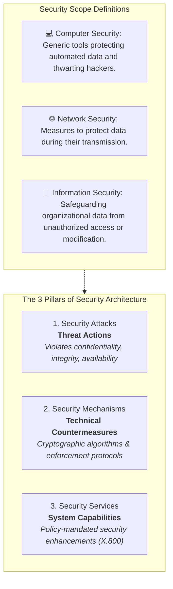
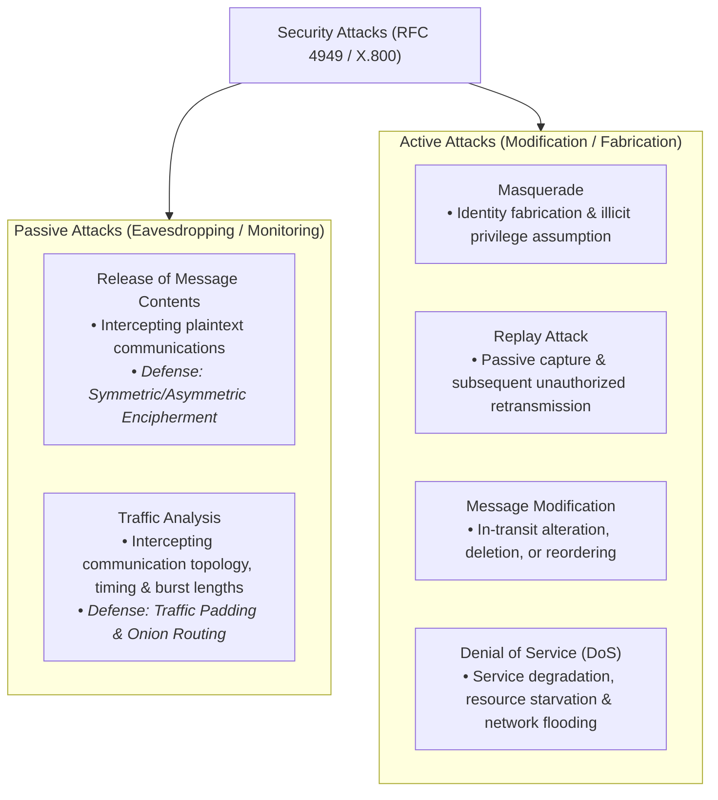

# Academic Summary: Security Concepts & Classical Encryption Techniques

**Subject:** Cryptography and Network Security (CNS) | **Unit:** Chapter 1  
**Audience Level:** Intermediate (Undergraduate Academic & Applied Rigor)  
**Target Bloom's Levels:** Understanding (L-2), Applying (L-3) & Analyzing (L-4)  
**Institution:** Chalapathi Institute of Engineering & Technology / Chalapathi University  

---

## 🖼️ 1. Information Assurance Framework & Security Triad

Information security in distributed computing relies on three fundamental pillars governing all defensive architectures:



---

## 🖼️ 2. Comprehensive Security Attack Matrix



### Comparative Analysis: Passive vs. Active Attacks

| Criterion | Passive Attacks | Active Attacks |
| :--- | :--- | :--- |
| **Operational Impact** | No alteration to data stream or server state | Alteration of data stream, replay, or service disruption |
| **System Visibility** | Undetectable in transit (zero transmission telemetry change) | Readily detectable via checksums, sequence numbers, logs |
| **Engineering Objective**| Obtain unauthorized access to information | Fabricate data, steal identity, or deny authorized service |
| **Primary Mitigation** | **Prevention** via mathematical encipherment | **Detection, containment, and state recovery** |

---

## 🖼️ 3. ITU-T X.800 Security Services & Mechanisms Mapping

```mermaid
flowchart LR
    subgraph SERVICES["ITU-T X.800 Security Services"]
        S_AUTH["Authentication<br/>(Peer Entity / Data Origin)"]
        S_AC["Access Control<br/>(Policy Enforcement)"]
        S_CONF["Confidentiality<br/>(Conn / Conn-less / Field / Traffic)"]
        S_INT["Integrity<br/>(Conn w/wo Recovery / Field / Conn-less)"]
        S_NONREP["Nonrepudiation<br/>(Proof of Origin / Destination)"]
    end

    subgraph MECHANISMS["Specific Security Mechanisms"]
        M_ENC["Encipherment (Ciphers)"]
        M_DS["Digital Signatures"]
        M_MAC["Data Integrity (MAC/Hash)"]
        M_AC["Access Control Rules"]
        M_PAD["Traffic Padding"]
        M_EXCH["Authentication Exchange"]
    end

    S_AUTH <--> M_EXCH & M_ENC
    S_AC <--> M_AC
    S_CONF <--> M_ENC & M_PAD
    S_INT <--> M_MAC & M_ENC
    S_NONREP <--> M_DS
```



---

## 🖼️ 4. Symmetric Cryptosystem Model & Cryptanalysis Dimensions

```
Plaintext X ──> [ Encryption E_K ] ──> Ciphertext Y ──> [ Decryption D_K ] ──> Plaintext X
                      ▲                                       ▲
                      │                                       │
                Secret Key K                            Secret Key K
                      └───────────[ Secure Key Exchange ]─────┘
```

* **Encryption Mapping:** $Y = E_K(X)$  
* **Decryption Mapping:** $X = D_K(Y)$  
* **Kerckhoffs's Principle:** The security of a cryptosystem must rest entirely upon the secrecy of the key $K$, not upon keeping the algorithm $E$ secret.

### Cryptanalytic Attack Taxonomy

| Attack Class | Cryptanalyst's Known Resources | Target Objective |
| :--- | :--- | :--- |
| **Ciphertext-Only** | Intercepted Ciphertext $Y$, Algorithm $E$ | Recover Plaintext $X$ or Secret Key $K$ |
| **Known-Plaintext** | Ciphertext $Y$, Algorithm $E$, plus one or more valid $(X_i, Y_i)$ pairs | Determine Secret Key $K$ |
| **Chosen-Plaintext** | Ciphertext $Y$, Algorithm $E$, ability to choose $X_i$ and obtain $Y_i = E_K(X_i)$ | Extract Secret Key $K$ |
| **Chosen-Ciphertext**| Ciphertext $Y$, Algorithm $E$, ability to choose $Y_j$ and obtain $X_j = D_K(Y_j)$ | Extract Secret Key $K$ |

---

## 🖼️ 5. Classical Cipher Summary & Mathematical Reference

| Cipher Type | Category | Mathematical Formulation | Keyspace Size | Cryptanalytic Vulnerability |
| :--- | :--- | :--- | :--- | :--- |
| **Caesar Cipher** | Monoalphabetic Shift | $c = (p + k) \pmod{26}$, $p = (c - k) \pmod{26}$ | $25$ keys | Exhaustive brute-force search in $< 1\text{ ms}$; frequency preservation. |
| **Monoalphabetic** | Substitution | Arbitrary permutation of 26-letter alphabet | $26! \approx 4 \times 10^{26}$ | Single-letter, digraph, and trigraph frequency analysis. |
| **Playfair Cipher** | Polygraphic (Digraph) | $5 \times 5$ keyword matrix; 4 geometric pair substitution rules | Matrix permutations | Digraph frequency distribution analysis ($650$ digraphs). |
| **Hill Cipher** | Polygraphic Block | $\mathbf{C} = K \mathbf{P} \pmod{26}$, $\mathbf{P} = K^{-1} \mathbf{C} \pmod{26}$ | Invertible matrices: $\gcd(\det(K), 26) = 1$ | Known-plaintext attack using $n$ linear vector equations. |
| **Vigenère Cipher**| Polyalphabetic | $c_i = (p_i + k_{i \bmod m}) \pmod{26}$ | $26^m$ for key length $m$ | Kasiski examination and Index of Coincidence ($I_c$). |
| **Vernam Cipher** | Stream Cipher (Binary) | $C_i = P_i \oplus K_i$, $P_i = C_i \oplus K_i$ | $2^L$ for length $L$ | Broken if key tape loop repeats or key stream is reused. |
| **One-Time Pad** | Unconditional Stream | $C_i = P_i \oplus K_i$ with truly random non-repeating $K$ | Infinite / Equal to message | **Unconditionally secure; mathematically unbreakable.** |
| **Rail Fence** | Transposition | Diagonal zigzag write across depth $d$, row readout | Depth $d$ ($2 \le d \ll L$) | Trivial combinatorial depth reconstruction. |
| **Columnar Transposition**| Transposition | Write in $k$ columns, read out by column permutation | $k!$ | Letter frequencies unchanged; column digraph anagramming. |
| **Rotor Machines** | Mechanical Polyalphabetic | Cascaded rotating cylinders stepping with keystrokes | $26^n$ substitution states ($n$ rotors) | Machine period factorization and electromechanical simulation. |
| **Steganography** | Information Hiding | Conceals existence: e.g. 24-bit RGB pixel LSB replacement | Carrier capacity | Statistical anomaly detection, steganalysis, file size overhead. |

