# Chapter 1: Introduction to Security & Classical Encryption Techniques — Academic Mindmap

---

## 1. Visual Mermaid Mindmap

```mermaid
mindmap
  root((Chapter 1: Security Concepts & Classical Encryption))

    %% ═════════════════════════════════════════════════════════════════════════
    %% BRANCH 1: SECURITY CONCEPTS, ATTACKS & TRIAD
    %% ═════════════════════════════════════════════════════════════════════════
    ("1. Security Concepts & Attacks")
      ("Security Disciplines & Triad")
        ["Computer Security - Protecting automated information systems & thwarting hackers"]
        ["Network Security - Protecting data in transit across interconnected systems"]
        ["Information Security - Safeguarding enterprise data from unauthorized access/alteration"]
        ["Three Pillars - Security Attacks, Security Mechanisms & Security Services"]
      ("Passive Attacks - Eavesdropping & Monitoring")
        ["Core Characteristics - No data alteration, detection extremely difficult, prevention via encryption"]
        ["Release of Message Contents - Intercepting sensitive emails, conversations & transferred files"]
        ["Traffic Analysis - Monitoring communication frequency, transmission location & packet patterns"]
      ("Active Attacks - Modification & Disruption")
        ["Core Characteristics - Alteration of data streams or creation of false streams, recovery prioritized"]
        ["Masquerade - Impersonating an authorized entity to acquire illicit privileges"]
        ["Replay Attack - Passive capture of valid data units & subsequent unauthorized retransmission"]
        ["Modification of Messages - Altering, delaying or reordering valid messages in transit"]
        ["Denial of Service (DoS) - Inhibiting normal use or overloading server & network bandwidth"]

    %% ═════════════════════════════════════════════════════════════════════════
    %% BRANCH 2: ITU-T X.800 SECURITY SERVICES
    %% ═════════════════════════════════════════════════════════════════════════
    ("2. Security Services (X.800 Framework)")
      ("Authentication Services")
        ["Peer Entity Authentication - Verifying identity of peer entity in connection phase"]
        ["Data Origin Authentication - Verifying true source of connectionless data units"]
      ("Access Control Service")
        ["Unauthorized Use Prevention - Enforcing permission policies on systems & communications"]
      ("Data Confidentiality Services")
        ["Connection Confidentiality - Protecting all user data on a connection from disclosure"]
        ["Connectionless Confidentiality - Protecting individual isolated data blocks"]
        ["Selective-Field Confidentiality - Protecting specific sensitive fields in a message"]
        ["Traffic-Flow Confidentiality - Concealing traffic volume, source-destination pairs & patterns"]
      ("Data Integrity Services")
        ["Connection Integrity with Recovery - Detecting unauthorized modification & automatic recovery"]
        ["Connection Integrity without Recovery - Detecting modification, insertion, deletion with alert only"]
        ["Selective-Field Connection Integrity - Guaranteeing integrity of designated message fields"]
        ["Connectionless Integrity - Detecting modifications in single independent packets"]
        ["Selective-Field Connectionless Integrity - Field-level integrity for connectionless units"]
      ("Nonrepudiation & Availability")
        ["Nonrepudiation with Proof of Origin - Sender cannot deny having dispatched the message"]
        ["Nonrepudiation with Proof of Destination - Receiver cannot deny having accepted message"]
        ["Availability Service - Ensuring system & network services remain accessible upon demand"]

    %% ═════════════════════════════════════════════════════════════════════════
    %% BRANCH 3: SECURITY MECHANISMS & NETWORK MODELS
    %% ═════════════════════════════════════════════════════════════════════════
    ("3. Security Mechanisms & Network Models")
      ("Specific Security Mechanisms (X.800)")
        ["Encipherment - Mathematical cryptographic algorithms (Symmetric & Asymmetric)"]
        ["Digital Signatures - Cryptographic data appended for origin proof & forgery protection"]
        ["Access Control Mechanisms - Permission matrices, user credentials & access capability lists"]
        ["Data Integrity Mechanisms - Cryptographic check values, hashes & message authentication codes"]
        ["Authentication Exchange - Challenge-response handshakes & mutual identity verification"]
        ["Traffic Padding - Inserting spurious bit streams to defeat traffic analysis"]
        ["Routing Control - Dynamically selecting physically secure routes for sensitive data"]
        ["Notarization - Trusted third-party guarantor for nonrepudiation & timestamping"]
      ("Pervasive Security Mechanisms (X.800)")
        ["Trusted Functionality - Certified secure hardware & software processing execution"]
        ["Security Labels - Marking sensitivity classifications on data resources"]
        ["Event Detection - Security-relevant anomaly & breach detection systems"]
        ["Security Audit Trail - Independent recording & systematic tracking of system activities"]
        ["Security Recovery - Automatic rollback, fault tolerance & manual incident recovery"]
      ("Model for Network Security")
        ["Five System Components - Sender, Receiver, Secret Key K, Transmission Channel & Opponent"]
        ["Trusted Third Party - Key distribution centers & authentication authorities"]
        ["Task 1 - Security Algorithm - Designing mathematical transformation functions E and D"]
        ["Task 2 - Secret Key Generation - Generating robust, unpredictable cryptographic keys"]
        ["Task 3 - Key Distribution - Establishing secure channels to distribute shared secrets"]
        ["Task 4 - Communication Protocol - Specifying exchange sequence between communicating entities"]
      ("Network Access Security Model")
        ["Gatekeeper Function - Login authenticators, biometric gates & stateful screening firewalls"]
        ["Internal Security Controls - Antivirus scanners, internal audit daemons & privilege monitors"]
        ["External Threat Actors - Malicious hackers, packet sniffers & automated cyber syndicates"]
        ["Software Threats - Viruses, self-propagating worms & Trojan payload logic"]

    %% ═════════════════════════════════════════════════════════════════════════
    %% BRANCH 4: SYMMETRIC CIPHER MODEL & CRYPTANALYSIS
    %% ═════════════════════════════════════════════════════════════════════════
    ("4. Symmetric Cipher Model & Cryptanalysis")
      ("Five Fundamental Ingredients")
        ["Plaintext X - Original intelligible input data stream"]
        ["Encryption Algorithm E - Performs mathematical transformations on plaintext"]
        ["Secret Key K - Independent parameter dictating exact transformation mapping"]
        ["Ciphertext Y - Scrambled, unintelligible output stream: Y = E_K(X)"]
        ["Decryption Algorithm D - Reverse algorithm restoring plaintext: X = D_K(Y)"]
      ("Two Core Security Requirements")
        ["Strong Encryption Algorithm - Opponent unable to decipher ciphertext or discover key"]
        ["Secure Key Distribution - Sender & receiver must securely obtain & guard secret key"]
      ("Three Cryptographic Dimensions")
        ["Operation Types - Substitution (mapping), Transposition (rearranging) & Product systems"]
        ["Key Multiplicity - Symmetric (Single secret key) vs Asymmetric (Two-key / Public-private)"]
        ["Plaintext Processing - Block Cipher (fixed blocks) vs Stream Cipher (continuous element-by-element)"]
      ("Cryptanalytic Attack Classifications")
        ["Ciphertext-Only Attack - Only encryption algorithm & intercepted ciphertext available"]
        ["Known-Plaintext Attack - Possession of one or more plaintext-ciphertext pairs"]
        ["Chosen-Plaintext Attack - Attacker chooses plaintext strings and obtains matching ciphertexts"]
        ["Chosen-Ciphertext Attack - Attacker chooses ciphertexts and obtains decrypted plaintexts"]
        ["Brute-Force Search - Exhaustive trial of all possible keys (averages 50% key space)"]
      ("Cryptographic Security Notions")
        ["Unconditionally Secure - Ciphertext contains zero statistical info to derive unique plaintext"]
        ["Computationally Secure - Breaking cost exceeds data value OR break time exceeds useful lifetime"]

    %% ═════════════════════════════════════════════════════════════════════════
    %% BRANCH 5: CLASSICAL SUBSTITUTION TECHNIQUES
    %% ═════════════════════════════════════════════════════════════════════════
    ("5. Classical Substitution Techniques")
      ("Caesar Cipher (Monoalphabetic Shift)")
        ["Mechanism - Fixed shift k=3: c = (p + k) mod 26 and p = (c - k) mod 26"]
        ["Vulnerabilities - Trivial key space (25 keys), brute force in seconds & frequency preservation"]
      ("Monoalphabetic Substitution Cipher")
        ["Mechanism - Arbitrary 26-letter permutation key yielding 26! ≈ 4 x 10^26 keyspace"]
        ["Vulnerability - English letter frequency distribution remains completely preserved"]
        ["Frequency Analysis - High frequency vowels E (12.7%), T (9.1%), A (8.2%), O, I, N"]
        ["Digraph and Trigraph Patterns - Common pairs (th, he, in, er) & triplets (the, and)"]
      ("Playfair Digraph Cipher")
        ["Matrix Construction - 5x5 key matrix based on keyword, combining I and J"]
        ["Digraph Rule 1 - Repeating letters in pair separated by filler 'x' (balloon -> ba lx lo on)"]
        ["Digraph Rule 2 - Same row letters replaced by element to immediate right (circular wrap)"]
        ["Digraph Rule 3 - Same column letters replaced by element immediately beneath (circular wrap)"]
        ["Digraph Rule 4 - Rectangle rule: each replaced by letter in own row and other's column"]
        ["Cryptanalysis - 25x25 = 650 digraphs, resists single-letter analysis, broken by digraph stats"]
      ("Hill Cipher (Polygraphic Block)")
        ["Creator & Structure - Lester Hill (1929), operates on vector blocks of size n via linear algebra"]
        ["Matrix Formulation - Ciphertext vector C = K * P mod 26; Decryption P = K^-1 * C mod 26"]
        ["Invertibility Criterion - det(K) must be non-zero and coprime to 26: gcd(det(K), 26) = 1"]
        ["Strengths & Weaknesses - Masks 1-gram & 2-gram frequencies, but vulnerable to known-plaintext attack"]
      ("Polyalphabetic Substitution Ciphers")
        ["Vigenere Cipher - 26 Caesar ciphers indexed by repeating keyword letters"]
        ["Vigenere Weakness - Periodic key repetition exploited via Kasiski examination & index of coincidence"]
        ["Autokey System - Eliminates periodic key by concatenating keyword with plaintext itself"]
      ("Vernam Cipher & One-Time Pad")
        ["Vernam Cipher (1918) - Bitwise XOR on binary data: C_i = P_i XOR K_i and P_i = C_i XOR K_i"]
        ["One-Time Pad (Joseph Mauborgne) - Truly random key equal to message length, used only once"]
        ["Theoretical Perfection - Sole unconditionally secure, mathematically unbreakable cryptosystem"]
        ["Practical Drawbacks - Gigantic random key generation & impossible secure key synchronization"]

    %% ═════════════════════════════════════════════════════════════════════════
    %% BRANCH 6: TRANSPOSITION TECHNIQUES & SYSTEMS
    %% ═════════════════════════════════════════════════════════════════════════
    ("6. Transposition, Rotors & Steganography")
      ("Rail Fence Cipher")
        ["Technique - Plaintext written in diagonal zigzag across d rails, read off row by row"]
        ["Cryptanalysis - Trivial depth exploration & straightforward permutation recovery"]
      ("Rectangular Columnar Transposition")
        ["Technique - Written row-by-row in rectangle of width k, columns read by key permutation order"]
        ["Vulnerability - Frequency preserved, anagramming attacks reconstruct columns"]
      ("Multiple Transposition")
        ["Technique - Re-encrypting ciphertext through second independent columnar transposition stage"]
        ["Security Advantage - Produces non-periodic complex permutations significantly harder to reconstruct"]
      ("Rotor Machines")
        ["Hardware Architecture - Series of independently rotating cylinders with 26 input/output pins"]
        ["Operation Mechanism - Key depression sends pulse through cylinders, rotating rotor after each stroke"]
        ["Period Multiplier - Cascaded rotors provide period of 26^n (3 rotors = 17,576 substitution alphabets)"]
        ["Historical Landmark - German Enigma Machine utilized in World War II military communication"]
      ("Steganography - Information Hiding")
        ["Fundamental Distinction - Hiding existence of communication vs Cryptography hiding message meaning"]
        ["Classical Methods - Invisible ink, pin punctures on typewritten text & deliberate typo patterns"]
        ["Digital Steganography - Least Significant Bit (LSB) embedding in 24-bit images and WAV audio files"]
        ["Trade-Offs - High overhead per data bit and vulnerable once detection algorithm is known"]
```

---

## 2. Topic Breakdown & Academic Reference Guide

### Branch 1: Security Concepts & Security Attacks
* **Source:** Notes.pdf Pages 1–4; Section 1.1–1.2
* **Bloom Level:** L-1 (Remembering) & L-2 (Understanding)
* **Core Concepts:**
  - **Triad Definition:** Distinction between Computer Security (tools to protect data/thwart hackers), Network Security (measures to protect data during transmission), and Information Security (safeguarding organizational data).
  - **Passive Attacks:** Eavesdropping/monitoring. Subtypes: (1) Release of message contents, (2) Traffic analysis. Emphasizes **prevention** through encryption because detection is virtually impossible without altering the stream.
  - **Active Attacks:** Modification of the data stream or creation of false streams. Subtypes: (1) Masquerade, (2) Replay, (3) Modification of messages, (4) Denial of Service (DoS). Emphasizes **detection and recovery** due to wide attack surfaces.

---

### Branch 2: Security Services (ITU-T Recommendation X.800)
* **Source:** Notes.pdf Pages 4–6; Section 1.3
* **Bloom Level:** L-2 (Understanding) & L-3 (Applying)
* **Core Concepts:**
  - **Authentication:** Confirms identity of sender/peer. Peer Entity Authentication (during connection establishment) vs. Data Origin Authentication (connectionless message units).
  - **Access Control:** Enforces authorization limits on computing and communication resources.
  - **Data Confidentiality:** Protects data against unauthorized disclosure. Includes connection, connectionless, selective-field, and traffic-flow confidentiality.
  - **Data Integrity:** Assures received data matches transmitted data without unauthorized deletion, insertion, or modification. Includes connection integrity with/without recovery, and connectionless integrity.
  - **Nonrepudiation:** Prevents denial of participation by sender (Proof of Origin) or receiver (Proof of Destination).
  - **Availability:** Guarantees timely and reliable access to system resources.

---

### Branch 3: Security Mechanisms & Network Security Models
* **Source:** Notes.pdf Pages 6–8; Section 1.4–1.5
* **Bloom Level:** L-2 (Understanding) & L-3 (Applying)
* **Core Concepts:**
  - **Specific Mechanisms:** Encipherment (symmetric/asymmetric), Digital Signatures, Access Control, Data Integrity (MAC/hashes), Authentication Exchange (challenge-response), Traffic Padding, Routing Control, Notarization.
  - **Pervasive Mechanisms:** Trusted Functionality, Security Labels, Event Detection, Security Audit Trail, Security Recovery.
  - **Model for Network Security:** 4 Design Tasks: (1) Algorithm design, (2) Key generation, (3) Key distribution methods, (4) Communication protocol specification.
  - **Network Access Security Model:** Protecting internal info systems against unauthorized users (hackers) and hostile software (viruses, worms) through gatekeepers and internal security controls.

---

### Branch 4: Symmetric Cipher Model & Cryptanalysis
* **Source:** Notes.pdf Pages 8–10; Section 2.1–2.4
* **Bloom Level:** L-2 (Understanding) & L-3 (Applying)
* **Core Concepts:**
  - **5 Ingredients:** Plaintext $X$, Encryption Algorithm $E$, Secret Key $K$, Ciphertext $Y = E_K(X)$, Decryption Algorithm $X = D_K(Y)$.
  - **Two Requirements:** Strong encryption algorithm + secure key distribution.
  - **Dimensions:** (1) Operations: Substitution vs. Transposition vs. Product; (2) Key Count: Symmetric (single key) vs. Asymmetric (two keys); (3) Processing: Block cipher vs. Stream cipher.
  - **Cryptanalytic Attacks:** Ciphertext-only, Known-plaintext, Chosen-plaintext, Chosen-ciphertext.
  - **Security Levels:** Unconditionally secure (mathematically unbreakable, e.g., One-Time Pad) vs. Computationally secure (breaking cost/time exceeds value/lifetime).

---

### Branch 5: Classical Substitution Techniques
* **Source:** Notes.pdf Pages 10–13; Section 2.5
* **Bloom Level:** L-3 (Applying) & L-4 (Analyzing)
* **Core Concepts:**
  - **Caesar Cipher:** Shift by $k=3$. Formula: $c = (p + k) \pmod{26}$, $p = (c - k) \pmod{26}$. Broken by 25-key brute-force.
  - **Monoalphabetic Cipher:** Arbitrary permutation of 26 letters ($26! \approx 4 \times 10^{26}$ keys). Broken by natural language letter/digraph frequency analysis ($E, T, A, O, I, N$).
  - **Playfair Cipher:** $5 \times 5$ matrix keyword grid. Digraph substitution using 4 geometric rules (filler $x$, same row right shift, same column down shift, opposite rectangle corners).
  - **Hill Cipher:** Polygraphic block substitution. Matrix multiplication: $C = K \cdot P \pmod{26}$, $P = K^{-1} \cdot C \pmod{26}$. Requires $\gcd(\det(K), 26) = 1$. Broken via known-plaintext linear algebra attacks.
  - **Polyalphabetic Ciphers:** Vigenère cipher (repeating keyword shifts), Autokey cipher (concatenation with plaintext).
  - **Vernam & One-Time Pad:** Vernam binary XOR ($C_i = P_i \oplus K_i$). One-Time Pad uses truly random non-repeating key of message length; unconditionally secure.

---

### Branch 6: Transposition Techniques, Rotor Machines & Steganography
* **Source:** Notes.pdf Pages 13–15; Section 2.6–2.7
* **Bloom Level:** L-3 (Applying) & L-4 (Analyzing)
* **Core Concepts:**
  - **Rail Fence Cipher:** Diagonal writing across rails of depth $d$, horizontal row extraction.
  - **Rectangular Columnar Transposition:** Plaintext arranged in rows of fixed width; columns reordered and read out via key permutation.
  - **Multiple Transposition:** Successive transposition stages yielding non-periodic complex permutations.
  - **Rotor Machines:** Mechanical cascaded cylinders with 26 internal pin mappings rotating after each keystroke, generating polyalphabetic periods of $26^n$ (e.g., German Enigma).
  - **Steganography:** Concealing the very presence of a message (invisible inks, pin punctures, LSB replacement in audio/image files).

