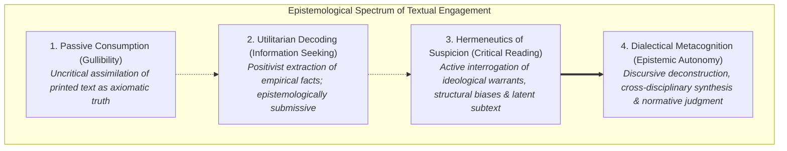
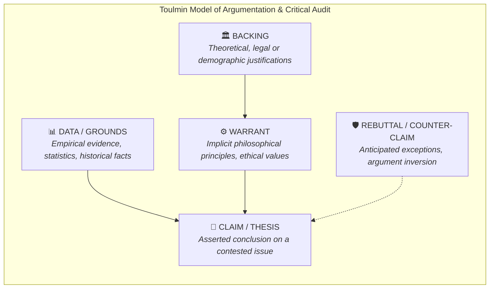
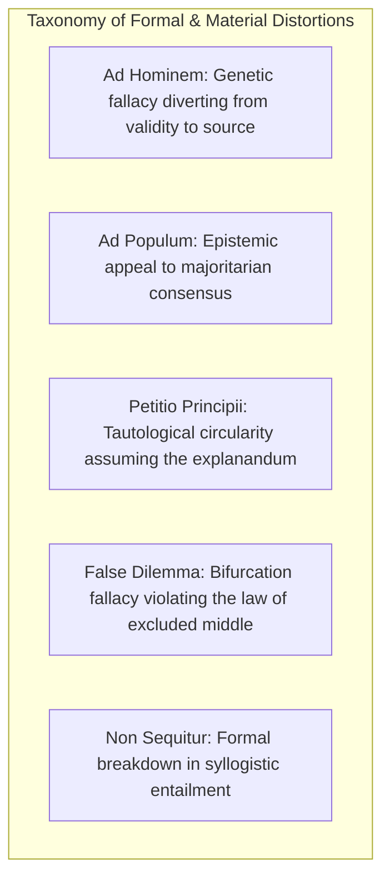
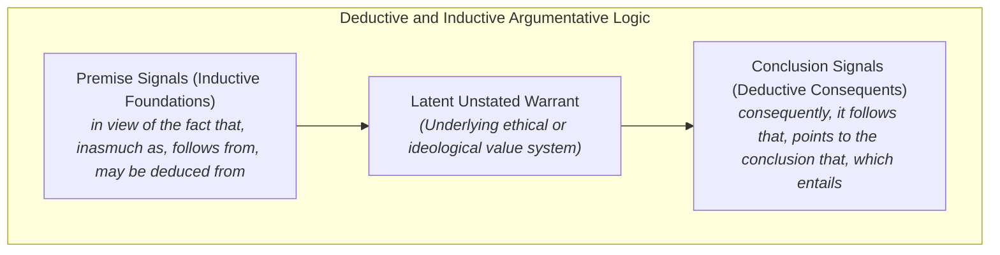
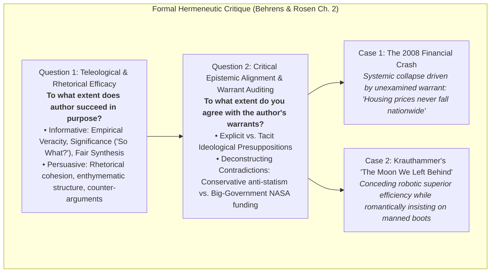
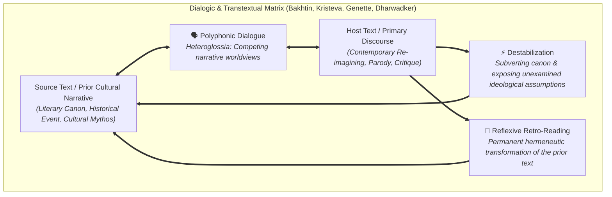

# Comprehensive Treatise: Critical Reading as Looking for Ways of Thinking (Advanced Level)

**Subject:** Reading and Writing Skills | **Unit:** Week 2  
**Audience Level:** Advanced / University-Prep & Honors Rhetoric  
**Target Bloom's Levels:** Analyzing (L-4), Evaluating (L-5), Creating (L-6)  
**Academic References:**  
1. Metherell, J.R. & Winkler, A. (2007). *Readings for Writers* (2nd ed., pp. 1-10).  
2. Hirschberg, S. & Hirschberg, T. (2009). *The Millennium Reader* (5th ed., pp. 1-3).  
3. Behrens, L. & Rosen, L. (2000). *Writing and Reading Across the Curriculum* (7th ed., pp. 45-77, Ch. 1 & 2).  
4. Dharwadker, Dharwadker, Harrison, Lemaster, & Bourenane. *What is Intertextuality?* (p. 70).  
5. DLSU Senior High School Department (2024-2025). *Critical Reading as Looking for Ways of Thinking* (`critical reading.md`).  

---

## 1. The Epistemological Spectrum of Reading & The Hermeneutics of Suspicion

In *The Millennium Reader*, Stuart and Terry Hirschberg position critical reading not merely as a mechanical skill, but as an epistemological posture essential for intellectual autonomy:
* **Casual Reading:** Low-cognitive, involuntary processing dictated by the semiotic landscape of modernity (street signage, push notifications, environmental disclaimers).
* **Reading for Pleasure:** Aesthetic immersion wherein narrative disbelief is voluntarily suspended. The reader seeks affective transport rather than analytical interrogation.
* **Reading for Information:** Utilitarian, comprehension-focused data extraction practiced in academic and occupational domains. Despite its high cognitive focus, it operates within an authoritarian paradigm, viewing the author as a reliable conduit of established truth.
* **Critical Reading:** An active dialectical duel and a hermeneutics of suspicion. Rather than passively internalizing claims, the critical reader treats reading as an intellectual debate:
  > *"You engage in a kind of mental dialogue with the writer. The writer says so-and-so is the case and you reply, 'Maybe so, but what about this?' You annotate the margins... You not only try to understand the author's main point, but you also try to deduce any consequences of it... Critical reading is not gullibility—accepting as truth anything you read."*

### Historical Genesis: Montaigne's Essais and Secular Inquiry
In *Writing and Reading Across the Curriculum*, Laurence Behrens and Leonard Rosen contextualize critical literacy within the historical birth of the essay:
* In 1580, French humanist **Michel de Montaigne** invented the genre of the essay, entitling his reflections *essais* (from the French *essayer*, meaning "to attempt" or "to try").
* Montaigne marked a radical break from scholastic dogmatism. Instead of presenting theological absolutes, he disclosed an observant, introspective mind wrestling with conflicting values, empirical observations, and personal doubts.
* The essayist speaks directly to the audience without fictional mediation. Because an essay represents an exploratory attempt, it invites the reader to join as an intellectual co-investigator, evaluating arguments on their own merits.

---

## 2. The Cognitive Triad: Dialectical Deconstruction, Synthesis, and Evaluation

Hirschberg and Hirschberg delineate the three-stage cognitive architecture governing critical literacy:

### 1. Analysis (Deconstruction of Structural Scaffolding & Ideology)
* Dissecting how arguments are engineered: isolating the core thesis from supporting sub-claims, warrants, and empirical grounds.
* Identifying authorial positionality: auditing biographical headnotes, demographic factors (age, socioeconomic status, academic discipline), institutional funding, and political alignments.
* Multi-source collection: gathering diverse empirical studies, dissenting counter-arguments, and theoretical paradigms to map the complete controversy.

### 2. Synthesis (Dialectical Integration & Epistemic Humility)
* Synthesizing divergent perspectives into an authentic, original intellectual synthesis.
* **The Antidote to Epistemic Arrogance:** Hirschberg emphasizes that synthesis is the ultimate cure for arrogance:
  > *"The best part about synthesis is that it tampers down the students' arrogance by demonstrating that on most knotty subjects, more than a single opinion exists."*
* Resisting false dichotomies by recognizing that reality is multi-variable and structurally complex.

### 3. Evaluation (Normative Appraisal & Balanced Judgment)
* Assessing argumentative validity, empirical sufficiency, and logical soundness.
* **Placing Weight on the Seesaw:** Critical scholars cannot retreat into moral or epistemic relativism ("everyone has their own truth"). The scholar must evaluate competing claims and take an educated stance—walking the middle road to avoid dogmatic extremes while remaining open to revised evidence.

---

## 3. Deconstructing Metherell & Winkler's 14 Guidelines for Critical Reading

Metherell and Winkler articulate 14 foundational principles of critical reading:

### Phase I: Epistemic Stance & Demystification
1. **Read actively:** Maintain continuous intellectual dialogue; record margin notes, challenge deductive leaps, and flag empirical discrepancies.
2. **Demystify the writer:** "Kick the writer off the throne of public esteem." Reject the author-as-oracle fallacy; authors are fallible human beings operating under cognitive and demographic constraints.
3. **Understand comprehensively before judging:** Rereading, semantic disambiguation, and oral summarization must precede critique. Hermeneutic comprehension is the ethical prerequisite of critical evaluation.

### Phase II: Rhetorical Perspective Reversal & Value Systems
4. **Invert the argument:** Systematically inhabit the counter-argument to test structural resilience.  
   * *The Canine Medical Research Case Study:* Inverting the anti-animal-testing position reveals that canine research enabled the isolation and therapeutic application of insulin, saving millions of human diabetic lives. Critical readers must balance competing ethical goods (animal welfare vs. human survival).
5. **Uncover latent biases and ideological warrants:** Audit the author's metaphysical and philosophical presuppositions.  
   * *Bioethical Incommensurability:* An atheist debating abortion operates on secular bodily autonomy warrants; a devout Catholic operates on the metaphysical sanctity of the soul from conception. Without identifying these warrants, genuine debate is impossible.
6. **Separate emotional rhetoric from empirical substance:** Deconstruct loaded terminology, ad populum sloganeering, and binary demonization of ideological opponents.

### Phase III: Interdisciplinary Triangulation & Evidentiary Recency
7. **Fill empirical deficits:** Consult primary stakeholders, peer-reviewed registries, and actuarial datasets when analyzing unfamiliar public policy disputes.
8. **Interdisciplinary cross-examination:** Leverage insights across fields to correct siloed academic reductionism.  
   * *Textbook Refutation:* Disproving psychological claims of innate passivity among oppressed peoples by citing armed Native American resistance at the Battles of Fallen Timbers (1794), Tippecanoe (1811), and the Black Hawk War (1832).
9. **Audit evidence recency and methodological credibility:**  
   * *The Susumu Tonegawa Case Study (MIT, 1976):* Before Tonegawa's genetic recombination discovery, the mechanism generating millions of unique antibodies was considered an insoluble enigma. Citing a pre-1976 scientific paper today presents false, obsolete evidence.
10. **Ponder foundational philosophical value hierarchies:**  
    * Contrasting Thomas Jefferson's *Declaration of Independence* (anchored in universal natural rights and individual equality) with Karl Marx's *Communist Manifesto* (anchored in the supreme societal value of labor). All political rhetoric derives from competing moral axioms.

### Phase IV: Fallacy Diagnosis, Marginalia & Opening Context
11. **Diagnose logical fallacies:**

12. **Resist bogus claims:** Dismiss unverified authoritative pronouncements ("Studies show beyond doubt...") lacking transparent methodological metrics, peer review, and verifiable data.
13. **Practice active marginal annotation:** Transform texts into active intellectual seminars. Reluctance to annotate out of a desire to preserve textbook resale value is "penny-wise and pound-foolish."
14. **Deconstruct the opening discourse context:** Situate texts within ongoing socio-historical dialogues.  
    * *Andy Rooney on Fowler Case Study:* Rooney's essay praised Henry Watson Fowler's *A Dictionary of Modern English Usage* (1926) for the Screenwriters Guild 2000 feature *A Writer's Fantasy: What I Wish I Had Written*. Rooney ironically adopts Fowler's pedantic authority to parody starchy prescriptivism, mocking split infinitives, zeugma, syllepsis, and archaic usage rules like "It is I."

---

## 4. Essay Architecture: Thesis Formulation & Structural Signposts

In *Writing and Reading Across the Curriculum*, Behrens and Rosen establish that academic argumentation relies on explicit structural signposts:
* **The Central Thesis:** A focused declarative assertion presenting the author's response to an issue open to debate.
  * *Mark Twain's The Lowest Animal:* Twain deliberately subverts Victorian evolutionary hierarchies:
    > *"In the course of my experiments I convinced myself that among the animals man is the only one that harbors insults and injuries, broods over them, waits till a chance offers, then takes revenge. The passion of revenge is unknown to the higher animals."*
* **Premise Signals (Reasoning Starters):** *since, because, for, as, follows from, as shown by, inasmuch as, otherwise, as indicated by, the reason is that, may be inferred from, may be derived from, may be deduced from, in view of the fact that*.
* **Conclusion Signals (Inferential Closers):** *therefore, hence, thus, so, accordingly, in consequence, it follows that, we may infer, I conclude that, in conclusion, in summary, which shows that, which means that, and which entails, consequently, proves that, as a result, which implies that, points to the conclusion that*.

---

## 5. Formal Hermeneutic Critique & Epistemic Warrant Auditing (Behrens & Rosen Ch. 2)

A formal academic critique is an advanced exercise in rhetorical and epistemological criticism. In Chapter 2 of *Writing and Reading Across the Curriculum*, Laurence Behrens and Leonard Rosen formulate the dual-question engine of critique:

### Question 1: Teleological & Rhetorical Efficacy
**"To what extent does the author succeed in his or her purpose?"**
* **Informative Discourse:**
  * **Empirical Veracity (Accuracy):** Auditing claims against verifiable primary sources and peer-reviewed empirical data.
  * **The "So What?" Threshold (Significance):** Facts may be indisputably true yet conceptually trivial. Significance demands that factual propositions meaningfully address the central inquiry, offering substantive epistemic utility.
  * **Hermeneutic Fairness (Fair Interpretation):** Identifying whether the author contextually honors opposing interpretations or engages in dialectical distortion and cherry-picking.
* **Persuasive Discourse:** Auditing whether the thesis is supported by coherent enthymemes, empirical grounds, and fair treatment of dissenting counterarguments.

### Question 2: Critical Epistemic Alignment & Warrant Auditing
**"To what extent do you agree with the author's warrants?"**
This question requires scholars to deconstruct the author's **hidden assumptions**—the underlying ideological warrants that bridge empirical data to normative claims.
* **The 2008 Subprime Mortgage Collapse Case Study:**
  * *Systemic Warrant Failure:* The multi-trillion dollar financial edifice of collateralized debt obligations (CDOs) and credit default swaps rested upon an unexamined, tacit warrant: *that U.S. residential real estate prices would perpetually appreciate nationwide.*
  * *The Catastrophe of Unexamined Presuppositions:* Because institutional gatekeepers (rating agencies, investment banks) treated this warrant as an unassailable axiom, loan verification standards collapsed. When home values declined, the unexamined warrant imploded, freezing global credit liquidity.
* **Charles Krauthammer's "The Moon We Left Behind" (Time, 2009):**
  * *Rhetorical Exordium & Loaded Diction:* Krauthammer laments the cessation of Apollo manned missions, deploying emotive rhetoric (*"ignominious retreat," "national loss of nerve"*) to provoke patriotic melancholy.
  * *The Concession of Counter-Evidence:* To his rhetorical credit, Krauthammer explicitly concedes the strongest empirical counter-argument: unmanned robotic rovers and deep-space telescopes are vastly cheaper, eliminate risk to human life, and yield vastly superior scientific data per dollar invested.
  * *Deconstructing the Tacit Warrant:* Having conceded that science favors robots, Krauthammer nonetheless demands human missions. This unmasks his fundamental warrant: *The ultimate justification of space exploration is not scientific utility or cost-effective data collection, but romantic heroism, national myth-making, and imperial frontier glory.*
  * *Deconstructing Ideological Contradictions:* Krauthammer was a prominent conservative intellectual renowned for championing small-government anti-statism and denouncing federal bureaucracy. Yet in this essay, his romantic nationalism completely overrides his conservative fiscal principles, compelling him to demand a multi-billion dollar state-run government enterprise (NASA). A critical reader deconstructs this philosophical rupture.

---

## 6. Advanced Intertextuality Theory: Dialogism, Transtextuality, and Canon Subversion

Grounded in Dharwadker, Harrison, Lemaster, and Bourenane, enriched by Mikhail Bakhtin's dialogism, Julia Kristeva's intertextuality, and Gérard Genette's transtextuality:

### Definitions and Theoretical Paradigm
No text exists in cultural isolation. Every literary, media, or social text is an active intersection of textual surfaces—a mosaic of quotations, cultural echoes, and historical dialogues.

### The Two Forms of Intertextual Borrowing
1. **Form 1: Book in a Book (Literary in Literary):** Incorporation of prior literature via quotation, character transposition, or full structural hypotext adaptation (e.g., Jean Rhys's *Wide Sargasso Sea* reimagining Charlotte Brontë's *Jane Eyre*).
2. **Form 2: Other Text in a Book (Cultural/Media in Literary):** Incorporating cultural or historical events possessing an innate narrative quality (e.g., Rosa Parks's bus defiance or the assassination of JFK). The historical narrative imports instant moral stakes into the host text.

### The Tripartite Functional Engine
1. **Comparison:** Structural juxtaposition compelling the reader to evaluate thematic parallels and ideological divergences.
2. **Bakhtinian Dialogism (Heteroglossia):** Staging a polyphonic conversation where competing cultural discourses contest ideological authority.
3. **Destabilization & Canon Subversion:** Decentering the canonical authority of the source text, exposing unexamined historical, colonial, or gender biases.

### The Three Hermeneutic Consequences
1. **Host Text Enrichment:** Multi-layered symbolic resonance.
2. **Reflexive Retrospective Re-Reading:** The intertext permanently reconfigures how the reader interprets the original source text.
3. **Simultaneous Reciprocal Interrogation:** A reciprocal dialectic where both texts interrogate each other concurrently.

### Epistemological Convergence: Digital Hypertext vs. Literary Intertextuality
* **Hypertext:** Technological externalization of non-linear reading via digital protocols, clickable URLs, and algorithmic network architecture.
* **Intertextuality:** The cognitive and cultural precursor to hypertext. Centuries before the internet, literature operated as a decentralized, associative, hyperlinked network across human consciousness.
