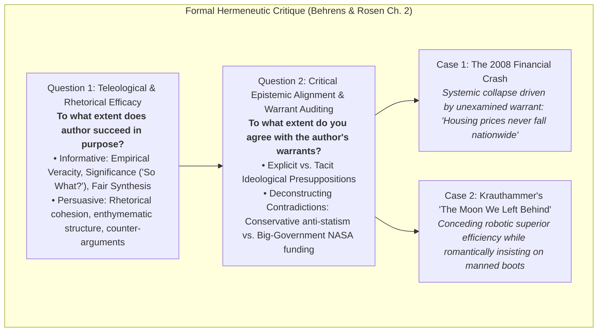

# Flashcards: Critical Reading as Looking for Ways of Thinking (Advanced Level)

**Subject:** Reading and Writing Skills | **Total Cards:** 20 Cards  
**Audience Level:** Advanced (Collegiate Rigor & Epistemological Deconstruction)  

### Master Epistemological Critique Matrix:

---
### Card 01
**Front:** Contrast 'Positivist Information Reading' with 'Critical Hermeneutic Duel' across epistemic paradigms.  
**Back:**  
Positivist information reading views text as an authoritative repository of stable facts; critical reading is a hermeneutics of suspicion that interrogates ideological warrants, unstated premises, and latent biases.  

---
### Card 02
**Front:** How did Michel de Montaigne's 1580 'essais' secularize prose and inaugurate modern critical literacy?  
**Back:**  
Montaigne abandoned scholastic dogmatism to present an 'essai' (attempt)—an honest disclosure of an inquiring mind exploring internal doubts, establishing reader and writer as co-equal investigative peers.  

---
### Card 03
**Front:** Explain the epistemic workflow of Hirschberg's Cognitive Triad: Analysis, Synthesis, Evaluation.  
**Back:**  
Analysis deconstructs argumentative anatomy and warrants; Synthesis blends multi-disciplinary contradictions to temper dogmatic arrogance; Evaluation normatively audits validity to place weight on the seesaw.  

---
### Card 04
**Front:** How does the Toulmin Argumentation Model integrate with critical reading guidelines?  
**Back:**  
Critical reading audits the connection between Grounds (Data) and Claim, rigorously unmasking the unstated Warrant and challenging its underlying Backing.  

---
### Card 05
**Front:** Why is 'Demystifying the Writer' considered the foundational axiom of epistemic autonomy?  
**Back:**  
Kicking the author off the pedestal shatters the authoritarian illusion of infallibility, treating texts as fallible human artifacts open to audit, empirical testing, and ideological critique.  

---
### Card 06
**Front:** How does the canine insulin case study illustrate dialectical argument inversion?  
**Back:**  
Inverting the ethical condemnation of animal testing reveals that canine experiments yielded insulin, preserving millions of human lives—forcing a nuanced balance between competing moral goods.  

---
### Card 07
**Front:** Deconstruct the competing metaphysical warrants in Jeffersonian vs. Marxist political rhetoric.  
**Back:**  
Jefferson anchors his political claims in the metaphysical warrant of universal natural rights; Marx anchors his in the supreme socio-economic primacy of labor.  

---
### Card 08
**Front:** How does historical armed resistance at Fallen Timbers and Tippecanoe refute psychological generalizations?  
**Back:**  
It provides empirical falsification against psychological claims of innate passivity among oppressed populations, demonstrating the power of interdisciplinary cross-examination.  

---
### Card 09
**Front:** What epistemic lesson regarding temporal validity emerges from Dr. Susumu Tonegawa's 1976 discovery?  
**Back:**  
Scientific knowledge is dynamic and falsifiable; citing pre-1976 medical sources asserting the mystery of antibody creation presents obsolete and factually invalid evidence.  

---
### Card 10
**Front:** Differentiate between an Ad Hominem fallacy and legitimate ethos auditing.  
**Back:**  
Ad Hominem attacks irrelevant personal traits to dismiss a premise; ethos auditing investigates whether an author possesses relevant methodological competence and institutional bias.  

---
### Card 11
**Front:** Define Petitio Principii (Begging the Question) from a formal logical perspective.  
**Back:**  
A circular reasoning defect where the conclusion is smuggled into the premise as an unproven assumption, failing to establish independent epistemic warrant.  

---
### Card 12
**Front:** What are the TWO guiding teleological questions of an academic critique (Behrens & Rosen)?  
**Back:**  
Question 1: To what extent does the author succeed in his or her purpose?
Question 2: To what extent do you agree with the author (auditing tacit assumptions and warrants)?  

---
### Card 13
**Front:** Differentiate 'Empirical Accuracy' from the 'So What?' Significance threshold in informative writing.  
**Back:**  
Accuracy certifies empirical correctness; Significance evaluates whether that correctness possesses meaningful relevance and explanatory power regarding the core inquiry.  

---
### Card 14
**Front:** Deconstruct how an unexamined warrant caused the 2008 Subprime Mortgage Financial Collapse.  
**Back:**  
Global financial derivatives rested upon the unexamined warrant that residential real estate prices would never decline nationwide, causing systemic collapse when housing depreciated.  

---
### Card 15
**Front:** Analyze the ideological contradiction in Charles Krauthammer's 'The Moon We Left Behind'.  
**Back:**  
Krauthammer conceded robotic probes are scientifically superior and cheaper, yet demanded manned missions based on romantic warrants—advocating massive NASA state spending despite his conservative anti-statism.  

---
### Card 16
**Front:** How do premise signals and conclusion signals interact in enthymematic argumentation?  
**Back:**  
Premise signals introduce evidentiary grounds, while conclusion signals claim deductive entailment; critical readers supply the missing enthymematic warrant to audit logical validity.  

---
### Card 17
**Front:** Differentiate Dharwadker's Form 1 vs. Form 2 Intertextuality through narrative theory.  
**Back:**  
Form 1 (Book in a Book) transposes literary hypotexts into literature; Form 2 (Other Text in a Book) transposes cultural-historical events possessing narrative quality into literature.  

---
### Card 18
**Front:** How does the Destabilization function of intertextuality subvert canonical literary authority?  
**Back:**  
It recontextualizes classic source narratives through marginalized or contemporary viewpoints, exposing latent historical, gender, or colonial biases in canonical literature.  

---
### Card 19
**Front:** Explain Dharwadker's concept of 'Reflexive Retrospective Re-Reading'.  
**Back:**  
The retrospective hermeneutic phenomenon where encountering an intertextual adaptation permanently alters the reader's cognitive and thematic perception of the original source text.  

---
### Card 20
**Front:** Synthesize the epistemological relationship between digital Hypertext and literary Intertextuality.  
**Back:**  
Hypertext is the digital-technological externalization of non-linear reading; Intertextuality is the innate cognitive-cultural hypertext operating across human consciousness and memory.  

---
