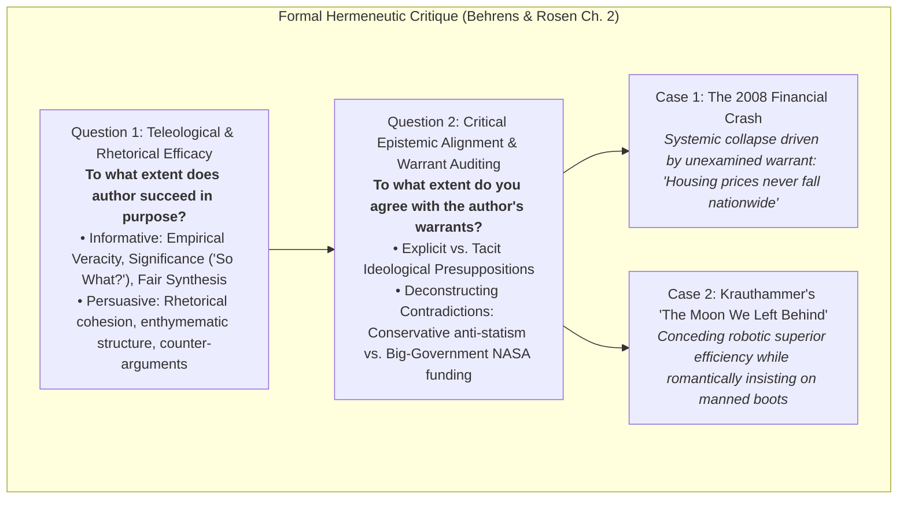

# Multiple Choice Questions (MCQ) - Collegiate Exam (Advanced Level)

**Subject:** Reading and Writing Skills | **Unit:** Week 2  
**Total Questions:** 20 MCQs (4 Options Each)  

### Master Epistemological Critique Matrix:

---
### Question 1
**Mindmap Location:** 1. Taxonomy of Reading > Epistemological Spectrum  
**Question:** Why does Hirschberg categorize 'Reading for Information' as epistemologically submissive compared to 'Critical Reading'?  
- A) It demands less cognitive concentration than casual reading  
- B) It operates within an authoritarian paradigm that treats the text as an infallible repository of facts, lacking dialectical interrogation  
- C) It is exclusively practiced by elementary school children  
- D) It requires readers to ignore all mathematical data  

Click to view Answer

<b>Correct Option: B</b> 
<b>Rationale:</b> Information reading treats the text as an authoritative repository of data to be absorbed, while critical reading is a dialectical duel interrogating claims, premises, and warrants.

---
### Question 2
**Mindmap Location:** 1. Taxonomy of Reading > Montaigne's Essais  
**Question:** What epistemological transformation was initiated by Michel de Montaigne's invention of the *essai* (1580)?  
- A) The formalization of Latin as the mandatory language of legal jurisprudence  
- B) The transition from dogmatic theological absolutes to secular, exploratory disclosures of an inquiring mind exploring its own doubts and values  
- C) The codification of strict prescriptivist grammar rules banning split infinitives  
- D) The establishment of blind peer review in European scientific academies  

Click to view Answer

<b>Correct Option: B</b> 
<b>Rationale:</b> Montaigne's essays (from 'essayer' - to attempt) secularized prose by replacing theological certainty with personal, skeptical exploration, inviting reciprocal reader scrutiny.

---
### Question 3
**Mindmap Location:** 2. Cognitive Triad > Synthesis  
**Question:** In what manner does cognitive synthesis serve as an epistemic antidote to intellectual arrogance (Hirschberg, 2009)?  
- A) By allowing students to speed-read through contradictory chapters  
- B) By demonstrating that complex, knotty human controversies possess multiple legitimate perspectives, curbing simplistic dogmatism  
- C) By forcing students to surrender their personal ethical values to majority consensus  
- D) By eliminating the need to evaluate empirical evidence  

Click to view Answer

<b>Correct Option: B</b> 
<b>Rationale:</b> Synthesis requires integrating conflicting perspectives, proving that complex controversies cannot be resolved by single-variable dogmatic certainty.

---
### Question 4
**Mindmap Location:** 3. Guidelines > Demystification  
**Question:** From a critical pedagogical standpoint, what danger arises when readers fail to 'demystify the writer'?  
- A) They will be unable to memorize the author's biographical data  
- B) They fall victim to the author-as-oracle fallacy, passively absorbing ideological biases, factual errors, and fallacious reasoning as absolute truth  
- C) They will fail to calculate standard deviation on statistical exams  
- D) They will be legally barred from publishing critical reviews  

Click to view Answer

<b>Correct Option: B</b> 
<b>Rationale:</b> Failing to demystify authors leads to gullible submission, treating fallible human writers as unquestioned authorities.

---
### Question 5
**Mindmap Location:** 3. Guidelines > Argument Inversion  
**Question:** How does dialectical argument inversion operate in the canine medical testing case study?  
- A) It proves that scientific progress should always override ethical concerns  
- B) It demonstrates that inverting the ethical condemnation of animal testing reveals how canine trials discovered insulin, forcing a balanced evaluation of competing moral goods  
- C) It establishes that dogs possess higher cognitive capacity than primates  
- D) It asserts that ethical dilemmas should be excluded from scientific debate  

Click to view Answer

<b>Correct Option: B</b> 
<b>Rationale:</b> Inverting the argument reveals that canine research produced insulin, preserving millions of human lives—compelling scholars to evaluate competing ethical goods.

---
### Question 6
**Mindmap Location:** 3. Guidelines > Interdisciplinary Triangulation  
**Question:** How did historical documentation of Native American armed resistance refute a psychological theory?  
- A) It proved that historians utilize more rigorous statistical methods than psychologists  
- B) Battles like Fallen Timbers (1794) and Tippecanoe (1811) provided empirical falsification against psychological claims of innate passivity among oppressed peoples  
- C) It showed that psychological theories are never applicable to historical research  
- D) It demonstrated that oppressed populations always achieve military victory  

Click to view Answer

<b>Correct Option: B</b> 
<b>Rationale:</b> Documented military resistance provided empirical falsification against psychological generalizations regarding innate passive surrender.

---
### Question 7
**Mindmap Location:** 3. Guidelines > Evidentiary Recency  
**Question:** What epistemological insight regarding scientific evidence is illustrated by Dr. Susumu Tonegawa's 1976 discovery?  
- A) Scientific knowledge is permanently immutable once printed in peer-reviewed journals  
- B) Scientific paradigms evolve; citing pre-1976 medical sources asserting the mystery of antibody creation presents superseded, factually invalid claims  
- C) Medical discoveries made in Massachusetts are more valid than those made in Europe  
- D) Genetics and immunology are completely separate, non-overlapping disciplines  

Click to view Answer

<b>Correct Option: B</b> 
<b>Rationale:</b> Tonegawa's 1976 discovery solved antibody gene rearrangement; citing pre-1976 literature presents factually obsolete evidence.

---
### Question 8
**Mindmap Location:** 3. Guidelines > Ad Hominem Fallacy  
**Question:** What differentiates an *Ad Hominem* fallacy from a legitimate sociological positionality audit?  
- A) Ad Hominem audits the author's university degrees, while positionality audits appearance  
- B) Ad Hominem attacks irrelevant personal traits to dismiss a premise, while positionality auditing investigates structural, financial, or institutional biases that skew methodology  
- C) Ad Hominem is valid in political science but invalid in literature  
- D) Positionality auditing is prohibited under international research ethics  

Click to view Answer

<b>Correct Option: B</b> 
<b>Rationale:</b> Ad Hominem is an irrelevant personal attack; positionality auditing legitimately examines institutional funding and ideological bias.

---
### Question 9
**Mindmap Location:** 3. Guidelines > Begging the Question  
**Question:** What defines the formal defect in *Petitio Principii* (Begging the Question)?  
- A) Using a premise that offends the sensibilities of the audience  
- B) Circularity wherein the proposition to be proved is presupposed as an unproven premise, failing to provide independent epistemic justification  
- C) Utilizing an excessively large empirical sample size  
- D) Reaching a deductive conclusion that contradicts inductive grounds  

Click to view Answer

<b>Correct Option: B</b> 
<b>Rationale:</b> Begging the question is circular reasoning: presupposing as a premise the very conclusion that requires proof.

---
### Question 10
**Mindmap Location:** 3. Guidelines > Discourse Context  
**Question:** How does rhetorical irony function in Andy Rooney's essay on Fowler's *Modern English Usage*?  
- A) Rooney writes a legal defense of copyright laws for screenwriters  
- B) Rooney adopts the persona of a grammatical purist only to satirize prescriptivist pedantry, deliberately violating archaic usage taboos  
- C) Rooney argues that the English language should be replaced by computer programming code  
- D) Rooney sincerely demands that students who split infinitives be expelled from school  

Click to view Answer

<b>Correct Option: B</b> 
<b>Rationale:</b> Rooney playfully adopts Fowler's authoritative mantle to parody grammatical prescriptivism, splitting infinitives and mocking arcane rules.

---
### Question 11
**Mindmap Location:** 4. Essay Architecture > Mark Twain's Teleology  
**Question:** In *The Lowest Animal*, what fundamental philosophical inversion forms the basis of Mark Twain's thesis?  
- A) The claim that technology has made modern humans morally superior to ancestors  
- B) The satirical inversion of Darwinian teleology, asserting that humans have descended below animals because humans alone harbor malice and premeditated revenge  
- C) The argument that wild animals should be domesticated to teach them human ethics  
- D) The assertion that scientific laboratory experiments should be abolished worldwide  

Click to view Answer

<b>Correct Option: B</b> 
<b>Rationale:</b> Twain subverts evolutionary teleology, asserting that humans are degraded below animals by uniquely harboring petty revenge and cruelty.

---
### Question 12
**Mindmap Location:** 4. Essay Architecture > Signpost Semantics  
**Question:** Which of the following phrases functions as an inductive or deductive PREMISE SIGNAL?  
- A) 'Points to the conclusion that'  
- B) 'In view of the fact that'  
- C) 'Consequently, it follows that'  
- D) 'Accordingly, we deduce that'  

Click to view Answer

<b>Correct Option: B</b> 
<b>Rationale:</b> 'In view of the fact that' introduces supporting evidentiary reasons (premise). The others signal deductions/conclusions.

---
### Question 13
**Mindmap Location:** 7. Critical Reading for Critique > Teleological Inquiries  
**Question:** According to Behrens and Rosen, what two teleological questions govern an academic critique?  
- A) 1. How many words does the essay contain? 2. Is it indexed in Scopus?  
- B) 1. To what extent does the author succeed in his or her purpose? 2. To what extent do you agree with the author's assumptions and warrants?  
- C) 1. Does the author agree with the ruling political party? 2. Is the essay illustrated?  
- D) 1. What was the author's advance payment? 2. Has the work been adapted into a film?  

Click to view Answer

<b>Correct Option: B</b> 
<b>Rationale:</b> Behrens and Rosen structure academic critique around: Question 1 (evaluating success in rhetorical purpose) and Question 2 (evaluating critical agreement and tacit assumptions).

---
### Question 14
**Mindmap Location:** 7. Critical Reading for Critique > Significance Threshold  
**Question:** In Behrens and Rosen's critique framework, how does the 'So What?' criterion operate in informative discourse?  
- A) It verifies whether every sentence adheres to grammatical prescriptivism  
- B) It establishes whether accurate empirical data possesses meaningful explanatory power and relevance to the core inquiry, rather than providing trivial trivia  
- C) It tests whether the author's writing style is emotionally stirring  
- D) It checks whether the informative text includes poetic metaphors  

Click to view Answer

<b>Correct Option: B</b> 
<b>Rationale:</b> The 'So What?' test represents Significance: empirical accuracy alone is insufficient if the facts are trivial and lack meaningful relevance.

---
### Question 15
**Mindmap Location:** 7. Critical Reading for Critique > Subprime Crisis Warrant  
**Question:** What unexamined warrant underpinned the systemic institutional failure of the 2008 Subprime Mortgage Financial Collapse?  
- A) That home buyers preferred renting over property ownership  
- B) That U.S. residential real estate prices would perpetually appreciate and never experience a nationwide decline  
- C) That computer algorithms were incapable of processing complex bond derivatives  
- D) That foreign governments would refuse to purchase American mortgage-backed securities  

Click to view Answer

<b>Correct Option: B</b> 
<b>Rationale:</b> The entire subprime securitization market rested upon the unexamined warrant that nationwide residential home prices would never depreciate.

---
### Question 16
**Mindmap Location:** 7. Critical Reading for Critique > Krauthammer Rhetorical Deconstruction  
**Question:** What fundamental ideological contradiction is exposed through a critical critique of Charles Krauthammer's 'The Moon We Left Behind'?  
- A) He claims the Apollo landings were staged in a television studio  
- B) He concedes robotic probes are cheaper, safer, and yield superior scientific data, yet demands manned missions based on romantic warrants—advocating a massive state-funded NASA program despite his conservative anti-statism  
- C) He demands that private aerospace corporations be nationalized by the United Nations  
- D) He denies that the Moon possesses scientific value while demanding an astronomical observatory be built there  

Click to view Answer

<b>Correct Option: B</b> 
<b>Rationale:</b> Krauthammer conceded robotic superiority yet romanticized manned flight, and his call for massive state NASA spending clashed with his conservative anti-statism.

---
### Question 17
**Mindmap Location:** 5. Intertextuality > Bakhtinian Heteroglossia  
**Question:** In Dharwadker's taxonomy, how does Form 2 ('Other Text in a Book') introduce Bakhtinian heteroglossia into a literary work?  
- A) By appending a dictionary of foreign vocabulary terms  
- B) By incorporating a cultural or historical event (e.g., Rosa Parks's bus protest) possessing an innate narrative arc that imports competing socio-political discourses into the host text  
- C) By requiring that the novel be performed as a choral musical drama  
- D) By eliminating the primary narrator in favor of a silent protagonist  

Click to view Answer

<b>Correct Option: B</b> 
<b>Rationale:</b> Form 2 weaves cultural or media narratives possessing distinct story arcs into literature, importing competing socio-political discourses into the host work.

---
### Question 18
**Mindmap Location:** 5. Intertextuality > Canonical Destabilization  
**Question:** How does the 'Destabilization' function of intertextuality operate as a counter-hegemonic mechanism?  
- A) By physically altering the archival bindings of canonical manuscripts  
- B) By reframing a canonical source text through subaltern or contemporary perspectives, exposing latent historical, gender, or colonial biases in the original canon  
- C) By legally enforcing the censorship of classic literature in universities  
- D) By translating canonical texts into obscure dialects  

Click to view Answer

<b>Correct Option: B</b> 
<b>Rationale:</b> Destabilization reframes classic texts through subaltern perspectives, exposing unexamined ideological biases in canonical literature.

---
### Question 19
**Mindmap Location:** 5. Intertextuality > Reflexive Retro-Reading  
**Question:** What characterizes Dharwadker's concept of 'Reflexive Retrospective Re-Reading'?  
- A) Reading a novel backward from the conclusion to the opening chapter  
- B) A bi-directional hermeneutic phenomenon wherein encountering an intertextual adaptation permanently alters the reader's cognitive and thematic perception of the original source text  
- C) Rereading an essay strictly during an examination review session  
- D) The automatic cognitive deletion of a prior text upon reading a contemporary remake  

Click to view Answer

<b>Correct Option: B</b> 
<b>Rationale:</b> Reflexive retro-reading means that experiencing an adaptation or intertext permanently reshapes the reader's retrospective perception of the original work.

---
### Question 20
**Mindmap Location:** 6. Hypertext vs. Intertextuality  
**Question:** What is the primary ontological distinction between digital Hypertext and literary Intertextuality?  
- A) Hypertext is an external technological protocol connecting digital nodes via code, while Intertextuality is an internal cognitive-cultural network operating across human consciousness  
- B) Hypertext is strictly linear, while Intertextuality is strictly non-linear  
- C) Intertextuality was invented in the 1990s following the creation of HTML  
- D) Hypertext operates exclusively within spoken oral traditions  

Click to view Answer

<b>Correct Option: A</b> 
<b>Rationale:</b> Hypertext is a technological network connecting digital nodes; intertextuality is an innate cognitive and cultural web connecting stories across human consciousness.

---
