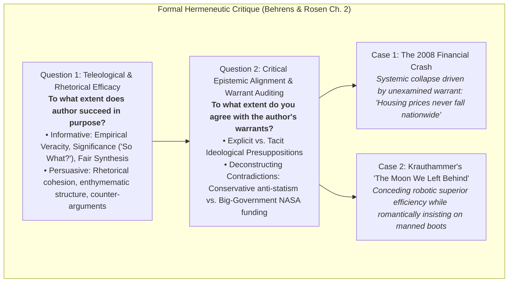

# Multiple Select Questions (MSQ) - Collegiate Study (Advanced Level)

**Subject:** Reading and Writing Skills | **Unit:** Week 2  
**Total Questions:** 10 MSQs (One or More Correct Answers)  

### Master Epistemological Critique Matrix:

---
### Question 1
**Mindmap Location:** 1. Taxonomy of Reading > Epistemological Models  
**Question:** Which of the following attributes characterize 'Critical Reading' as an epistemological stance? (Select ALL that apply)  
- [ ] A) The systematic practice of a hermeneutics of suspicion regarding authorial claims  
- [ ] B) Active marginal annotation deconstructing underlying premises and warrants  
- [ ] C) Voluntary suspension of critical faculties to achieve escapist immersion  
- [ ] D) Interdisciplinary cross-examination of empirical claims against diverse academic fields  

Click to view Answer

<b>Correct Options: A, B, D</b> 
<b>Rationale:</b> Critical reading involves a hermeneutics of suspicion, active marginalia, and interdisciplinary auditing. Voluntary suspension of disbelief defines pleasure reading.

---
### Question 2
**Mindmap Location:** 2. Cognitive Triad > Dialectical Operations  
**Question:** Which of the following are recognized operations of the Cognitive Triad (Hirschberg, 2009)? (Select ALL that apply)  
- [ ] A) Analysis: Deconstruction of structural claims, warrants, and ideological positionality  
- [ ] B) Subjugation: Aligning reader interpretation to authoritative state doctrines  
- [ ] C) Synthesis: Cross-pollinating divergent sources to temper dogmatic arrogance  
- [ ] D) Evaluation: Normative appraisal of validity to place weight on the seesaw  

Click to view Answer

<b>Correct Options: A, C, D</b> 
<b>Rationale:</b> Analysis, Synthesis, and Evaluation form Hirschberg's triad. Subjugation is the antithesis of critical inquiry.

---
### Question 3
**Mindmap Location:** 3. Guidelines > Demystifying Authors  
**Question:** Why do Metherell and Winkler mandate 'kicking the writer off the throne of public esteem'? (Select ALL that apply)  
- [ ] A) Writers operate under demographic, socioeconomic, and institutional constraints  
- [ ] B) Published authors are human beings prone to cognitive bias and logical fallacies  
- [ ] C) To encourage a nihilistic rejection of all scientific literature  
- [ ] D) To establish an egalitarian dialogue where reader and author interact as peers  

Click to view Answer

<b>Correct Options: A, B, D</b> 
<b>Rationale:</b> Demystification acknowledges human fallibility and bias, fostering egalitarian scrutiny rather than cynical nihilism.

---
### Question 4
**Mindmap Location:** 3. Guidelines > Logical Fallacies  
**Question:** Which of the following statements regarding LOGICAL FALLACIES are TRUE? (Select ALL that apply)  
- [ ] A) An Ad Hominem fallacy substitutes character attacks for substantive evidentiary refutation  
- [ ] B) Petitio Principii (Begging the Question) occurs when an argument assumes its conclusion as an unproven premise  
- [ ] C) A False Dilemma bifurcates a complex multifaceted issue into artificial binary opposites  
- [ ] D) A Non Sequitur occurs when a conclusion is supported by too much empirical evidence  

Click to view Answer

<b>Correct Options: A, B, C</b> 
<b>Rationale:</b> Ad hominem, Petitio Principii, and False Dilemma are accurately defined. A Non Sequitur lacks a valid deductive or inductive bridge.

---
### Question 5
**Mindmap Location:** 4. Essay Architecture > Signposts  
**Question:** Which of the following phrases serve as PREMISE SIGNALS in formal academic prose? (Select ALL that apply)  
- [ ] A) 'Inasmuch as it is evident that'  
- [ ] B) 'In view of the fact that'  
- [ ] C) 'Consequently, it follows that'  
- [ ] D) 'May be deduced from the premise that'  

Click to view Answer

<b>Correct Options: A, B, D</b> 
<b>Rationale:</b> 'Inasmuch as', 'in view of the fact that', and 'may be deduced from' introduce premises. 'Consequently' introduces a conclusion.

---
### Question 6
**Mindmap Location:** 7. Critical Reading for Critique > Informative Discourse Criteria  
**Question:** According to Behrens and Rosen, which THREE criteria must be audited when evaluating informative writing? (Select ALL that apply)  
- [ ] A) Accuracy: Empirical veracity verified against primary evidence  
- [ ] B) Significance: Satisfying the 'So What?' threshold of meaningful explanatory utility  
- [ ] C) Fair Interpretation: Objective context without dialectical distortion or selective omission  
- [ ] D) Melodic Rhythm: Adherence to classical poetic meters across paragraphs  

Click to view Answer

<b>Correct Options: A, B, C</b> 
<b>Rationale:</b> Accuracy, Significance ('So What?'), and Fair Interpretation are Behrens and Rosen's three criteria for evaluating informative discourse.

---
### Question 7
**Mindmap Location:** 7. Critical Reading for Critique > Krauthammer Rhetorical Criticism  
**Question:** Which of the following conclusions emerge from a critical rhetorical deconstruction of Charles Krauthammer's 'The Moon We Left Behind'? (Select ALL that apply)  
- [ ] A) Krauthammer explicitly concedes that robotic probes are safer, cheaper, and yield superior scientific data  
- [ ] B) Krauthammer relies upon an unexamined romantic warrant that human presence is essential for civilizational glory  
- [ ] C) Krauthammer demonstrates flawless adherence to his conservative anti-spending philosophy  
- [ ] D) Krauthammer reveals an ideological contradiction by advocating massive federal NASA funding despite his conservative anti-statism  

Click to view Answer

<b>Correct Options: A, B, D</b> 
<b>Rationale:</b> Krauthammer conceded robotic superiority, relied on romantic warrants, and displayed ideological tension by advocating massive government NASA spending despite his conservative anti-statism.

---
### Question 8
**Mindmap Location:** 7. Critical Reading for Critique > Assumption Auditing  
**Question:** Which of the following statements regarding HIDDEN WARRANTS and ASSUMPTIONS are TRUE? (Select ALL that apply)  
- [ ] A) An assumption is an unproven foundational premise connecting evidence to normative claims  
- [ ] B) The 2008 Subprime Mortgage Crisis proves that unexamined warrants can produce systemic institutional collapse  
- [ ] C) Authors with doctoral degrees never rely on unexamined assumptions  
- [ ] D) Auditing assumptions forms the central objective of Question 2 in an academic critique  

Click to view Answer

<b>Correct Options: A, B, D</b> 
<b>Rationale:</b> Assumptions are unproven foundational premises; unexamined warrants triggered the 2008 crisis, and auditing assumptions forms Question 2 of critique.

---
### Question 9
**Mindmap Location:** 5. Intertextuality > Tripartite Functional Engine  
**Question:** Which of the following constitute the primary functions of intertextual borrowing (Dharwadker et al.)? (Select ALL that apply)  
- [ ] A) Comparison: Activating analogical structural parallels between source and host text  
- [ ] B) Dialogue: Staging polyphonic heteroglossia between competing narrative discourses  
- [ ] C) Destabilization: Subverting canonical authority and exposing unexamined ideological biases  
- [ ] D) Annihilation: Legally extinguishing copyright ownership of older literary works  

Click to view Answer

<b>Correct Options: A, B, C</b> 
<b>Rationale:</b> Comparison, Dialogue, and Destabilization constitute the tripartite engine of intertextuality.

---
### Question 10
**Mindmap Location:** 5. Intertextuality > Hermeneutic Consequences  
**Question:** Which transformative hermeneutic consequences occur during intertextual engagement? (Select ALL that apply)  
- [ ] A) Layered enrichment and symbolic deepening of the primary host text  
- [ ] B) Reflexive retrospective re-reading permanently reconfiguring the cognitive schema of the source text  
- [ ] C) Simultaneous reciprocal interrogation wherein both texts interrogate each other concurrently  
- [ ] D) Total erasure of the reader's capacity to engage in linear reading  

Click to view Answer

<b>Correct Options: A, B, C</b> 
<b>Rationale:</b> Dharwadker outlines the three transformations: host text enrichment, reflexive retro-reading of the prior text, and simultaneous mutual reinterpretation.

---
