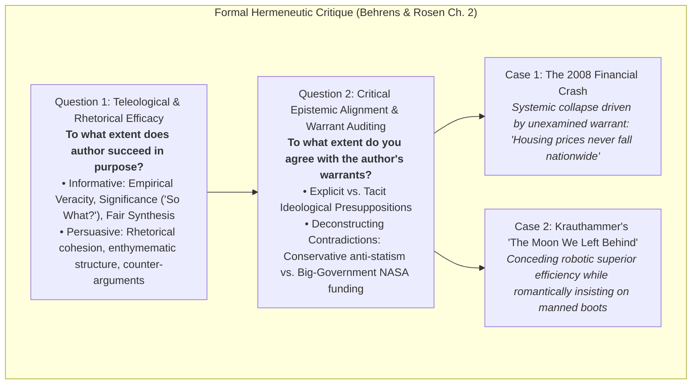

# Question Bank: Critical Reading as Looking for Ways of Thinking (Advanced Level)

**Subject:** Reading and Writing Skills | **Unit:** Week 2  
**Total Questions:** 30 Questions (15 Short Answer + 15 Long Answer)  
**Academic Target:** Epistemological Deconstruction, Rhetorical Criticism & Hermeneutic Synthesis  

### Master Epistemological Critique Schematic:

---

## PART A: SHORT ANSWER QUESTIONS (15 QUESTIONS)

### Question 1
**Mindmap Location:** 1. Taxonomy of Reading > Hirschberg Spectrum  
**Question:** From an epistemological perspective, why is "Reading for Information" categorized as authoritarian compared to "Critical Reading"?  
**Solution:**  
Reading for information operates within a positivist paradigm that treats the author as an unassailable authority and the printed text as objective truth to be passively memorized. Critical reading rejects this submission, adopting a hermeneutics of suspicion that interrogates claims, hidden warrants, and demographic biases as an intellectual equal.

---

### Question 2
**Mindmap Location:** 1. Taxonomy of Reading > Montaigne's Essais  
**Question:** How did Michel de Montaigne's coining of *essais* in 1580 de-dogmatize Western philosophical discourse?  
**Solution:**  
Montaigne replaced dogmatic medieval scholasticism with the *essai* ("attempt")—a secular, exploratory self-disclosure of a human mind investigating its own attitudes, uncertainties, and contradictions. By framing prose as an "attempt" rather than settled dogma, he established the essay as an open dialogue inviting reader evaluation.

---

### Question 3
**Mindmap Location:** 2. The Cognitive Triad > Analysis  
**Question:** In Toulminian terms, what is the critical reader's primary objective during the Analysis stage?  
**Solution:**  
To isolate the author's primary Claim, identify the supporting Grounds (empirical data), uncover the unstated Warrant connecting grounds to claim, and evaluate the conceptual Backing supporting that warrant.

---

### Question 4
**Mindmap Location:** 2. The Cognitive Triad > Synthesis  
**Question:** Why does Hirschberg define synthesis as an epistemological antidote to intellectual arrogance?  
**Solution:**  
Because synthesis forces the scholar to reconcile disparate, conflicting empirical perspectives, demonstrating that complex human dilemmas possess multiple legitimate viewpoints and shattering simplistic dogmatism.

---

### Question 5
**Mindmap Location:** 2. The Cognitive Triad > Evaluation  
**Question:** How does the metaphor of "placing your weight on the seesaw" resolve the tension between dogmatism and relativism?  
**Solution:**  
It rejects both uncritical dogmatism (blindly picking an extreme) and lazy relativism (claiming all opinions are equally valid). The critical scholar evaluates competing arguments and places their weight on a reasoned, evidence-based stance while remaining balanced and open to revised evidence.

---

### Question 6
**Mindmap Location:** 3. Guidelines > Demystification  
**Question:** Why is "kicking the writer off the throne of public esteem" considered the foundational rule of critical reading?  
**Solution:**  
Because venerating authors as infallible authorities paralyzes the reader's critical faculties. Demystifying the writer treats published texts as fallible human productions subject to demographic bias, faulty logic, and ideological blind spots.

---

### Question 7
**Mindmap Location:** 3. Guidelines > Argument Inversion  
**Question:** How does the canine insulin discovery case study demonstrate the necessity of dialectical argument inversion?  
**Solution:**  
Inverting an argument against animal experimentation reveals that canine research produced insulin, preserving millions of human lives. Dialectical inversion forces scholars to confront agonizing ethical trade-offs between competing goods (animal welfare vs. human survival) rather than accepting one-sided rhetoric.

---

### Question 8
**Mindmap Location:** 3. Guidelines > Interdisciplinary Rigor  
**Question:** How does historical evidence of Native American armed resistance refute psychological claims of innate passivity?  
**Solution:**  
By providing empirical falsification: documentation of armed resistance at Fallen Timbers (1794), Tippecanoe (1811), and the Black Hawk War (1832) disproves the psychological hypothesis that oppressed populations naturally develop passive, defeatist surrender.

---

### Question 9
**Mindmap Location:** 3. Guidelines > Evidentiary Recency  
**Question:** Explain the epistemic danger of utilizing pre-1976 immunology sources regarding antibody diversity.  
**Solution:**  
Prior to Dr. Susumu Tonegawa's 1976 breakthrough at MIT, immunology textbooks declared antibody diversity an impenetrable genetic mystery. Relying on pre-1976 literature today yields superseded, factually false claims due to scientific paradigm shifts.

---

### Question 10
**Mindmap Location:** 3. Guidelines > Ad Hominem Analysis  
**Question:** Differentiate between an *Ad Hominem* fallacy and a legitimate sociological audit of authorial positionality.  
**Solution:**  
An *Ad Hominem* fallacy attacks irrelevant personal or superficial attributes to dismiss a valid argument. A sociological positionality audit rigorously examines whether an author's institutional funding, demographic background, or political allegiances introduce structural bias into their empirical methodology.

---

### Question 11
**Mindmap Location:** 3. Guidelines > Begging the Question  
**Question:** Deconstruct the formal logical failure of *Petitio Principii* (Begging the Question).  
**Solution:**  
*Petitio Principii* is an epistemic circularity defect where the proposition to be proved is presupposed implicitly or explicitly within the premises, thereby failing to supply independent epistemic justification.

---

### Question 12
**Mindmap Location:** 3. Guidelines > Discourse Context  
**Question:** What rhetorical irony operates in Andy Rooney's essay on Fowler's *Modern English Usage*?  
**Solution:**  
Commissioned for the Screenwriters Guild symposium *A Writer's Fantasy: What I Wish I Had Written* (2000), Rooney adopts the persona of a grammatical authority only to satirize prescriptivist pedantry, playfully lampooning split infinitive bans and archaic usage rules like "It is I."

---

### Question 13
**Mindmap Location:** 4. Essay Architecture > Signposts  
**Question:** Explain how premise signals and conclusion signals interact in enthymematic argumentation.  
**Solution:**  
Premise signals (*inasmuch as, since*) introduce explicit evidentiary grounds, while conclusion signals (*consequently, therefore*) announce deductive claims. The critical reader detects when a conclusion signal is asserted without a valid unstated warrant, exposing an enthymematic non sequitur.

---

### Question 14
**Mindmap Location:** 7. Critical Reading for Critique > Teleological Questions  
**Question:** Formulate the two fundamental questions of an academic critique according to Behrens and Rosen.  
**Solution:**  
1. Question 1: To what extent does the author succeed in his or her purpose (informative, persuasive, or entertaining)?  
2. Question 2: To what extent do you agree with the author (analyzing their underlying assumptions, values, and warrants)?

---

### Question 15
**Mindmap Location:** 7. Critical Reading for Critique > Informative Criteria  
**Question:** Define the "So What?" criterion of Significance in Behrens and Rosen's critique framework.  
**Solution:**  
The "So What?" test evaluates whether an informative text's accurate factual propositions possess meaningful intellectual significance and explanatory power, rather than providing trivial, irrelevant data.

---

## PART B: LONG ANSWER QUESTIONS (15 QUESTIONS)

### Question 16
**Mindmap Location:** 1. Taxonomy of Reading > Epistemological Modality Spectrum  
**Question:** Provide an exhaustive philosophical critique of Hirschberg's reading spectrum (Casual, Pleasure, Information, Critical). How does the transition from Information Reading to Critical Reading represent an epistemological break?  
**Solution:**  
* **Casual Reading:** Automatic, low-involvement decoding driven by environmental semiotics (signs, notifications). It requires minimal cognitive investment.  
* **Reading for Pleasure:** Aesthetic immersion wherein narrative disbelief is voluntarily suspended. The reader seeks emotional transport and fabulation, deliberately relaxing critical faculties.  
* **Reading for Information:** Positivist data extraction. While demanding high attention and mnemonic retention, it operates within an authoritarian epistemological framework, treating the text as an unassailable repository of empirical truth.  
* **The Epistemological Break to Critical Reading:** Critical reading rejects passive assimilation. It adopts a hermeneutics of suspicion, treating reading as a dialectical duel between intellectual equals. The critical reader annotates margins, interrogates unstated warrants, traces sociological biases, detects logical fallacies, and deduces ideological consequences. It represents the transformation from an obedient consumer of knowledge to an autonomous co-investigator.

---

### Question 17
**Mindmap Location:** 2. The Cognitive Triad > Hermeneutic Synthesis  
**Question:** Elaborate on the dialectical interplay of Analysis, Synthesis, and Evaluation in resolving complex bioethical or public policy disputes (e.g., genetic editing).  
**Solution:**  
1. **Analysis:** Deconstructing scientific papers, bioethics journals, and religious declarations regarding CRISPR gene editing. The scholar separates empirical efficacy data from metaphysical arguments, mapping underlying warrants (utilitarian disease eradication vs. deontological sanctity of the human genome) and identifying commercial funding biases.  
2. **Synthesis:** Integrating these divergent perspectives into an authentic, multi-faceted perspective. Synthesis serves as the epistemic antidote to arrogance, proving that neither naive techno-utopianism nor reactionary prohibition captures the moral reality. The scholar formulates a nuanced thesis that bridges therapeutic gene therapy with strict regulations against germline enhancement.  
3. **Evaluation:** Auditing the sufficiency and temporal validity of clinical trial evidence, detecting slippery slope fallacies, and placing weight on the seesaw—taking a reasoned ethical stand that balances human suffering reduction against ecological and societal risks.

---

### Question 18
**Mindmap Location:** 3. Guidelines > Demystification & Critical Consciousness  
**Question:** Connect Metherell & Winkler's mandate to "demystify the writer" with Paulo Freire's concept of *critical consciousness*. How does demystifying authority dismantle ideological hegemony?  
**Solution:**  
* **The Freirean Parallel:** Paulo Freire argued that oppressive education treats students as passive repositories for the teacher's deposits ("banking model"). Similarly, treating published writers as infallible authorities enforces intellectual subjugation.  
* **Dismantling Ideological Hegemony:** Published texts are historical artifacts produced within institutional, economic, and political power structures. "Kicking the writer off the throne" shatters the illusion of neutral objectivity, empowering readers to unmask how texts legitimize dominant power relations, racial hierarchies, or economic inequality. Critical demystification transforms literacy from passive obedience into a tool for epistemic liberation.

---

### Question 19
**Mindmap Location:** 3. Guidelines > Ideological Coordinate Systems  
**Question:** Deconstruct how underlying philosophical warrants govern political discourse, comparing Jeffersonian natural rights with Marxist historical materialism.  
**Solution:**  
All political arguments rest upon unstated foundational warrants:  
* **Jeffersonian Natural Rights:** Anchored in the Enlightenment warrant that all human beings possess intrinsic, divinely endowed equality and natural rights (life, liberty, pursuit of happiness). Government legitimacy is derived strictly from the consent of the governed to protect individual autonomy.  
* **Marxist Historical Materialism:** Anchored in the warrant that socio-economic relations of production form the foundation of human society, and labor is the supreme moral and economic good. Class struggle, rather than individual rights, drives historical progression.  
* **Critical Reader Takeaway:** When evaluating political essays, critical readers do not merely debate surface claims; they identify which metaphysical coordinate system the author expects the audience to adopt as self-evident truth.

---

### Question 20
**Mindmap Location:** 3. Guidelines > Interdisciplinary Triangulation  
**Question:** Develop an advanced theoretical model illustrating how interdisciplinary triangulation prevents reductionism in academic research.  
**Solution:**  
Interdisciplinary triangulation exposes the blind spots of single-discipline paradigms:  
* **The Epistemic Problem:** Academic specialization frequently leads to disciplinary reductionism—e.g., an economist explaining all human behavior through rational self-interest and utility maximization.  
* **Triangulation in Action:** A critical scholar cross-examines economic models using evolutionary biology (showing innate altruism and kin selection), cultural anthropology (showing gift economies that defy profit maximization), and cognitive psychology (showing cognitive biases like loss aversion).  
* **Textbook Foundation:** Just as historical evidence of armed Native American resistance demolished psychological assertions of innate passivity, interdisciplinary triangulation ensures that empirical claims survive cross-examination across all domains of human knowledge.

---

### Question 21
**Mindmap Location:** 3. Guidelines > Temporal Epistemology (Tonegawa Case Study)  
**Question:** Analyze Dr. Susumu Tonegawa's 1976 discovery through the lens of Thomas Kuhn's *The Structure of Scientific Revolutions*.  
**Solution:**  
* **Kuhnian Paradigm Shift:** Prior to 1976, immunology operated under the paradigm of the "one gene, one protein" doctrine. Because human DNA contained only ~25,000 genes while the immune system produced millions of unique antibodies, science was mired in an insurmountable anomaly, labeling antibody generation an impenetrable mystery.  
* **The Tonegawa Breakthrough:** Tonegawa's discovery of genetic rearrangement (somatic recombination) shattered the old paradigm, establishing that gene fragments physically shuffle and splice to create antibody diversity.  
* **Critical Reader Lesson:** Scientific knowledge is not a static monolith; it is an evolving series of paradigm shifts. A critical reader must audit the publication date of scientific citations; relying on a 1975 text is not merely using old data—it is operating within an overturned scientific universe.

---

### Question 22
**Mindmap Location:** 3. Guidelines > Satirical Parody (Rooney Case Study)  
**Question:** Conduct a rhetorical deconstruction of Andy Rooney's essay on Fowler's *Modern English Usage*. How does Rooney employ rhetorical ethos to subvert prescriptivism?  
**Solution:**  
* **Ethos Appropriation:** Rooney begins by praising Henry Watson Fowler's monumental 1926 dictionary, professing admiration for Fowler's absolute authority over the English language.  
* **Ironic Subversion:** Once this conservative ethos is established, Rooney inverts it. He deliberately executes stylistic heresies—splitting infinitives with gusto, lampooning arcane rhetorical tropes like zeugma and syllepsis, and ridiculing the pedantic rule that the copula verb cannot take an objective pronoun ("It is I" vs. "It's me").  
* **Rhetorical Mastery:** Rooney's essay demonstrates that genuine linguistic mastery involves recognizing that language is a dynamic, living instrument of human expression rather than a set of petrified Victorian taboos.

---

### Question 23
**Mindmap Location:** 4. Essay Architecture > Mark Twain's Satirical Deconstruction  
**Question:** In *The Lowest Animal*, how does Mark Twain invert Darwinian evolutionary teleology to mount a radical ethical critique of Victorian civilization?  
**Solution:**  
* **Subverting the Teleological Ascent:** Victorian Darwinism viewed humans as the glorious apex of evolutionary progress. Twain reverses this ladder, declaring that humanity has descended from the "higher animals" to become the "lowest animal."  
* **The Experimental Persona:** Twain adopts the voice of an empirical scientist conducting laboratory experiments, juxtaposing animal behavior (anacondas killing only for sustenance) with human behavior (earls slaughtering seventy-two buffalo and abandoning the meat).  
* **The Core Ethical Thesis:** Twain identifies vindictive malice, grudge-holding, and premeditated revenge as uniquely human afflictions. Animals kill without sadism; humans inflict torture, wage religious wars, and enslave others under the banner of the "Moral Sense." By proving that the Moral Sense enables cruelty, Twain exposes civilization's hypocrisies.

---

### Question 24
**Mindmap Location:** 4. Essay Architecture > Enthymematic Deconstruction  
**Question:** Explain how an author's unstated warrant functions within an Aristotelian enthymeme. Provide an original academic example and show how to audit it.  
**Solution:**  
* **The Enthymeme Defined:** An enthymeme is a rhetorical syllogism in which one of the premises—typically the major premise or warrant—remains unstated, assumed to be accepted by the audience.  
* **Original Example:** "Artificial intelligence systems have achieved human-level scores on medical licensing exams; therefore, AI diagnostic algorithms should replace primary care physicians."  
  * *Premise Signal (Grounds):* AI scores match human doctors on exams.  
  * *Conclusion Signal (Claim):* AI should replace human primary care doctors.  
  * *Unstated Enthymematic Warrant:* Passing standardized medical exams is identical to the holistic practice of clinical medicine, including empathetic bed-side dialogue, physical examination, and contextual ethical judgment.  
* **Critical Audit:** The critical reader uncovers this unstated warrant and challenges its backing, demonstrating that clinical doctoring requires human empathy and somatic observation that standardized exams do not measure.

---

### Question 25
**Mindmap Location:** 5. Intertextuality > Bakhtinian Dialogism  
**Question:** Connect Dharwadker's theory of intertextuality with Mikhail Bakhtin's concepts of *dialogism* and *heteroglossia*.  
**Solution:**  
* **Bakhtin's Heteroglossia:** Bakhtin argued that language is never neutral; every word is inhabited by prior social intentions, historical voices, and cultural struggles.  
* **Intertextuality as Staged Heteroglossia:** In Dharwadker's framework, when an author employs Form 1 ("Book in a Book") or Form 2 ("Other Text in a Book"), they are staging a polyphonic dialogue between competing social voices. The host text does not assimilate the borrowed text passively; the two narrative worldviews converse, collide, and contest each other's ideological authority.  
* **Canon Decentering:** Intertextuality disrupts monologic authoritarianism by proving that all texts are collaborative, evolving tapestries woven from the collective dialogic memory of humanity.

---

### Question 26
**Mindmap Location:** 5. Intertextuality > Canon Subversion & Destabilization  
**Question:** Analyze how the "Destabilization" function of intertextuality operates as a counter-hegemonic tool in post-colonial literature.  
**Solution:**  
* **Subverting Canonical Authority:** Canonical Western literature frequently reinforced colonial, racial, and patriarchal hierarchies while masquerading as universal humanism.  
* **The Counter-Hegemonic Mechanism:** Post-colonial authors utilize intertextuality to rewrite canonical texts from the perspective of the silenced subaltern. For instance, Jean Rhys's *Wide Sargasso Sea* rewrites Charlotte Brontë's *Jane Eyre* from the perspective of the Caribbean Creole "madwoman in the attic," Antoinette Cosway.  
* **Hermeneutic Consequence:** Rhys's intertext destabilizes the moral innocence of Rochester and Victorian England, exposing the imperialist exploitation underpinning English wealth. The reader can never read *Jane Eyre* again without confronting its colonial blind spots.

---

### Question 27
**Mindmap Location:** 5. Intertextuality > Reflexive Retrospective Hermeneutics  
**Question:** Detail the mechanics of Dharwadker's "Reflexive Retro-Reading." How does reading an intertextual adaptation alter the reader's cognitive schema of a pre-existing work?  
**Solution:**  
Reflexive retro-reading operates as a bi-directional hermeneutic feedback loop:  
* **Forward Movement:** The prior text provides the narrative blueprint or archetypal resonance that enriches the new host text.  
* **Reflexive Backward Movement:** Once the reader experiences the host text's critique, modern framing, or ideological inversion, that new interpretive framework is permanently encoded into the reader's cognitive schema.  
* **Permanent Hermeneutic Alteration:** When the reader subsequently revisits or remembers the original source text, they perceive nuances, contradictions, and ideological presuppositions that were previously invisible. The original text has been retrospectively transformed in the reader's consciousness without a single printed word being altered.

---

### Question 28
**Mindmap Location:** 6. Hypertext vs. Intertextuality Matrix  
**Question:** Provide an epistemological synthesis comparing digital Hypertext (Nelson, Berners-Lee) with literary Intertextuality (Kristeva, Dharwadker).  
**Solution:**  
* **Ontological Medium:** Hypertext is an external, technological protocol constructed of binary code, HTML protocols, and clickable URLs on computer monitors. Intertextuality is an internal, cognitive and cultural phenomenon operating across human memory, symbolic archetypes, and narrative traditions.  
* **Navigation & Agency:** Hypertext empowers the user to physically direct their navigational path across discrete digital nodes. Intertextuality invites the reader's consciousness to trace thematic and philosophical connections across centuries of literary and cultural discourse.  
* **Epistemological Synthesis:** Hypertext is the digital externalization of intertextuality. Centuries before the invention of the internet, human storytelling was already an open, interconnected, non-linear web of cultural hyperlinks. Intertextuality proves that human consciousness has always functioned as a decentralized hypertextual network.

---

### Question 29
**Mindmap Location:** 7. Critical Reading for Critique > Subprime Mortgage Epistemic Collapse  
**Question:** Conduct an advanced epistemological audit of the 2008 Subprime Mortgage Financial Collapse as examined by Behrens and Rosen. How did the uncritical acceptance of a hidden warrant lead to systemic institutional blindness?  
**Solution:**  
* **The Latent Warrant:** The global financial apparatus—comprising Federal Reserve regulators, Wall Street investment houses, rating agencies (Moody's, S&P), mortgage brokers, and institutional investors—predicated a multi-trillion dollar market of mortgage-backed securities on a single unexamined warrant: *that residential real estate prices in the United States would perpetually rise, or at minimum remain flat, but would never experience a nationwide structural collapse.*  
* **Systemic Epistemic Blindness:** Because this warrant was treated as an axiomatic law of nature, every institutional safeguard was dismantled:  
  1. *Lenders* issued no-documentation, subprime mortgages knowing they could securitize the debt immediately.  
  2. *Rating agencies* assigned AAA ratings to toxic tranches based on econometric models that lacked historical data for nationwide housing deflation.  
  3. *Insurers* (e.g., AIG) wrote unhedged credit default swaps without maintaining capital reserves.  
* **The Epistemic Collapse:** When housing prices declined nationwide in 2007-2008, the unexamined warrant was falsified. Because every financial derivative rested upon this single foundation, the entire global credit system froze in liquidity shock, precipitating the Great Recession.  
* **The Pedagogical Moral:** Behrens and Rosen demonstrate that critical reading and warrant auditing are not academic exercises—they are essential cognitive safeguards against catastrophic institutional and economic failure.

---

### Question 30
**Mindmap Location:** 7. Critical Reading for Critique > Krauthammer Rhetorical & Ideological Deconstruction  
**Question:** Conduct an exhaustive rhetorical criticism and ideological deconstruction of Charles Krauthammer's op-ed "The Moon We Left Behind" (Time, 2009). Dissect his thesis, loaded diction, concession of counter-evidence, hidden romantic warrants, and the central ideological tension between his conservatism and his advocacy for massive state spending.  
**Solution:**  
* **Rhetorical Context & Thesis:** Marking the 40th anniversary of Apollo 11, Pulitzer-winning columnist Charles Krauthammer published "The Moon We Left Behind" in *Time* magazine. His central thesis is that the United States' cessation of manned lunar exploration represents an ignominious civilizational retreat and a catastrophic failure of national nerve.  
* **Loaded Diction & Affective Manipulation:** Krauthammer deploys emotive, militaristic terminology (*"ignominious retreat," "abandonment," "loss of national nerve," "timid decay"*) designed to induce patriotic shame and nostalgic yearning for 1960s Cold War supremacy.  
* **Concession of Counterarguments:** To his credit as a master rhetorician, Krauthammer addresses the central counter-argument directly. He openly concedes that unmanned robotic probes (e.g., Mars rovers, orbital telescopes) are vastly cheaper, completely eliminate risk to human life, and yield vastly superior scientific returns per dollar invested compared to manned spaceflight.  
* **Unmasking the Tacit Romantic Warrant:** Having admitted that science, cost, and safety all favor robotic exploration, Krauthammer nonetheless demands that human astronauts return to the Moon and proceed to Mars. This concession reveals his fundamental unstated warrant: *The primary purpose of space exploration is not scientific knowledge or cost-effective utility, but romantic heroism, existential national myth-making, and imperial frontier glory.* Only living human footprints on alien soil satisfy his romantic conception of human destiny.  
* **Deconstructing the Ideological Contradiction:** Critical readers must deconstruct the stark ideological tension at the heart of the essay. Krauthammer was one of the United States' most prominent neo-conservative columnists, famed for championing small-government anti-statism, fiscal austerity, and relentless critiques of federal bureaucracy. Yet in this essay, his romantic nationalism compels him to advocate for a colossal, multi-billion dollar, taxpayer-funded government bureaucracy (NASA). His romantic vision of national greatness completely eclipses his conservative fiscal principles. Identifying such ideological fissures is the ultimate triumph of critical reading.
