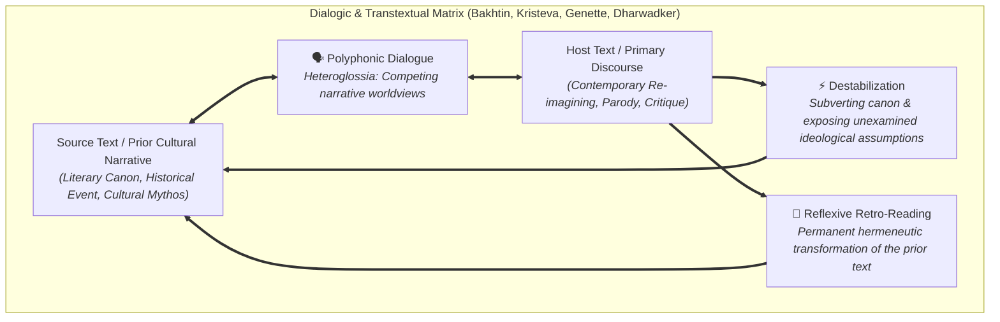

# Pop Quiz: Critical Reading as Looking for Ways of Thinking (Advanced Level)

**Subject:** Reading and Writing Skills | **Unit:** Week 2  
**Level:** Advanced | **Target Bloom's:** Evaluating (L-5) & Analyzing (L-4)  

---

### Pop Quiz Question

**Mindmap Location:** 5. Intertextuality > Bakhtinian Dialogism & Canon Destabilization  
**Difficulty:** Advanced  

**Question:**  
In Jean Rhys's *Wide Sargasso Sea*, the narrative reconstructs the Caribbean backstory of Bertha Mason from Charlotte Brontë's *Jane Eyre*. Concurrently, in Tom Stoppard's play *Rosencrantz and Guildenstern Are Dead*, the dramatic action reframes Shakespeare's *Hamlet* from the perspective of two disposable, minor characters who are bewildered by tragic royal politics.  

Applying Dharwadker et al.'s framework and modern dialogic theory (Bakhtin, Genette), which profound **function** and **hermeneutic consequence** are simultaneously executed across both works?

- **A)** Function: Superficial namedropping; Consequence: Elimination of the central thesis through Ad Hominem fallacy.
- **B)** Function: Destabilization of Canonical Authority; Consequence: Reflexive Retro-Reading and Simultaneous Reciprocal Reinterpretation of Both Texts.
- **C)** Function: Technological Hypertext Linking; Consequence: Automated digital indexing across web servers.
- **D)** Function: Literal Memorization; Consequence: Submissive absorption of 19th-century prescriptivist grammar rules.

---

### Detailed Answer & Analysis

<b>Click to View Solution & Answer Breakdown</b>

 

**Correct Answer:** **Option B**

#### 💡 Why Option B is CORRECT:
* **Function: Destabilization of Canonical Authority:** Dharwadker et al. emphasize that intertextuality possesses a subversive function—*destabilization*. Both Rhys and Stoppard take monumental canonized texts (*Jane Eyre* and *Hamlet*) and decenter their traditional ideological authority. Rhys exposes the colonial and patriarchal violence underpinning Victorian romance; Stoppard exposes the tragic absurdity and callous disregard of grand royal narratives toward ordinary human lives.
* **Hermeneutic Consequence: Reflexive Retro-Reading and Simultaneous Reinterpretation:** Reading *Wide Sargasso Sea* or *Rosencrantz and Guildenstern Are Dead* alters our understanding of the prior classics reflexively. When scholars return to *Hamlet* or *Jane Eyre*, they can never again read them with uncritical Victorian or Elizabethan innocence. A continuous, reciprocal back-and-forth dialectic is established where both texts interrogate each other across centuries.

---

#### ❌ Why the Other Options are INCORRECT:
* **Option A is False:** Both works are profound artistic adaptations, not superficial namedropping or ad hominem attacks.
* **Option C is False:** Hypertext is an electronic web protocol, whereas Rhys and Stoppard operate within cultural literary hermeneutics.
* **Option D is False:** Critical intertextual reimagining is the antithesis of submissive memorization or grammatical prescriptivism.

