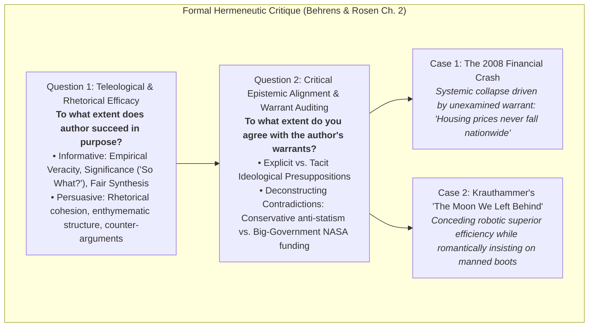

# Master Pop Quiz Study Guide: Critical Reading as Looking for Ways of Thinking (Advanced Level)

**Subject:** Reading and Writing Skills | **Unit:** Week 2  
**Level:** Advanced (Scholarly Critique & Rhetorical Deconstruction)  

### Master Epistemological Critique Matrix:

---

## Pop Quiz Assessment Framework

### Advanced Rhetorical & Hermeneutic Competencies:
1. **Epistemological Spectrum of Reading:** Analyzing why information reading remains positivist and submissive while critical reading achieves epistemic autonomy via a hermeneutics of suspicion.  
2. **Cognitive Triad Dynamics:** Operationalizing Analysis (Toulmin deconstruction), Synthesis (mitigating dogmatic arrogance), and Evaluation (seesaw balance).  
3. **Metherell & Winkler Operational Principles:** Demystification of authorial ethos, argument inversion in bioethics, interdisciplinary falsification (history vs. psychology), and temporal evidence audits (Tonegawa 1976).  
4. **Formal & Informal Fallacy Diagnosis:** Ad Hominem vs. sociological positionality audits, Petitio Principii (circularity), False Dilemmas, and Non Sequiturs.  
5. **Enthymematic Architecture:** Central thesis formulation, premise connectives (*inasmuch as*), conclusion entailments (*consequently*), and supplying latent unstated warrants.  
6. **Academic Critique Formulation (Behrens & Rosen Ch. 2):**
   * *Question 1:* Teleological efficacy (Accuracy, Significance / "So What?" threshold, Fair Interpretation).
   * *Question 2:* Critical alignment and auditing latent warrants.
   * *Case Studies:* 2008 Subprime Mortgage collapse as an unexamined warrant catastrophe; Charles Krauthammer's "The Moon We Left Behind" rhetorical deconstruction and ideological tensions.  
7. **Advanced Transtextuality (Dharwadker, Bakhtin, Genette):** Form 1 (Book in a Book) vs. Form 2 (Other Text in a Book), Tripartite Functions (Comparison, Dialogic Heteroglossia, Canonical Destabilization), and Reflexive Retrospective Hermeneutics.  

---

### Exemplary Collegiate Analysis Item:

**Prompt:** In Chapter 2 of *Writing and Reading Across the Curriculum*, what makes Charles Krauthammer's defense of manned space exploration an exemplary case study in uncovering tacit warrants?  
- **A)** He fails to cite the correct landing date of Apollo 11.  
- **B)** He concedes that robotic probes are safer, cheaper, and yield superior scientific data, yet insists on human exploration based on an unexamined romantic/nationalistic warrant—revealing an ideological contradiction between his small-government conservatism and advocacy for massive federal NASA spending.  
- **C)** He plagiarized his op-ed from Mark Twain's *The Lowest Animal*.  
- **D)** He argues that NASA should be privatized and sold to foreign corporations.  

<b>Click to View Solution</b>

<b>Correct Answer: Option B</b> 
<b>Rationale:</b> Behrens and Rosen showcase Krauthammer's op-ed as a prime model of warrant auditing: Krauthammer explicitly concedes that robotic probes are scientifically superior and cost-effective, yet his romantic assumptions about human heroism override his empirical concessions, and his call for massive state NASA spending contradicts his fiscal conservatism.

