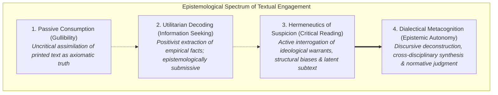
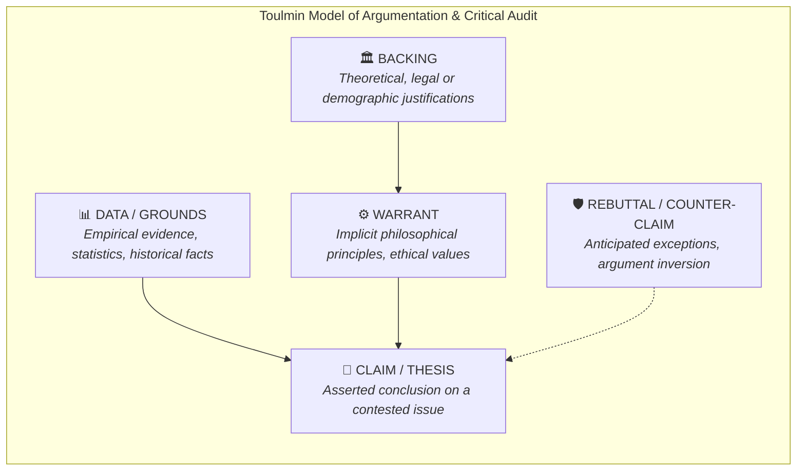
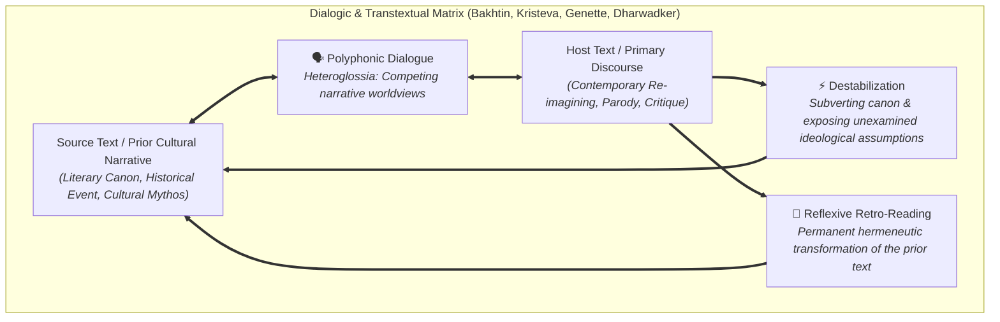

# Executive Theoretical Summary: Critical Reading as Looking for Ways of Thinking (Advanced Level)

**Subject:** Reading and Writing Skills | **Curriculum:** Week 2 Module  
**Audience Level:** Advanced (Collegiate Rigor, Rhetorical Criticism & Epistemological Deconstruction)  
**Target Bloom's Levels:** Analyzing (L-4), Evaluating (L-5) & Creating (L-6)  
**Curriculum Materials:** critical reading.md, Reading Critically.md, reading_essays.md, intertextuality.md  
**Institution:** De La Salle University - Senior High School Department  

---

## 🖼️ 1. Epistemological Modality Spectrum & Reading Hermeneutics

In *The Millennium Reader*, Stuart and Terry Hirschberg present an epistemological critique of reading practices:

### Theoretical Distinctions
* **Casual Reading:** Environmental stimulus decoding driven by involuntary survival utility. Minimal cognitive depth.
* **Pleasure Reading:** Aesthetic surrender to textual fabulation. Suspension of disbelief without interrogating truth claims or ideological subtext.
* **Reading for Information:** Positivist data extraction. While demanding high attention, it operates within an authoritarian paradigm, viewing the text as an unassailable repository of empirical truth.
* **Critical Reading:** A hermeneutics of suspicion and dialogic inquiry. The reader deconstructs arguments, interrogates unstated warrants, traces sociological biases, and calculates ideological ramifications. Critical reading rejects gullibility and embraces epistemic autonomy.

---

## 🖼️ 2. Montaigne and the Rhetorical Anatomy of the Essay

In *Writing and Reading Across the Curriculum*, Behrens and Rosen trace the essay genre to Michel de Montaigne's *essais* (1580):
* **The Epistemological Shift:** Montaigne replaced medieval dogmatic certainty with personal, skeptical inquiry (*Que sais-je?* / "What do I know?").
* **Direct Discourse:** The essayist addresses the reader unmediated by fictional characters or allegorical shields, inviting the reader into the laboratory of a thinking mind.
* **The Essay as 'Attempt':** An essay is fundamentally an *essai*—a trial, an exploration of conflicting impulses. The critical reader engages the essayist as an intellectual equal, testing claims against empirical rigor and logic.

---

## 🖼️ 3. Argumentative Scaffolding & Toulmin Model Integration

* **Thesis Statement:** A single declarative assertion presenting the author's focused position on a contested issue (e.g., Mark Twain's hypothesis in *The Lowest Animal* asserting that vindictive malice is unique to humans).
* **Premise Signals:** Epistemic grounds announcing inductive or deductive reasoning (*inasmuch as, since, because, follows from, in view of the fact that*).
* **Conclusion Signals:** Logical entailments announcing inferential outcomes (*therefore, hence, thus, consequently, it follows that, points to the conclusion that*).
* **Auditing Latent Warrants:** Critical readers expose the unstated ideological warrants bridging data to claims (e.g., Jeffersonian egalitarianism vs. Marxist labor value).

---

## 🖼️ 4. Advanced Intertextuality: Dialogism, Transtextuality, and Canon Revision

Grounded in Dharwadker, Harrison, Lemaster, Bourenane, and modern literary theory (Bakhtin, Kristeva, Genette):

* **Forms of Narrative Borrowing:** Form 1 (*Book in a Book* / Literary in Literary) and Form 2 (*Other Text in a Book* / Media or Social Narrative in Literature).
* **Tripartite Functional Engine:** Comparison (structural juxtaposition), Dialogue (Bakhtinian heteroglossia and competing narrative discourses), and Destabilization (decentering canon and exposing historical blind spots).
* **Transformative Hermeneutic Consequences:** Host text enrichment, reflexive retrospective transformation of the prior text, and simultaneous reciprocal reinterpretation.
* **Hypertext vs. Intertextuality:** Hypertext constitutes technological non-linearity (HTML, web nodes, physical user agency); Intertextuality constitutes cultural, hermeneutic non-linearity (polyphonic memory, cultural associations across millennia).
