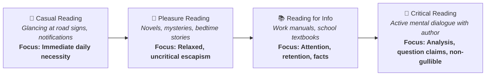
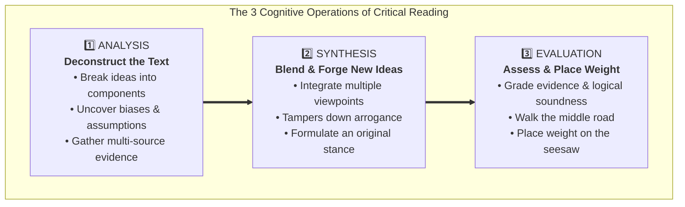
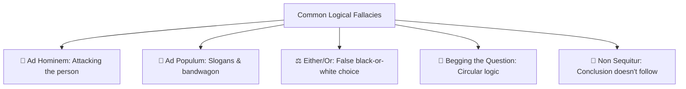
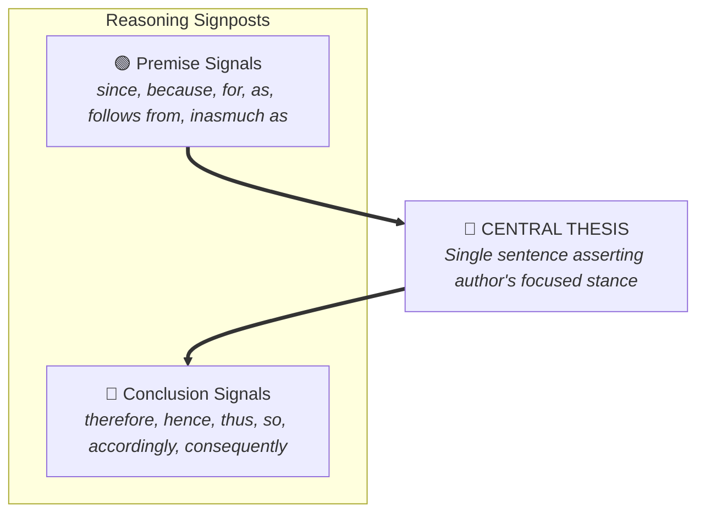
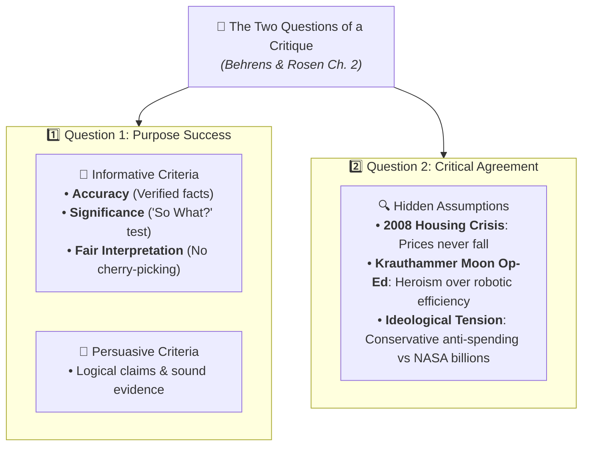
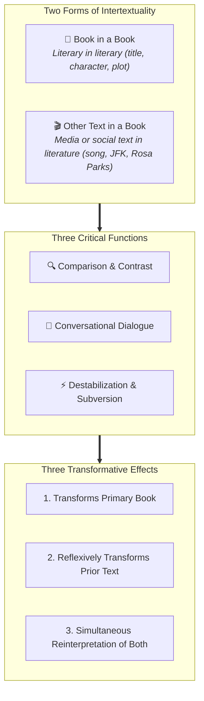

# Detailed Study Guide: Critical Reading as Looking for Ways of Thinking (Beginner Level)

**Subject:** Reading and Writing Skills | **Curriculum:** Week 2  
**Target Audience:** Beginner Learners (Foundational Concepts, Guided Examples & Scaffolded Explanations)  
**Academic References:**  
1. Metherell & Winkler (2007). *Readings for Writers* (2nd ed., pp. 1-10).  
2. Hirschberg & Hirschberg (2009). *The Millennium Reader* (5th ed., pp. 1-3).  
3. Behrens & Rosen (2000). *Writing and Reading Across the Curriculum* (7th ed., pp. 45-77).  
4. Dharwadker et al. *What is Intertextuality?* (p. 70).  
5. DLSU Senior High School Department (2024-2025). *Critical Reading as Looking for Ways of Thinking* (`critical reading.md`).  

---

## Section 1: What is Critical Reading?

Imagine you are having a conversation with a friend. If your friend tells you that a dog can fly, you wouldn't just nod and believe it—you would ask, "Where did you see that? Show me the video!"  
**Critical reading is simply doing that with a book or an article.**

Many students are used to reading passively—they look at the words, memorize a few facts for a test, and forget them. But Hirschberg and Hirschberg emphasize:
> *"Critical reading is not gullibility—accepting as truth anything you read. Critical reading is active reading. You engage in a kind of mental dialogue with the writer."*

### The Historical Origin: Michel de Montaigne's Essais
Four hundred years ago, in 1580, French writer **Michel de Montaigne** invented the genre of the essay. He called his writings *essais*, which means **"attempts."**  
Montaigne did not claim to know absolute divine truth; instead, he disclosed his own thoughts, exploring his values, attitudes, and doubts. When we read an essay today, we are witnessing an author's attempt to figure out an issue. That means we don't have to worship the author's opinion—we can test it!

---

## Section 2: The Three Cognitive Operations: Analysis, Synthesis, and Evaluation

Let's understand how a student applies these three steps in real life:

### 1. Analysis (Taking it Apart)
* You examine how the author builds their argument. What is their main point? What reasons do they provide? Are their facts true or based on personal prejudice?
* *Example:* If you read about **online dating**, analysis means finding out what psychologists, counselors, and users report about both good experiences (finding spouses) and bad experiences (scams and danger).

### 2. Synthesis (Putting it Together)
* You combine what you've learned from different sources to create an original opinion that belongs to you.
* *Key Benefit:* Synthesis **tampers down our arrogance**. When you realize that smart people disagree on complex topics, you stop assuming that your first reaction is the only correct one.

### 3. Evaluation (Grading and Taking a Stand)
* You judge whether the author's evidence is strong or weak. Finally, you must "place your weight on the seesaw"—take an educated side, while being fair to the middle ground.

---

## Section 3: The 14 Guidelines for Critical Reading (Metherell & Winkler)

Metherell and Winkler provide 14 practical rules to help you read like an active detective:

1. **Read actively:** Always keep a pencil in hand. Underline main ideas and write notes in the margins.
2. **Demystify the writer:** "Kick the writer off the throne of public esteem!" Writers are regular human beings. They make mistakes of fact and logic just like anyone else.
3. **Understand what you read:** If a sentence is confusing, re-read it. Look up difficult words in a dictionary. Try summarizing difficult ideas out loud in your own words.
4. **Imagine an opposing point of view:** If an author is against medical testing on animals, force yourself to consider the other side: insulin was discovered through tests on dogs, saving millions of human lives.
5. **Look for biases and hidden assumptions:** Check who the author is. Are they a doctor, a politician, an oil company executive? Their background influences their views.
6. **Separate emotion from fact:** Don't be fooled by emotional words or simple slogans. Real problems are rarely black and white.
7. **If the issue is new to you, look up the facts:** If you read about foster care insurance rates, research the Department of Social Services before deciding who is right.
8. **Use insights from one subject to help another:** You can use your knowledge of history to check claims in psychology! For example, if a psychologist claims oppressed people are naturally passive, you can point to historical rebellions to prove that claim false.
9. **Evaluate the evidence:** Check if the evidence is reliable and **check its date!** Before 1976, no one knew how our bodies made antibodies. In 1976, Dr. Susumu Tonegawa discovered how antibody genes rearrange. A science article from 1975 would say it's an unsolved mystery—outdated evidence!
10. **Ponder the values behind a claim:** What does the author care about most? Freedom, equality, profit, revenge, or human dignity?
11. **Recognize logical fallacies:** Learn to spot flawed logic:

12. **Don't be seduced by bogus claims:** Beware of sentences like "Recent studies prove beyond doubt..." that don't name the study or author!
13. **Annotate your reading:** Scribble in your book! Reselling a clean textbook for a little money is "penny-wise and pound-foolish." Annotating gives you a lasting education.
14. **Understand the opening context:** Find out why the author wrote the piece. For example, commentator Andy Rooney wrote a funny essay wishing he had written Fowler's *Modern English Usage* for a Screenwriters Guild feature called *A Writer's Fantasy*. Knowing that context helps you understand that Rooney was making fun of strict grammar rules!

---

## Section 4: Anatomy of an Essay — Finding the Thesis and Signposts

### What is a Thesis?
The thesis is the single declarative sentence that asserts the author's response to an issue that others might debate.  
* *Example:* In Mark Twain's essay *The Lowest Animal*, his thesis is:
  > *"In the course of my experiments I convinced myself that among the animals man is the only one that harbors insults and injuries, broods over them, waits till a chance offers, then takes revenge."*

### Spotting Traffic Signposts in Reading
* **Premise Signals:** Tell you a reason is coming (*because, since, for, as, follows from*).
* **Conclusion Signals:** Tell you a final result is coming (*therefore, thus, hence, so, it follows that*).

---

## Section 5: Writing a Critique & Auditing Assumptions (Behrens & Rosen Ch. 2)

When you critique a text, you are not simply expressing personal like or dislike. Laurence Behrens and Leonard Rosen establish that a formal critique answers two specific questions:

### Question 1: To What Extent Does the Author Succeed in His or Her Purpose?
* **Informative Writing:**
  * **Accuracy:** Are the factual claims verifiable and true?
  * **Significance:** The **"So What?"** question. Even if a set of facts is 100% accurate, is it meaningful and important to the reader?
  * **Fair Interpretation:** Does the author interpret the facts objectively, or do they omit facts that contradict their stance?
* **Persuasive Writing:** Does the author state a clear thesis, offer credible evidence, and address obvious counterarguments?

### Question 2: To What Extent Do You Agree with the Author?
This question requires you to uncover and evaluate the author's **assumptions**—the fundamental ideas taken for granted.
* **The 2008 Financial Crisis Example:** In the mid-2000s, mortgage companies and banks made billions of dollars in risky home loans based on an unexamined hidden assumption: that real estate prices would always rise and never drop across the whole country. When home prices crashed, the entire economy almost collapsed.
* **Charles Krauthammer's Moon Op-Ed Case Study:** In 2009, columnist Charles Krauthammer argued that the U.S. must send astronauts back to the Moon. He openly admitted that robotic probes are cheaper, safer, and produce far better scientific data. So why send humans? Because Krauthammer assumed that the supreme goal of space exploration is not science, but human glory and adventure! Critical readers also spot that Krauthammer, an outspoken conservative critic of government spending, was demanding a massive, multi-billion dollar government program (NASA).

---

## Section 6: What is Intertextuality and Hypertext?

### Definition of Intertextuality
Intertextuality is the borrowing or referencing of a literary, media, or social "text" inside another text.

### The Two Forms:
1. **Book in a Book:** A story referencing another story (e.g., a modern novel mentioning Harry Potter or Romeo and Juliet).
2. **Other Text in a Book:** A novel referencing a real-world social or media story that has narrative quality (e.g., referencing Rosa Parks's bus protest).

### The Three Functions:
1. **Comparison:** Comparing the new story with the old story.
2. **Dialogue:** Letting the two stories talk to each other.
3. **Destabilization:** Shaking up what you thought you knew about the original story.

### The Three Transformative Effects:
1. Transforms the new book.
2. Changes how you remember the older story (reflexive re-reading).
3. Makes you reinterpret both stories simultaneously.

### The Hypertext Connection:
Hypertext is digital—clickable links that connect web pages on a screen. Intertextuality is mental—cultural links in our minds that connect human stories across centuries!
