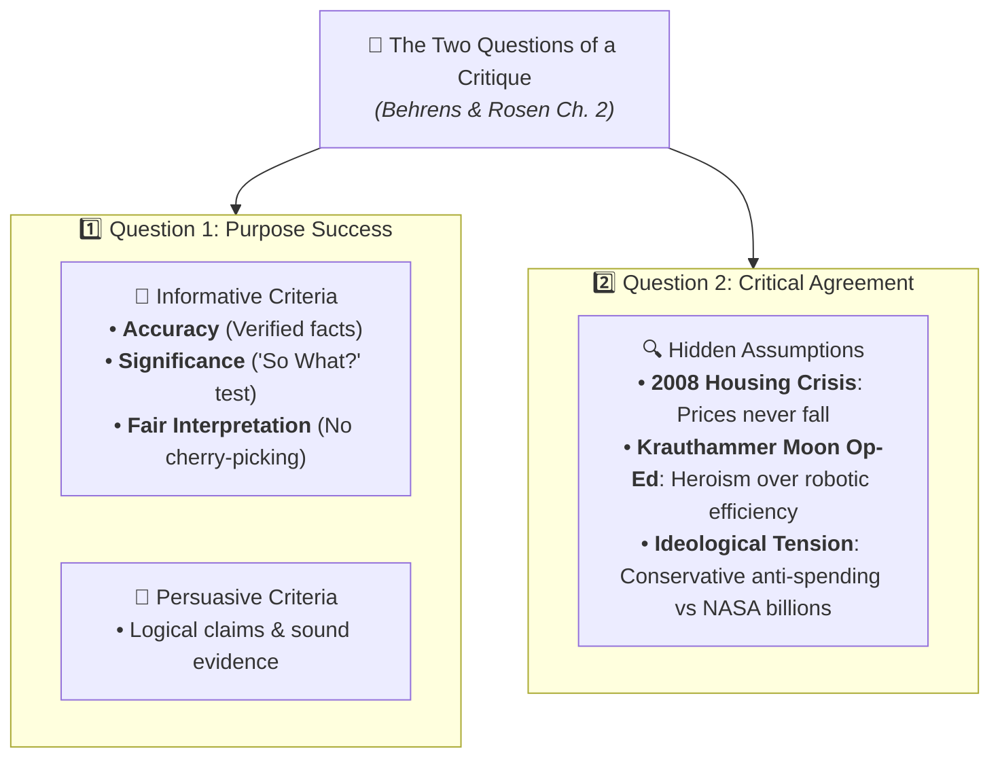

# Flashcards: Critical Reading as Looking for Ways of Thinking (Beginner Level)

**Subject:** Reading and Writing Skills | **Total Cards:** 20 Cards  
**Audience Level:** Beginner  

### Embedded Infographic Guide:

---
### Card 01
**Front:** What are the four kinds of reading identified by Hirschberg?  
**Back:**  
1. Casual Reading
2. Reading for Pleasure
3. Reading for Information
4. Critical Reading  

---
### Card 02
**Front:** What defines 'Casual Reading'?  
**Back:**  
Glancing at road signs, headlines, and notifications out of daily necessity with minimal mental effort.  

---
### Card 03
**Front:** What is the primary purpose of 'Reading for Pleasure'?  
**Back:**  
Relaxed and uncritical reading (e.g. mystery novels) to be transported to an imaginary world.  

---
### Card 04
**Front:** What is 'Critical Reading'?  
**Back:**  
Active reading where you engage in a mental dialogue with the author, question claims, and avoid gullibility.  

---
### Card 05
**Front:** What does the French word 'essais' mean, and who coined it?  
**Back:**  
'Essais' means 'attempts' or 'trials', coined in 1580 by Michel de Montaigne to describe personal explorations of the mind.  

---
### Card 06
**Front:** What are the 3 steps of the Cognitive Triad in critical reading?  
**Back:**  
1. Analysis (Deconstruction)
2. Synthesis (Blending ideas)
3. Evaluation (Judging and taking a stand)  

---
### Card 07
**Front:** How does Synthesis 'tamper down our arrogance'?  
**Back:**  
It demonstrates that on complex, knotty subjects, more than a single valid opinion exists.  

---
### Card 08
**Front:** What does 'Demystify the Writer' mean in Metherell & Winkler's guidelines?  
**Back:**  
Kicking the author off the throne of public esteem—viewing writers as fallible humans prone to bias and errors.  

---
### Card 09
**Front:** Why should you 'imagine an opposing point of view' for every opinion?  
**Back:**  
To test the strength of arguments and avoid one-sided bias (e.g. medical research on dogs led to insulin).  

---
### Card 10
**Front:** Why is the date of scientific evidence important? (Give Tonegawa example)  
**Back:**  
Evidence changes over time. Before Susumu Tonegawa's 1976 discovery, antibody creation was an unsolved mystery.  

---
### Card 11
**Front:** What is an 'Ad Hominem' logical fallacy?  
**Back:**  
Attacking the personal character or appearance of the arguer instead of addressing their argument.  

---
### Card 12
**Front:** What is an 'Either/Or' fallacy (False Dilemma)?  
**Back:**  
Presenting a complex controversy as if only two extreme choices exist, ignoring shades of gray.  

---
### Card 13
**Front:** What are the TWO guiding questions of a critique (Behrens & Rosen)?  
**Back:**  
1. To what extent does the author succeed in his or her purpose?
2. To what extent do you agree with the author (evaluating assumptions)?  

---
### Card 14
**Front:** What three criteria evaluate Informative Writing (Behrens & Rosen)?  
**Back:**  
1. Accuracy (verified facts)
2. Significance (the 'So What?' test)
3. Fair Interpretation (balanced presentation)  

---
### Card 15
**Front:** What hidden assumption did Krauthammer make in his Moon op-ed?  
**Back:**  
He assumed human romance and adventure are more important than scientific utility, even though robotic probes are cheaper and safer.  

---
### Card 16
**Front:** What is a 'Thesis Statement' in an essay?  
**Back:**  
A single sentence that asserts the author's central response to an issue that others might debate.  

---
### Card 17
**Front:** Give three examples of 'Premise Signals'.  
**Back:**  
'Because', 'since', 'for', 'follows from', 'inasmuch as'.  

---
### Card 18
**Front:** Give three examples of 'Conclusion Signals'.  
**Back:**  
'Therefore', 'hence', 'thus', 'so', 'it follows that', 'consequently'.  

---
### Card 19
**Front:** What is 'Intertextuality'?  
**Back:**  
The reference to or application of a literary, media, or social 'text' within another text.  

---
### Card 20
**Front:** What are the two forms of Intertextuality according to Dharwadker?  
**Back:**  
1. 'Book in a Book' (literary text in another literary text)
2. 'Other Text in a Book' (media or social narrative in literature)  

---
