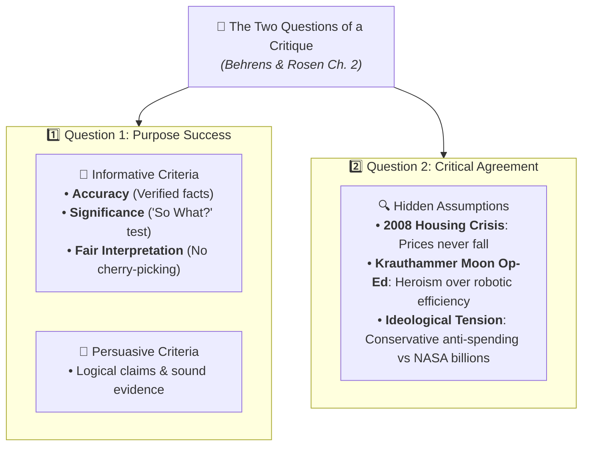

# Multiple Choice Questions (MCQ) - Chapter Test (Beginner Level)

**Subject:** Reading and Writing Skills | **Unit:** Week 2  
**Total Questions:** 20 MCQs (4 Options Each)  

### Concept Map:

---
### Question 1
**Mindmap Location:** 1. Taxonomy of Reading > Four Kinds  
**Question:** Which kind of reading involves glancing at email subject lines, roadside signs, and newspaper headlines out of daily necessity?  
- A) Critical Reading  
- B) Reading for Pleasure  
- C) Casual Reading  
- D) Reading for Information  

Click to view Answer

<b>Correct Option: C</b> 
<b>Rationale:</b> Textbook definition: Casual reading is the most common kind of reading where people glance at headlines, signs, and messages not because they want to, but because they must.

---
### Question 2
**Mindmap Location:** 1. Taxonomy of Reading > Four Kinds  
**Question:** What is the primary characteristic of 'Reading for Pleasure'?  
- A) It is relaxed and uncritical, transporting the reader to an imaginary world  
- B) It requires rigorous memorization and formula derivation  
- C) It focuses on detecting logical fallacies and checking evidence dates  
- D) It requires writing detailed academic critiques in margins  

Click to view Answer

<b>Correct Option: A</b> 
<b>Rationale:</b> Hirschberg explains that reading for pleasure (mystery novels, romances) is relaxed and uncritical bedtime reading to transport the reader to an imaginary world.

---
### Question 3
**Mindmap Location:** 1. Taxonomy of Reading > Four Kinds  
**Question:** How does Hirschberg define 'Critical Reading'?  
- A) Memorizing every word in the first chapter  
- B) Active reading where you engage in a mental dialogue with the author and resist gullibility  
- C) Criticizing the grammar and spelling of published books  
- D) Reading mystery novels to find out who the killer is  

Click to view Answer

<b>Correct Option: B</b> 
<b>Rationale:</b> Critical reading is active reading involving a mental dialogue with the writer, questioning claims, deducing consequences, and refusing to accept printed claims with gullibility.

---
### Question 4
**Mindmap Location:** 1. Taxonomy of Reading > Origins of the Essay  
**Question:** Why did Michel de Montaigne call his writings 'essais' in 1580?  
- A) Because they were legally binding contracts  
- B) Because they were personal disclosures of a mind exploring its attitudes, meaning 'attempts'  
- C) Because they were scientific lab reports published in Latin  
- D) Because they were imaginary tales featuring mythological beasts  

Click to view Answer

<b>Correct Option: B</b> 
<b>Rationale:</b> Montaigne called his writings 'essais' (attempts) because they were personal disclosures of an observant mind exploring its attitudes and values rather than accounts of settled dogma.

---
### Question 5
**Mindmap Location:** 2. Cognitive Triad > Three Steps  
**Question:** What are the three steps of the Cognitive Triad in critical thinking?  
- A) Skimming, Scanning, Memorizing  
- B) Analysis, Synthesis, Evaluation  
- C) Reading, Reciting, Reviewing  
- D) Pre-writing, Drafting, Editing  

Click to view Answer

<b>Correct Option: B</b> 
<b>Rationale:</b> Hirschberg establishes the three cognitive operations of critical reading: 1. Analysis, 2. Synthesis, and 3. Evaluation.

---
### Question 6
**Mindmap Location:** 2. Cognitive Triad > Synthesis  
**Question:** According to Hirschberg, what is the 'best part about synthesis'?  
- A) It allows students to finish reading in half the time  
- B) It tampers down student arrogance by demonstrating that on knotty subjects, more than a single opinion exists  
- C) It guarantees a perfect score on factual multiple-choice exams  
- D) It eliminates the need to evaluate evidence  

Click to view Answer

<b>Correct Option: B</b> 
<b>Rationale:</b> Hirschberg states that synthesis tampers down arrogance by proving that complex, knotty subjects always have multiple viewpoints.

---
### Question 7
**Mindmap Location:** 2. Cognitive Triad > Evaluation  
**Question:** What does the 'Evaluation' step empower students to do?  
- A) Grade and assess the material read and take an educated stand  
- B) Erase marginal notes to resell the textbook  
- C) Blindly accept the teacher's interpretation  
- D) Translate texts into ancient Latin  

Click to view Answer

<b>Correct Option: A</b> 
<b>Rationale:</b> Evaluation empowers students to assess and grade the material read, probe arguments for and against, and take a reasoned side on the seesaw.

---
### Question 8
**Mindmap Location:** 3. Guidelines > Demystify the Writer  
**Question:** What do Metherell and Winkler mean by 'Demystify the writer'?  
- A) Refuse to read any book written before the year 2000  
- B) Kick the writer off the throne of public esteem and treat their work as a fallible human production  
- C) Learn the author's home address and telephone number  
- D) Assume the author is an infallible genius  

Click to view Answer

<b>Correct Option: B</b> 
<b>Rationale:</b> Demystifying means recognizing that authors are fallible human beings who can make mistakes of fact, logic, and bias.

---
### Question 9
**Mindmap Location:** 3. Guidelines > Opposing Point of View  
**Question:** Why does Metherell advise imagining the counter-argument regarding medical testing on dogs?  
- A) Because dogs don't feel pain  
- B) Because dog testing led to insulin, which saves millions of human lives  
- C) Because dogs are cheaper than guinea pigs  
- D) Because laws prohibit testing on humans  

Click to view Answer

<b>Correct Option: B</b> 
<b>Rationale:</b> The counter-argument shows that research on dogs saved millions of human diabetic lives through insulin, demonstrating why critical readers must weigh both sides.

---
### Question 10
**Mindmap Location:** 3. Guidelines > Evidence Timestamp  
**Question:** Why is a 1975 medical paper on human antibody generation considered outdated today?  
- A) Because Susumu Tonegawa discovered antibody gene rearrangement in 1976  
- B) Because paper yellows after 30 years  
- C) Because Latin was banned in medicine in 1976  
- D) Because antibodies were renamed in 1980  

Click to view Answer

<b>Correct Option: A</b> 
<b>Rationale:</b> In 1976, Dr. Susumu Tonegawa made his breakthrough discovery on antibody diversity; prior to 1976, textbooks called it an impenetrable mystery.

---
### Question 11
**Mindmap Location:** 3. Guidelines > Logical Fallacies  
**Question:** What logical fallacy occurs when an author attacks their opponent's character or looks instead of the argument?  
- A) Ad Populum  
- B) Ad Hominem  
- C) False Dilemma  
- D) Non Sequitur  

Click to view Answer

<b>Correct Option: B</b> 
<b>Rationale:</b> Ad Hominem ('to the man') attacks the personal traits of the arguer rather than dealing with the merits of the claim.

---
### Question 12
**Mindmap Location:** 3. Guidelines > Logical Fallacies  
**Question:** What fallacy is committed when an issue is framed as: 'Either you ban all cars, or the planet will burn tomorrow'?  
- A) Ad Hominem  
- B) Either/Or Reasoning (False Dilemma)  
- C) Circular Reasoning  
- D) Non Sequitur  

Click to view Answer

<b>Correct Option: B</b> 
<b>Rationale:</b> Either/Or reasoning forces a multifaceted problem into an artificial binary choice between two extreme opposites.

---
### Question 13
**Mindmap Location:** 4. Essay Architecture > Thesis Statement  
**Question:** What is Mark Twain's thesis in his essay 'The Lowest Animal'?  
- A) Animals should be given the right to vote  
- B) Humans are the only animals that harbor insults and take revenge  
- C) Dogs are more intelligent than cats  
- D) Evolution stopped in the sixteenth century  

Click to view Answer

<b>Correct Option: B</b> 
<b>Rationale:</b> Twain's thesis is that man is the only creature that harbors insults, broods over them, and seeks petty revenge.

---
### Question 14
**Mindmap Location:** 4. Essay Architecture > Signposts  
**Question:** Which of the following is a 'Premise Signal' that introduces a supporting reason?  
- A) Therefore  
- B) Consequently  
- C) Inasmuch as  
- D) It follows that  

Click to view Answer

<b>Correct Option: C</b> 
<b>Rationale:</b> 'Inasmuch as' is a premise signal introducing a reason. The others are conclusion signals.

---
### Question 15
**Mindmap Location:** 4. Essay Architecture > Signposts  
**Question:** Which of the following is a 'Conclusion Signal' indicating a deduction?  
- A) Since  
- B) For the reason that  
- C) Thus  
- D) Because  

Click to view Answer

<b>Correct Option: C</b> 
<b>Rationale:</b> 'Thus' indicates that a conclusion is reached. The other options introduce premises.

---
### Question 16
**Mindmap Location:** 7. Critical Reading for Critique > Two Questions  
**Question:** According to Behrens and Rosen, what are the two core questions for writing an academic critique?  
- A) 1. How many pages is the text? 2. What font was used?  
- B) 1. To what extent does the author succeed in their purpose? 2. To what extent do you agree with the author?  
- C) 1. Did the author win an award? 2. How much does the book cost?  
- D) 1. Can you read it aloud? 2. Do you like the cover art?  

Click to view Answer

<b>Correct Option: B</b> 
<b>Rationale:</b> Behrens and Rosen define critique around two questions: Question 1 assesses authorial success in purpose, and Question 2 assesses critical agreement and assumptions.

---
### Question 17
**Mindmap Location:** 7. Critical Reading for Critique > Informative Criteria  
**Question:** When evaluating informative writing, what is the 'So What?' test according to Behrens and Rosen?  
- A) The test of grammar correctness  
- B) The test of Significance—whether the facts are meaningful and important rather than trivial  
- C) The test of whether the essay rhymes  
- D) The test of whether the text can be summarized in one word  

Click to view Answer

<b>Correct Option: B</b> 
<b>Rationale:</b> The 'So What?' question represents Significance: even completely accurate facts fail if they are trivial and lack meaningful relevance.

---
### Question 18
**Mindmap Location:** 7. Critical Reading for Critique > Krauthammer Op-Ed  
**Question:** In Charles Krauthammer's op-ed 'The Moon We Left Behind', what major concession does he make about robotic probes?  
- A) Robotic probes are useless and never take good photos  
- B) Robotic probes are cheaper, safer, and yield superior scientific data  
- C) Robots are controlled by foreign adversaries  
- D) Probes are more expensive than manned Apollo missions  

Click to view Answer

<b>Correct Option: B</b> 
<b>Rationale:</b> Krauthammer explicitly concedes that robotic probes are vastly cheaper, safe from human loss of life, and yield superior scientific data per dollar.

---
### Question 19
**Mindmap Location:** 5. Intertextuality > Definition  
**Question:** How do Dharwadker and his co-authors define Intertextuality?  
- A) Reading a book while listening to music  
- B) The reference to or application of a literary, media, or social text inside another text  
- C) Translating English texts into Filipino  
- D) Using highlighters to color code textbook pages  

Click to view Answer

<b>Correct Option: B</b> 
<b>Rationale:</b> Intertextuality is the borrowing or application of a literary, media, or social 'text' inside another text.

---
### Question 20
**Mindmap Location:** 5. Intertextuality > Transformative Effects  
**Question:** What happens when a new book borrows a famous classic story (reflexive re-reading)?  
- A) The classic story is automatically erased from library catalogs  
- B) The reader's memory and understanding of the original classic is permanently transformed  
- C) The reader is forbidden from reading the original text  
- D) The author of the new book is sued for copyright infringement  

Click to view Answer

<b>Correct Option: B</b> 
<b>Rationale:</b> Dharwadker's second effect is the reflexive transformation of the prior text—reading a retelling permanently alters how we view the original work.

---
