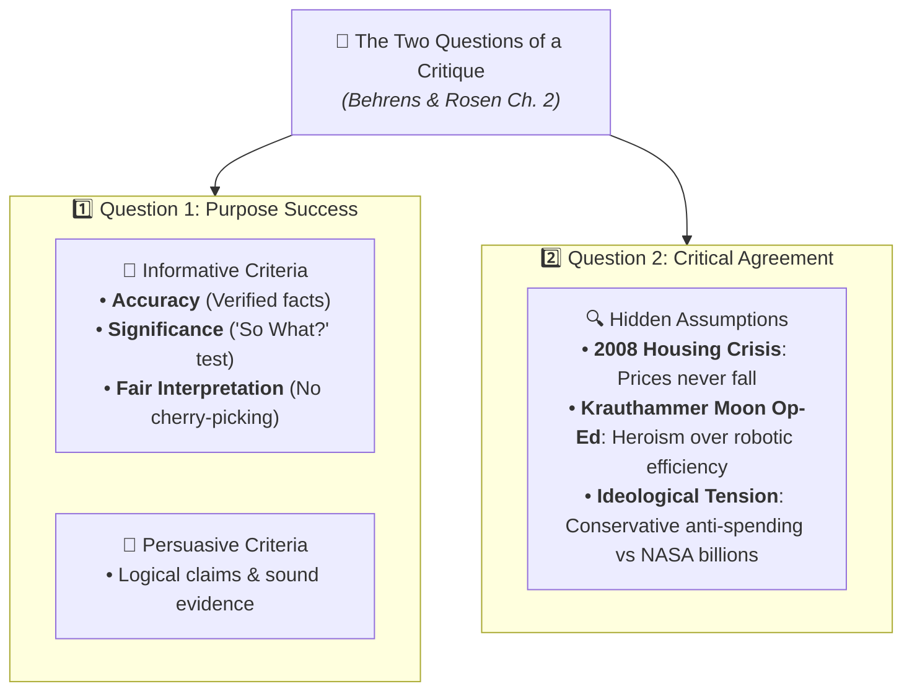

# Question Bank: Critical Reading as Looking for Ways of Thinking (Beginner Level)

**Subject:** Reading and Writing Skills | **Unit:** Week 2  
**Total Questions:** 30 Questions (15 Short Answer + 15 Long Answer)  
**Academic Target:** Foundational Knowledge & Concept Mastery  

### Reference Infographic:

---

## PART A: SHORT ANSWER QUESTIONS (15 QUESTIONS)

### Question 1
**Mindmap Location:** 1. Taxonomy of Reading > Four Kinds of Reading  
**Question:** Name and briefly define the four kinds of reading described by Stuart and Terry Hirschberg.  
**Solution:**  
1. **Casual Reading:** Glancing at headlines, roadside signs, and emails out of daily necessity.  
2. **Reading for Pleasure:** Relaxed and uncritical reading of stories to enjoy being transported to an imaginary world.  
3. **Reading for Information:** Reading as an academic or workplace tool requiring attention, comprehension, and memorization.  
4. **Critical Reading:** Active mental dialogue with the author to analyze ideas, question claims, and avoid gullibility.

---

### Question 2
**Mindmap Location:** 1. Taxonomy of Reading > Origins of Essay  
**Question:** Who was Michel de Montaigne, and why did he name his writings *essais*?  
**Solution:**  
Michel de Montaigne was a 16th-century French writer who created the essay genre in 1580. He called his writings *essais* (meaning "attempts") because they were personal explorations of an inquiring mind trying to understand its own thoughts, rather than accounts of absolute dogma.

---

### Question 3
**Mindmap Location:** 2. The Cognitive Triad > Analysis  
**Question:** What does the critical reader do during the "Analysis" stage?  
**Solution:**  
During analysis, the reader deconstructs the reading to see how ideas are composed, how they connect with other concepts, and what underlying biases or assumptions are present.

---

### Question 4
**Mindmap Location:** 2. The Cognitive Triad > Synthesis  
**Question:** Why does the synthesis of multiple sources "tamper down arrogance" in a student?  
**Solution:**  
Because studying multiple sources reveals that on complex controversies, more than one valid viewpoint exists, preventing the student from stubbornly assuming their initial opinion is the only truth.

---

### Question 5
**Mindmap Location:** 2. The Cognitive Triad > Evaluation  
**Question:** What does it mean to "place your weight on the seesaw" in critical reading?  
**Solution:**  
It means taking a reasoned personal stance on a controversial issue after carefully weighing the arguments and evidence for and against both sides.

---

### Question 6
**Mindmap Location:** 3. Guidelines > Demystify the Writer  
**Question:** Explain the guideline "Demystify the writer."  
**Solution:**  
It means kicking the writer off the throne of public esteem—recognizing that published authors are fallible human beings who can make mistakes of fact, logic, and bias just like anyone else.

---

### Question 7
**Mindmap Location:** 3. Guidelines > Opposing Point of View  
**Question:** Give an example showing why a critical reader must imagine an opposing viewpoint.  
**Solution:**  
If an essay passionately argues against medical experiments on animals, the reader must consider the counter-view: testing on dogs led to the discovery and refinement of insulin, which saves millions of human lives.

---

### Question 8
**Mindmap Location:** 3. Guidelines > Historical Correction  
**Question:** How can knowledge of American history disprove the psychological claim that oppressed people are naturally passive?  
**Solution:**  
By citing historical events like the Battle of Fallen Timbers (1794), Tippecanoe (1811), and the Black Hawk War (1832), where Native Americans actively fought back against oppression rather than submit passively.

---

### Question 9
**Mindmap Location:** 3. Guidelines > Evidence Timestamp  
**Question:** Why is the year 1976 important when evaluating medical evidence about antibodies?  
**Solution:**  
Because in 1976, Dr. Susumu Tonegawa discovered how antibody genes rearrange. Any scientific article written before 1976 would say antibody creation was an unsolved mystery, which is now outdated evidence.

---

### Question 10
**Mindmap Location:** 3. Guidelines > Fallacy Identification  
**Question:** What is the difference between an *Ad Hominem* fallacy and an *Ad Populum* fallacy?  
**Solution:**  
An *Ad Hominem* fallacy attacks the personal character or traits of the person arguing, while an *Ad Populum* fallacy appeals to popular consensus, peer pressure, or emotional slogans to win agreement.

---

### Question 11
**Mindmap Location:** 4. Essay Architecture > Thesis Statement  
**Question:** What was Mark Twain's central thesis in his famous essay *The Lowest Animal*?  
**Solution:**  
Twain's thesis was that humans are the only animals that harbor insults and injuries, brood over them, wait for a chance, and take revenge.

---

### Question 12
**Mindmap Location:** 4. Essay Architecture > Signposts  
**Question:** What is the function of "Premise Signals" and "Conclusion Signals" in an essay?  
**Solution:**  
Premise signals (e.g. *because, since, for*) tell the reader that reasons or evidence are coming. Conclusion signals (e.g. *therefore, hence, thus*) tell the reader that a final outcome or deduction is reached.

---

### Question 13
**Mindmap Location:** 5. Intertextuality > Three Functions  
**Question:** List the three functions of intertextuality described by Dharwadker and his co-authors.  
**Solution:**  
1. **Comparison:** Comparing the new text with the borrowed text.  
2. **Dialogue:** Allowing the two stories to talk with and challenge each other.  
3. **Destabilization:** Shaking up settled interpretations of one or both texts.

---

### Question 14
**Mindmap Location:** 7. Critical Reading for Critique > Two Guiding Questions  
**Question:** What are the two fundamental questions that guide the writing of a critique according to Behrens and Rosen?  
**Solution:**  
1. **Question 1:** To what extent does the author succeed in his or her purpose (informative, persuasive, or entertaining)?  
2. **Question 2:** To what extent do you agree with the author (evaluating their underlying assumptions)?

---

### Question 15
**Mindmap Location:** 7. Critical Reading for Critique > Informative Criteria  
**Question:** What three criteria must a critical reader use to evaluate informative writing?  
**Solution:**  
1. **Accuracy:** Are the factual assertions verifiable and correct?  
2. **Significance:** Does the information pass the "So What?" test by providing meaningful, important knowledge?  
3. **Fair Interpretation:** Does the author interpret the facts objectively without bias or distortion?

---

## PART B: LONG ANSWER QUESTIONS (15 QUESTIONS)

### Question 16
**Mindmap Location:** 1. Taxonomy of Reading > Four Kinds of Reading  
**Question:** Contrast "Reading for Information" with "Critical Reading." Why is reading for information insufficient for high school and university scholars?  
**Solution:**  
**Reading for Information** is an occupational and academic skill where the reader concentrates, comprehends, and memorizes factual data to complete an assignment, perform a job, or pass an exam. While essential, it remains intellectually submissive because the reader treats the text as an unquestioned authority.  
**Critical Reading**, on the other hand, is an active mental dialogue where the reader interrogates the author's claims, investigates underlying assumptions, detects logical fallacies, and considers counterarguments. For high school and university scholars, information reading alone is insufficient because academic inquiry requires evaluating competing theories, identifying bias, and creating new knowledge rather than merely reciting accepted facts.

---

### Question 17
**Mindmap Location:** 1. Taxonomy of Reading > Origins of Essay  
**Question:** Explain how Michel de Montaigne's invention of the *essai* changed the relationship between author and reader.  
**Solution:**  
In 1580, Michel de Montaigne began writing what he called *essais*, derived from the French verb *essayer* meaning "to try" or "to attempt." Prior to Montaigne, writing was dominated by formal philosophical treatises or dogmatic religious doctrines that proclaimed absolute truth.  
Montaigne introduced a radically intimate, exploratory genre: he spoke directly to the reader in the first person, openly disclosing his attitudes, values, prejudices, and doubts. By presenting his writings as an "attempt" of an inquiring mind rather than absolute truth, Montaigne leveled the playing field between author and reader. The reader is no longer an obedient subject listening to a sermon; the reader is an intellectual equal invited into the author's mental laboratory to test, challenge, and reflect upon the ideas.

---

### Question 18
**Mindmap Location:** 2. The Cognitive Triad > Full Process  
**Question:** Walk through the three stages of the Cognitive Triad (Analysis, Synthesis, Evaluation) using the contemporary issue of **social media screen time among teenagers**.  
**Solution:**  
1. **Analysis:** The student deconstructs research articles, surveys, and expert statements on adolescent screen time. The student separates factual data (e.g., average hours spent on smartphones) from opinions and looks for possible biases (e.g., whether a study was funded by a tech company or a conservative parenting group).  
2. **Synthesis:** The student combines findings from psychologists, sociologists, educators, and teenagers themselves. The student discovers that while excessive screen time correlates with sleep loss and anxiety, social media also provides essential social connection and educational support for isolated teens. This synthesis humbles the student, demonstrating that the issue cannot be solved with a simple "phones are evil" slogan.  
3. **Evaluation:** The student weighs the conflicting evidence and decides where to place their weight on the seesaw. The student formulates a nuanced stance: rather than calling for a total phone ban or unlimited use, they argue for healthy boundary guidelines that curb late-night scrolling while preserving daytime digital connection.

---

### Question 19
**Mindmap Location:** 3. Guidelines > Demystifying Authors  
**Question:** Why do Metherell and Winkler strongly advocate "kicking the writer off the throne of public esteem"? What happens when a student fails to do this?  
**Solution:**  
Metherell and Winkler urge students to demystify writers because treating authors like infallible gods leads to passive gullibility. Writers are human beings who possess political agendas, personal insecurities, demographic biases, and blind spots.  
When a student fails to demystify the author, they accept every printed claim as undeniable gospel. They lose their capacity for independent thought, fail to spot flawed reasoning or biased statistics, and become vulnerable to intellectual manipulation. Kicking the writer off the throne empowers the student to engage with the text as an auditor, verifying evidence, checking logic, and asserting their own critical voice.

---

### Question 20
**Mindmap Location:** 3. Guidelines > Annotation Value  
**Question:** Why do Metherell and Winkler describe keeping a textbook clean for resale as "penny-wise and pound-foolish"?  
**Solution:**  
Keeping a textbook unmarked just to resell it for a few hundred pesos at the end of the trimester is "penny-wise and pound-foolish" because the student saves a tiny sum of money at the expense of a far greater educational asset.  
Active marginal annotation—underlining main claims, writing questions, noting vocabulary, and challenging weak logic—forces the reader's brain to stay actively engaged. It transforms reading into a live seminar. The permanent knowledge, analytical habits, and critical skills gained from annotating a text are worth infinitely more than the resale value of a clean book.

---

### Question 21
**Mindmap Location:** 3. Guidelines > Andy Rooney Context  
**Question:** Analyze Andy Rooney's essay on Fowler's *Modern English Usage*. Why is understanding its opening context crucial for the reader?  
**Solution:**  
CBS commentator Andy Rooney wrote an essay expressing a humorous wish that he had authored Henry Watson Fowler's *A Dictionary of Modern English Usage*. If a reader does not understand the opening context, the essay seems eccentric and bizarre.  
However, the essay was written for a Screenwriters Guild feature titled *"A Writer's Fantasy: What I Wish I Had Written."* In that symposium, writers playful confessed books they admired. Rooney seized the opportunity to satirize grammatical pedantry—poking fun at strict rules against split infinitives and the fussy requirement to say "It is I" instead of "It's me." Knowing the opening context allows the reader to recognize that Rooney was writing lighthearted satire, not a serious grammatical treatise.

---

### Question 22
**Mindmap Location:** 3. Guidelines > Logical Fallacies  
**Question:** Define and provide concrete examples for: (a) *Either/Or Reasoning*, (b) *Begging the Question*, and (c) *Non Sequitur*.  
**Solution:**  
(a) **Either/Or Reasoning (False Dilemma):** Forcing a multifaceted dispute into an artificial binary choice between two extremes. *Example:* "Either we ban all smartphones in schools immediately, or our students will completely fail in life."  
(b) **Begging the Question (Circular Reasoning):** An argument where the premise merely restates the conclusion in different words instead of proving it. *Example:* "We must obey the school curfew because the school curfew must be obeyed."  
(c) **Non Sequitur:** A Latin term meaning "it does not follow"—drawing a conclusion that has no logical bridge to the evidence offered. *Example:* "Professor Cruz has a stylish haircut and wears nice suits; therefore, his theory of macroeconomics must be correct."

---

### Question 23
**Mindmap Location:** 4. Essay Architecture > Thesis Statement  
**Question:** What are the key characteristics of an effective thesis statement, and where is it typically positioned in an essay?  
**Solution:**  
An effective thesis statement has three primary characteristics:  
1. It is a single, clear declarative sentence.  
2. It asserts the author's focused response to an issue that rational people might debate.  
3. It serves as the governing blueprint for the entire essay, with every subsequent paragraph providing supporting premises, evidence, or counterargument refutations.  
It is typically located near the end of the essay's introductory section, orienting the reader before the argument unfolds.

---

### Question 24
**Mindmap Location:** 4. Essay Architecture > Premise vs. Conclusion Signals  
**Question:** Explain how "Premise Signals" and "Conclusion Signals" guide the reader's comprehension through complex argumentation.  
**Solution:**  
Premise and conclusion signals serve as the navigational road signs of an essay:  
* **Premise Signals** (such as *because, since, for, follows from, inasmuch as, in view of the fact that*) alert the reader that evidentiary data, reasons, or justifications are being introduced. They answer the question: *"Why should I believe this?"*  
* **Conclusion Signals** (such as *therefore, hence, thus, consequently, accordingly, it follows that*) alert the reader that a logical deduction or final claim is being derived from previously stated premises.  
By tracking these signal words, a critical reader can construct a logical map of the author's reasoning, distinguishing supporting evidence from main assertions.

---

### Question 25
**Mindmap Location:** 5. Intertextuality > Definition and Two Forms  
**Question:** Detail Dharwadker's definition of intertextuality and contrast the two primary forms: "Book in a Book" versus "Other Text in a Book."  
**Solution:**  
Dharwadker and his co-authors define intertextuality as the reference to or application of a literary, media, or social "text" inside another text. No author creates in isolation; literature builds upon prior cultural stories.  
* **Form 1: Book in a Book:** Occurs when a literary work references another literary work. This can be brief (quoting a Shakespearean line or naming a character Hamlet) or prolonged (adapting an entire plot, as when modern novels rewrite classic fairy tales).  
* **Form 2: Other Text in a Book:** Occurs when a literary work weaves in a media or cultural narrative—such as a famous song, a film, or an iconic historical event (like Rosa Parks refusing to give up her bus seat or the Apollo Moon landing). Because the referenced cultural event has an existing narrative quality, it brings a rich second storyline and moral weight into the host book.

---

### Question 26
**Mindmap Location:** 5. Intertextuality > Three Functions  
**Question:** Explain the three dynamic functions of intertextuality: Comparison, Dialogue, and Destabilization.  
**Solution:**  
1. **Comparison:** By placing an earlier text inside a new text, the author invites the reader to compare both contexts, noticing similarities and sharp differences in morality, culture, and character choices.  
2. **Dialogue:** Both the host text and the referenced text are stories with distinct worldviews. Intertextuality creates a dynamic conversation between them, allowing them to support, question, or challenge each other's authority.  
3. **Destabilization:** The presence of an intertext can shake up comfortable interpretations. A new novel might reveal that a celebrated classic hero actually held disturbing, unexamined prejudices, subverting the canon and forcing readers to re-evaluate what they thought they knew.

---

### Question 27
**Mindmap Location:** 5. Intertextuality > Transformative Effects  
**Question:** Explain the three transformative effects that occur when a reader engages with an intertextual work.  
**Solution:**  
Dharwadker identifies three transformative effects:  
1. **Transformation of the Primary Book:** The intertext enriches the new book by adding historical depth and symbolic resonance.  
2. **Reflexive Transformation of the Prior Text:** Seeing an old story retold through a modern lens permanently changes how the reader remembers the original work (reflexive re-reading).  
3. **Simultaneous Reinterpretation of Both Texts:** The reader engages in a reciprocal mental ping-pong, evaluating both texts against each other at the exact same time.

---

### Question 28
**Mindmap Location:** 5. Intertextuality vs. Hypertext  
**Question:** Compare and contrast digital Hypertext with literary Intertextuality.  
**Solution:**  
* **Hypertext** is a digital and technological mechanism. It connects electronic web documents using clickable links on a computer screen, allowing a reader to navigate non-linearly across internet nodes.  
* **Intertextuality** is an intellectual and cultural phenomenon. It connects human ideas, stories, and cultural memories in the reader's mind without requiring physical links.  
* **Synthesis:** Hypertext is the digital externalization of intertextuality. Centuries before the World Wide Web was built, human literature was already an interconnected cultural web where every book contained intellectual hyperlinks to prior stories.

---

### Question 29
**Mindmap Location:** 7. Critical Reading for Critique > Hidden Assumptions & 2008 Crisis  
**Question:** What is a hidden assumption, and how did an unexamined hidden assumption cause the 2008 Subprime Mortgage Financial Crisis?  
**Solution:**  
A hidden assumption is an underlying premise taken for granted by an author or community without being explicitly stated or verified. If the assumption is flawed, the entire argument or system built upon it collapses.  
In Chapter 2 of *Writing and Reading Across the Curriculum*, Behrens and Rosen discuss the 2008 Subprime Mortgage Financial Collapse. For years, major Wall Street banks, mortgage lenders, and financial analysts operated on a single, unexamined hidden assumption: *that residential real estate prices across the United States would always rise, or at worst remain flat, but never drop nationwide.* Because everyone accepted this assumption without question, banks issued hundreds of billions of dollars in risky mortgages to unqualified borrowers. When real estate prices plunged, the entire financial market crashed. This real-world catastrophe demonstrates the danger of failing to critically evaluate hidden assumptions.

---

### Question 30
**Mindmap Location:** 7. Critical Reading for Critique > Charles Krauthammer Case Study  
**Question:** Analyze Charles Krauthammer's op-ed "The Moon We Left Behind" as a model critique case study. How does a critical reader evaluate his claims, concessions, hidden assumptions, and political tension?  
**Solution:**  
In *Writing and Reading Across the Curriculum*, Behrens and Rosen present Charles Krauthammer's 2009 op-ed celebrating the 40th anniversary of Apollo 11:  
1. **Thesis & Loaded Tone:** Krauthammer argues that America's retreat from manned space exploration represents a tragic loss of national ambition. He uses loaded words like *"retreat," "abandonment,"* and *"ignominious"* to evoke emotional regret.  
2. **Concessions (Counterarguments):** Krauthammer openly concedes that unmanned robotic probes are far cheaper, involve zero risk to human life, and yield vastly superior scientific data per dollar spent.  
3. **Hidden Assumption:** Despite admitting robots are superior for science, Krauthammer insists humans must return to the Moon. Why? Because of his hidden assumption: that the ultimate purpose of space exploration is not scientific utility, but human adventure, romance, and national heroism!  
4. **Ideological Contradiction:** Critical readers note that Krauthammer was a famous conservative columnist who normally opposed big-government spending. Yet in this essay, his romantic nationalism led him to advocate for a colossal, taxpayer-funded government initiative (NASA). Spotting these assumptions and tensions is the core of critical critique!
