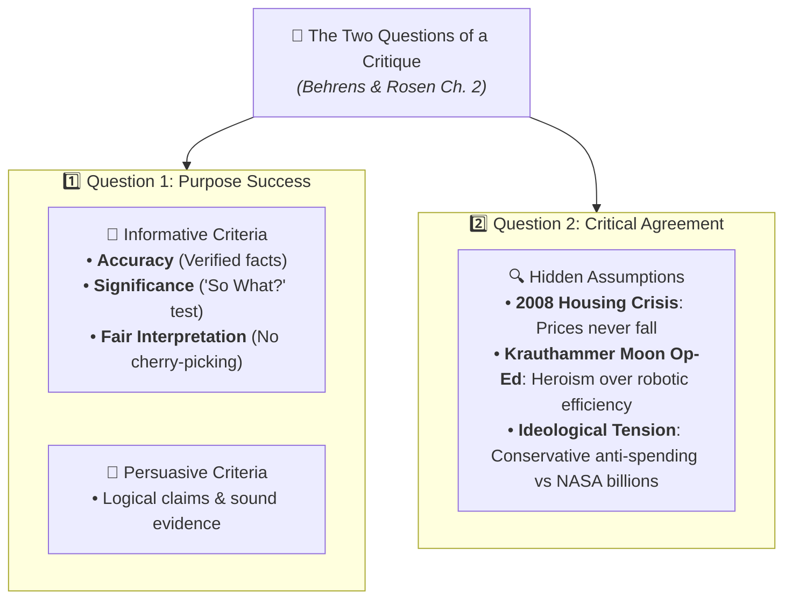

# Master Pop Quiz Study Guide: Critical Reading as Looking for Ways of Thinking (Beginner Level)

**Subject:** Reading and Writing Skills | **Unit:** Week 2  
**Level:** Beginner  

### Quick Concept Map:

---

## Pop Quiz Diagnostic Overview

### Question Blueprint
* **Question 1:** Taxonomy of Reading (Hirschberg's 4 Modes)  
* **Question 2:** The Cognitive Triad (Analysis, Synthesis, Evaluation)  
* **Question 3:** Demystifying the Author (Metherell & Winkler)  
* **Question 4:** Logical Fallacy Detection  
* **Question 5:** Essay Architecture & Signpost Words  
* **Question 6:** Writing a Critique (Question 1 & Question 2)  
* **Question 7:** Evaluating Informative Writing (Accuracy, Significance, Fair Interpretation)  
* **Question 8:** Evaluating Hidden Assumptions (2008 Subprime & Krauthammer Op-ed)  
* **Question 9:** Intertextuality: Forms & Functions (Dharwadker et al.)  
* **Question 10:** Transformative Effects & Hypertext Links  

---

### Sample Worked Question:

**Question:** Why does Laurence Behrens emphasize the "So What?" question when evaluating informative writing?  
- **A)** Because an informative text must always rhyme.  
- **B)** Because facts can be 100% accurate, yet still be trivial, unimportant, or irrelevant to the reader's real needs.  
- **C)** Because authors should only write about sports.  
- **D)** Because informative essays cannot contain numbers.  

<b>Click to View Solution</b>

<b>Correct Answer: Option B</b> 
<b>Rationale:</b> In Chapter 2 of <i>Writing and Reading Across the Curriculum</i>, Behrens and Rosen explain that Accuracy is only the first step. An essay can report true facts, but if those facts are insignificant or trivial, the writing fails the test of significance ("So What?").

