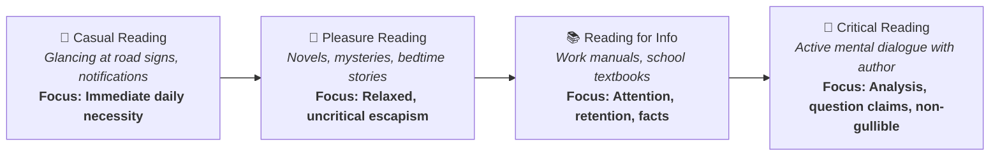

# Pop Quiz: Critical Reading as Looking for Ways of Thinking (Beginner Level)

**Subject:** Reading and Writing Skills | **Unit:** Week 2  
**Level:** Beginner | **Target Bloom's:** Understanding (L-2)  

---

### Pop Quiz Question

**Mindmap Location:** 1. Taxonomy of Reading > Four Kinds of Reading  
**Difficulty:** Beginner  

**Question:**  
Why does Stuart and Terry Hirschberg state that **Critical Reading is NOT gullibility**, and how does it fundamentally differ from **Reading for Information**?

- **A)** Critical reading requires reading aloud in front of a mirror, while reading for information is done only in libraries.
- **B)** Critical reading is an active mental dialogue where the reader questions claims, uncovers assumptions, and tests evidence; reading for information is goal-driven memorization where the reader passively accepts the text as an unquestioned authority.
- **C)** Critical reading only applies to fictional poetry, while reading for information is reserved for science textbooks.
- **D)** Critical reading means reading as fast as possible without taking margin notes.

---

### Detailed Answer & Analysis

<b>Click to View Solution & Answer Breakdown</b>

 

**Correct Answer:** **Option B**

#### 💡 Why Option B is CORRECT:
* In *The Millennium Reader*, Stuart and Terry Hirschberg define critical reading by first explaining what it is *not*: it is **not gullibility—accepting as truth anything you read**. 
* In **Reading for Information**, the student reads as an occupational tool—paying attention, comprehending, and memorizing facts to pass an exam or complete an assignment. While essential, information reading is essentially submissive: it takes the author's words at face value.
* In **Critical Reading**, the reader enters into an active intellectual duel: when the writer states a claim, the reader responds, *"Maybe so, but what about this counter-evidence?"* The critical reader deconstructs arguments, searches for biases, spots logical fallacies, and deduces consequences.

---

#### ❌ Why the Other Options are INCORRECT:
* **Option A is False:** Critical reading is a cognitive habit of mind, not a performance ritual in front of a mirror.
* **Option C is False:** Critical reading applies to all forms of non-fiction, essays, scientific reports, and arguments, not just poetry.
* **Option D is False:** Speed reading without notes is the opposite of critical reading; critical reading emphasizes active marginal annotation and deliberate re-reading.

