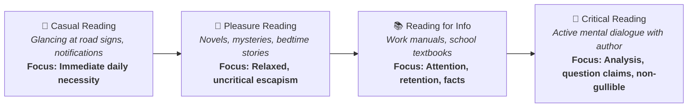
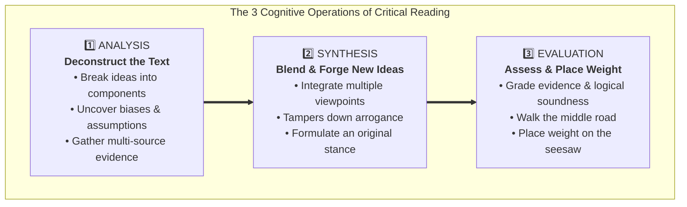
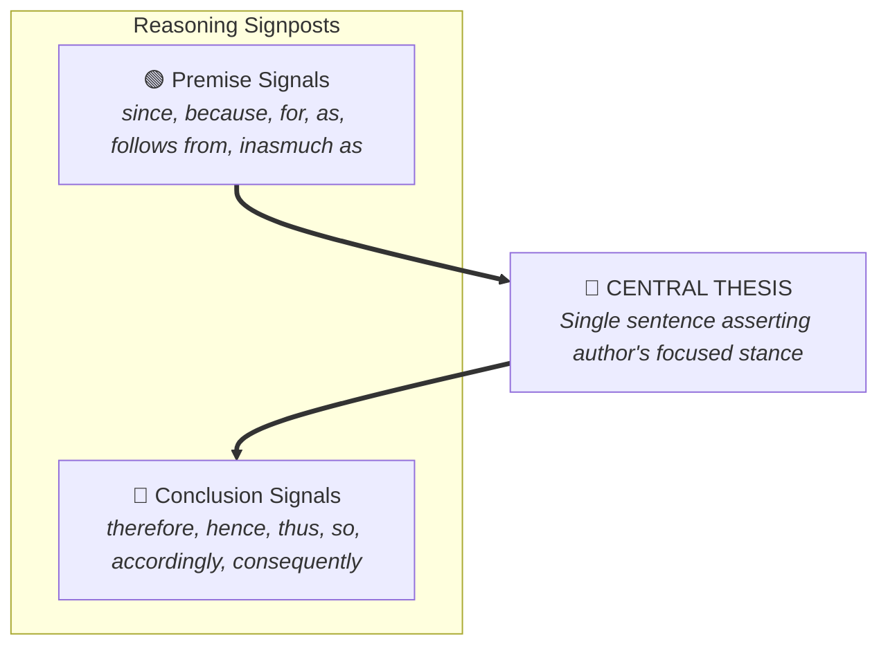
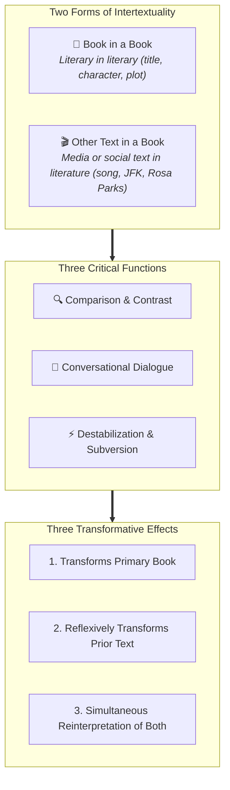

# Quick Study Guide & Summary: Critical Reading as Looking for Ways of Thinking (Beginner Level)

**Subject:** Reading and Writing Skills | **Unit:** Week 2  
**Audience Level:** Beginner (Foundational & Visual Learner Focus)  
**Target Bloom's Levels:** Remembering (L-1) & Understanding (L-2)  
**Curriculum Materials:** critical reading.md, Reading Critically.md, reading_essays.md, intertextuality.md  
**Institution:** De La Salle University - Senior High School Department  

---

## 🖼️ 1. Master Infographic: The Four Kinds of Reading

Reading is not just one simple activity. Stuart and Terry Hirschberg (*The Millennium Reader*) identify four different kinds:

### 📌 Core Textbook Definitions (Kept Intact)
* **Casual Reading:** Glancing at magazines, newspaper headlines, letters, email messages, and roadside signs out of necessity.
* **Reading for Pleasure:** Relaxed and uncritical reading (like mystery novels or bedtime stories) where the reader is transported to an imaginary world.
* **Reading for Information:** Used as a tool at work or school; requires attention, understanding, and memorization to do a job or complete an assignment.
* **Critical Reading:** Active reading where you engage in a mental dialogue with the writer, question claims, deduce consequences, and avoid gullibility.

---

## 🖼️ 2. Infographic: The Cognitive Triad of Critical Reading

Critical reading requires your mind to perform three essential steps:

* **Analysis:** Taking the reading apart to see how ideas are composed, how they connect, and what biases are present.
* **Synthesis:** Blending different ideas together to create an original opinion that belongs to you. It humbles us by showing that more than one valid opinion exists.
* **Evaluation:** Assessing and grading the material read, probing pros and cons, and taking a reasoned stand ("placing your weight on the seesaw").

---

## 🖼️ 3. Infographic: Essay Architecture & Traffic Signals

In *Writing and Reading Across the Curriculum*, Behrens and Rosen explain that every essay has a spine:

* **Finding the Thesis:** Discovering the single sentence that states the author's response to a controversial topic (e.g. Mark Twain's thesis in *The Lowest Animal* that man is the only creature that holds grudges and takes revenge).
* **Premise Signals (Starting Reasons):** *since, because, for, as, follows from, as shown by, inasmuch as*.
* **Conclusion Signals (Outcomes):** *therefore, hence, thus, so, accordingly, in consequence, it follows that, consequently*.

---

## 🖼️ 4. Infographic: Intertextuality Framework

According to Dharwadker, Harrison, Lemaster, and Bourenane, **intertextuality** is when one text refers to or borrows another text:

* **Form 1: Book in a Book:** A literary work referring to another literary work (e.g., naming a character Hamlet, or retelling a classic story).
* **Form 2: Other Text in a Book:** A literary work referencing a social or media story with narrative quality (e.g., Rosa Parks's bus ride or the JFK assassination).
* **Three Functions:** Comparison, Dialogue, and Destabilization.
* **Three Effects:** Transforms the host book, transforms our view of the original text, and sparks a simultaneous re-reading of both.
