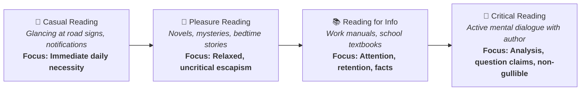
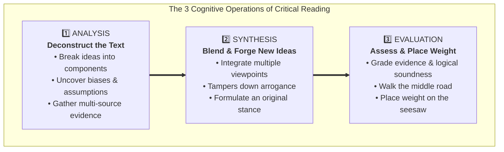
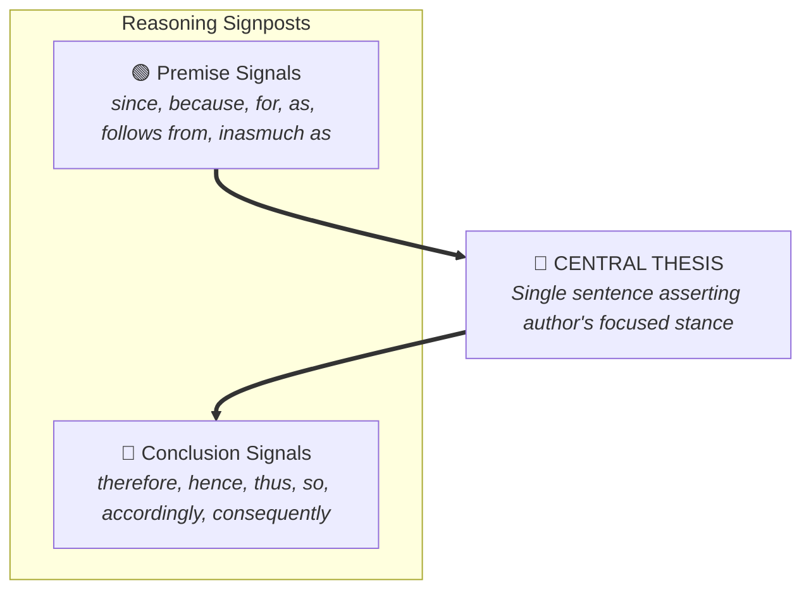
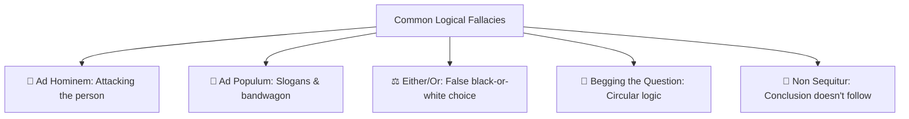
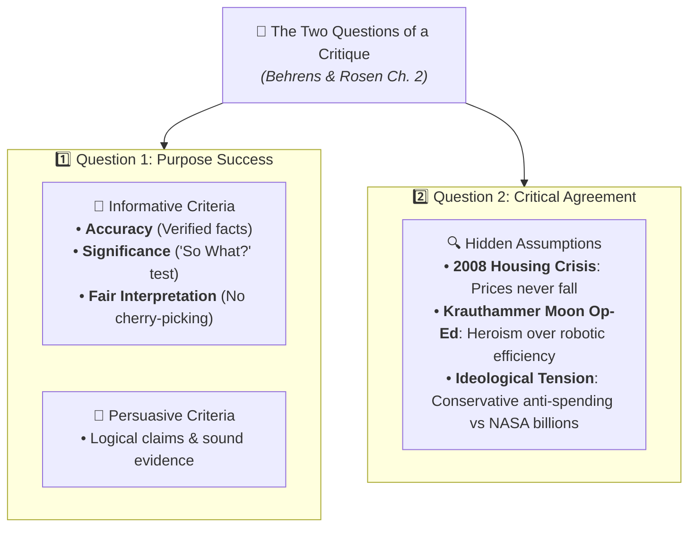
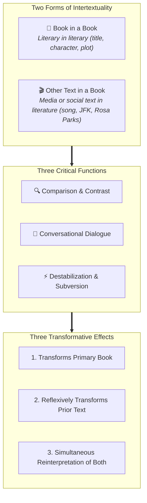

# Quick Study Guide & Summary: Critical Reading as Looking for Ways of Thinking (Beginner Level)

**Subject:** Reading and Writing Skills | **Unit:** Week 2  
**Audience Level:** Beginner (Foundational & Visual Learner Focus)  
**Target Bloom's Levels:** Remembering (L-1) & Understanding (L-2)  
**Curriculum Materials:** critical reading.md, Reading Critically.md, reading_essays.md, intertextuality.md, critical_reading_and_critique_extracted.md  
**Institution:** De La Salle University - Senior High School Department  

---

## 🖼️ 1. Master Infographic: The Four Kinds of Reading

Reading is not just one simple activity. Stuart and Terry Hirschberg (*The Millennium Reader*) identify four different kinds:

### 📌 Core Textbook Definitions (Kept Intact)
* **Casual Reading:** Glancing at magazines, newspaper headlines, letters, email messages, and roadside signs out of necessity.
* **Reading for Pleasure:** Relaxed and uncritical reading (like mystery novels or bedtime stories) where the reader is transported to an imaginary world.
* **Reading for Information:** Used as a tool at work or school; requires attention, understanding, and memorization to do a job or complete an assignment.
* **Critical Reading:** Active reading where you engage in a mental dialogue with the writer, question claims, deduce consequences, and avoid gullibility.

---

## 🖼️ 2. Infographic: The Cognitive Triad of Critical Reading

Critical reading requires your mind to perform three essential steps:

* **Analysis:** Taking the reading apart to see how ideas are composed, how they connect, and what biases are present.
* **Synthesis:** Blending different ideas together to create an original opinion that belongs to you. It humbles us by showing that more than one valid opinion exists.
* **Evaluation:** Assessing and grading the material read, probing pros and cons, and taking a reasoned stand ("placing your weight on the seesaw").

---

## 🖼️ 3. Infographic: Essay Architecture & Traffic Signals

In *Writing and Reading Across the Curriculum*, Behrens and Rosen explain that every essay has a spine:

* **Thesis Statement:** A single sentence asserting the author's central stance on a debatable topic (e.g. Mark Twain's thesis that only humans seek petty revenge).
* **Premise Signals:** Words that announce reasons (*because, since, for, follows from, inasmuch as*).
* **Conclusion Signals:** Words that announce outcomes (*therefore, thus, hence, consequently, it follows that*).

---

## 🖼️ 4. Infographic: Common Logical Fallacies

Never accept an argument on eloquent words alone! Watch out for:
* **Ad Hominem:** Attacking the person instead of the argument.
* **Ad Populum:** Appealing to popular slogans or bandwagon emotions.
* **Either/Or (False Dilemma):** Pretending there are only two extreme choices.
* **Begging the Question:** Circular reasoning where the claim assumes its own conclusion.
* **Non Sequitur:** Making a leap that doesn't follow from the evidence.

---

## 🖼️ 5. Infographic: The Two Questions of a Critique & Assumptions

In Chapter 2 of *Writing and Reading Across the Curriculum*, Behrens and Rosen show how critical reading turns into writing an academic critique:

### The Two Master Questions:
1. **Question 1: To what extent does the author succeed in his or her purpose?**
   * *For Informative Writing:* Evaluate **Accuracy** (correct facts), **Significance** (the "So What?" test), and **Fair Interpretation** (balanced view).
   * *For Persuasive Writing:* Evaluate whether the thesis is supported with sound logic.
2. **Question 2: To what extent do you agree with the author?**
   * Evaluate the author's **hidden assumptions**—the unstated beliefs beneath the claims.
   * *The 2008 Subprime Mortgage Crisis:* Wall Street collapsed because lenders assumed home prices would never fall nationwide.
   * *Charles Krauthammer's Moon Op-Ed:* Concedes that robots are cheaper, safer, and provide better science, yet insists on human astronauts because of a hidden romantic assumption about national greatness!

---

## 🖼️ 6. Infographic: Intertextuality and Hypertext

* **Intertextuality:** Borrowing or referencing a literary, media, or social "text" inside another text (Dharwadker et al.).
* **Two Forms:** *Book in a Book* (literary in literary) and *Other Text in a Book* (media or cultural event in literature).
* **Three Functions:** Comparison, Dialogue, and Destabilization.
* **Three Effects:** Transforms primary book, reflexively transforms prior text, and creates simultaneous re-reading of both!
* **Hypertext Link:** Hypertext connects digital documents with clickable web links; Intertextuality is the cognitive hypertext connecting human ideas across centuries!
