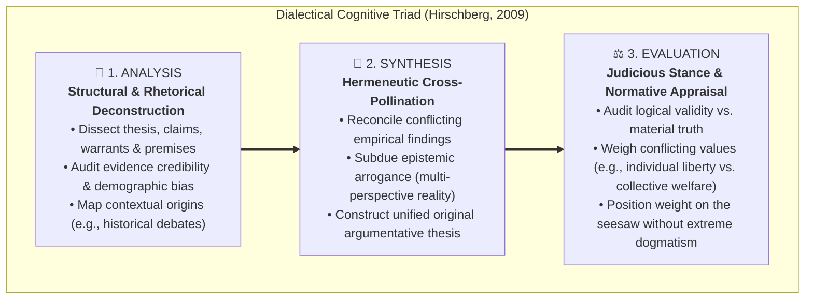
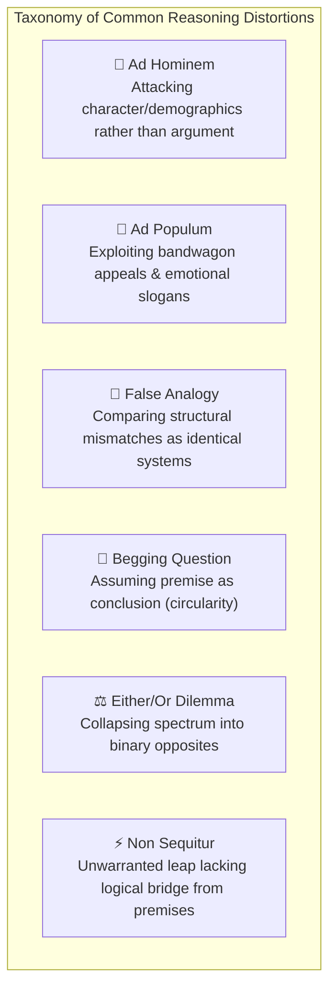
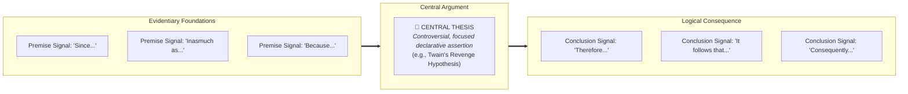
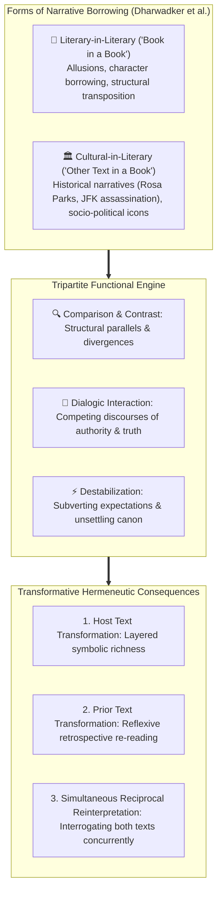

# Detailed Study Guide: Critical Reading as Looking for Ways of Thinking (Intermediate Level)

**Subject:** Reading and Writing Skills | **Curriculum:** Week 2  
**Target Audience:** Intermediate Scholars (Applied Rhetorical Analysis, Argumentation Theory & Hermeneutics)  
**Academic References:**  
1. Metherell, J.R. & Winkler, A. (2007). *Readings for Writers* (2nd ed., pp. 1-10).  
2. Hirschberg, S. & Hirschberg, T. (2009). *The Millennium Reader* (5th ed., pp. 1-3).  
3. Behrens, L. & Rosen, L. (2000). *Writing and Reading Across the Curriculum* (7th ed., pp. 45-55).  
4. Dharwadker, Dharwadker, Harrison, Lemaster, & Bourenane. *What is Intertextuality?* (p. 70).  
5. DLSU Senior High School Department (2024-2025). *Critical Reading as Looking for Ways of Thinking* (`critical reading.md`).  

---

## 1. Epistemology of Reading: From Passive Absorption to Dialectical Duel

```mermaid
quadrantChart
    title Reading Modality Quadrant (Cognitive Depth vs Engagement)
    x-axis Low Engagement --> High Active Engagement
    y-axis Uncritical Reception --> Critical Interrogation
    quadrant-1 Critical Reading (Dialectic, Fallacy Detection)
    quadrant-2 Reading for Information (Memorization, Academic Tool)
    quadrant-3 Casual Reading (Skimming, Environmental Obligation)
    quadrant-4 Reading for Pleasure (Escapist Surrender, Fiction)
    "Casual Reading": [0.15, 0.25]
    "Reading for Pleasure": [0.75, 0.20]
    "Reading for Information": [0.45, 0.65]
    "Critical Reading": [0.85, 0.88]
```

Reading in academic and professional contexts cannot remain confined to literal decoding. In *The Millennium Reader*, Stuart and Terry Hirschberg present an epistemological taxonomy:
* **Casual Reading:** The low-cognitive-load processing of urban environmental text (street signs, notices, UI alerts). It is compulsory rather than contemplative.
* **Reading for Pleasure:** A voluntary, aesthetic surrender to fictional narratives. Disbelief is willingly suspended; the reader seeks imaginative absorption rather than analytical deconstruction.
* **Reading for Information:** Goal-oriented comprehension and mnemonic retention practiced by students and professionals. Although disciplined, it remains epistemologically submissive, treating the text as a stable repository of authoritative facts.
* **Critical Reading:** An active dialectical duel. Rather than absorbing content as truth, the critical reader interrogates the writer:
  > *"The writer says so-and-so is the case and you reply, 'Maybe so, but what about this?' You annotate the margins... You not only try to understand the author's main point, but you also try to deduce any consequences of it... Critical reading is not gullibility—accepting as truth anything you read."*

### Historical Genesis: Montaigne's Essais (1580)
Laurence Behrens and Leonard Rosen (*Writing and Reading Across the Curriculum*) contextualize this inquiring posture by returning to Michel de Montaigne. In 1580, Montaigne coined the term *essais* (attempts):
* Montaigne broke from medieval scholastic dogma, choosing to disclose an observant mind wrestling with internal attitudes, uncertainties, and opposing impulses.
* The essayist speaks directly to the reader without fictional personas or mythological allegories.
* Because an essay represents an exploratory "attempt," it invites reciprocal scrutiny from the critical reader as an intellectual equal.

---

## 2. The Cognitive Triad: Analysis, Synthesis, and Evaluation



### Step 1: Analysis (Structural and Ideological Deconstruction)
Analysis requires dissecting how an essay's argument is composed:
* Isolating the primary thesis from subordinate background context.
* Mapping supporting premises, empirical evidence, and logical warrants.
* Identifying authorial bias, institutional funding, and ideological predispositions.
* *Case Illustration (Online Dating):* When researching digital romance, analysis requires gathering peer-reviewed sociological studies, psychological counseling data, and user testimonies to separate empirical trends from commercial marketing claims.

### Step 2: Synthesis (Dialectical Cross-Pollination)
Synthesis involves integrating analyzed components into an original, coherent thesis:
* Fusing disparate and sometimes contradictory perspectives into a multi-faceted framework.
* **The Epistemic Antidote to Arrogance:** Hirschberg emphasizes that synthesis humbles the scholar by proving that on complex public policy and human dilemmas, single-variable dogmatic solutions are invalid.
* Producing an authentic voice that synthesizes divergent inputs into a mature perspective.

### Step 3: Evaluation (Normative Judgment & Positioning)
Evaluation requires assessing the argumentative weight and logical soundness of the synthesized materials:
* Auditing evidence against criteria of sufficiency, relevance, and methodological credibility.
* **Placing Weight on the Seesaw:** Critical scholars cannot retreat into passive relativism ("everyone has their opinion"). One must take a reasoned stance while maintaining intellectual humility—walking the middle road to avoid extreme polarization.

---

## 3. Systematic Breakdown of the 14 Guidelines for Critical Reading (Metherell & Winkler)

Metherell and Winkler articulate 14 operational rules governing critical reading:

### Phase I: Reader Persona & Active Demystification
1. **Read actively:** Maintain continuous dialogue; annotate marginal reactions, challenge unsupported leaps, and flag factual inaccuracies.
2. **Demystify the writer:** "Kick the writer off the throne of public esteem." Authors are mortal, fallible beings operating within personal constraints and ideological blind spots.
3. **Understand what you read:** Rereading, dictionary lookup, and vocal oral summarization must precede evaluation. Comprehension is the prerequisite of critique.

### Phase II: Perspective Reversal & Bias Detection
4. **Imagine an opposing point of view:** Invert the author's core thesis to test its structural resilience.  
   * *Example:* While animal welfare advocates condemn medical testing on dogs, critical analysis requires contemplating the millions of human lives preserved through insulin, which was developed via canine trials.
5. **Look for biases and hidden assumptions:** Examine biographical headnotes (age, socioeconomic status, academic discipline, political alignment). An atheist and a Roman Catholic approach bioethics from fundamentally disparate metaphysical warrants.
6. **Separate emotion from fact:** Strip away sensationalized vocabulary, bumper-sticker philosophizing, and the demonization of ideological adversaries.

### Phase III: Interdisciplinary Fact-Checking & Evidentiary Scrutiny
7. **Fill gaps in knowledge:** If encountering an unfamiliar controversy, consult primary stakeholders and empirical datasets before formulating an opinion.
8. **Use insights from one subject to illuminate or correct another:** Interdisciplinary cross-examination.  
   * *Textbook Example:* Refuting psychological generalizations about natural passivity among oppressed populations by citing Native American armed resistance at Fallen Timbers (1794), Tippecanoe (1811), and the Black Hawk War (1832).
9. **Evaluate evidence recency and validity:**  
   * *Case Study (Dr. Susumu Tonegawa, MIT, 1976):* Before Tonegawa's genetic breakthrough, antibody diversity was deemed an impenetrable enigma. A 1975 scientific source asserting the mystery of antibody creation is factually obsolete today. Always timestamp evidence!
10. **Ponder the values behind a claim:** Identify ethical premises (e.g., Jeffersonian equality vs. Marxist labor theory; retribution vs. human dignity in capital punishment).

### Phase IV: Formal Fallacy Detection, Annotation & Discourse Context
11. **Recognize logical fallacies:**

12. **Don't be seduced by bogus claims:** Reject unverified declarations ("Studies show beyond doubt...") lacking transparency, sample size, or verifiable citations.
13. **Annotate your reading:** Writing marginalia converts passive reading into an active academic seminar. Avoiding notes to protect resale value is "penny-wise and pound-foolish."
14. **Understand the writer's opening context:** Situate the text within ongoing historical and cultural debates.  
   * *Case Study (Andy Rooney on Fowler):* Written for the 2000 Screenwriters Guild symposium *A Writer's Fantasy: What I Wish I Had Written*, Rooney's essay satirizes grammatical pedantry (split infinitives, zeugma, syllepsis, and fusty rules like "It is I"). Without understanding this comedic context, the essay's rhetorical purpose is lost.

---

## 4. Essay Architecture: Thesis Identification & Reasoning Signposts



In *Writing and Reading Across the Curriculum*, Behrens and Rosen establish that expository and argumentative essays rely on identifiable structural conventions:
* **The Central Thesis:** Typically positioned within the introductory paragraphs, the thesis asserts the author's response to an issue open to debate.
  * *Mark Twain Case Study (The Lowest Animal):* Twain shocks the audience by overturning evolutionary hierarchies:
    > *"In the course of my experiments I convinced myself that among the animals man is the only one that harbors insults and injuries, broods over them, waits till a chance offers, then takes revenge. The passion of revenge is unknown to the higher animals."*
* **Premise Signals (Reasoning Starters):** *since, because, for, as, follows from, as shown by, inasmuch as, otherwise, as indicated by, the reason is that, may be inferred from, may be derived from, may be deduced from, in view of the fact that*.
* **Conclusion Signals (Reasoning Closers):** *therefore, hence, thus, so, accordingly, in consequence, it follows that, we may infer, I conclude that, in conclusion, in summary, which shows that, which means that, and which entails, consequently, proves that, as a result, which implies that, points to the conclusion that*.

---

## 5. Intertextuality & Hypertext: Cultural Memory and Non-Linear Networks



### Theory of Intertextuality (Dharwadker et al.)
Intertextuality is the explicit or implicit application of a prior literary, media, or social "text" within another host text, inviting comparative cognitive engagement.

### The Two Structural Forms
1. **Form 1: Book in a Book (Literary in Literary):** Brief allusions (character names, famous phrases) or prolonged narrative adoptions (adapting an entire plot or revisiting an iconic scene).
2. **Form 2: Other Text in a Book (Cultural/Media in Literary):** Incorporating non-literary narratives possessing distinct story arcs (songs, films, historical watershed moments like the assassination of JFK or Rosa Parks's 1955 Montgomery bus protest).

### The Tripartite Functional Engine
1. **Comparison:** Activating the reader's prior knowledge to draw thematic parallels and divergences between source and host text.
2. **Conversational Dialogue:** Establishing a polyphonic dialogue between competing narrative worldviews.
3. **Destabilization:** Subverting conventional interpretations, unsettling comfortable assumptions in either the borrowed text or the host work.

### The Three Transformative Hermeneutic Consequences
1. **Transformation of the Primary Book:** Layering the new work with dense symbolic and cultural meaning.
2. **Transformation of the Prior Text (Reflexive Re-reading):** Compelling the reader to re-evaluate the original classic through the host text's contemporary lens.
3. **Simultaneous Mutual Reinterpretation:** A reciprocal hermeneutic dialectic where both texts interrogate each other continuously.

### Hypertext vs. Intertextuality Matrix
| Dimension | Hypertext | Intertextuality |
| :--- | :--- | :--- |
| **Medium** | Digital, electronic, web protocol | Hermeneutic, cognitive, cultural memory |
| **Mechanism** | Clickable URLs and document nodes | Narrative allusions, thematic echoes, archetypes |
| **Navigation** | Reader clicks physical links on screens | Mind navigates cultural associations in consciousness |
| **Historical Emergence**| Late 20th Century (Tim Berners-Lee) | Ancient / Innate to human storytelling and literature |
