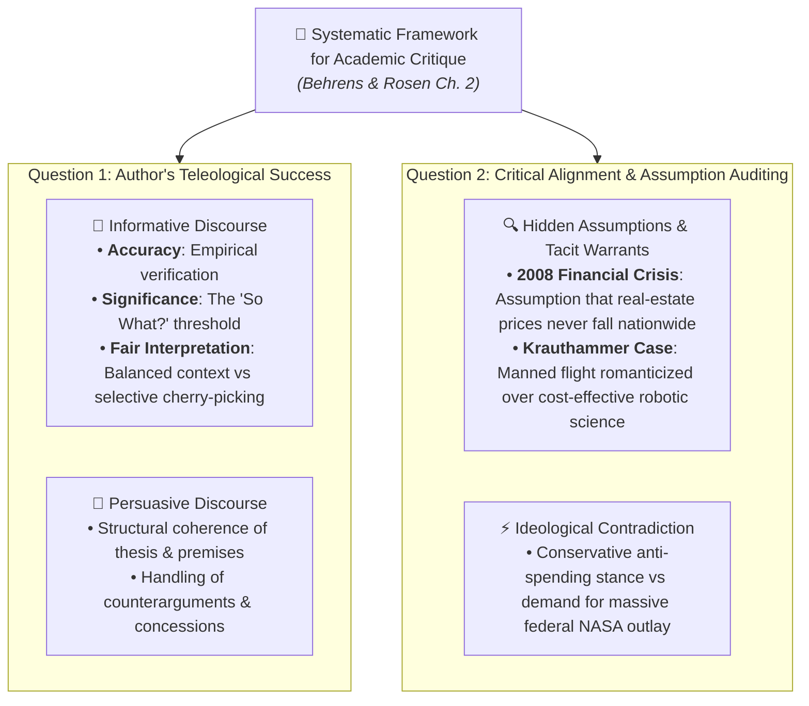

# Flashcards: Critical Reading as Looking for Ways of Thinking (Intermediate Level)

**Subject:** Reading and Writing Skills | **Total Cards:** 20 Cards  
**Audience Level:** Intermediate (Applied Analytical & Rhetorical Rigor)  

### Master Critique Matrix:

---
### Card 01
**Front:** Contrast 'Reading for Information' with 'Critical Reading' across cognitive engagement.  
**Back:**  
Reading for information is utilitarian memorization treating text as authoritative data; critical reading is an active dialectical duel questioning claims, premises, and biases.  

---
### Card 02
**Front:** What epistemological breakthrough did Michel de Montaigne achieve in 1580?  
**Back:**  
He coined 'essais' (attempts), moving prose from dogmatic pronouncements of absolute truth to personal disclosures of a mind exploring its attitudes and doubts.  

---
### Card 03
**Front:** Explain the 3 phases of Hirschberg's Cognitive Triad.  
**Back:**  
1. Analysis (Deconstructing claims & warrants)
2. Synthesis (Blending cross-disciplinary data into an original thesis)
3. Evaluation (Auditing evidentiary weight & taking a reasoned stand)  

---
### Card 04
**Front:** Why is Synthesis defined as the 'antidote to intellectual arrogance'?  
**Back:**  
Because synthesizing multiple conflicting perspectives proves that complex controversies have multi-faceted valid viewpoints, curbing one-sided dogmatism.  

---
### Card 05
**Front:** What does 'Demystifying the Writer' mean for Senior High School scholars?  
**Back:**  
Kicking the author off the pedestal of unquestioned esteem—auditing their work as a fallible human construction prone to demographic and ideological bias.  

---
### Card 06
**Front:** How does the insulin discovery case study support the principle of argument inversion?  
**Back:**  
Inverting the anti-animal-testing claim highlights that canine medical trials produced insulin, saving millions of human lives—forcing a nuanced ethical balance.  

---
### Card 07
**Front:** How do underlying philosophical values shape the arguments of Jefferson vs. Marx?  
**Back:**  
Jefferson bases his argument on universal individual equality; Marx bases his on the supreme societal value of labor. Claims are rooted in competing ethical warrants.  

---
### Card 08
**Front:** Explain how historical events refuted a psychological claim in Metherell & Winkler.  
**Back:**  
Native American resistance at Fallen Timbers (1794) and Tippecanoe (1811) disproved the psychological hypothesis that oppressed peoples naturally develop passive defeatism.  

---
### Card 09
**Front:** Why does Dr. Susumu Tonegawa's 1976 discovery emphasize the recency of scientific evidence?  
**Back:**  
Before 1976, antibody gene rearrangement was deemed an unsolved mystery. Using pre-1976 citations today would yield obsolete, factually inaccurate evidence.  

---
### Card 10
**Front:** Define the 'Ad Hominem' fallacy and explain why it is logically invalid.  
**Back:**  
Attacking the arguer's personal character rather than their premise. It is invalid because the truth of a claim is independent of the person asserting it.  

---
### Card 11
**Front:** Define 'Begging the Question' (Petitio Principii) and provide an example.  
**Back:**  
Circular reasoning where the premise assumes the truth of the conclusion (e.g., 'We must trust this text because it is trustworthy').  

---
### Card 12
**Front:** What are the TWO guiding questions of a critique according to Behrens & Rosen?  
**Back:**  
1. To what extent does the author succeed in his or her purpose?
2. To what extent do you agree with the author (evaluating their assumptions)?  

---
### Card 13
**Front:** What three criteria determine the quality of Informative Writing (Behrens & Rosen)?  
**Back:**  
1. Accuracy (empirical verification)
2. Significance (the 'So What?' threshold)
3. Fair Interpretation (balanced presentation without omission)  

---
### Card 14
**Front:** How did an unexamined hidden assumption trigger the 2008 Subprime Mortgage Crisis?  
**Back:**  
Financial institutions operated on the unexamined warrant that residential home prices would never nationwide fall, issuing hundreds of billions in toxic loans.  

---
### Card 15
**Front:** What hidden assumption and ideological contradiction exist in Krauthammer's Moon op-ed?  
**Back:**  
He assumed human romance outweighs robotic scientific superiority, and as a conservative critic of government spending, he ironically advocated massive NASA federal outlay.  

---
### Card 16
**Front:** List four Premise Signals and four Conclusion Signals.  
**Back:**  
Premise: 'inasmuch as', 'because', 'since', 'follows from'. Conclusion: 'consequently', 'therefore', 'thus', 'it follows that'.  

---
### Card 17
**Front:** Define Dharwadker's two forms of Intertextuality: Form 1 vs. Form 2.  
**Back:**  
Form 1: 'Book in a Book' (literary text in literary text). Form 2: 'Other Text in a Book' (media or historical narrative in literary text).  

---
### Card 18
**Front:** Explain the three functions of Intertextuality: Comparison, Dialogue, Destabilization.  
**Back:**  
Comparison contrasts source and host; Dialogue stages a polyphonic conversation; Destabilization subverts conventional interpretations of either narrative.  

---
### Card 19
**Front:** What are the three transformative effects produced by Intertextuality?  
**Back:**  
1. Transformation of the primary host text
2. Reflexive transformation of the prior text
3. Simultaneous reciprocal reinterpretation of both texts  

---
### Card 20
**Front:** Contrast digital Hypertext with literary Intertextuality.  
**Back:**  
Hypertext connects electronic nodes via clickable URLs; Intertextuality connects cultural and thematic narratives across the reader's consciousness.  

---
