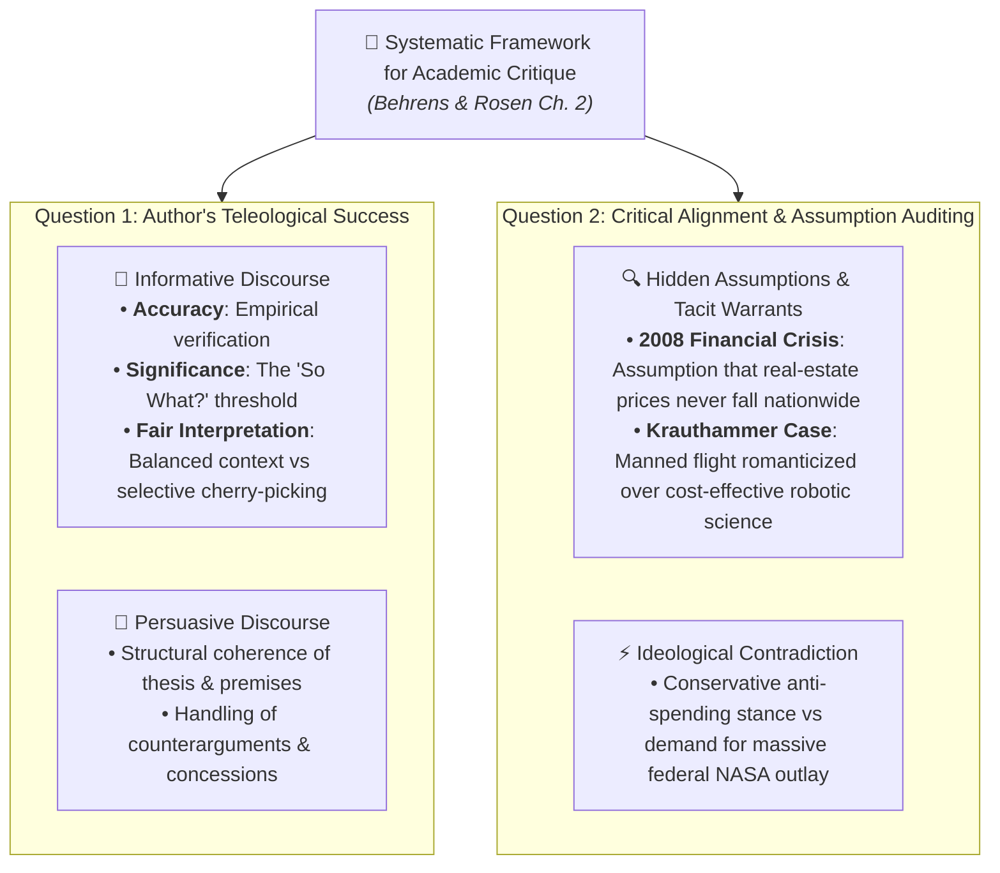

# Multiple Choice Questions (MCQ) - Chapter Test (Intermediate Level)

**Subject:** Reading and Writing Skills | **Unit:** Week 2  
**Total Questions:** 20 MCQs (4 Options Each)  

### Master Critique Matrix:

---
### Question 1
**Mindmap Location:** 1. Taxonomy of Reading > Hirschberg Spectrum  
**Question:** What distinguishes 'Critical Reading' from 'Reading for Information' in Hirschberg's epistemological framework?  
- A) Critical reading is exclusively reserved for literary fiction and poetry  
- B) Critical reading is an active dialectical duel interrogating authorial claims and warrants, whereas reading for information is utilitarian memorization  
- C) Reading for information requires higher mathematical fluency than critical reading  
- D) Critical reading strictly forbids the reader from taking margin notes  

Click to view Answer

<b>Correct Option: B</b> 
<b>Rationale:</b> Hirschberg establishes that reading for information is an occupational tool that treats the text as authoritative, while critical reading actively interrogates premises, detects bias, and avoids gullibility.

---
### Question 2
**Mindmap Location:** 1. Taxonomy of Reading > Montaigne's Essais  
**Question:** How did Michel de Montaigne's 1580 creation of the *essai* shift rhetorical engagement?  
- A) It introduced legally binding scientific peer-review protocols  
- B) It replaced dogmatic declarations of absolute certainty with personal explorations ('attempts') of an inquiring mind, inviting reciprocal evaluation  
- C) It mandated that all philosophical essays be written in rhyming iambic pentameter  
- D) It banned the use of the first-person singular pronoun in academic discourse  

Click to view Answer

<b>Correct Option: B</b> 
<b>Rationale:</b> Derived from 'essayer' (to attempt), Montaigne's essays disclosed personal inquiries rather than settled dogma, inviting readers to engage as intellectual equals.

---
### Question 3
**Mindmap Location:** 2. Cognitive Triad > Synthesis  
**Question:** Why does Hirschberg characterize Synthesis as the ultimate pedagogical antidote to intellectual arrogance?  
- A) It speeds up reading comprehension by eliminating the need to read entire chapters  
- B) It proves that on contentious issues, multiple valid viewpoints exist, shattering simplistic dogmatism  
- C) It forces students to memorize opposing arguments without evaluating their merits  
- D) It guarantees unanimous consensus among debating scholars  

Click to view Answer

<b>Correct Option: B</b> 
<b>Rationale:</b> Synthesis requires integrating disparate perspectives, demonstrating that complex human dilemmas cannot be collapsed into single-variable certainties.

---
### Question 4
**Mindmap Location:** 3. Guidelines > Demystification  
**Question:** According to Metherell and Winkler, what is the consequence of failing to 'demystify the writer'?  
- A) The reader fails to memorize the author's biography  
- B) The reader succumbs to passive gullibility, viewing fallible authors as infallible authorities  
- C) The reader receives an automatic failing grade on standardized exams  
- D) The author is legally allowed to sue the reader for copyright violations  

Click to view Answer

<b>Correct Option: B</b> 
<b>Rationale:</b> Demystifying authors prevents readers from bowing down to published authority, reminding them that writers carry personal biases and flawed logic.

---
### Question 5
**Mindmap Location:** 3. Guidelines > Argument Inversion  
**Question:** How does the canine medical research case study illustrate Metherell & Winkler's guideline of 'Argument Inversion'?  
- A) It proves that animals should never be used in scientific experiments under any circumstances  
- B) It demonstrates that inverting the anti-testing claim reveals how canine trials discovered insulin, saving millions of human lives  
- C) It shows that dogs are biologically identical to human beings in every physiological system  
- D) It asserts that scientific essays should avoid discussing ethical dilemmas  

Click to view Answer

<b>Correct Option: B</b> 
<b>Rationale:</b> Inverting an argument forces readers to evaluate counter-evidence: while animal testing is ethically fraught, canine trials produced insulin, preserving millions of diabetic lives.

---
### Question 6
**Mindmap Location:** 3. Guidelines > Interdisciplinary Illumination  
**Question:** How does knowledge of American history correct an empirical error in psychology regarding oppressed populations?  
- A) It shows that psychologists never publish verified data  
- B) Historical documentation of Native American armed resistance (e.g., Fallen Timbers, Tippecanoe) refutes claims of natural passivity  
- C) It demonstrates that psychology and history share identical statistical methodologies  
- D) It proves that oppressed populations always accept subjugation without protest  

Click to view Answer

<b>Correct Option: B</b> 
<b>Rationale:</b> Metherell and Winkler show that historical documentation of armed resistance refutes psychological generalizations regarding innate defeatist passivity.

---
### Question 7
**Mindmap Location:** 3. Guidelines > Evidentiary Recency  
**Question:** Why does citing a 1975 medical study on antibody diversity represent a failure of critical evidence evaluation?  
- A) Because scientific publications older than twenty years are legally classified as public domain  
- B) Because Dr. Susumu Tonegawa's 1976 discovery resolved antibody gene rearrangement, rendering 1975 claims of 'impenetrable mystery' obsolete  
- C) Because immunology was only recognized as a legitimate medical field in 1980  
- D) Because pre-1976 medical texts were printed without peer-review procedures  

Click to view Answer

<b>Correct Option: B</b> 
<b>Rationale:</b> Tonegawa's 1976 discovery solved the genetic mechanism of antibody variation; relying on a 1975 text presents superseded, factually incorrect science.

---
### Question 8
**Mindmap Location:** 3. Guidelines > Logical Fallacies  
**Question:** Which logical fallacy is committed in: 'We cannot trust Dr. Rivera's climate economic model because he drives a sports car'?  
- A) Petitio Principii (Begging the Question)  
- B) Ad Hominem (Genetic character attack)  
- C) False Analogy  
- D) Ad Populum (Bandwagon appeal)  

Click to view Answer

<b>Correct Option: B</b> 
<b>Rationale:</b> Ad Hominem attacks personal characteristics rather than evaluating the empirical validity or mathematical rigor of the economic model.

---
### Question 9
**Mindmap Location:** 3. Guidelines > Logical Fallacies  
**Question:** What constitutes the fallacy of *Begging the Question* (Petitio Principii)?  
- A) Asking a question that offends the author's political beliefs  
- B) Circular reasoning wherein the argument assumes as a premise the very conclusion it seeks to demonstrate  
- C) Comparing two completely unrelated biological systems  
- D) Drawing a conclusion that is supported by too much empirical evidence  

Click to view Answer

<b>Correct Option: B</b> 
<b>Rationale:</b> Begging the question is circularity: asserting a claim as evidence for itself (e.g., 'This law is just because it is a righteous statute').

---
### Question 10
**Mindmap Location:** 3. Guidelines > Opening Context  
**Question:** What opening context is required to properly interpret Andy Rooney's essay on Fowler's *Modern English Usage*?  
- A) It was a sworn deposition in a federal copyright infringement trial  
- B) It was written for a Screenwriters Guild symposium ('A Writer's Fantasy'), using satirical irony to mock pedantic grammar rules  
- C) It was an official academic preface commissioned for the Oxford English Dictionary  
- D) It was a private diary entry published posthumously without Rooney's permission  

Click to view Answer

<b>Correct Option: B</b> 
<b>Rationale:</b> Rooney's essay was written for the Screenwriters Guild symposium 'A Writer's Fantasy' (2000), playfully satirizing prescriptivist pedantry.

---
### Question 11
**Mindmap Location:** 4. Essay Architecture > Thesis Identification  
**Question:** In Mark Twain's *The Lowest Animal*, what fundamental premise underpins his thesis?  
- A) Darwinian evolution proves humans are morally superior to all other species  
- B) Humans are the only creatures driven by petty revenge, harboring insults, and inflicting deliberate cruelty  
- C) Quadruped mammals lack emotional capacity and nervous system responses  
- D) Scientific experimentation should be banned across all university laboratories  

Click to view Answer

<b>Correct Option: B</b> 
<b>Rationale:</b> Twain argues that revenge and premeditated cruelty are uniquely human vices absent in other animal species.

---
### Question 12
**Mindmap Location:** 4. Essay Architecture > Signposts  
**Question:** Which of the following phrases functions as a PREMISE SIGNAL rather than a conclusion signal?  
- A) 'Consequently, it follows that'  
- B) 'Points to the conclusion that'  
- C) 'Inasmuch as it is evident that'  
- D) 'Accordingly, we deduce that'  

Click to view Answer

<b>Correct Option: C</b> 
<b>Rationale:</b> 'Inasmuch as' introduces supporting evidentiary reasons (premise). The others are conclusion signals.

---
### Question 13
**Mindmap Location:** 7. Critical Reading for Critique > Two Questions  
**Question:** According to Behrens and Rosen, what are the two core questions structuring an academic critique?  
- A) 1. How long is the document? 2. Is the font readable?  
- B) 1. To what extent does the author succeed in their purpose? 2. To what extent do you agree with the author?  
- C) 1. Does the author agree with government policy? 2. Is the text illustrated?  
- D) 1. What awards has the author won? 2. How much was the publishing advance?  

Click to view Answer

<b>Correct Option: B</b> 
<b>Rationale:</b> Behrens and Rosen structure critique around: Question 1 (assessing rhetorical success in purpose) and Question 2 (evaluating critical agreement and assumptions).

---
### Question 14
**Mindmap Location:** 7. Critical Reading for Critique > Informative Criteria  
**Question:** In Behrens and Rosen's critique framework, how is the 'So What?' question defined?  
- A) It tests whether an essay contains grammatical errors  
- B) It tests Significance—whether the factual assertions are intellectually meaningful and relevant, or merely trivial  
- C) It tests whether the author's tone is sufficiently humorous  
- D) It tests whether the essay has been translated into multiple languages  

Click to view Answer

<b>Correct Option: B</b> 
<b>Rationale:</b> The 'So What?' test represents Significance: verifiable facts must possess meaningful relevance to the core inquiry.

---
### Question 15
**Mindmap Location:** 7. Critical Reading for Critique > Subprime Crisis  
**Question:** What unexamined hidden assumption catalyzed the 2008 Subprime Mortgage Financial Collapse?  
- A) That computer algorithms would replace Wall Street bankers by 2010  
- B) That U.S. residential real estate prices would perpetually appreciate and never decline nationwide  
- C) That mortgage borrowers preferred paying high interest rates over fixed rates  
- D) That foreign central banks would refuse to purchase American treasury bonds  

Click to view Answer

<b>Correct Option: B</b> 
<b>Rationale:</b> Financial markets predicated hundreds of billions in derivatives upon the tacit assumption that nationwide home values would never drop.

---
### Question 16
**Mindmap Location:** 7. Critical Reading for Critique > Krauthammer Op-Ed  
**Question:** What underlying warrant explains Charles Krauthammer's insistence on manned space missions despite robotic superiority?  
- A) Krauthammer believed robots were scientifically incapable of taking color photographs  
- B) Krauthammer operated on the romantic warrant that true space exploration requires human presence and heroic adventure, rather than scientific efficiency  
- C) Krauthammer owned substantial stock in commercial aerospace launch companies  
- D) Krauthammer believed the Moon contained secret mineral deposits needed for energy  

Click to view Answer

<b>Correct Option: B</b> 
<b>Rationale:</b> Krauthammer explicitly conceded robotic probes yield better science, but his unstated romantic warrant valued human heroism above cost-effective data collection.

---
### Question 17
**Mindmap Location:** 5. Intertextuality > Forms  
**Question:** In Dharwadker's taxonomy, how does Form 2 ('Other Text in a Book') operate within a literary narrative?  
- A) It prints an entire second textbook as an appendix  
- B) It incorporates a media or historical narrative (e.g., Rosa Parks's protest) that injects an active pre-existing cultural storyline into the host work  
- C) It replaces all fictional character dialogue with verbatim legal transcripts  
- D) It translates the host novel into HTML code  

Click to view Answer

<b>Correct Option: B</b> 
<b>Rationale:</b> Form 2 weaves cultural or media narratives possessing distinct story arcs into literature, bringing instant moral and narrative resonance.

---
### Question 18
**Mindmap Location:** 5. Intertextuality > Functions  
**Question:** How does the 'Destabilization' function of intertextuality challenge canonical literature?  
- A) By physically damaging library editions of classic works  
- B) By subverting settled interpretations and exposing latent ideological biases in the source canon  
- C) By reordering the alphabetical catalog of university libraries  
- D) By legally banning the publication of classic literature  

Click to view Answer

<b>Correct Option: B</b> 
<b>Rationale:</b> Destabilization subverts comfortable readings, exposing unexamined ideological assumptions in the source text through a contemporary re-framing.

---
### Question 19
**Mindmap Location:** 5. Intertextuality > Transformative Effects  
**Question:** What characterizes Dharwadker's concept of 'Reflexive Re-reading'?  
- A) Reading a text backward from the final chapter to the introduction  
- B) A retrospective transformation wherein encountering an intertext permanently alters how the reader understands the original source text  
- C) Rereading a textbook strictly the night before an examination  
- D) Automatically forgetting a classic story once a modern adaptation is read  

Click to view Answer

<b>Correct Option: B</b> 
<b>Rationale:</b> Reflexive re-reading occurs when an adaptation or intertext permanently reshapes the reader's retrospective perception of the original work.

---
### Question 20
**Mindmap Location:** 6. Hypertext vs. Intertextuality  
**Question:** What is the primary distinction between digital Hypertext and literary Intertextuality?  
- A) Hypertext links electronic documents via digital web code, while Intertextuality links cultural concepts across human consciousness  
- B) Hypertext is strictly linear, while Intertextuality is strictly non-linear  
- C) Intertextuality was invented in the 1990s by computer software developers  
- D) Hypertext can only be used on mobile smartphones, not personal computers  

Click to view Answer

<b>Correct Option: A</b> 
<b>Rationale:</b> Hypertext is an electronic protocol connecting digital nodes; intertextuality is an innate cognitive and cultural mechanism connecting stories across human consciousness.

---
