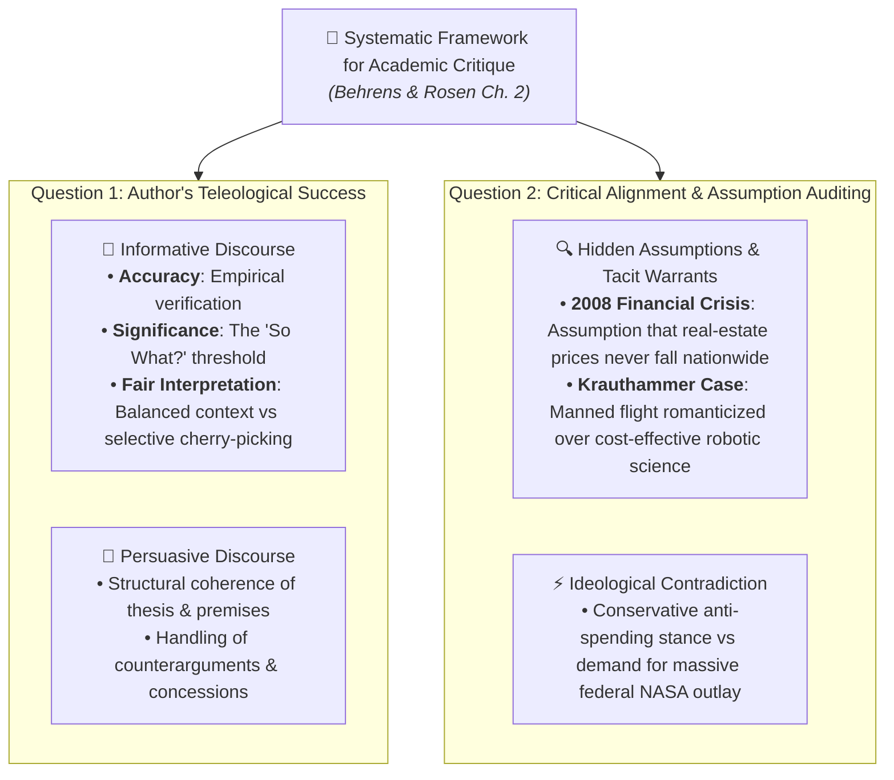

# Multiple Select Questions (MSQ) - Chapter Study (Intermediate Level)

**Subject:** Reading and Writing Skills | **Unit:** Week 2 Curriculum  
**Total Questions:** 10 MSQs (One or More Correct Answers)  

### Master Critique Framework:

---
### Question 1
**Mindmap Location:** 1. Taxonomy of Reading > Modality Matrix  
**Question:** Which of the following characteristics differentiate 'Critical Reading' from 'Casual Reading' and 'Pleasure Reading'? (Select ALL that apply)  
- [ ] A) Active interrogation of underlying ideological warrants and demographic biases  
- [ ] B) Voluntary suspension of critical disbelief to experience escapist pleasure  
- [ ] C) Marginal annotation tracking premise and conclusion signposts  
- [ ] D) Interdisciplinary testing of evidentiary claims against other academic fields  

Click to view Answer

<b>Correct Options: A, C, D</b> 
<b>Rationale:</b> Critical reading involves active interrogation, marginalia, and interdisciplinary auditing. Voluntary suspension of disbelief defines reading for pleasure.

---
### Question 2
**Mindmap Location:** 2. Cognitive Triad > Epistemic Operations  
**Question:** Which of the following are valid operations of the Cognitive Triad (Hirschberg, 2009)? (Select ALL that apply)  
- [ ] A) Analysis: Deconstructing arguments into thesis, premises, and warrants  
- [ ] B) Subjugation: Conforming personal opinions to the published author's authority  
- [ ] C) Synthesis: Cross-pollinating multiple sources to temper dogmatic arrogance  
- [ ] D) Evaluation: Auditing evidentiary validity and placing weight on the seesaw  

Click to view Answer

<b>Correct Options: A, C, D</b> 
<b>Rationale:</b> Analysis, Synthesis, and Evaluation form Hirschberg's triad. Subjugation is the antithesis of critical thinking.

---
### Question 3
**Mindmap Location:** 3. Guidelines > Demystifying Authors  
**Question:** Why do Metherell and Winkler mandate kicking authors off the pedestal of public esteem? (Select ALL that apply)  
- [ ] A) Authors operate within personal demographic, political, and institutional biases  
- [ ] B) Authors are prone to errors of formal logic and material fact  
- [ ] C) To encourage cynical rejection of all scientific research  
- [ ] D) To establish an egalitarian relationship where reader and writer meet as peers  

Click to view Answer

<b>Correct Options: A, B, D</b> 
<b>Rationale:</b> Demystification recognizes human fallibility and bias, fostering egalitarian scrutiny rather than cynical nihilism.

---
### Question 4
**Mindmap Location:** 3. Guidelines > Logical Fallacies  
**Question:** Which of the following correctly pair a logical fallacy with its structural flaw? (Select ALL that apply)  
- [ ] A) Ad Hominem: Substituting personal attacks for substantive evidentiary refutation  
- [ ] B) Begging the Question: Using circular premises that assume the truth of the conclusion  
- [ ] C) Either/Or Dilemma: Artificially constraining a complex issue into binary polarities  
- [ ] D) Non Sequitur: Formulating conclusions that are excessively supported by peer-reviewed evidence  

Click to view Answer

<b>Correct Options: A, B, C</b> 
<b>Rationale:</b> Ad hominem, begging the question, and either/or dilemmas are correctly matched. A non sequitur is an unwarranted leap lacking logical connection.

---
### Question 5
**Mindmap Location:** 4. Essay Architecture > Connective Signals  
**Question:** Which of the following phrases serve as PREMISE SIGNALS in academic argumentation? (Select ALL that apply)  
- [ ] A) 'Inasmuch as'  
- [ ] B) 'In view of the fact that'  
- [ ] C) 'Consequently, it follows that'  
- [ ] D) 'Follows from the premise that'  

Click to view Answer

<b>Correct Options: A, B, D</b> 
<b>Rationale:</b> 'Inasmuch as', 'in view of the fact that', and 'follows from' introduce premises. 'Consequently' introduces a conclusion.

---
### Question 6
**Mindmap Location:** 7. Critical Reading for Critique > Informative Criteria  
**Question:** According to Behrens and Rosen, which THREE criteria must be audited when evaluating informative writing? (Select ALL that apply)  
- [ ] A) Accuracy: Factual veracity and empirical verification  
- [ ] B) Significance: Passing the 'So What?' test of intellectual meaningfulness  
- [ ] C) Fair Interpretation: Objective context without deceptive cherry-picking  
- [ ] D) Aesthetic Rhyme Scheme: Metrical symmetry across body paragraphs  

Click to view Answer

<b>Correct Options: A, B, C</b> 
<b>Rationale:</b> Accuracy, Significance, and Fair Interpretation are Behrens and Rosen's three criteria for evaluating informative discourse.

---
### Question 7
**Mindmap Location:** 7. Critical Reading for Critique > Charles Krauthammer Critique  
**Question:** Which of the following insights emerge from a critical rhetorical critique of Charles Krauthammer's 'The Moon We Left Behind'? (Select ALL that apply)  
- [ ] A) Krauthammer concedes that robotic probes are safer, cheaper, and scientifically superior  
- [ ] B) Krauthammer relies on a tacit romantic warrant that human presence is essential for civilizational greatness  
- [ ] C) Krauthammer demonstrates complete logical consistency with his conservative anti-spending philosophy  
- [ ] D) Krauthammer exhibits ideological tension by demanding massive taxpayer funding for NASA  

Click to view Answer

<b>Correct Options: A, B, D</b> 
<b>Rationale:</b> Krauthammer conceded robotic superiority, relied on romantic warrants, and displayed ideological tension by advocating massive government NASA spending despite his conservative anti-statism.

---
### Question 8
**Mindmap Location:** 7. Critical Reading for Critique > Assumption Auditing  
**Question:** Which of the following statements regarding HIDDEN ASSUMPTIONS in persuasive writing are TRUE? (Select ALL that apply)  
- [ ] A) An assumption is an unproven foundational premise taken for granted  
- [ ] B) The 2008 Subprime Collapse demonstrates that unexamined warrants can produce systemic real-world failure  
- [ ] C) Assumptions never affect an argument if the author possesses a university degree  
- [ ] D) Evaluating assumptions is the core task of Question 2 in an academic critique  

Click to view Answer

<b>Correct Options: A, B, D</b> 
<b>Rationale:</b> Assumptions are unproven foundational premises; unexamined warrants triggered the 2008 crisis, and auditing assumptions forms Question 2 of critique.

---
### Question 9
**Mindmap Location:** 5. Intertextuality > Tripartite Engine  
**Question:** Which of the following are the primary functions executed by intertextual borrowing? (Select ALL that apply)  
- [ ] A) Comparison: Activating analogical parallels between source and host text  
- [ ] B) Dialogue: Staging polyphonic discourse between competing worldviews  
- [ ] C) Destabilization: Subverting settled canon and exposing latent biases  
- [ ] D) Eradication: Legally extinguishing copyright ownership of older texts  

Click to view Answer

<b>Correct Options: A, B, C</b> 
<b>Rationale:</b> Comparison, Dialogue, and Destabilization constitute the tripartite engine of intertextuality.

---
### Question 10
**Mindmap Location:** 5. Intertextuality > Hermeneutic Consequences  
**Question:** Which transformative consequences occur during intertextual engagement (Dharwadker et al.)? (Select ALL that apply)  
- [ ] A) Layered enrichment and thematic deepening of the primary host text  
- [ ] B) Reflexive retro-reading transforming the reader's cognitive schema of the source text  
- [ ] C) Simultaneous reciprocal interrogation of both texts concurrently  
- [ ] D) Total erasure of the reader's short-term working memory  

Click to view Answer

<b>Correct Options: A, B, C</b> 
<b>Rationale:</b> Dharwadker outlines the three transformations: host text enrichment, reflexive retro-reading of the prior text, and simultaneous mutual reinterpretation.

---
