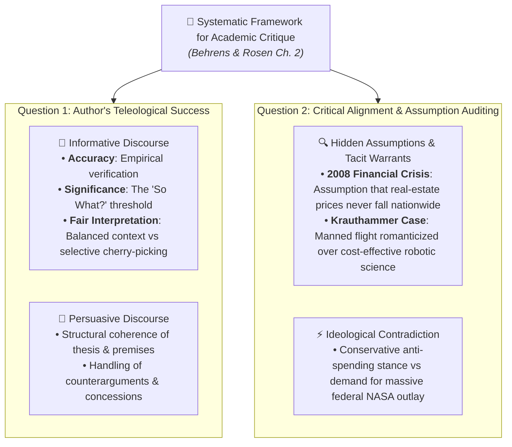

# Question Bank: Critical Reading as Looking for Ways of Thinking (Intermediate Level)

**Subject:** Reading and Writing Skills | **Unit:** Week 2 Curriculum  
**Total Questions:** 30 Questions (15 Short Answer + 15 Long Answer)  
**Academic Target:** Applied Analytical Rigor, Evidentiary Auditing & Rhetorical Mastery  

### Conceptual Schematic:

---

## PART A: SHORT ANSWER QUESTIONS (15 QUESTIONS)

### Question 1
**Mindmap Location:** 1. Taxonomy of Reading > Hirschberg Spectrum  
**Question:** Contrast the cognitive demands of "Reading for Information" with "Critical Reading."  
**Solution:**  
Reading for information focuses on comprehension and retention of authoritative facts to execute tasks or pass exams. Critical reading demands active dialectical interrogation—deconstructing arguments, probing underlying assumptions, detecting fallacies, and deducing consequences.

---

### Question 2
**Mindmap Location:** 1. Taxonomy of Reading > Montaigne's Essais  
**Question:** How does Montaigne's conception of the *essai* (1580) redefine the relationship between writer and reader?  
**Solution:**  
Montaigne conceived the essay as an exploratory "attempt" of a thinking mind rather than absolute dogma. The writer speaks directly without fictional disguise, inviting the reader to evaluate the line of thought as an intellectual equal.

---

### Question 3
**Mindmap Location:** 2. The Cognitive Triad > Analysis  
**Question:** What constitutes an analytical audit of an essay's arguments?  
**Solution:**  
An analytical audit involves decomposing the text into its central thesis, supporting claims, evidence, warrants, and identifying demographic or ideological biases.

---

### Question 4
**Mindmap Location:** 2. The Cognitive Triad > Synthesis  
**Question:** Explain how synthesis acts as an epistemic antidote to intellectual arrogance.  
**Solution:**  
Synthesis compels the scholar to integrate multiple conflicting sources, demonstrating that complex controversies possess multiple legitimate perspectives and curbing dogmatic overconfidence.

---

### Question 5
**Mindmap Location:** 2. The Cognitive Triad > Evaluation  
**Question:** What does the metaphor "placing your weight on the seesaw" signify in the evaluation stage?  
**Solution:**  
It signifies making a reasoned, evidence-based decision on a controversial dispute while maintaining balance—avoiding uncritical, dogmatic extremes.

---

### Question 6
**Mindmap Location:** 3. Guidelines > Demystification  
**Question:** Why is demystifying the writer essential for democratic literacy?  
**Solution:**  
Demystifying the writer strips away the illusion of infallibility, empowering citizens to scrutinize published claims, political rhetoric, and institutional policies rather than conforming to authority.

---

### Question 7
**Mindmap Location:** 3. Guidelines > Argument Inversion  
**Question:** Demonstrate the principle of "Argument Inversion" using the controversy over animal testing.  
**Solution:**  
When confronting an argument condemning animal testing, the reader inverts the premise to examine its counter-position: testing on dogs enabled the discovery of insulin, preserving millions of human lives.

---

### Question 8
**Mindmap Location:** 3. Guidelines > Interdisciplinary Illumination  
**Question:** How does interdisciplinary thinking prevent errors when evaluating academic claims?  
**Solution:**  
It allows insights from one field (e.g., historical resistance battles like Fallen Timbers) to correct unwarranted generalizations in another (e.g., a psychological claim of innate passivity in oppressed groups).

---

### Question 9
**Mindmap Location:** 3. Guidelines > Evidence Timestamping  
**Question:** What does Dr. Susumu Tonegawa's 1976 discovery illustrate regarding evidentiary recency?  
**Solution:**  
It demonstrates that scientific knowledge changes. Before 1976, antibody diversity was an unsolved mystery; citing a 1975 text today would present obsolete and false evidence.

---

### Question 10
**Mindmap Location:** 3. Guidelines > Ad Hominem Fallacy  
**Question:** Differentiate between an *Ad Hominem* attack and a legitimate critique of an author's credentials.  
**Solution:**  
An *Ad Hominem* attacks irrelevant personal traits (appearance, background) to dismiss an argument. Legitimate credential critique audits whether the author possesses relevant expertise and methodological competence on the specific topic.

---

### Question 11
**Mindmap Location:** 3. Guidelines > Begging the Question  
**Question:** Explain the structural failure in the fallacy of *Begging the Question* (Petitio Principii).  
**Solution:**  
It is circular: the arguer uses the claim they are trying to prove as a premise in the argument, offering no independent proof.

---

### Question 12
**Mindmap Location:** 3. Guidelines > Opening Context  
**Question:** Why did Andy Rooney choose Fowler's *Modern English Usage* as the subject of his essay?  
**Solution:**  
Commissioned for a Screenwriters Guild feature called *A Writer's Fantasy*, Rooney selected Fowler's legendary work to satirize grammatical prescriptivism and snooty usage rules.

---

### Question 13
**Mindmap Location:** 4. Essay Architecture > Signposts  
**Question:** Identify the role of "inasmuch as" versus "consequently" in argumentative flow.  
**Solution:**  
* "Inasmuch as" acts as a premise signal introducing evidentiary justification.  
* "Consequently" acts as a conclusion signal announcing a deductive result.

---

### Question 14
**Mindmap Location:** 7. Critical Reading for Critique > Two Guiding Questions  
**Question:** What two foundational questions structure an academic critique according to Behrens and Rosen?  
**Solution:**  
1. Question 1: To what extent does the author succeed in his or her purpose (whether informative, persuasive, or entertaining)?  
2. Question 2: To what extent do you agree with the author (analyzing their underlying assumptions and philosophical warrants)?

---

### Question 15
**Mindmap Location:** 7. Critical Reading for Critique > Informative Criteria  
**Question:** Contrast the criterion of "Accuracy" with "Significance" (the "So What?" question) in informative writing.  
**Solution:**  
Accuracy verifies that empirical statements are factually true and verifiable. Significance evaluates whether those accurate facts are intellectually meaningful and relevant to the inquiry; an essay can be 100% accurate while remaining trivial and useless.

---

## PART B: LONG ANSWER QUESTIONS (15 QUESTIONS)

### Question 16
**Mindmap Location:** 1. Taxonomy of Reading > Four Modes Comparison  
**Question:** Provide an exhaustive comparative analysis of the four reading modalities (Casual, Pleasure, Information, Critical). How does critical reading bridge academic inquiry and active citizenship?  
**Solution:**  
* **Casual Reading:** Characterized by low cognitive engagement and uncritical processing. The reader skims notices, signs, and alerts out of immediate necessity.  
* **Reading for Pleasure:** Aesthetic and escapist. The reader intentionally suspends critical disbelief to experience emotional immersion in imaginary worlds.  
* **Reading for Information:** Methodological and utilitarian. Practiced in academic and professional settings to acquire facts, procedures, and data. However, it remains submissive to the text.  
* **Critical Reading:** A dialectical duel characterized by active marginalia, ideological auditing, and evidentiary testing. It bridges scholarship and citizenship by cultivating the habit of questioning assertions, resisting demagoguery, and evaluating public policies independently.

---

### Question 17
**Mindmap Location:** 2. The Cognitive Triad > Application  
**Question:** Detail how a scholar applies Analysis, Synthesis, and Evaluation when investigating a complex sociopolitical issue such as "Universal Basic Income (UBI)."  
**Solution:**  
1. **Analysis:** The researcher decomposes diverse sources—economic econometric models, pilot project empirical data, and ideological arguments. The scholar maps underlying assumptions (free-market incentives vs. poverty eradication warrants) and audits methodology.  
2. **Synthesis:** The scholar blends conflicting economic findings (inflation risks vs. poverty reduction benefits). Synthesis tempers arrogance by showing that neither pure utopian nor catastrophic predictions are guaranteed. The researcher produces a multi-variable thesis.  
3. **Evaluation:** The scholar audits the recency and sufficiency of the trial data, spots fallacies (e.g., slippery slope claims), and places their weight on the seesaw—formulating a policy recommendation that balances fiscal realities with social welfare.

---

### Question 18
**Mindmap Location:** 3. Guidelines > Demystification & Authority  
**Question:** Analyze the pedagogical significance of Metherell & Winkler's mandate to "kick the writer off the throne of public esteem." Why do uncritical readers resist this?  
**Solution:**  
* **Pedagogical Significance:** Viewing published writers as fallible mortals transforms reading from passive submission into active peer review. It empowers students to evaluate arguments based on empirical proof and validity rather than celebrity ethos.  
* **Why Uncritical Readers Resist:** Readers naturally seek certainty and cognitive ease. Elevating authors to infallible status allows readers to bypass the strenuous labor of evaluating evidence, checking sources, and grappling with ambiguity.

---

### Question 19
**Mindmap Location:** 3. Guidelines > Biases & Worldviews  
**Question:** Examine how conflicting ideological warrants (e.g., Libertarianism vs. Progressive Social Welfare) dictate an author's argumentative architecture.  
**Solution:**  
Ideological warrants serve as unstated premises connecting evidence to claims:  
* A Libertarian author operating on the warrant of minimal state interference will interpret private management of utilities as inherently efficient and ethical.  
* A Progressive author operating on the warrant of state responsibility for the vulnerable will interpret private management as corporate exploitation.  
A critical reader must identify these latent ideological coordinate systems; without understanding them, one cannot evaluate the true validity of the author's conclusions.

---

### Question 20
**Mindmap Location:** 3. Guidelines > Interdisciplinary Rigor  
**Question:** Elaborate on the principle of using insights from one discipline to interrogate claims in another. Provide an original academic illustration.  
**Solution:**  
Interdisciplinary interrogation prevents academic silo blindness:  
* *Textbook Case:* Refuting psychological generalizations about passive surrender among oppressed groups by citing armed Native American resistance at Fallen Timbers (1794) and Tippecanoe (1811).  
* *Original Illustration:* An economist asserts that automating agricultural harvesting will universally enrich rural communities by raising overall GDP. An anthropologist or cultural geographer can interrogate this claim by demonstrating that sudden mechanization destroys traditional community kinships, creates mass urban migration, and destabilizes cultural heritage. Historical and anthropological data correct economic reductionism.

---

### Question 21
**Mindmap Location:** 3. Guidelines > Evidentiary Recency Case Study  
**Question:** Detail why scientific and academic evidence must be audited for temporal validity, using Dr. Susumu Tonegawa's 1976 immunology breakthrough as a case study.  
**Solution:**  
* **Epistemic Dynamics:** Scientific knowledge is iterative and falsifiable. What is deemed an impenetrable scientific mystery in one decade may be resolved in the next.  
* **Tonegawa Breakthrough:** Prior to 1976, genetics held that human DNA lacked sufficient coding capacity to account for millions of unique antibodies; the process was considered an unresolved enigma. In 1976 at MIT, Susumu Tonegawa proved that genetic fragments physically recombine to generate antibody diversity.  
* **Critical Lesson:** If a scholar cites a 1975 medical publication today, they are citing superseded claims. Critical readers must cross-check timestamps to ensure evidentiary freshness.

---

### Question 22
**Mindmap Location:** 3. Guidelines > Rooney Case Study  
**Question:** Deconstruct Andy Rooney's essay on Henry Watson Fowler's *Modern English Usage*. How does rhetorical irony operate in his text?  
**Solution:**  
* **Rhetorical Context:** Commissioned by the Screenwriters Guild in 2000 for *A Writer's Fantasy: What I Wish I Had Written*, Rooney adopts the persona of a grammar authority.  
* **Operation of Irony:** Rooney claims he wants Fowler's fame and definitive authority, but uses that authority to subvert starchy grammatical rules. He splits infinitives deliberately, jokes about arcane figures like zeugma and syllepsis, and ridicules the pedantic prohibition against objective predicate pronouns ("It is I").  
* **Critical Reader Takeaway:** Without identifying the opening context and satirical irony, a reader would mistake playful parody for reactionary prescriptivism.

---

### Question 23
**Mindmap Location:** 4. Essay Architecture > Mark Twain Analysis  
**Question:** How does Mark Twain establish and defend his thesis in *The Lowest Animal*? Evaluate his use of satirical hyperbole.  
**Solution:**  
* **Thesis Placement:** Twain places his central thesis early: human beings are the only animals driven by malice, grudges, and premeditated revenge.  
* **Argumentative Strategy:** Twain mimics scientific experimental methodology, comparing anacondas that kill only for sustenance with human monarchs who slaughter for wealth and religious intolerance.  
* **Rhetorical Evaluation:** While Twain uses extreme satirical hyperbole, his argument succeeds because his underlying premise—that animals lack vindictive sadism—exposes human moral failings by subverting evolutionary arrogance.

---

### Question 24
**Mindmap Location:** 4. Essay Architecture > Signpost Analysis  
**Question:** Explain how an author's misuse of premise and conclusion signals can disguise a logical fallacy. Provide an illustrative example.  
**Solution:**  
Writers sometimes use confident conclusion signals (*therefore, thus, consequently*) to mask the absence of legitimate premise signals (*because, since*):  
* *Example:* "Economic volatility has increased globally. Therefore, all tariffs must be doubled immediately."  
* *Deconstruction:* The word "therefore" creates the illusion of deductive inevitability. However, the author provided no premise demonstrating *how* doubling tariffs resolves volatility. The conclusion signal conceals a *Non Sequitur* fallacy.

---

### Question 25
**Mindmap Location:** 5. Intertextuality > Forms Analysis  
**Question:** Analyze the narrative mechanics of "Book in a Book" versus "Other Text in a Book" using distinct literary illustrations.  
**Solution:**  
* **Book in a Book:** Direct literary borrowing. For example, James Joyce structuring *Ulysses* upon the narrative architecture of Homer's *Odyssey*. The modern events in Dublin gain epic resonance by mirroring ancient mythic trials.  
* **Other Text in a Book:** Weaving historical or media narratives into fiction. For example, a novel featuring a character hearing the news of Rosa Parks's arrest on a bus radio. The author does not need to explain the history of racial segregation; the cultural narrative of Rosa Parks imports instant moral weight and historical realism into the fictional scene.

---

### Question 26
**Mindmap Location:** 5. Intertextuality > Tripartite Functional Engine  
**Question:** Dissect the tripartite functional engine of Intertextuality (Comparison, Dialogue, Destabilization). How does destabilization challenge canonical authority?  
**Solution:**  
* **Comparison:** Establishes an analogical bridge, inviting the reader to evaluate similarities and differences between hypotext and host text.  
* **Dialogue:** Creates a polyphonic discourse where competing ideologies and historical voices converse and contest authority.  
* **Destabilization:** Subverts settled assumptions. When a modern author rewrites a classic from the perspective of an oppressed subaltern character (e.g., Jean Rhys rewriting *Jane Eyre* from the perspective of Bertha Mason in *Wide Sargasso Sea*), it destabilizes the classic's canonical moral authority, exposing unexamined colonialist biases in the original.

---

### Question 27
**Mindmap Location:** 5. Intertextuality > Hermeneutic Consequences  
**Question:** Explain Dharwadker's concept of "Reflexive Retro-Reading" as a transformative effect of intertextuality.  
**Solution:**  
Reflexive retro-reading means that intertextual engagement does not merely flow forward from past to present; it flows backward retrospectively. When a reader engages with a powerful contemporary adaptation or subversion of a classic text, their cognitive memory of the original text is permanently altered. Even though the printed words of the original classic remain untouched, the reader can never read that original text again with uncritical innocence; it is now perpetually filtered through the lens of the subsequent intertext.

---

### Question 28
**Mindmap Location:** 6. Hypertext vs. Intertextuality Matrix  
**Question:** Evaluate the epistemological intersection between digital Hypertext and literary Intertextuality.  
**Solution:**  
* **Structural Parallel:** Both systems reject rigid linear sequencing in favor of associative, networked navigation.  
* **Technological vs. Cognitive:** Hypertext executes non-linear linkage externally via digital code, HTTP protocols, and clickable hyperlinks. Intertextuality executes non-linear linkage internally across the reader's cultural consciousness and cognitive schema.  
* **Epistemic Convergence:** Hypertext is the technological materialization of intertextuality. Intertextuality proves that human consciousness has always operated as a non-linear, hyperlinked web of narrative associations across centuries.

---

### Question 29
**Mindmap Location:** 7. Critical Reading for Critique > Subprime Mortgage Crisis  
**Question:** Deconstruct the role of unexamined assumptions in the 2008 Subprime Mortgage Financial Collapse as analyzed by Behrens and Rosen. What epistemic lesson does this provide for critical thinkers?  
**Solution:**  
* **Unexamined Assumption:** The entire global financial pyramid of mortgage-backed securities, collateralized debt obligations (CDOs), and credit default swaps was built upon a single unexamined warrant: *that U.S. residential real estate prices would never experience a nationwide decline.*  
* **Systemic Blindness:** Because this warrant was treated as an self-evident axiom, rating agencies granted AAA ratings to subprime bonds, and lenders abandoned basic income verification standards. When nationwide home prices depreciated, the unexamined warrant was falsified, triggering a near-total collapse of global liquidity.  
* **Epistemic Lesson:** When foundational assumptions remain unstated and untested, catastrophic systemic failure ensues. Critical reading is not an academic luxury; it is a safeguard against collective cognitive delusion.

---

### Question 30
**Mindmap Location:** 7. Critical Reading for Critique > Krauthammer Rhetorical Analysis  
**Question:** Conduct a rigorous rhetorical critique of Charles Krauthammer's op-ed "The Moon We Left Behind" (Time, 2009). Dissect his claims, concessions, hidden warrants, and ideological contradictions.  
**Solution:**  
* **Thesis & Diction:** Commemorating Apollo 11's 40th anniversary, Krauthammer deploys emotive, loaded rhetoric (*"ignominious retreat," "abandonment," "loss of national nerve"*) to argue that America must recommit to manned space exploration.  
* **Concession of Counterarguments:** To his rhetorical credit, Krauthammer acknowledges the primary counterargument: unmanned robotic rovers and space telescopes are vastly cheaper, eliminate risk to human life, and produce vastly superior scientific returns per dollar invested.  
* **Tacit Warrants:** Having conceded that science favors robots, Krauthammer insists humans must return. This reveals his tacit warrant: *The primary value of space exploration is not scientific utility or cost-benefit efficiency, but national prestige, existential adventure, and heroic frontier mythology.*  
* **Ideological Contradiction:** Krauthammer was an iconic conservative commentator celebrated for fiercely opposing government bureaucracy and profligate federal spending. Yet in this essay, his romantic nationalism compels him to champion a multi-billion dollar state-run government enterprise (NASA). A critical reader identifies this stark philosophical tension between his fiscal conservatism and his romantic statism.
