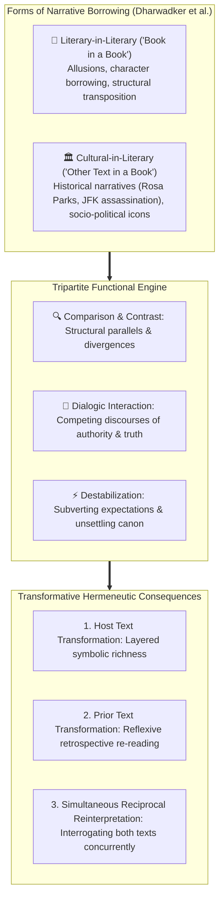

# Pop Quiz: Critical Reading as Looking for Ways of Thinking (Intermediate Level)

**Subject:** Reading and Writing Skills | **Unit:** Week 2  
**Level:** Intermediate | **Target Bloom's:** Analyzing (L-4)  

---

### Pop Quiz Question

**Mindmap Location:** 5. Intertextuality > Three Functions & Transformative Effects  
**Difficulty:** Intermediate  

**Question:**  
In Jean Rhys's novel *Wide Sargasso Sea*, the narrative reimagines the life of Bertha Mason, the "madwoman in the attic" from Charlotte Brontë's 19th-century classic *Jane Eyre*.  
According to Dharwadker et al.'s framework, which **function** and **transformative effect** of intertextuality are primarily at work when this modern retelling subverts our moral perception of Mr. Rochester and compels us to reconsider the colonial subtext of the original classic?

- **A)** Function: Passive Casual Reading; Effect: Technological Hypertext Encoding.
- **B)** Function: Destabilization; Effect: Reflexive Transformation of the Prior Text.
- **C)** Function: Sloganeering; Effect: Ad Hominem Fallacy Inversion.
- **D)** Function: Literal Memorization; Effect: Elimination of the Author's Thesis.

---

### Detailed Answer & Analysis

<b>Click to View Solution & Answer Breakdown</b>

 

**Correct Answer:** **Option B**

#### 💡 Why Option B is CORRECT:
* **Function: Destabilization:** Dharwadker et al. explain that intertextuality can *destabilize*, or shake up, our understanding of an original text that readers felt familiar with. By giving Bertha Mason a full narrative voice and showing her exploitation, Rhys destabilizes the comfortable Victorian narrative of *Jane Eyre*, subverting the romantic hero status of Mr. Rochester.
* **Transformative Effect: Reflexive Transformation of the Prior Text:** Even though the physical text of *Jane Eyre* remains untouched, reading *Wide Sargasso Sea* causes readers to *reflexively* re-read and reconsider their understanding of the original work. The classic is reframed and permanently transformed in cultural memory.

---

#### ❌ Why the Other Options are INCORRECT:
* **Option A is False:** Casual reading is low-attention skimming of environmental text, which is completely irrelevant to deep literary critique.
* **Option C is False:** Intertextual reimagining is an artistic dialogue, not an emotional political slogan or an ad hominem fallacy.
* **Option D is False:** Intertextuality does not eliminate the author's thesis; it enriches and complicates textual meaning.

