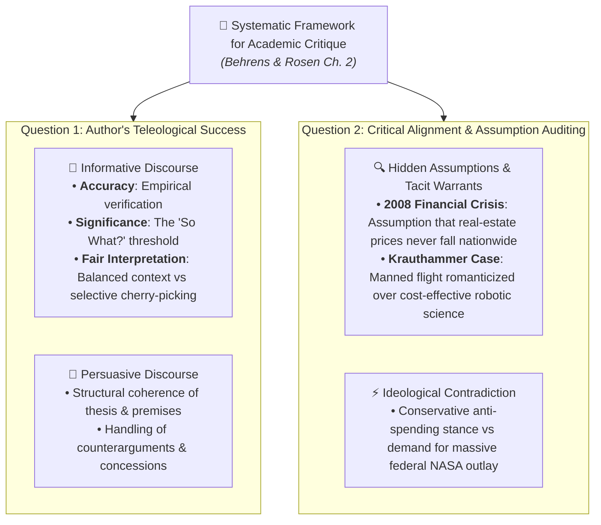

# Master Pop Quiz Study Guide: Critical Reading as Looking for Ways of Thinking (Intermediate Level)

**Subject:** Reading and Writing Skills | **Unit:** Week 2  
**Level:** Intermediate (Applied Rhetorical & Analytical Evaluation)  

### Master Critique Framework:

---

## Pop Quiz Assessment Matrix

### Core Evaluative Competencies:
1. **Reading Taxonomy:** Differentiating Information Reading vs. Dialectical Critical Reading (Hirschberg).  
2. **Cognitive Triad Mechanics:** Analysis, Synthesis (as arrogance antidote), and Evaluation (seesaw balance).  
3. **Metherell & Winkler Operational Guidelines:** Active margin interrogation, demystifying authorial ethos, argument inversion, and evidentiary timestamping (Tonegawa 1976).  
4. **Logical Fallacies:** Ad Hominem, Begging the Question (Petitio Principii), Either/Or Dilemmas, and Non Sequiturs.  
5. **Structural Architecture:** Thesis identification, premise signals (*inasmuch as, since*), and conclusion signals (*consequently, therefore*).  
6. **Critique Mechanics (Behrens & Rosen Ch. 2):**
   * *Question 1:* Author's success in purpose (Informative: Accuracy, Significance/"So What?", Fair Interpretation).
   * *Question 2:* Critical agreement and auditing hidden assumptions/warrants.
   * *Case Studies:* 2008 Subprime Mortgage crisis assumptions & Krauthammer's Moon op-ed rhetorical tensions.  
7. **Intertextuality & Transtextuality (Dharwadker et al.):** Forms (Book in a Book vs. Other Text in a Book), Tripartite Functions (Comparison, Dialogue, Destabilization), and Reflexive Retro-Reading.  

---

### Exemplary Analytical Question:

**Prompt:** In Chapter 2 of *Writing and Reading Across the Curriculum*, what makes Charles Krauthammer's advocacy for manned space exploration rhetorically paradoxical?  
- **A)** He claims the Moon is made of cheese while citing NASA physics.  
- **B)** He concedes that robotic probes are safer, cheaper, and provide superior scientific data, yet insists on human exploration based on romantic warrants—while advocating a massive government-funded initiative despite being a conservative critic of federal spending.  
- **C)** He denies that Apollo 11 ever took place.  
- **D)** He plagiarized his op-ed from Andy Rooney.  

<b>Click to View Solution</b>

<b>Correct Answer: Option B</b> 
<b>Rationale:</b> Behrens and Rosen showcase Krauthammer's op-ed as a prime case study of assumption auditing: Krauthammer explicitly concedes that robotic probes are scientifically superior and cost-effective, yet his romantic assumptions about human glory override his empirical concessions, and his call for massive state NASA spending contradicts his fiscal conservatism.

