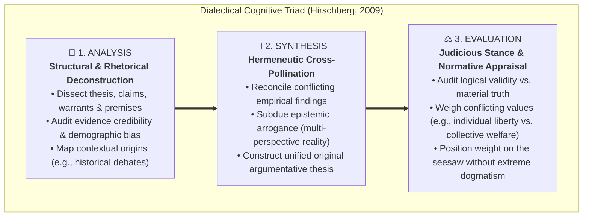
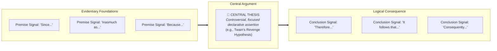
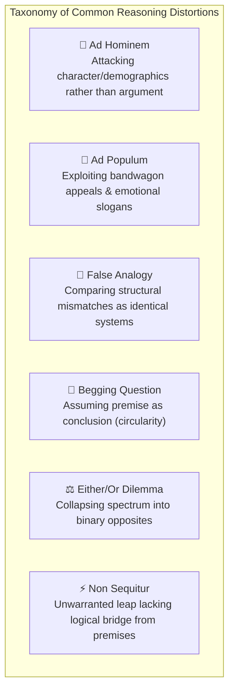
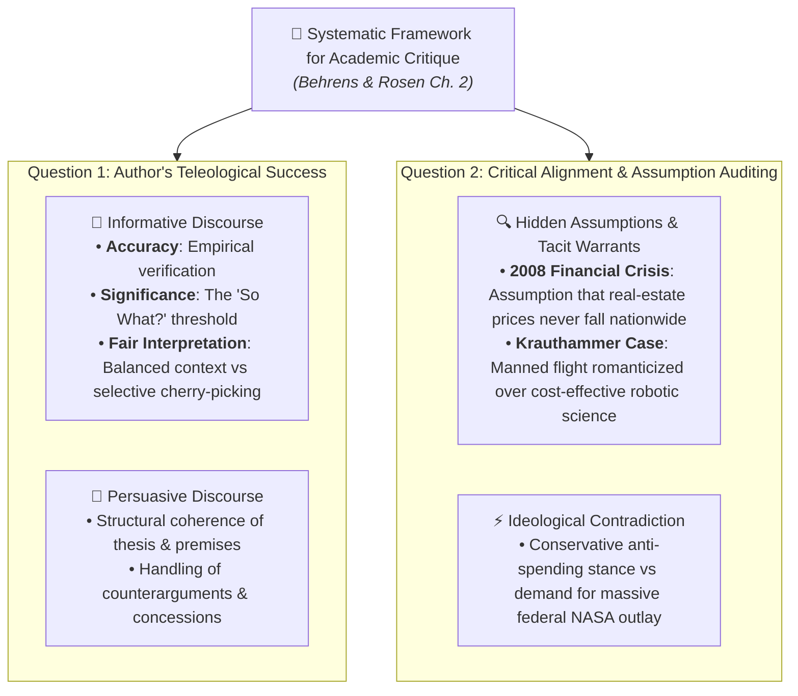
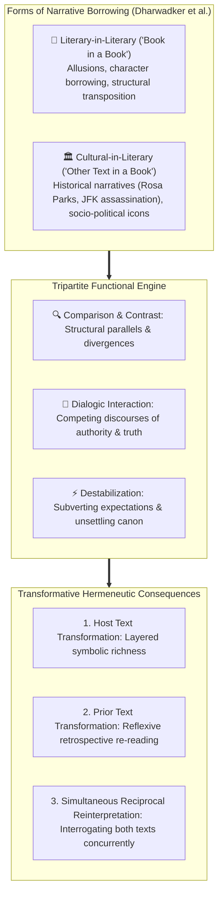

# Academic Summary: Critical Reading as Looking for Ways of Thinking (Intermediate Level)

**Subject:** Reading and Writing Skills | **Unit:** Week 2 Curriculum  
**Audience Level:** Intermediate (Undergraduate Prep & Applied Analytical Rigor)  
**Target Bloom's Levels:** Understanding (L-2), Applying (L-3) & Analyzing (L-4)  
**Curriculum Materials:** critical reading.md, Reading Critically.md, reading_essays.md, intertextuality.md, critical-reading.docx  
**Institution:** De La Salle University - Senior High School Department  

---

## 🖼️ 1. Reading Modality Quadrant & Theoretical Framework

Stuart and Terry Hirschberg (*The Millennium Reader*) establish that reading modes differ across active engagement and critical scrutiny:

```mermaid
quadrantChart
    title Reading Modality Quadrant (Cognitive Depth vs Engagement)
    x-axis Low Engagement --> High Active Engagement
    y-axis Uncritical Reception --> Critical Interrogation
    quadrant-1 Critical Reading (Dialectic, Fallacy Detection)
    quadrant-2 Reading for Information (Memorization, Academic Tool)
    quadrant-3 Casual Reading (Skimming, Environmental Obligation)
    quadrant-4 Reading for Pleasure (Escapist Surrender, Fiction)
    "Casual Reading": [0.15, 0.25]
    "Reading for Pleasure": [0.75, 0.20]
    "Reading for Information": [0.45, 0.65]
    "Critical Reading": [0.85, 0.88]
```

### 📌 Formal Theoretical Distinctions
* **Casual Reading:** Automatic, low-involvement decoding dictated by environment (street signs, banners, alerts).
* **Reading for Pleasure:** Escapist, aesthetic, uncritical immersion in fictional universes where narrative disbelief is voluntarily suspended.
* **Reading for Information:** Utilitarian, comprehension-focused data extraction required for professional execution or academic examinations.
* **Critical Reading:** High-engagement dialectical inquiry. The reader interrogates the writer's thesis, probes evidentiary sufficiency, unearths tacit presuppositions, detects fallacies, and deduces social consequences.

---

## 🖼️ 2. The Cognitive Triad: Analysis, Synthesis, Evaluation



1. **Analysis (Deconstruction):** Deconstructing arguments into foundational premises, evidence, and underlying assumptions (e.g., investigating whether studies on online romance reflect representative demographics).
2. **Synthesis (Hermeneutic Integration):** Fusing contrasting cross-disciplinary insights into an authentic, coherent thesis. Crucially, synthesis **tampers down intellectual arrogance** by demonstrating the multidimensional nature of contentious disputes.
3. **Evaluation (Normative Appraisal):** Auditing evidential validity and taking an educated stand ("placing weight on the seesaw") while steering clear of uncritical, polarized extremes.

---

## 🖼️ 3. Argumentative Architecture & Logical Signposts

In *Writing and Reading Across the Curriculum*, Behrens and Rosen map the anatomy of formal academic prose:



* **Thesis Formulation:** A single declarative assertion offering a focused stance on a debatable matter (e.g., Mark Twain's thesis in *The Lowest Animal* asserting that vindictive revenge is uniquely human).
* **Premise Signposts:** *since, because, for, as, follows from, as shown by, inasmuch as, in view of the fact that, the reason is that*.
* **Conclusion Signposts:** *therefore, hence, thus, so, accordingly, in consequence, it follows that, we may infer, consequently, points to the conclusion that*.

---

## 🖼️ 4. Logical Fallacies & Critical Evaluation Radar



Critical readers audit texts against common distortions of reasoning:
* **Ad Hominem:** Diverting scrutiny from the claim to personal background or traits.
* **Ad Populum:** Substituting consensus or slogans for empirical proof.
* **False Analogy:** Asserting equivalence between structurally distinct systems.
* **Begging the Question:** Circularly asserting premises as already proven.
* **Either/Or (False Dilemma):** Artificially reducing multi-faceted issues to stark binaries.
* **Non Sequitur:** Inferring conclusions lacking justifiable deductive or inductive bridges.

---

## 🖼️ 5. Formal Critique Mechanics & Assumption Auditing (Behrens & Rosen Ch. 2)

In Chapter 2 of *Writing and Reading Across the Curriculum*, Behrens and Rosen formalize critical reading into written critique:



### The Two Core Inquiries:
1. **Question 1: To what extent does the author succeed in their purpose?**
   * *Informative Writing Criteria:* **Accuracy** (factual veracity), **Significance** (the "So What?" hurdle), and **Fair Interpretation** (avoiding biased omissions).
   * *Persuasive Writing Criteria:* Scrutinizing thesis coherence, empirical support, and counterargument refutation.
2. **Question 2: To what extent do you agree with the author?**
   * *Assumption Auditing:* Interrogating explicit and tacit presuppositions.
   * *The 2008 Subprime Mortgage Case:* A multi-trillion dollar crisis fueled by the unexamined assumption that housing values would perpetually appreciate.
   * *Charles Krauthammer's "The Moon We Left Behind":* Concedes robotic probes are cheaper, safer, and yield superior data, yet insists on human exploration due to an unexamined romantic/nationalistic warrant—revealing an ideological contradiction between his small-government conservatism and advocacy for massive NASA spending.

---

## 🖼️ 6. Intertextuality & Hypertext Framework

Grounded in Dharwadker, Harrison, Lemaster, and Bourenane:



* **Two Forms:** Form 1 (*Book in a Book* / Literary in Literary) and Form 2 (*Other Text in a Book* / Cultural Narrative in Literature).
* **Three Functions:** Comparison (analogical framing), Dialogue (polyphonic confrontation), and Destabilization (subverting settled truths).
* **Three Effects:** Host text transformation, reflexive re-reading of prior text, and simultaneous mutual reinterpretation.
* **Hypertext Intersection:** Hypertext executes non-linear electronic connections via web nodes; intertextuality executes non-linear cultural connections via reader consciousness.
