# Critical Reading as Looking for Ways of Thinking — Comprehensive Master Mindmap

---

## 1. Visual Mermaid Mindmap

```mermaid
mindmap
  root((Critical Reading as Ways of Thinking))

    %% ═════════════════════════════════════════════════════════════════════════
    %% BRANCH 1: FOUR KINDS OF READING & PHILOSOPHICAL FOUNDATIONS
    %% ═════════════════════════════════════════════════════════════════════════
    ("1. Taxonomy of Reading & Foundations")
      ("Four Kinds of Reading (Hirschberg)")
        ["Casual Reading - Glancing at signs, emails, headlines; reading out of obligation"]
        ["Reading for Pleasure - Novels, romances; relaxed, uncritical bedtime transport to imaginary worlds"]
        ["Reading for Information - School and workplace tool; focus on attention, comprehension, memorization"]
        ["Critical Reading - Active mental dialogue with author; deducing consequences; resisting gullibility"]
      ("Origins of the Essay (Montaigne & Behrens)")
        ["Michel Montaigne (1580) - Coined 'essais' (attempts); personal explorations of the mind"]
        ["Non-Dogmatic Nature - Reconciling opposing impulses rather than presenting absolute dogmas"]
        ["Direct Voice - Essayist speaks directly without mediation of fictional characters"]
      ("Democratic Inquiry vs. Dogmatism")
        ["Challenging Authority - Kicking the author off the throne of public esteem"]
        ["Active Citizenship - Questioning institutional policies, conformity, and received opinions"]

    %% ═════════════════════════════════════════════════════════════════════════
    %% BRANCH 2: THE COGNITIVE TRIAD OF CRITICAL READING
    %% ═════════════════════════════════════════════════════════════════════════
    ("2. The Cognitive Triad")
      ("Analysis - Deconstruction")
        ["Constituent Components - Identifying how ideas are composed, structured, and interconnected"]
        ["Uncovering Assumptions - Exposing underlying premises, biases, and unstated warrants"]
        ["Multi-Source Gathering - Gathering diverse empirical and theoretical sources on an issue"]
      ("Synthesis - Creative Integration")
        ["Blending Perspectives - Merging disparate findings into a coherent, original viewpoint"]
        ["Tempering Intellectual Arrogance - Recognizing that every knotty controversy has multiple valid viewpoints"]
        ["Original Synthesis - Producing an authentic voice and perspective belonging to the student"]
      ("Evaluation - Critical Judgment")
        ["Assessing Evidence & Logic - Grading validity, weight, sound reasoning, and credibility"]
        ["Taking an Educated Stand - Placing weight on the seesaw; choosing reasoned positions without extreme bias"]
        ["Nuanced Judgment - 'Walking in the middle of the road' to avoid unexamined dogmatic extremes"]

    %% ═════════════════════════════════════════════════════════════════════════
    %% BRANCH 3: THE 14 GUIDELINES FOR CRITICAL READING
    %% ═════════════════════════════════════════════════════════════════════════
    ("3. The 14 Guidelines (Metherell & Winkler)")
      ("Active Engagement & Persona")
        ["1. Read Actively - Question the text, note agreements/disagreements, detect factual/logical slips"]
        ["2. Demystify the Writer - View authors as fallible humans prone to errors, biases, and oversights"]
        ["3. Understand Comprehensively - Reread tough passages, define unfamiliar words, summarize orally"]
      ("Perspective & Objectivity")
        ["4. Invert Arguments - Imagine opposing views; reverse premises (e.g., animal testing vs. insulin discovery)"]
        ["5. Uncover Biases - Examine author background, socio-economic context, gender, and philosophy"]
        ["6. Separate Emotion from Fact - Guard against loaded language, sloganeering, and bumper-sticker rhetoric"]
      ("Verification & Interdisciplinarity")
        ["7. Fill Information Gaps - Conduct targeted research; consult primary stakeholders when uninformed"]
        ["8. Cross-Disciplinary Insights - Apply history to psychology, literature to geography to cross-examine claims"]
        ["9. Scrutinize Evidence - Verify source recency (e.g., Tonegawa 1976 antibodies), reliability, and common sense"]
      ("Logical Rigor & Context")
        ["10. Ponder Implicit Values - Unearth philosophical roots (e.g., Jefferson equality vs. Marx labor)"]
        ["11. Recognize Logical Fallacies - Ad hominem, ad populum, false analogy, circularity, false dilemma, non sequitur"]
        ["12. Resist Bogus Claims - Dismiss unsubstantiated statistics and unverified authoritative assertions"]
        ["13. Annotate Margin-Notes - Record immediate impressions, stylistic devices, questions, and allusions"]
        ["14. Unpack Opening Context - Situating the text in pre-existing debates (e.g., Andy Rooney on Fowler)"]

    %% ═════════════════════════════════════════════════════════════════════════
    %% BRANCH 4: ESSAY ARCHITECTURE & REASONING SIGNPOSTS
    %% ═════════════════════════════════════════════════════════════════════════
    ("4. Essay Architecture & Reasoning Signposts")
      ("Thesis Discovery (Behrens & Rosen)")
        ["Definition of Thesis - Single sentence asserting the author's focused stance on a debatable topic"]
        ["Placement Strategies - Early introductory placement to guide reader expectation (e.g., Mark Twain)"]
        ["Expository vs. Argumentative - Clarifying positions vs. debating contentious social values"]
      ("Premise Signals (Starting Chains of Reasoning)")
        ["Causal Terms - 'since', 'because', 'for', 'as', 'follows from'"]
        ["Inferential Starters - 'as indicated by', 'inasmuch as', 'in view of the fact that'"]
        ["Deductive Roots - 'may be inferred from', 'may be deduced from', 'the reason is that'"]
      ("Conclusion Signals (Closing Chains of Reasoning)")
        ["Direct Consequents - 'therefore', 'hence', 'thus', 'so', 'accordingly', 'in consequence'"]
        ["Logical Deduction - 'it follows that', 'we may infer', 'I conclude that', 'consequently'"]
        ["Synthesizing Ends - 'in summary', 'proves that', 'which entails', 'points to the conclusion that'"]
      ("Structural Narrative Openings")
        ["Personal Anecdote - Dramatic memory opening (e.g., Jill Nelson's 'Number One!')"]
        ["Telling Quotation - Provocative quote setting thematic tension"]
        ["Thought-Provoking Inquiries - Rhetorical questions, provocative paradoxes, or precise definitions"]

    %% ═════════════════════════════════════════════════════════════════════════
    %% BRANCH 5: INTERTEXTUALITY & CULTURAL NARRATIVES (DHARWADKER ET AL.)
    %% ═════════════════════════════════════════════════════════════════════════
    ("5. Intertextuality & Cultural Narratives")
      ("Definition of Intertextuality")
        ["Narrative Borrowing - Borrowing/applying a literary, media, or social text inside another text"]
        ["Active Juxtaposition - Comparative interplay between outside text and inside textual re-imagining"]
      ("Two Forms of Intertextuality")
        ["Form 1: Book in a Book - Literary text in another literary text (titles, characters, famous scenes, plots)"]
        ["Form 2: Other Text in a Book - Media/social text in literature (films, songs, JFK assassination, Rosa Parks)"]
      ("Three Functions of Intertextuality")
        ["Function 1: Comparison - Implicit comparison/contrast highlighting thematic parallels and divergences"]
        ["Function 2: Dialogue - Dynamic conversational interaction between two multi-vocal narrative worldviews"]
        ["Function 3: Destabilization - Subverting and shaking up established understandings or primary expectations"]
      ("Three Transformative Effects")
        ["Effect 1: Transformation of Primary Book - Intertext deepens, complicates, or reframes the main narrative"]
        ["Effect 2: Transformation of Prior Text - Reflexive re-reading; new context re-evaluates the borrowed story"]
        ["Effect 3: Simultaneous Reinterpretation - Back-and-forth dialectic illuminating both texts concurrently"]

    %% ═════════════════════════════════════════════════════════════════════════
    %% BRANCH 6: HYPERTEXT VS. INTERTEXTUALITY
    %% ═════════════════════════════════════════════════════════════════════════
    ("6. Hypertext vs. Intertextuality Exercise")
      ("Hypertext Architecture")
        ["Technological Medium - Digital nodes, web hyperlinks, non-linear electronic pathways"]
        ["Reader Agency - Reader clicks links to navigate self-determined reading trajectories"]
      ("Intertextuality Architecture")
        ["Conceptual & Cultural - Cognitive, artistic, literary, and historical associations"]
        ["Dialogic Depth - Deep narrative conversations operating across cultural memory"]
      ("Synergy in Modern Reading")
        ["Combined Modality - Digital hypertext physically connects nodes; intertextuality cognitively enriches them"]

    %% ═════════════════════════════════════════════════════════════════════════
    %% BRANCH 7: CRITICAL READING FOR CRITIQUE (BEHRENS & ROSEN CH. 2)
    %% ═════════════════════════════════════════════════════════════════════════
    ("7. Critical Reading for Critique (Behrens & Rosen Ch. 2)")
      ("The Two Fundamental Critical Questions")
        ["Question 1: Success in Purpose - To what extent does the author succeed in his or her purpose?"]
        ["Question 2: Personal Agreement - To what extent do you agree with the author's claims and warrants?"]
      ("The Tripartite Authorial Purpose")
        ["Writing to Inform - Evaluated by Accuracy, Significance ('So What?'), and Fair Interpretation"]
        ["Writing to Persuade - Informative vs Persuasive Thesis, Fair Use of Evidence, Logical Validity"]
        ["Writing to Entertain - Aesthetic engagement, emotional resonance, dramatic and comic craft"]
      ("Evaluating Assumptions & Ideological Foundations")
        ["Assumptions as Structural Foundations - Presentations rest upon explicit or unstated presuppositions"]
        ["Hidden Assumptions in Finance - The 2008 Subprime Mortgage crisis built on the assumption home prices never fall"]
        ["Testing Warrants - Interrogating unstated philosophical and political warrants bridging data to claims"]
      ("Guidelines & Strategy for Composing Critiques")
        ["Section 1: Introduction & Summary - Fair representation of author, context, and core thesis"]
        ["Section 2: Purpose Audit - Evaluating evidence accuracy, logical coherence, and rhetorical effectiveness"]
        ["Section 3: Evaluating Assumptions - Analyzing warrants, stating reasoned points of agreement and disagreement"]
        ["Section 4: Conclusion - Final balanced judgment of validity, significance, and cultural impact"]
      ("Model Case Study: Charles Krauthammer (2009)")
        ["The Text - 'The Moon We Left Behind' (Washington Post, July 17, 2009)"]
        ["Krauthammer's Purpose - Persuading America to recommit to NASA manned lunar exploration"]
        ["Emotional Rhetoric - Loaded terms ('abandonment', 'retreat', 'hyper-terrestrial')"]
        ["Hidden Assumptions Audited - Space travel as innate moral imperative vs earthly poverty and $1T stimulus deficit"]
        ["Ideological Inconsistency - Conservative small-government columnist demanding massive taxpayer space spending"]
```

---

## 2. Exhaustive Hierarchical Text Mindmap

### Branch 1: Taxonomy of Reading & Philosophical Foundations
* **1.1 The Four Modalities of Reading (Hirschberg & Hirschberg, 2009)**
  * **1.1.1 Casual Reading:** Involuntary, low-attention glance at road signs, social media feeds, notification banners, and headlines. Driven by necessity rather than conscious intent.
  * **1.1.2 Reading for Pleasure:** Relaxed, non-critical, escapist engagement with fiction, romance, and mysteries. The reader seeks immersion into alternate realities without dissecting formal structures or verifying truth claims.
  * **1.1.3 Reading for Information:** Goal-oriented, academic, or professional reading. Demands focused comprehension, structural retention, and accurate memorization to execute tasks or pass examinations.
  * **1.1.4 Critical Reading:** A questioning, dialogic posture. Engaging in mental debates with the author, identifying subtext, deducing unstated implications, spotting fallacies, and resisting gullible acceptance.
* **1.2 Origins of the Essay Genre (Montaigne, 1580 & Behrens, 2000)**
  * **1.2.1 Michel de Montaigne:** French thinker who coined *essais* (meaning "attempts" or "trials").
  * **1.2.2 Epistemological Shift:** Transitioned prose from dogmatic pronouncements of absolute truth to personal disclosures of a thinking mind exploring attitudes, doubts, and values.
  * **1.2.3 Direct Personal Voice:** The essayist addresses the reader directly without relying on invented fictional characters or imaginary narrative shields.
* **1.3 Democratic Inquiry vs. Authoritarian Conformism**
  * **1.3.1 Kicking the Author off the Throne:** Demystifying authority figures to view printed discourse as a fallible human construction.
  * **1.3.2 Critical Literacy as Civic Agency:** Resisting authoritarian propaganda, questioning institutional policies, and exercising democratic citizenship through independent thought.

---

### Branch 2: The Cognitive Triad of Critical Reading
* **2.1 Analysis (Deconstruction of the Text)**
  * **2.1.1 Structural Decomposition:** Deconstructing an essay into its constituent parts: central thesis, supporting claims, evidential proof, and transitional scaffolding.
  * **2.1.2 Unearthing Latent Assumptions:** Exposing unstated warrants, ideological leanings, cultural premises, and authorial biases.
  * **2.1.3 Gathering Empirical Diversity:** Collecting diverse cross-disciplinary sources to map the full conceptual territory of a controversy.
* **2.2 Synthesis (Dialectical Integration)**
  * **2.2.1 Blending Opposing Ideas:** Merging divergent viewpoints, data sets, and theoretical models into an integrated, holistic perspective.
  * **2.2.2 Countering Intellectual Arrogance:** Demonstrating through multi-perspective exploration that thorny real-world dilemmas rarely permit black-and-white solutions.
  * **2.2.3 Forging an Authentic Voice:** Crafting an original viewpoint that reflects the critical reader's own judgment rather than mimicry.
* **2.3 Evaluation (Critical Valuation and Stance)**
  * **2.3.1 Evidentiary Audit:** Weighing the sufficiency, verifiability, relevance, and logical soundess of arguments.
  * **2.3.2 Placing Weight on the Seesaw:** Moving beyond passive neutrality to take a reasoned, evidence-backed personal position on controversial issues.
  * **2.3.3 The Middle Path Principle:** Adopting nuanced stances that reconcile competing truths while avoiding uncritical dogmatic extremes.

---

### Branch 3: The 14 Guidelines for Critical Reading (Metherell & Winkler, 2007)
* **3.1 Active Engagement & Demystification**
  * **Rule 1: Read Actively:** Maintain continuous dialogue; record marginal reactions; probe for factual and logical slips.
  * **Rule 2: Demystify the Writer:** Treat authors as fallible humans prone to bias and miscalculation rather than infallible prophets.
  * **Rule 3: Understand Before Judging:** Re-read complex passages, look up unfamiliar terminology, summarize sections aloud.
* **3.2 Perspective-Taking & Neutrality**
  * **Rule 4: Invert Arguments:** Systematically hypothesize the counter-argument for every stated claim (e.g., medical animal research vs. animal welfare).
  * **Rule 5: Uncover Biases & Hidden Assumptions:** Scrutinize the author's demographic background, academic pedigree, institutional funding, and ideological affiliations.
  * **Rule 6: Separate Emotion from Fact:** Detect loaded language, emotional appeals, ad populum slogans, and demonization of opponents.
* **3.3 Cross-Disciplinary Research & Fact-Checking**
  * **Rule 7: Fill Knowledge Deficits:** Actively research unfamiliar issues by consulting affected primary stakeholders and authoritative empirical repositories.
  * **Rule 8: Cross-Disciplinary Illumination:** Leverage insights across fields (e.g., using historical uprisings to disprove psychological claims of innate passivity among oppressed groups).
  * **Rule 9: Scrutinize Evidence Rigorously:** Cross-check dubious claims, inspect data recency (e.g., Tonegawa's 1976 immunology breakthrough), and apply common sense.
* **3.4 Logic, Values & Discourse Context**
  * **Rule 10: Ponder Implicit Value Systems:** Identify the underlying ethical hierarchy (e.g., Jeffersonian human equality vs. Marxist labor value).
  * **Rule 11: Recognize Logical Fallacies:** Diagnose ad hominem, false analogy, circular reasoning, false dilemma (either/or), hasty generalizations, and non sequiturs.
  * **Rule 12: Resist Bogus Claims:** Reject unverified statistics, phantom studies, and vague authoritative endorsements.
  * **Rule 13: Annotate Actively:** Record immediate reactions, analyze rhetorical style, mark key allusions, and pose direct questions to the text.
  * **Rule 14: Unpack Opening Context:** Situate the text within ongoing historical, intellectual, or political debates (exemplified by Andy Rooney's critique of Fowler).

---

### Branch 4: Essay Architecture & Reasoning Signposts (Behrens & Rosen, 2000)
* **4.1 Thesis Identification & Placement**
  * **4.1.1 Nature of the Thesis:** A single declarative assertion presenting the author's specific stance on a debatable topic.
  * **4.1.2 Placement Patterns:** Typically situated in the opening introductory section to establish clear interpretive expectations (e.g., Mark Twain's thesis in *The Lowest Animal*).
* **4.2 Reasoning Signposts**
  * **4.2.1 Premise Indicators:** Lexical markers introducing supporting reasons: *since, because, for, as, follows from, as shown by, inasmuch as, in view of the fact that, the reason is that*.
  * **4.2.2 Conclusion Indicators:** Lexical markers signaling deductive or inductive outcomes: *therefore, hence, thus, so, accordingly, in consequence, it follows that, we may infer, consequently, proves that*.
* **4.3 Narrative Hooks & Transitions**
  * **4.3.1 Anecdotal Openings:** Personal memories that humanize the topic (e.g., Jill Nelson's breakfast table scene in *Number One!*).
  * **4.3.2 Quotations & Inquiries:** Setting philosophical stakes via resonant quotations, surprising definitions, or provocative dilemmas.

---

### Branch 5: Intertextuality Theory & Dynamics (Dharwadker et al.)
* **5.1 Core Definition**
  * The explicit or implicit presence, borrowing, or reimagining of a prior literary, media, or social "text" inside another text, creating a web of narrative meaning.
* **5.2 Two Primary Forms**
  * **5.2.1 Form 1: Book in a Book (Literary Intertext):** Direct reference to another literary work through title citation, character borrowing, iconic scenes, or full plot transposition.
  * **5.2.2 Form 2: Other Text in a Book (Social/Cultural Intertext):** Incorporation of narrative cultural texts (films, popular songs, historical events like Rosa Parks' defiance or the JFK assassination).
* **5.3 Three Critical Functions**
  * **5.3.1 Function 1: Comparison:** Evoking similarities and contrasts between the original source and its new application.
  * **5.3.2 Function 2: Conversational Dialogue:** Generating a multi-vocal exchange between two narratives, creating competing discourses of truth and authority.
  * **5.3.3 Function 3: Destabilization:** Subverting familiar interpretations of either the borrowed intertext or the host text.
* **5.4 Three Transformative Effects**
  * **5.4.1 Effect 1: Transformation of the Primary Book:** Enriching the new work with deeper symbolic resonance and thematic complexity.
  * **5.4.2 Effect 2: Transformation of the Prior Text:** Compelling readers to reflexively re-read and re-evaluate the original source text.
  * **5.4.3 Effect 3: Simultaneous Reinterpretation:** A reciprocal, back-and-forth dialectic where both texts illuminate and challenge each other.

---

### Branch 6: Hypertext vs. Intertextuality Exercise
* **6.1 Architectural Differences**
  * **Hypertext:** Technological, discrete, non-linear electronic links connecting distinct web documents via explicit user clicks.
  * **Intertextuality:** Hermeneutic, psychological, and cultural connections occurring within the reader's consciousness across texts.
* **6.2 Pedagogical Synthesis**
  * While hypertext makes references physically clickable, intertextuality requires active cognitive decoding of thematic, stylistic, and ideological dialogues.

---

### Branch 7: Critical Reading for Critique (Behrens & Rosen Ch. 2, critical-reading.txt)
* **7.1 The Two Fundamental Guiding Questions**
  * **7.1.1 Question 1: Success in Purpose:** To what extent does the author succeed in his or her purpose? (Objective evaluation of rhetorical effectiveness, coherence, and evidence).
  * **7.1.2 Question 2: Extent of Agreement:** To what extent do you agree with the author? (Subjective yet reasoned audit of premises, ethical warrants, and assumptions).
* **7.2 The Tripartite Authorial Purpose & Evaluation Metrics**
  * **7.2.1 Writing to Inform:** Judged on (1) **Accuracy of Information** (data verification), (2) **Significance of Information** (answering the "So what?" question), and (3) **Fair Interpretation** (separating raw facts from subjective spin).
  * **7.2.2 Writing to Persuade:** Judged on thesis clarity (Informative vs. Persuasive thesis), evidential sufficiency, logical soundess, and fair use of counter-arguments.
  * **7.2.3 Writing to Entertain:** Judged on aesthetic craft, emotional truth, comedic or dramatic impact.
* **7.3 Uncovering and Auditing Assumptions**
  * **7.3.1 Assumptions as Structural Foundations:** Every argument rests on tacit presuppositions that author assumes the audience shares.
  * **7.3.2 The Subprime Mortgage Case Study in Finance:** The 2008 global financial collapse was built on the unstated, disastrous assumption that residential real estate prices would perpetually appreciate.
* **7.4 The Anatomy & Strategy of Writing Critiques**
  * **7.4.1 Step 1 (Introduction & Summary):** Contextualizing the author, title, and accurately stating the central thesis.
  * **7.4.2 Step 2 (Purpose Evaluation):** Rigorously assessing the author's success in informing or persuading.
  * **7.4.3 Step 3 (Assumption & Warrant Audit):** Articulating explicit reasons for agreement or disagreement with underlying axioms.
  * **7.4.4 Step 4 (Conclusion):** Providing an overarching judgment of validity, significance, and enduring relevance.
* **7.5 Applied Case Study: Charles Krauthammer's "The Moon We Left Behind" (2009)**
  * **7.5.1 The Text & Context:** Written by conservative columnist Charles Krauthammer on the 40th anniversary of Apollo 11 (Washington Post, July 17, 2009).
  * **7.5.2 Rhetorical Strategies:** Deploying emotionally charged diction ("abandonment", "retreat", "hyper-terrestrial retreat") to induce patriotic shame.
  * **7.5.3 Deconstructing Assumptions:** Auditing Krauthammer's unstated assumption that human space exploration is an absolute moral imperative overriding terrestrial economic crises ($1 trillion stimulus deficits, shuttered schools, poverty).
  * **7.5.4 Exposing Ideological Contradictions:** Highlighting the paradox of a conservative fiscal columnist advocating a gargantuan, federal taxpayer-funded space program rather than free-market private space initiatives.
