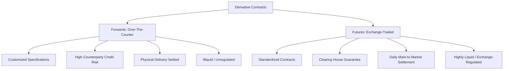

# Derivatives - Futures

## 1. Structural Comparison: Futures vs. Forwards

While both forwards and futures are commitments to buy or sell an asset at a predetermined price at a specified future date, they operate in structurally distinct trading environments.



### Contrast Table
| Characteristic | Forward Contracts | Futures Contracts |
| :--- | :--- | :--- |
| **Trading Venue** | Over-the-Counter (OTC) | Organized Exchanges (e.g., NSE, BSE) |
| **Contract Specifications** | Custom-tailored (size, date, price, quality) | Highly standardized (lot size, expiry, tick size) |
| **Counterparty Credit Risk** | High; borne directly by the contracting parties | Minimal; cleared and guaranteed by the Clearing Corporation |
| **Pricing and Quotes** | Private negotiations; not publicly disseminated | Publicly quoted on continuous limit order books |
| **Settlement Mechanics** | Occurs solely at maturity (single payment) | Daily mark-to-market settlement in cash |
| **Liquidity & Reversibility** | Low liquidity; exiting requires bilateral agreement | High liquidity; easily squared off by taking an opposite trade |
| **Collateral Requirements** | None (or negotiated security deposits) | Mandatory initial and maintenance margins |
| **Delivery vs. Cash Settlement**| Usually physical delivery of the underlying asset | Mostly cash-settled (especially index products), though stock futures can be delivery-settled |

---

## 2. Mathematical Foundations of Futures Pricing

The theoretical pricing of futures relies on the **No-Arbitrage Principle**. The cost of carrying the underlying asset from the spot date to the expiry date must equal the futures price; otherwise, a riskless arbitrage opportunity is created.

### 2.1 The Cost of Carry Model (Simple Interest)
If a trader borrows money to buy the stock today and holds it until the futures expiry $T$, the accumulated loan amount must equal the futures price at expiry.

Let:
*   $S_0$ = Spot price of the underlying asset
*   $r$ = Borrowing interest rate (expressed as a decimal, p.a.)
*   $T$ = Time to maturity in years (or $t/12$ months, or $t/365$ days)

$$\text{Theoretical Futures Price } (F_0) = S_0 \times \left( 1 + r \times T \right)$$

If the asset yields a discrete cash income (e.g., dividend $D$) paid during the life of the contract at time $t_d$:
$$F_0 = S_0 \times \left(1 + r \times T\right) - D \times \left(1 + r \times (T - t_d)\right)$$
Alternatively, in present-value terms:
$$F_0 = (S_0 - \text{PV}(D)) \times \left(1 + r \times T\right)$$
Where $\text{PV}(D) = $\frac{D}{1 + r \times t_d}$ (discounted at the risk-free rate).

---

### 2.2 Continuous Compounding Formulation
In institutional finance, risk-free rates are modeled using continuous compounding. The cost of carry is represented exponentially.

For a non-dividend-paying stock:
$$F_0 = S_0 \times e^{r \times T}$$

#### Derivation:
Suppose the spot price is $S_0$. If an investor borrows $S_0$ at the continuously compounded risk-free rate $r$, the repayment obligation at time $T$ is $S_0 e^{rT}$. If $F_0 > S_0 e^{rT}$, an arbitrageur will:
1. Borrow $S_0$ at rate $r$.
2. Buy the stock in the spot market at $S_0$.
3. Sell the futures contract at $F_0$.
At time $T$, the arbitrageur delivers the stock, receives $F_0$, and pays off the loan $S_0 e^{rT}$, capturing a riskless profit of $F_0 - S_0 e^{rT}$. 

Through arbitrage trading pressure, the futures price is driven down until:
$$F_0 = S_0 \times e^{r \times T}$$

---

### 2.3 Pricing with Discrete Dividends under Continuous Compounding
If a stock pays a discrete dividend $D$ at time $t_d$ (where $0 < t_d < T$), the holder of the physical stock receives this dividend, but the holder of the futures contract does not. 
The dividend inflow reduces the net cost of carrying the stock. Therefore, we deduct the present value of the dividend from the spot price:
$$F_0 = \left( S_0 - D \times e^{-r \times t_d} \right) \times e^{r \times T}$$

---

### 2.4 Pricing Index Futures with Continuous Dividend Yield ($d$)
A stock index consists of multiple stocks paying dividends at different times. Rather than calculating discrete dividends, we model the dividends as a continuous flow represented by an annual dividend yield ($d$).

The pricing equation becomes:
$$F_0 = S_0 \times e^{(r - d) \times T}$$

Where:
*   $r$ = Continuously compounded risk-free rate p.a.
*   $d$ = Continuously compounded dividend yield p.a.

If simple compounding is used in exams (e.g. for short maturities or when requested), the formula is:
$$F_0 = S_0 \times \left(1 + (r - d) \times \frac{t}{12}\right)$$

---

## 3. Market Terminology: Contango vs. Backwardation

The relationship between the spot price ($S_0$) and the futures price ($F_0$) varies based on market conditions, inventory levels, and demand.

```
Spot Price (S) < Futures Price (F)  =================>  Contango (Positive Carry)
Spot Price (S) > Futures Price (F)  =================>  Backwardation (Negative Carry)
```

### 3.1 Contango
*   **Condition:** $F_0 > S_0$ (Futures price is higher than spot price).
*   **Drivers:** High carrying costs (storage, insurance, finance costs) and absence of immediate supply shortages. Common in financial assets and metal commodities.
*   **Economic Meaning:** The market is willing to pay a premium to avoid holding and storing the physical asset today, preferring to receive it in the future.

### 3.2 Backwardation
*   **Condition:** $F_0 < S_0$ (Futures price is lower than spot price).
*   **Drivers:** High demand for immediate physical possession (high **Convenience Yield**) or expectations of a future supply increase/demand fall.
*   **Economic Meaning:** The benefits of holding the physical asset today (e.g., keeping a factory running during a raw material shortage) exceed the financial costs of carry.

---

## 4. Margin Architecture & Risk Mitigation

To eliminate counterparty default risk, exchanges use a clearing house that acts as the counterparty to every trade and mandates daily margin payments.

```
       [ Client A ]                [ Client B ]
            │                           │
         Margin                      Margin
            ▼                           ▼
       [ Broker A ]                [ Broker B ]
            │                           │
      Clearing Margin             Clearing Margin
            ▼                           ▼
       ┌─────────────────────────────────┐
       │   Exchange Clearing House (CCP)  │
       │  (Guarantees settlement daily)  │
       └─────────────────────────────────┘
```

### 4.1 Value-at-Risk (VaR) Margin Design
The **Initial Margin** is the deposit required to open a futures position. The clearing corporation computes this using the Value-at-Risk (VaR) methodology, typically calibrated to cover potential daily losses with 99.7% confidence.

$$\text{Initial Margin \%} \approx \text{Mean of Absolute Daily Returns } (\mu) + 3 \times \text{Daily Volatility } (\sigma)$$

By collecting this margin, the clearing house ensures that if a trader defaults on any single day, the deposited funds are sufficient to cover the liquidation loss in 99.7% of market conditions.

### 4.2 Maintenance Margin
The **Maintenance Margin** is the minimum equity level that must be maintained in the margin account to keep a position open. It is usually set at a percentage of the initial margin (e.g., 75% to 80%).

$$\text{Maintenance Margin} = \theta \times \text{Initial Margin} \quad (\text{where } 0 < \theta < 1)$$

### 4.3 Variation Margin & Daily Mark-to-Market (MTM)
At the end of each trading day, the exchange determines a **Daily Settlement Price** (usually the volume-weighted average price of the last 30 minutes). Every open position is revalued against this settlement price.

1.  **Marking-to-Market:**
    *   **Long Position:** $\text{MTM Cash Flow}_t = (S_t - S_{t-1}) \times \text{Lot Size} \times \text{Contracts}$
    *   **Short Position:** $\text{MTM Cash Flow}_t = (S_{t-1} - S_t) \times \text{Lot Size} \times \text{Contracts}$
2.  **Margin Account Update:**
    $$\text{Balance}_t = \text{Balance}_{t-1} + \text{MTM Cash Flow}_t$$
3.  **Action Thresholds:**
    *   **If $\text{Balance}_t < \text{Maintenance Margin}$:** A **Margin Call** is triggered. The client must deposit **Variation Margin** to restore the account balance back to the **Initial Margin** level.
    *   **If $\text{Balance}_t > \text{Initial Margin}$:** The excess balance can be withdrawn by the client.

---

## 5. Arbitrage Mechanics & Market Frictions

When the actual market futures price ($F_{\text{mkt}}$) deviates from the theoretical fair price ($F_{\text{theoretical}}$), arbitrageurs step in to exploit the mispricing.

### 5.1 Cash & Carry Arbitrage (When $F_{\text{mkt}} > F_{\text{theoretical}}$)
If futures are overvalued, the arbitrageur buys the physical asset and sells the futures.

*   **Step 1 ($t=0$):** Borrow money at interest rate $r$ to buy the spot asset at $S_0$. Sell the futures contract at $F_{\text{mkt}}$.
*   **Step 2 ($t=T$):** Deliver the asset to settle the futures contract, receiving $F_{\text{mkt}}$. Repay the borrowed funds with interest: $S_0(1+rT)$ or $S_0 e^{rT}$.
*   **Riskless Profit:** $F_{\text{mkt}} - S_0 e^{rT} > 0$.

---

### 5.2 Reverse Cash & Carry Arbitrage (When $F_{\text{mkt}} < F_{\text{theoretical}}$)
If futures are undervalued, the arbitrageur sells the physical asset and buys the futures.

*   **Step 1 ($t=0$):** Short sell the asset at $S_0$ (requires borrowing the stock via the SLB desk and paying an upfront stock borrowing fee). Invest the short sale proceeds at the risk-free rate $r$. Buy the futures contract at $F_{\text{mkt}}$.
*   **Step 2 ($t=T$):** Collect the matured investment: $S_0 e^{rT}$. Settle the futures contract by buying the asset at the locked-in price $F_{\text{mkt}}$. Return the physical asset to the lender to close the short position.
*   **Riskless Profit:** $S_0 e^{rT} - F_{\text{mkt}} - \text{Stock Borrowing Costs} - \text{Dividend Pass-throughs} > 0$.

---

### 5.3 The Arbitrage-Free Corridor
In the real world, transaction costs (brokerage, exchange fees, clearing fees), taxes (STT, GST), bid-ask spreads, and borrowing-lending interest rate spreads create an **Arbitrage-Free Corridor**. Arbitrage is profitable only when the market price falls outside this corridor.

```
       Market Futures Price (F)
         ▲
         │   [ Cash & Carry Arbitrage Zone ]
─────────┼───────────────────────────────────────── Upper Bound: F_fair + Costs
         │
         │   Arbitrage-Free Corridor
         │   (No profitable trade possible)
         │
─────────┼───────────────────────────────────────── Lower Bound: F_fair - Costs
         │   [ Reverse Cash & Carry Arbitrage Zone ]
         ▼
```

The arbitrage-free bounds are calculated as:
$$\text{Upper Bound} = (S_0 + C_{\text{spot,0}}) \cdot e^{r_{\text{borrow}} T} + C_{\text{fut,0}} \cdot e^{r_{\text{borrow}} T} + C_{\text{expiry}}$$
$$\text{Lower Bound} = (S_0 - C_{\text{spot,0}}) \cdot e^{r_{\text{lend}} T} - C_{\text{SLB}} \cdot e^{r_{\text{lend}} T} - C_{\text{fut,0}} \cdot e^{r_{\text{lend}} T} - C_{\text{expiry}} - \text{PV}(D)$$
Where $C$ represents various transaction costs.
