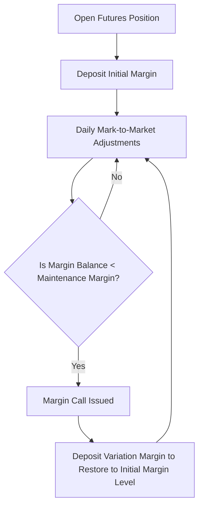

# Derivatives - Futures

## 1. Introduction to Derivatives

### 1.1 What is a Derivative?
In the financial world, the term **derivative** is derived from the verb "to derive," which means to obtain or extract something from a source. A financial derivative is a contract between two or more parties whose value is determined by (or derived from) the value of an underlying asset. 

The derivative itself does not have any intrinsic value. If the underlying asset’s price changes, the value of the derivative changes in tandem.

**Key Example:** 
Consider a stock futures contract for a company like Reliance Industries Ltd. The underlying asset is the common share of Reliance. If the current spot market price of a Reliance share rises, the price of the Reliance stock futures contract will typically rise as well. Conversely, if the stock price falls, the futures contract value falls.

### 1.2 The Concept of "Underlying"
The **underlying asset** (or simply "underlying") is the asset, index, or reference rate that determines the value of the derivative contract. Common underlying assets include:
*   **Equity Shares:** Common stock of individual companies.
*   **Stock Indices:** Market benchmarks like Nifty 50, Sensex, S&P 500.
*   **Commodities:** Agricultural goods (wheat, cotton), metals (gold, silver), energy (crude oil, natural gas).
*   **Currencies:** Foreign exchange pairs (USD/INR, EUR/USD).
*   **Interest Rates:** Treasury bills, government bonds.

#### Essential Features of the Underlying Asset:
1.  **Risk Exposure:** The market price of the underlying asset is subject to market risks, supply-demand dynamics, and economic factors.
2.  **Price Driver:** The spot price of the underlying is the primary factor determining the price of the derivative contract.
3.  **Dependency:** Without the underlying asset, the derivative contract cannot exist and carries no value.
4.  **Daily Valuation (Marking-to-Market):** During the life of the derivative contract, outstanding positions are valued daily against the prevailing price of the underlying.

---

## 2. Market Participants

There are four primary categories of participants in the derivatives market:

### 2.1 Hedgers
Hedgers are individuals or companies who face an existing risk in the spot market and enter the derivatives market to reduce or eliminate that risk. 
*   **Example:** A farmer (grower) who expects to harvest wheat in three months faces the risk that wheat prices might crash by then. To lock in a selling price, the farmer enters into a futures contract to sell wheat.
*   **Example:** A manufacturing company that imports raw materials and owes USD in three months faces the risk that the USD will appreciate. They can buy USD futures to lock in the exchange rate.

### 2.2 Speculators
Speculators are traders who willingly accept risk in pursuit of profits. They do not have an underlying exposure in the spot market. Instead, they form a view on the future direction of prices and take a leveraged position.
*   **Example:** A trader who believes the price of Gold will rise over the next month goes long (buys) Gold futures, hoping to sell them later at a higher price.

### 2.3 Arbitrageurs
Arbitrageurs are traders who search for pricing discrepancies (mispricings) between two different markets to lock in riskless profits. They buy the asset in the cheaper market and simultaneously sell it in the more expensive market.
*   **Example:** If Reliance stock is trading at ₹2,500 in the cash market and its futures contract is trading at an unjustified premium of ₹2,560 (when the fair theoretical value should be ₹2,510), an arbitrageur will buy the stock in the cash market and sell the futures contract, locking in a risk-free return.

### 2.4 Dealers
Dealers provide liquidity to the market by quoting two-way prices (bid and ask). They facilitate trading for other participants and hedge their own exposures using various market instruments.

---

## 3. Cash Market vs. Derivatives Market

To understand derivatives, one must understand how they differ from the traditional cash (spot) market.

| Feature | Cash (Spot) Market | Derivatives (Futures) Market |
| :--- | :--- | :--- |
| **Basic Concept** | Actual assets are bought and sold for immediate or near-immediate delivery. | Contracts representing the underlying asset are traded for settlement at a future date. |
| **Trading Unit** | Shares can be bought individually (even 1 single share). | Trading is standardized in **Lots** (e.g., a lot size of 200 shares). You must trade in multiples of the lot size. |
| **Ownership** | Settlement leads to direct ownership of the asset (delivery of shares to Demat account). | Settlement does not necessarily lead to ownership. Most contracts are cash-settled or squared off before maturity. |
| **Holding Period** | Once purchased, shares can be held indefinitely (for life). | Contracts have a fixed expiry date (e.g., 1-month, 2-month, or 3-month) and must be settled by then. |
| **Dividends** | Shareholder is an owner and is entitled to receive dividends and voting rights. | Derivative holder is not an owner and receives no dividends or voting rights. |
| **Leverage & Margin** | Investor must pay the full 100% value of the shares (except for minor intraday broker limits). | Trader pays only a small percentage of the total contract value as **margin money** (typically 10% to 20%). |
| **Investment Objective** | Primarily investment or long-term wealth creation. | Hedging, speculation, or arbitrage. |

---

## 4. Forwards vs. Futures Contracts

Both forward and futures contracts represent an agreement to buy or sell an asset at a future date at a price agreed upon today. However, they operate in completely different environments.

| Feature | Forward Contract | Futures Contract |
| :--- | :--- | :--- |
| **Trading Venue** | Over-the-Counter (OTC). Traded directly between two private parties. | Organized Exchange (e.g., NSE, BSE). Traded on a public electronic platform. |
| **Standardization** | Highly customized. Parties decide the quantity, quality, price, and delivery date. | Standardized contracts defined by the exchange (fixed lot sizes, expiry dates, quality parameters). |
| **Liquidity** | Low liquidity because it is difficult to find a counterparty to exit the contract early. | High liquidity. Traders can buy or sell contracts easily at any time during market hours. |
| **Counterparty Risk** | High. If one party defaults or goes bankrupt, the other party faces a loss. | Zero/Negligible. The Exchange's Clearing House acts as the counterparty to every trade, guaranteeing settlement. |
| **Margin System** | Usually no formal margin requirements (depends on bilateral agreements). | Strict daily margin systems (Initial, Maintenance, and Variation margins) mandatory for all. |
| **Mark-to-Market (MTM)**| No daily cash settlement. Profit or loss is realized only on the final maturity date. | Daily marking-to-market. Profits and losses are computed and settled in cash at the end of each day. |
| **Regulation** | Self-regulated by bilateral contracts; light regulatory oversight. | Highly regulated by market regulators (e.g., SEBI in India). |

---

## 5. Margin and Marking-to-Market (MTM) Mechanics

Because futures contracts are highly leveraged, a robust system of margins is necessary to prevent default risk.

### 5.1 Types of Margin
1.  **Initial Margin:** The upfront deposit required from both the buyer and the seller when they first open a futures position. The exchange determines this based on **Value-at-Risk (VaR)**, which measures the maximum expected loss over a single day with 99% confidence.
2.  **Maintenance Margin:** The minimum balance that must be maintained in the margin account at all times. It is typically set as a percentage of the Initial Margin (e.g., 70% or 80%).
3.  **Variation Margin:** The cash amount required to restore the margin account back to the **Initial Margin** level once the balance falls below the Maintenance Margin limit.

### 5.2 Marking-to-Market (MTM) Process
Every trading day, the exchange determines a "closing price" for each futures contract. The outstanding positions of all buyers (longs) and sellers (shorts) are adjusted relative to this closing price.
*   **For a Long Position (Buyer):** 
    $$\text{Daily Profit/Loss} = (\text{Current Day's Closing Price} - \text{Previous Day's Closing Price}) \times \text{Lot Size}$$
*   **For a Short Position (Seller):** 
    $$\text{Daily Profit/Loss} = (\text{Previous Day's Closing Price} - \text{Current Day's Closing Price}) \times \text{Lot Size}$$

The calculated profit is credited to the gainer's margin account, and the loss is debited from the loser's margin account. Futures trading is a **zero-sum game**: the total gains of the winners exactly equal the total losses of the losers.

---

## 6. Futures Pricing: The Cost of Carry Model

The theoretical pricing of a futures contract is based on the **Cost of Carry** model. It assumes that buying a futures contract today to receive the asset in the future should cost the same as buying the asset today in the spot market and holding ("carrying") it until that future date using borrowed funds.

### 6.1 Pricing Individual Stock Futures (Simple Interest)
For a contract with maturity $T$ (in months) and annual risk-free borrowing/lending rate $r\%$:

#### Case A: No Dividends Expected Before Expiry
$$F = S \times \left(1 + \frac{r \times T}{12 \times 100}\right)$$
Or, written as:
$$F = S + S \times \frac{r \times T}{1200}$$
Where:
*   $F$ = Theoretical Futures Price
*   $S$ = Spot Price of the underlying stock
*   $r$ = Annual risk-free rate of interest (%)
*   $T$ = Time to expiry in months

#### Case B: Dividend ($D$) Expected Before Expiry
If the stock is expected to pay a dividend ($D$ in ₹) on or before the expiry of the futures contract, the buyer of the future misses out on this dividend (since only cash shareholders receive it). Therefore, the futures price is adjusted downwards:
$$F = S \times \left(1 + \frac{r \times T}{12 \times 100}\right) - D$$
*Note: A dividend paid after the expiry date of the futures contract is completely ignored in the pricing.*

### 6.2 Pricing Index Futures
A stock index (like Nifty 50) is a basket of stocks. Since companies pay dividends at various times, we use an annualized **Dividend Yield ($d\%$)** of the index.

#### Cost of Carry Formula for Index Futures:
$$F = S \times \left(1 + \frac{(r - d) \times T}{12 \times 100}\right)$$
Where:
*   $d$ = Annualized Dividend Yield (%) of the index
*   $(r - d)$ = Net Cost of Carry (%)

### 6.3 Pricing under Continuous Compounding
In advanced finance, interest is assumed to compound continuously. The formulas modify to:
*   **Without Dividends:** $F = S \times e^{r \times t}$
*   **With Dividend Yield ($d$):** $F = S \times e^{(r - d) \times t}$
*   **With Discrete Dividend ($D$ at time $t_d$):** $F = (S - D \times e^{-r \times t_d}) \times e^{r \times t}$
Where $t$ is time to maturity expressed as a fraction of a year (e.g., $3 \text{ months} = 3/12 = 0.25$ years).

---

## 7. Contango vs. Backwardation

These terms describe the relationship between the spot price ($S$) and the futures price ($F$):

### 7.1 Contango
*   **Condition:** Futures Price is greater than the Spot Price ($F > S$).
*   **Explanation:** This is the normal market state. The premium reflects the positive cost of carrying the asset (financing cost, storage, insurance) over time.

### 7.2 Backwardation
*   **Condition:** Futures Price is lower than the Spot Price ($F < S$).
*   **Explanation:** This occurs when there is a severe shortage of the physical asset in the spot market, leading to high spot demand, or when the dividend yield is exceptionally high relative to interest rates.

---

## 8. Index Futures vs. Individual Stock Futures

| Feature | Index Futures | Stock Futures |
| :--- | :--- | :--- |
| **Underlying** | A basket of diversified stocks (e.g., Nifty 50). | A single company's stock (e.g., Infosys, HDFC Bank). |
| **Systematic Risk** | Primarily manages systematic (market-wide) risk. | Manages unsystematic (company-specific) risk. |
| **Volatility** | Generally lower volatility due to diversification. | Higher volatility due to company-specific news. |
| **Settlement** | Compulsorily Cash-settled. | Often physically settled (delivery of actual shares) in India. |
| **Margins** | Same margin parameters apply uniformly. | Margins vary heavily depending on the specific stock's volatility. |
| **Manipulation** | Extremely difficult to manipulate since it represents the entire market. | Relatively more vulnerable to manipulation. |
