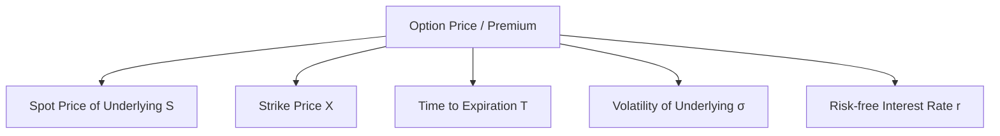

# Derivatives - Options

## 1. Foundation of Option Contracts

An **Option** is a financial derivative contract that grants the buyer the right, but not the obligation, to buy or sell a specified quantity of an underlying asset at a pre-determined price (strike price) on or before a specified date (expiry date). The counterparty who sells this right is the **Option Writer (or Seller)**, who receives an upfront payment called the **Premium** and bears the obligation to fulfill the contract terms if the buyer chooses to exercise.

### Key Terminology
* **Underlying Asset ($S$):** The financial instrument (equity, index, commodity, currency) on which the option contract is based.
* **Strike Price / Exercise Price ($X$):** The fixed price at which the underlying asset can be bought or sold.
* **Expiration Date ($T$):** The final date on which the option can be exercised. In India, equity options expire on the **last Thursday** of the respective contract month.
* **Option Premium ($C_0$ for call, $P_0$ for put):** The price paid by the option buyer to the option seller. It consists of two components:
  $$\text{Option Premium} = \text{Intrinsic Value} + \text{Time Value}$$
* **European vs. American Options:**
  * **European Options:** Can be exercised **only** on the expiration date. (In India, index and stock options traded on NSE are European-style, denoted as CE and PE).
  * **American Options:** Can be exercised at **any time** between the date of purchase and the expiration date.

### Moneyness of Options
The relationship between the spot price of the underlying asset ($S_t$) and the strike price ($X$) defines the "moneyness" of the contract:

| Moneyness | Call Option | Put Option |
| :--- | :--- | :--- |
| **In-the-Money (ITM)** | Spot Price > Strike Price ($S_t > X$) | Strike Price > Spot Price ($X > S_t$) |
| **At-the-Money (ATM)** | Spot Price = Strike Price ($S_t = X$) | Strike Price = Spot Price ($X = S_t$) |
| **Out-of-the-Money (OTM)** | Spot Price < Strike Price ($S_t < X$) | Strike Price < Spot Price ($X < S_t$) |

* **Intrinsic Value:** The economic value if the option were exercised immediately. It can never be negative:
  $$\text{Intrinsic Value (Call)} = \max(0, S_t - X)$$
  $$\text{Intrinsic Value (Put)} = \max(0, X - S_t)$$
* **Time Value:** The premium paid in excess of the intrinsic value, reflecting the probability that the option will move further in-the-money before expiry:
  $$\text{Time Value} = \text{Option Premium} - \text{Intrinsic Value}$$

---

## 2. Factors Affecting Option Pricing

The market price (premium) of an option is determined by five primary variables:



### 1. Spot Price of the Underlying ($S$)
* **Calls:** As the underlying spot price rises, the probability of the call option finishing in-the-money increases, raising its intrinsic value. Thus, Call price has a **positive** correlation with the spot price.
* **Puts:** As the underlying spot price falls, the put option becomes more valuable. Put price has a **negative** correlation with the spot price.

### 2. Strike Price ($X$)
* **Calls:** A higher strike price makes it harder for the call option to expire in-the-money. Thus, Call price has a **negative** correlation with the strike price.
* **Puts:** A higher strike price increases the price at which the investor can sell the asset. Thus, Put price has a **positive** correlation with the strike price.

### 3. Time to Expiration ($T$)
* For both Calls and Puts (European and American), longer time to expiration generally increases the option price because there is more time for the underlying asset to make favorable price movements.
* This time decay (Theta) accelerates as the expiration date approaches, particularly in the final 30 days.

### 4. Volatility of the Underlying Asset ($\sigma$)
* Volatility is a measure of price uncertainty. Unlike standard assets where increased risk is undesirable, options benefit from higher volatility.
* Since the buyer's downside is capped at the premium paid while the upside is unlimited, a highly volatile stock is more likely to make a large move that puts the option deep in-the-money. Hence, volatility has a **positive** correlation with both Call and Put premiums.

### 5. Risk-free Interest Rate ($r$)
* **Calls:** When interest rates rise, the present value of the strike price ($X$) to be paid in the future decreases. Buying a call is a leveraged alternative to buying the stock today, saving interest costs on borrowed capital. Thus, higher interest rates **increase** Call prices.
* **Puts:** A higher interest rate decreases the present value of the strike price to be received in the future when selling the stock. Thus, higher interest rates **decrease** Put prices.

### Summary Matrix of Sensitivity
| Variable | Call Option | Put Option |
| :--- | :---: | :---: |
| Spot Price ($S$) $\uparrow$ | $\uparrow$ | $\downarrow$ |
| Strike Price ($X$) $\uparrow$ | $\downarrow$ | $\uparrow$ |
| Time to Expiry ($T$) $\uparrow$ | $\uparrow$ | $\uparrow$ |
| Volatility ($\sigma$) $\uparrow$ | $\uparrow$ | $\uparrow$ |
| Interest Rate ($r$) $\uparrow$ | $\uparrow$ | $\downarrow$ |

---

## 3. Option Valuation Models

Option pricing models calculate the theoretical fair value of an option. The two dominant frameworks are the **Binomial Model** (discrete-time) and the **Black-Scholes Model** (continuous-time).

### 3.1 The Binomial Option Pricing Model (Discrete-Time)
The Binomial Model assumes that over a single time step, the underlying stock price can move to only two possible values: an up-state ($S_u$) or a down-state ($S_d$).

```
        S_u = S_0 * u  (with payoff C_u)
       /
     S_0 
       \
        S_d = S_0 * d  (with payoff C_d)
```
Where:
* $u = 1 + \text{Percentage Up Move}$
* $d = 1 - \text{Percentage Down Move}$

#### Approach A: The Delta Hedging / Replicating Portfolio Method
This method is built on the **No-Arbitrage Principle**. We construct a portfolio containing $\Delta$ shares of stock and a short position of $1$ Call option. We choose $\Delta$ such that the portfolio value is identical in both states:
$$\text{Portfolio Value Up} = \text{Portfolio Value Down}$$
$$\Delta \cdot S_u - C_u = \Delta \cdot S_d - C_d$$
Solving for $\Delta$ (the hedge ratio):
$$\Delta = \frac{C_u - C_d}{S_u - S_d}$$

Since the portfolio has the same value at expiry regardless of the stock price, it is riskless. Therefore, its return must equal the risk-free rate ($r$):
$$\text{Present Value of Portfolio } (V_0) = $\frac{\Delta \cdot S_u - C_u}{1 + r}$$
We also know that today's portfolio setup cost is:
$$V_0 = \Delta \cdot S_0 - C_0$$
Equating the two:
$$\Delta \cdot S_0 - C_0 = $\frac{\Delta \cdot S_u - C_u}{1 + r}$$
$$C_0 = \Delta \cdot S_0 - \frac{\Delta \cdot S_u - C_u}{1 + r}$$

#### Approach B: The Risk-Neutral Valuation Method
This method assumes that investors are risk-neutral, meaning they do not require a risk premium and expect all assets to earn the risk-free rate. 

1. **Calculate the Risk-Neutral Probability ($p$) of an up-move:**
   $$S_0 \cdot (1 + r) = p \cdot S_u + (1-p) \cdot S_d$$
   Substituting $S_u = S_0 \cdot u$ and $S_d = S_0 \cdot d$:
   $$S_0 \cdot (1 + r) = p \cdot S_0 \cdot u + (1-p) \cdot S_0 \cdot d$$
   $$1 + r = p \cdot u + d - p \cdot d$$
   $$p = \frac{(1+r) - d}{u - d}$$
   *(Note: Under continuous compounding, replace $(1+r)$ with $e^{rt}$, giving $p = \frac{e^{rt} - d}{u - d}$)*

2. **Calculate the Option Value:**
   $$C_0 = \frac{p \cdot C_u + (1-p) \cdot C_d}{1+r}$$
   *(Or $C_0 = e^{-rt}[p \cdot C_u + (1-p) \cdot C_d]$ under continuous compounding)*

---

### 3.2 The Black-Scholes-Merton Model (Continuous-Time)
The Black-Scholes-Merton (BSM) formula values European options on non-dividend-paying stocks by modeling stock prices as continuous geometric Brownian motions.

#### The BSM Formulas:
$$\text{Call Option Price } (C_0) = S_0 \cdot N(d_1) - X \cdot e^{-rt} \cdot N(d_2)$$
$$\text{Put Option Price } (P_0) = X \cdot e^{-rt} \cdot N(-d_2) - S_0 \cdot N(-d_1)$$

Where:
* $S_0$ = Current stock price
* $X$ = Strike price
* $r$ = Continuously compounded risk-free rate
* $t$ = Time to expiration (in years)
* $\sigma$ = Volatility of stock returns (standard deviation per year)
* $N(d)$ = Cumulative standard normal distribution function (probability that a variable is less than $d$)
* $d_1$ and $d_2$ are calculated as:
  $$d_1 = \frac{\ln(S_0 / X) + \left(r + \frac{\sigma^2}{2}\right) \cdot t}{\sigma \cdot \sqrt{t}}$$
  $$d_2 = d_1 - \sigma \cdot \sqrt{t}$$
* Note on $N(-d)$:
  $$N(-d) = 1 - N(d)$$

#### BSM with Dividend Adjustment
If a stock pays a discrete dividend ($D$) at a specific time ($t_d$) during the option's life, the stock price drops by the dividend amount on the ex-dividend date. To adjust the BSM model:
1. Find the present value of the dividend discounted at the risk-free rate:
   $$PV(D) = D \cdot e^{-r \cdot t_d}$$
2. Subtract this present value from the current stock price to find the adjusted stock price ($S_0^*$):
   $$S_0^* = S_0 - PV(D)$$
3. Substitute $S_0^*$ in place of $S_0$ in the formulas for $d_1$ and the option price:
   $$d_1 = \frac{\ln(S_0^* / X) + \left(r + \frac{\sigma^2}{2}\right) \cdot t}{\sigma \cdot \sqrt{t}}$$
   $$C_0 = S_0^* \cdot N(d_1) - X \cdot e^{-rt} \cdot N(d_2)$$

---

## 4. Understanding Option Greeks

Option Greeks measure how sensitive an option's price is to changes in key variables. They are essential tools for risk management and delta-hedging.

### 4.1 Delta ($\Delta$)
* **Definition:** The change in option premium for a ₹1 change in the underlying stock price.
* **Range:**
  * Call Option: $0 \le \Delta_c \le +1$
  * Put Option: $-1 \le \Delta_p \le 0$
* **Interpretation:** A Call Delta of $0.60$ means that if the stock price rises by ₹1, the call option premium will increase by ₹0.60.
* **Delta as Probability:** Delta is often used as a rough proxy for the probability that the option will expire in-the-money. An ATM option has a Delta close to $\pm 0.50$.
* **Delta of Underlying Stock:** The Delta of one share of underlying stock is always $+1.00$.

### 4.2 Gamma ($\Gamma$)
* **Definition:** The rate of change in Delta for a ₹1 change in the underlying stock price.
* **Key Properties:**
  * Gamma is always positive for long option positions (both long calls and long puts).
  * Gamma measures the acceleration of Delta.
  * Gamma is highest for at-the-money options and decreases as the option moves deep in-the-money or out-of-the-money.
  * High Gamma means Delta is highly sensitive to stock price changes, making a delta-hedged portfolio difficult to maintain without frequent rebalancing.

### 4.3 Theta ($\theta$)
* **Definition:** The rate of change in option premium with respect to time decay (passage of $1$ day).
* **Key Properties:**
  * Theta is negative for long option holders because options lose time value daily.
  * Theta decay is non-linear; it accelerates rapidly in the last few weeks before expiration.
  * ATM options have the highest Theta decay.

```
Option Value
  |       
  |      \
  |       \
  |        \  <- Time Decay accelerates near expiry
  |         \__
  +------------------ Expiry
  T-90     T-30   T-0
```

### 4.4 Vega ($\nu$)
* **Definition:** The change in option premium for a $1\%$ change in the implied volatility ($\sigma$) of the underlying asset.
* **Key Properties:**
  * Vega is positive for both long calls and long puts. Higher volatility means a higher option premium.
  * ATM options are the most sensitive to volatility changes (highest Vega).

### 4.5 Rho ($\rho$)
* **Definition:** The change in option premium for a $1\%$ change in the risk-free interest rate ($r$).
* **Key Properties:**
  * Call option Rho is positive.
  * Put option Rho is negative.
  * Rho is generally the least significant Greek for short-term option positions but becomes important for long-dated options (LEAPS).

---

## 5. Put-Call Parity (PCP)

Put-Call Parity is a fundamental pricing relationship that must hold between European call and put options with the same underlying asset, strike price, and expiration date. It is derived using a replicating portfolio argument.

### The Parity Equation
$$\text{Value of Call } (C_0) + \text{Present Value of Strike } (X) = \text{Value of Put } (P_0) + \text{Current Stock Price } (S_0)$$

#### Continuous Compounding:
$$C_0 + X \cdot e^{-rt} = P_0 + S_0$$

#### Simple Compounding:
$$C_0 + \frac{X}{1 + r \cdot t} = P_0 + S_0$$

### Arbitrage Violations
If this equality does not hold in the market, an arbitrage opportunity exists:

1. **If $C_0 + X \cdot e^{-rt} > P_0 + S_0$ (Call is overpriced / Put is underpriced):**
   * **Action:** Sell Call, Buy Put, Buy Stock, and Borrow the PV of Strike.
   * This is known as a **Reversal**.
2. **If $C_0 + X \cdot e^{-rt} < P_0 + S_0$ (Call is underpriced / Put is overpriced):**
   * **Action:** Buy Call, Sell Put, Short Stock, and Invest the PV of Strike at risk-free rate.
   * This is known as a **Conversion**.

---

## 6. Basic Hedging and Strategies

Options allow investors to design customized risk-return profiles. 

### 6.1 Delta Hedging (Creating a Delta-Neutral Portfolio)
A portfolio is **Delta-Neutral** if its overall Delta is zero, making its value insensitive to small changes in the price of the underlying asset.

$$\text{Portfolio Delta } (\Delta_p) = N_s \cdot \Delta_s + N_o \cdot \Delta_o = 0$$
Where:
* $N_s$ = Number of shares of stock (each share has a Delta of $+1.00$)
* $N_o$ = Number of option contracts
* $\Delta_o$ = Delta of the option

To hedge a short position of $1$ option contract ($\Delta_o$):
$$\text{Shares to Buy} = \text{Number of Options Written} \times \text{Delta of Option}$$
$$\text{Hedge Ratio } (\Delta) = $\frac{C_u - C_d}{S_u - S_d}$$

Because Delta changes as the stock price moves (measured by Gamma), the portfolio will not remain delta-neutral for long. Portfolio managers must periodically rebalance the portfolio by buying or selling shares to return the net Delta to zero.

### 6.2 Straddle Strategy (Volatility Strategy)
A **Long Straddle** is designed to profit from significant stock price volatility, regardless of the direction of the move.

* **Construction:** Buy $1$ Call Option and Buy $1$ Put Option with the same strike price ($X$) and expiration date ($T$).
* **Cost of Setup:** $C_0 + P_0$ (Net debit transaction).
* **Payoff Structure:**
  * **At Expiry:**
    $$\text{Payoff} = \max(0, S_t - X) + \max(0, X - S_t)$$
  * **Net Profit:** $\text{Payoff} - (\text{Call Premium} + \text{Put Premium})$
* **Breakeven Points:**
  * Upper Breakeven = $X + (\text{Call Premium} + \text{Put Premium})$
  * Lower Breakeven = $X - (\text{Call Premium} + \text{Put Premium})$
* **Maximum Risk:** Limited to the total premium paid (occurs if stock price ends exactly at strike price $X$).
* **Maximum Profit:** Unlimited on the upside (stock price rises to infinity) and substantial on the downside (stock price falls to zero).

```
Profit / Loss
   ^
   |        \           /
   |         \         /
   |          \       /
 0 |-----------LBE---X---UBE-------------> Stock Price at Expiry
   |            \   /
   |             \ /
   |              V (Max Loss = Premium Paid)
```
* **Short Straddle:** The exact opposite of the long straddle. An investor writes a Call and a Put at the same strike price, profiting from low volatility. The maximum profit is the premium received, and the risk is unlimited.
