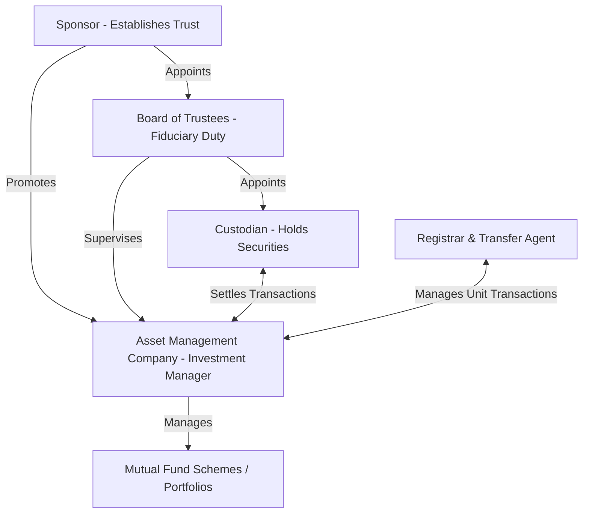

# Mutual Funds

## 1. Structural and Regulatory Architecture of Mutual Funds

Mutual funds are structured as trusts under the Indian Trusts Act, 1882. The structural integrity and operational separation of assets are governed by the Securities and Exchange Board of India (Mutual Funds) Regulations, 1996. This structure is designed to mitigate conflicts of interest and protect retail investors.



### 1.1 The Sponsor
*   **Role:** The sponsor acts as the promoter of the mutual fund, similar to the promoter of a company. The sponsor establishes the trust under the Indian Trusts Act and registers the mutual fund with SEBI.
*   **Eligibility Criteria (SEBI Norms):**
    *   The sponsor must have a sound track record and general reputation of fairness and integrity in all business transactions.
    *   The sponsor must have been carrying on business in financial services for a period of not less than five years, with a positive net worth in all the immediately preceding five years.
    *   The net worth of the sponsor in the immediately preceding year must be more than the capital contribution of the sponsor in the Asset Management Company (AMC).
    *   The sponsor must show profits in at least three out of the preceding five years, including the fifth year.
    *   The sponsor must contribute at least 40% of the net worth of the AMC.

### 1.2 The Board of Trustees
*   **Role:** The trustees hold the property of the mutual fund in trust for the benefit of the unit holders. They acts as the primary guardians of investor interests.
*   **Key Responsibilities:**
    *   Appointing the Asset Management Company (AMC) and approving the investment management agreement.
    *   Ensuring that the AMC acts in accordance with SEBI regulations, the trust deed, and the scheme information documents.
    *   Ensuring that the AMC has not given any undue preference to any associate companies.
    *   Reviewing all transactions carried out by the AMC and submitting six-monthly reports to SEBI.
    *   Two-thirds of the trustees must be independent (i.e., not associated with the sponsor).

### 1.3 The Asset Management Company (AMC)
*   **Role:** The AMC acts as the investment manager of the mutual fund. It is a company registered under the Companies Act and approved by SEBI to manage the funds collected under various schemes.
*   **Key Constraints:**
    *   The AMC must have a minimum net worth of ₹50 crores.
    *   An AMC cannot act as a trustee of any other mutual fund.
    *   An AMC cannot undertake any other business activities except portfolio management services, advisory services, and managing alternative investment funds (AIFs), subject to specific conditions.
    *   The Asset Management Company is paid a management fee, which is capped under the Total Expense Ratio (TER) guidelines.

### 1.4 The Custodian
*   **Role:** The custodian is an independent agency registered with SEBI that holds the physical and electronic securities of the mutual fund schemes in safe custody.
*   **Key Duties:**
    *   Clearing and settling trades executed by the AMC.
    *   Collecting dividends, interest, and handling corporate actions (such as bonus issues or stock splits) on behalf of the fund.
    *   The custodian must be completely independent of the sponsor and the AMC to avoid any misappropriation of securities.

### 1.5 The Registrar and Transfer Agent (RTA)
*   **Role:** RTAs handle the administrative work of processing investor applications, issuing and redeeming units, maintaining the register of unit holders, and processing dividend payouts.

---

## 2. In-Depth Mechanics of Dividend Equalization

### 2.1 The Rationale for Dividend Equalization
In an open-ended mutual fund scheme, transactions (subscriptions and redemptions) occur daily at the prevailing NAV. As the fund earns income (dividends and interest) throughout its financial year, this income accumulates within the fund's net assets, causing the NAV to rise. 

If a new investor purchases units mid-year, they pay the full NAV, which includes a share of the accumulated but undistributed income. If the fund subsequently distributes a dividend, the new investor is paid a share of the accumulated income, even though their capital was not invested when that income was earned. Conversely, if an investor redeems units mid-year, they receive a payout that includes their share of the accumulated income up to the redemption date.

Without adjustments, mid-year transactions would dilute the income share of long-term investors. **Dividend Equalization** is the accounting mechanism that solves this by separating the transaction price of units into two components:
1.  **Capital Component:** Represents the underlying value of the fund's investment portfolio (the principal).
2.  **Income Component (Dividend Equalization Reserve):** Represents the accumulated net income per unit up to the date of the transaction.

### 2.2 Mathematical Formulations and Accounting Entries

Let:
*   $N_0$ = Outstanding units at the start of the period.
*   $I_t$ = Net income earned by the fund during sub-period $t$.
*   $E_t$ = Net dividend equalization reserve balance.
*   $U_t$ = Outstanding units before transaction at time $t$.

#### Step-by-Step Mathematical Adjustments:

1.  **At Start of Period (T = 0):**
    *   Outstanding Units = $N_0$
    *   Opening NAV = $\text{NAV}_0$
    *   Accumulated Income = 0
    *   Dividend Equalization per unit ($\text{DER}_0$) = 0

2.  **During Month 1 (Income = $I_1$):**
    *   Accumulated Income Pool = $I_1$
    *   Outstanding Units = $N_0$
    *   Dividend Equalization per unit at end of Month 1 ($\text{DER}_1$):
        $$\text{DER}_1 = \frac{I_1}{N_0}$$

3.  **Transaction at end of Month 1 (Issue of $N_{new}$ units):**
    *   Issue Price = $\text{NAV}_0 + \text{Entry Load} + \text{DER}_1$
    *   Total cash received = $N_{new} \times (\text{NAV}_0 + \text{Entry Load} + \text{DER}_1)$
    *   **Accounting Allocation:**
        *   To Unit Capital: $N_{new} \times \text{NAV}_0$
        *   To Share Premium/AMC (Entry Load): $N_{new} \times \text{Entry Load}$
        *   To Dividend Equalization Reserve: $N_{new} \times \text{DER}_1$
    *   New Outstanding Units = $N_0 + N_{new}$
    *   Updated Income Pool = $I_1 + (N_{new} \times \text{DER}_1)$

4.  **During Month 2 (Income = $I_2$):**
    *   Accumulated Income Pool before Month 2 transactions = $I_1 + (N_{new} \times \text{DER}_1) + I_2$
    *   Current Outstanding Units = $N_0 + N_{new}$
    *   Dividend Equalization per unit at end of Month 2 ($\text{DER}_2$):
        $$\text{DER}_2 = \frac{I_1 + (N_{new} \times \text{DER}_2') + I_2}{N_0 + N_{new}}$$
        Where the numerator is the total balance in the Income and Equalization account.

5.  **Transaction at end of Month 2 (Repurchase of $N_{red}$ units):**
    *   Repurchase Price = $\text{NAV}_0 - \text{Exit Load} + \text{DER}_2$
    *   Total cash paid = $N_{red} \times (\text{NAV}_0 - \text{Exit Load} + \text{DER}_2)$
    *   **Accounting Allocation:**
        *   Debit Unit Capital: $N_{red} \times \text{NAV}_0$
        *   Credit AMC (Exit Load): $N_{red} \times \text{Exit Load}$
        *   Debit Dividend Equalization Reserve: $N_{red} \times \text{DER}_2$
    *   New Outstanding Units = $N_0 + N_{new} - N_{red}$
    *   Updated Income Pool = Accumulated Income Pool before repurchase $- (N_{red} \times \text{DER}_2)$

6.  **Distribution of Dividends at end of Period (T = 3):**
    *   Total Available Income = $\text{Accumulated Income Pool at end of Month 2} + I_3$
    *   Dividend Distributed = $\text{Distribution Rate } (d) \times \text{Total Available Income}$
    *   Retained Income = $(1 - d) \times \text{Total Available Income}$

---

## 3. Mutual Fund Performance Measurement Framework

Performance evaluation of mutual funds involves scaling the historical excess return of a fund by its risk. Depending on whether the portfolio represents the investor's sole investment (total risk is relevant) or is part of a wider diversified holding (systematic risk is relevant), different ratios are applied.

### 3.1 Sharpe Ratio (Reward-to-Variability)
The Sharpe ratio measures the excess return per unit of total risk (standard deviation).
$$\text{Sharpe Ratio} = $\frac{R_p - R_f}{\sigma_p}$$
Where:
*   $R_p$ = Average return of the portfolio.
*   $R_f$ = Risk-free rate of return.
*   $\sigma_p$ = Standard deviation of the portfolio returns.

#### Derivation from the Capital Market Line (CML):
The Sharpe ratio represents the slope of the line from the risk-free rate to the portfolio in the expected return-standard deviation space. A higher Sharpe ratio indicates a more efficient portfolio that lies closer to the CML.

---

### 3.2 Treynor Ratio (Reward-to-Volatility)
The Treynor ratio measures the excess return per unit of systematic risk (Beta).
$$\text{Treynor Ratio} = $\frac{R_p - R_f}{\beta_p}$$
Where:
*   $\beta_p$ = Systematic risk coefficient (Beta) of the portfolio, calculated as:
    $$\beta_p = \frac{\text{Covariance}(R_p, R_m)}{\sigma_m^2}$$
*   $R_m$ = Market portfolio return.

#### Derivation from the Security Market Line (SML):
The Treynor ratio represents the slope of the line from the risk-free rate to the portfolio in the expected return-Beta space.

---

### 3.3 Jensen's Alpha ($\alpha$)
Jensen's Alpha measures the abnormal return of a portfolio above or below its CAPM-expected return. It is an absolute measure of risk-adjusted performance.
$$\alpha_p = R_p - [R_f + \beta_p(R_m - R_f)]$$
Where:
*   $[R_f + \beta_p(R_m - R_f)]$ = Expected return of the portfolio based on the Capital Asset Pricing Model (CAPM).
*   If $\alpha_p > 0$: The portfolio has outperformed the market on a risk-adjusted basis (positive manager skill).
*   If $\alpha_p < 0$: The portfolio has underperformed (negative manager skill or high expenses).

---

### 3.4 Tracking Error (TE)
Tracking error measures the volatility of the active returns of a portfolio relative to its benchmark. It is a critical metric for passive index funds and enhanced index strategies.
$$\text{Active Return } (R_{a,t}) = R_{p,t} - R_{b,t}$$
Where:
*   $R_{p,t}$ = Return of the portfolio at time $t$.
*   $R_{b,t}$ = Return of the benchmark at time $t$.

$$\text{Tracking Error (TE)} = \sqrt{\frac{1}{T-1} \sum_{t=1}^{T} (R_{a,t} - \bar{R}_a)^2}$$
Where:
*   $\bar{R}_a$ = Mean active return over the period.
*   $T$ = Number of observation periods.
*   **Significance:** A high tracking error in a passive index fund indicates poor replication execution, high transaction costs, or cash drag. In an active fund, tracking error reflects the active risk taken by the manager.

---

### 3.5 Decomposition of Risk and Ranking Conflicts

By definition, total risk (variance) can be decomposed into systematic and unsystematic risk components:
$$\sigma_p^2 = \beta_p^2 \sigma_m^2 + \sigma_{ep}^2$$
Where:
*   $\beta_p^2 \sigma_m^2$ = Systematic Risk (Market risk that cannot be diversified away).
*   $\sigma_{ep}^2$ = Unsystematic / Residual Risk (Portfolio-specific risk).
*   $R^2 = $\frac{\beta_p^2 \sigma_m^2}{\sigma_p^2}$ = Coefficient of Determination (measures the percentage of total risk explained by the market).

#### Ranking Conflicts (Sharpe vs. Treynor):
*   **Case 1: Well-Diversified Portfolio ($R^2 \approx 1.00$):**
    If the portfolio is perfectly diversified, the unsystematic risk ($\sigma_{ep}^2$) is zero. Consequently, total risk is composed entirely of systematic risk:
    $$\sigma_p = \beta_p \sigma_m$$
    Substituting this into the Sharpe ratio:
    $$\text{Sharpe} = \frac{R_p - R_f}{\beta_p \sigma_m} = $\frac{1}{\sigma_m} \left( \frac{R_p - R_f}{\beta_p} \right) = $\frac{\text{Treynor}}{\sigma_m}$$
    Since $\sigma_m$ is constant for all portfolios, the Sharpe and Treynor rankings will be identical.
*   **Case 2: Poorly-Diversified Portfolio ($R^2 \ll 1.00$):**
    If the portfolio has significant unsystematic risk, its total standard deviation ($\sigma_p$) will be higher relative to its Beta. The portfolio will rank higher under the Treynor ratio (which ignores unsystematic risk) than under the Sharpe ratio (which penalizes for unsystematic risk).
*   **Investor Decision Rule:**
    - If the portfolio is the investor's sole asset: Use the **Sharpe Ratio** (total risk is what matters).
    - If the portfolio is one of many assets in a diversified holding: Use the **Treynor Ratio** or **Jensen's Alpha** (only systematic risk matters).

---

## 4. Advanced Concepts: Side-Pocketing and ETFs

### 4.1 Side-Pocketing in Mutual Funds
Side-pocketing is an accounting practice used by mutual funds to segregate distressed, illiquid, or defaulted debt securities from the main investment portfolio.

#### Mechanics of Side-Pocketing:
1.  **Trigger Event:** A debt security in the portfolio experiences a credit rating downgrade to "default" grade (e.g., D) or below investment grade, or becomes completely illiquid.
2.  **Creation of Side Pocket:** The AMC isolates the toxic asset into a separate "side-pocketed" scheme. 
3.  **Pro-Rata Allocation:** Existing unit holders are allocated units in the side-pocketed scheme in proportion to their holdings in the main scheme.
4.  **Split of NAV:** The NAV of the original scheme is split:
    $$\text{NAV}_{\text{Original Scheme}} = \text{NAV}_{\text{Main Portfolio}} + \text{NAV}_{\text{Side-Pocketed Portfolio}}$$
5.  **Redemption Restriction:** Units of the side-pocketed scheme are locked. No new subscriptions or redemptions are allowed. Units in the main portfolio remain fully liquid and open for transactions.
6.  **Liquidation:** As and when the AMC recovers any money from the distressed asset, it is distributed to the holders of the side-pocketed units on a pro-rata basis, and the side-pocketed units are cancelled.

```
[Initial Mutual Fund Scheme (NAV = ₹25.00)]
         |
         |---> [Distressed Asset Segregated]
         |
         v
[Main Scheme (NAV = ₹22.00)]  +  [Side-Pocket Scheme (NAV = ₹3.00)]
(Fully Liquid: Buy/Sell open)      (Illiquid: Locked until recovery)
```

---

### 4.2 Exchange Traded Funds (ETFs) and the Creation-Redemption Process
Exchange Traded Funds are hybrid investment instruments that combine the diversification benefits of open-ended mutual funds with the trading liquidity of stocks. 

#### Structural Differences:

| Feature | Open-Ended Mutual Fund | Exchange Traded Fund (ETF) | Closed-Ended Fund |
| :--- | :--- | :--- | :--- |
| **Trading venue** | Direct with the AMC | On the Stock Exchange | On the Stock Exchange |
| **Transaction Price** | End-of-day NAV | Real-time market price | Real-time market price |
| **Premium/Discount** | None | Minimally close to NAV | Can trade at deep discounts |
| **Liquidity Creator** | The AMC (cash payouts) | Authorized Participants (APs) | Secondary market buyers |

#### The Arbitrage and Creation-Redemption Mechanism:
Unlike mutual funds, where transactions are settled in cash directly with the fund, ETFs rely on **Authorized Participants (APs)**—usually large institutional market makers—to maintain the match between the ETF's market price and its underlying NAV.

```
   Market Price > NAV (Premium)                    Market Price < NAV (Discount)
==================================               ==================================
1. AP buys underlying basket.                    1. AP buys cheap ETF units on exchange.
2. AP delivers basket to ETF sponsor.            2. AP redeems ETF units with sponsor.
3. Sponsor issues new ETF units.                 3. Sponsor delivers underlying basket.
4. AP sells ETF units on exchange.               4. AP sells basket stocks in spot market.
--> Increases supply, drives price down to NAV.  --> Decreases supply, drives price up to NAV.
```

1.  **Creation Unit Block:** Transactions between the ETF sponsor and the AP occur only in large blocks called "Creation Units" (typically 50,000 to 100,000 units of the ETF) and are done **in-kind** (by exchanging a basket of underlying securities for ETF units, rather than cash).
2.  **Arbitrage in Action (Premium Scenario):**
    - If the ETF market price rises above the NAV (e.g., ETF trades at ₹105, but NAV is ₹100):
    - The AP buys the underlying basket of stocks in the spot market for ₹100.
    - The AP delivers the stock basket to the ETF sponsor in exchange for one Creation Unit of the ETF (valued at NAV = ₹100 per unit).
    - The AP sells the newly created ETF units on the stock exchange at the market price of ₹105.
    - The AP locks in a risk-free profit of ₹5 per unit.
    - The selling pressure of the AP on the stock exchange brings the ETF's market price back down to its NAV.
3.  **Arbitrage in Action (Discount Scenario):**
    - If the ETF market price falls below the NAV (e.g., ETF trades at ₹95, but NAV is ₹100):
    - The AP buys ETF units in the secondary market at ₹95.
    - The AP delivers the Creation Unit of ETF units to the ETF sponsor for redemption.
    - The ETF sponsor delivers the underlying stock basket (valued at ₹100 per unit) to the AP.
    - The AP sells the stocks in the spot market for ₹100.
    - The AP locks in a profit of ₹5 per unit.
    - The buying pressure on the ETF units on the exchange pushes the market price back up to its NAV.

---

## 5. Alternative Formats and Hedge Fund Operations

### 5.1 Gold Investment Vehicles: Physical Gold, Gold ETFs, and Sovereign Gold Bonds (SGBs)

Investors seeking exposure to gold can choose from physical holding, securitized market holding, or sovereign debt structures.

| Feature | Physical Gold | Gold ETFs | Sovereign Gold Bonds (SGBs) |
| :--- | :--- | :--- | :--- |
| **Nature of Holding** | Physical Asset | Mutual Fund Units (backed by physical gold) | Sovereign Debt Securities (denominated in gold) |
| **Purity Guarantee** | Subject to verification | Assured (99.5% pure physical gold held by Custodian) | Assured (linked to Indian Bullion and Jewellers Assoc. quotes) |
| **Annual Interest Yield**| None (costs incurred for storage) | None (TER deducted annually) | 2.50% p.a. (payable semi-annually on nominal value) |
| **Liquidity** | High (via gold dealers, but subject to high spreads) | Very High (traded daily on the stock exchange) | Low/Moderate (traded on exchange, but thin volumes; exit window opens after 5 years) |
| **Transaction Costs** | Making charges (5% - 20%), GST (3%) | Brokerage, AMC expense ratio (TER ~ 0.5% - 1%) | Nil (often discount of ₹50/gram on online purchase) |
| **Capital Gains Taxation** | LTCG after 3 years (20% with indexation) | Taxed at debt fund rates (marginal slab rate) | Exempt from capital gains tax if held till maturity (8 years) |

---

### 5.2 Hedge Funds and Fee Structure Math
Hedge funds are private investment partnerships open to high-net-worth individuals and institutional investors. Unlike highly regulated mutual funds, hedge funds have broader investment mandates, including short selling, leverage, and derivatives trading.

#### Fee Structure (The "2 and 20" Rule):
Hedge funds typically charge a flat management fee plus an incentive fee based on performance.
*   **Management Fee:** 1.0% to 2.0% of the Asset Under Management (AUM), charged regardless of performance.
*   **Incentive Fee:** Typically 20% of the profits generated by the fund.

#### Safeguards for Investors:
1.  **Hurdle Rate:** The minimum return the fund must generate before the manager can claim any incentive fee.
    - *Soft Hurdle:* Once the hurdle is cleared, the incentive fee is calculated on the entire return.
    - *Hard Hurdle:* The incentive fee is calculated only on the returns in excess of the hurdle rate.
2.  **High-Water Mark (HWM):** A rule ensuring that the manager only receives incentive fees on *new* net profits. If the fund loses money in Year 1, the manager cannot charge an incentive fee in Year 2 until the fund recovers the Year 1 losses and exceeds the highest historical year-end valuation (the high-water mark).

#### Step-by-Step Computational Process for Hedge Fund Fees:

Let:
*   $V_{t-1}$ = Year-end Net Assets of the previous year.
*   $V_t^{gross}$ = Assets at the end of year $t$ before any fees.
*   $m$ = Management fee rate.
*   $i$ = Incentive fee rate.
*   $H$ = Hurdle rate of return.
*   $\text{HWM}$ = Current High-Water Mark.

$$\text{Management Fee } (M_t) = V_{t-1} \times m$$
$$\text{Fund Value after Management Fee } (V_t') = V_t^{gross} - M_t$$
$$\text{Hurdle Value } (HV_t) = V_{t-1} \times (1 + H)$$
$$\text{Target to Beat } (T_t) = \max(HV_t, \text{HWM})$$

If $V_t' > T_t$:
$$\text{Eligible Profit} = V_t' - T_t$$
$$\text{Incentive Fee } (I_t) = Eligible Profit \times i$$
$$\text{Closing Net Assets } (V_t) = V_t' - I_t$$
$$\text{New High-Water Mark } (\text{HWM}_t) = V_t$$

If $V_t' \le T_t$:
$$\text{Incentive Fee } (I_t) = 0$$
$$\text{Closing Net Assets } (V_t) = V_t'$$
$$\text{New High-Water Mark } (\text{HWM}_t) = \max(\text{HWM}_{t-1}, V_t)$$

---

## 6. Taxation Framework for Mutual Funds (India)

Under the Indian Income Tax Act, 1961, the taxation of mutual fund returns depends on the classification of the scheme (Equity vs. Debt) and the holding period of the investment.

### 6.1 Classification of Schemes
*   **Equity-Oriented Funds:** Schemes that invest at least 65% of their total assets in equity shares of domestic companies.
*   **Debt-Oriented Funds:** Schemes that invest less than 35% of their assets in equity shares.
*   **Arbitrage Funds:** Classified as equity-oriented funds because they maintain an equity exposure of $\ge 65\%$ by holding offsetting spot and futures positions.

### 6.2 Holding Periods and Tax Rates (As of FY 2025-26 / AY 2026-27)

#### Equity-Oriented Funds (including Arbitrage Funds):
*   **Short-Term Capital Gains (STCG):** Holding period $< 12$ months. Taxed at a flat rate of **15%** (plus applicable surcharge and 4% cess).
*   **Long-Term Capital Gains (LTCG):** Holding period $\ge 12$ months. Capital gains up to **₹1.25 lakhs** in a financial year are exempt. Gains exceeding ₹1.25 lakhs are taxed at a flat rate of **12.5%** without indexation benefits.

#### Debt-Oriented Funds:
*   **Capital Gains:** Regardless of the holding period, capital gains on debt funds are treated as short-term capital gains and are added to the investor's taxable income and taxed at their **marginal income tax slab rate** (e.g., up to 30% or 39% including surcharges). Indexation benefits are no longer available for debt funds purchased after April 1, 2023.
*   **Tax Planning Benefit of Arbitrage Funds:** Arbitrage funds deliver low-risk returns similar to short-term debt funds or liquid funds, but they are taxed under the much lower equity tax rates (15% STCG or 12.5% LTCG). This tax arbitrage makes them highly attractive for high-bracket corporate and retail investors seeking to park short-term cash.
