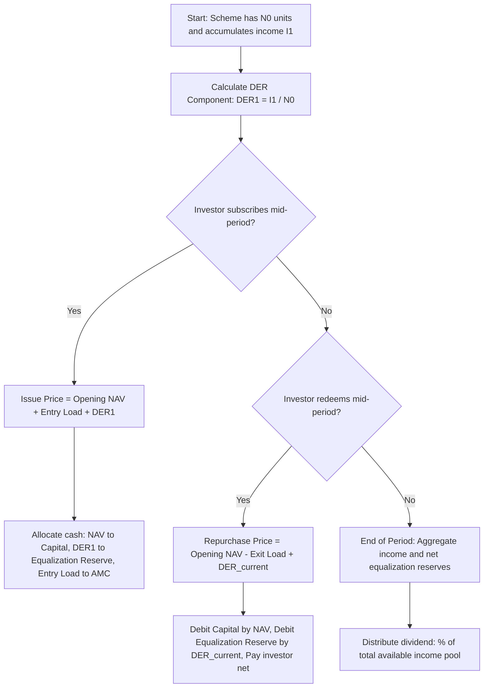

# Mutual Funds

## 1. Core Formulas Cheat Sheet

### 1.1 Net Asset Value (NAV)
$$\text{NAV per unit} = $\frac{\text{Market Value of Investments} + \text{Receivables} + \text{Accrued Income} - \text{Accrued Expenses} - \text{Liabilities}}{\text{Number of Outstanding Units}}$$

### 1.2 Performance Evaluation Ratios
*   **Sharpe Ratio (Total Risk):**
    $$\text{Sharpe Ratio} = $\frac{R_p - R_f}{\sigma_p}$$
*   **Treynor Ratio (Systematic Risk):**
    $$\text{Treynor Ratio} = $\frac{R_p - R_f}{\beta_p}$$
*   **Jensen's Alpha ($\alpha$ - CAPM Premium):**
    $$\alpha_p = R_p - [R_f + \beta_p(R_m - R_f)]$$
*   **Tracking Error (TE):**
    $$\text{Tracking Error} = \text{Standard Deviation of } (R_p - R_b)$$

### 1.3 Risk Decomposition
$$\text{Total Portfolio Variance } (\sigma_p^2) = \text{Systematic Variance } (\beta_p^2 \sigma_m^2) + \text{Unsystematic Variance } (\sigma_{ep}^2)$$
*   **Coefficient of Determination ($R^2$):**
    $$R^2 = r_{pm}^2 = $\frac{\text{Systematic Risk}}{\text{Total Risk}} = $\frac{\beta_p^2 \sigma_m^2}{\sigma_p^2}$$

### 1.4 Dynamic Yield and Return
*   **Holding Period Yield (HPY) - Simple Return:**
    $$\text{HPY} = \frac{(\text{NAV}_1 - \text{NAV}_0) + \text{Dividend Paid}}{\text{NAV}_0}$$
*   **Effective Annualized Yield (365-day basis):**
    $$\text{Effective Annualized Yield} = \left( 1 + \text{HPY} \right)^{\frac{365}{\text{Days of holding}}} - 1$$

---

## 2. Key Concept Definitions

*   **Dividend Equalization Reserve (DER):** An accounting pool designed to prevent the dilution of distributable income per unit when new units are issued or old units are repurchased mid-year.
*   **Authorized Participant (AP):** A market-making institutional entity that has a contract with an ETF sponsor to execute in-kind creation and redemption of ETF units.
*   **Side-Pocketing:** The practice of separating distressed or defaulted debt assets from the main liquid portfolio of a mutual fund scheme into a locked, separate scheme.
*   **High-Water Mark (HWM):** The highest historical valuation that a hedge fund has reached at the end of any previous performance period. The manager cannot charge incentive fees until the fund value beats this mark.
*   **Tracking Error:** A statistical measure of how closely a fund's portfolio returns follow its benchmark index. It is the standard deviation of the difference between the fund and benchmark returns.
*   **Arbitrage Fund:** A mutual fund that exploits price discrepancies between the spot and derivative markets of a stock to generate low-risk returns.

---

## 3. High-Yield Comparison Tables

### 3.1 Open-Ended Mutual Funds vs. ETFs vs. Closed-Ended Funds

| Feature | Open-Ended Mutual Fund | Exchange Traded Fund (ETF) | Closed-Ended Fund |
| :--- | :--- | :--- | :--- |
| **Transaction Method** | Directly with the AMC | Through a stockbroker on exchange | Through a stockbroker on exchange |
| **Pricing** | Handled once daily at end-of-day NAV | Real-time market price throughout the day | Real-time market price on the exchange |
| **Creation/Redemption**| Unlimited units created/redeemed daily | APs trade in-kind in Creation Units | Fixed capital raised during NFO |
| **NAV Alignment** | Always trades exactly at NAV | Kept close to NAV by AP arbitrage | Can trade at a steep discount or premium |

### 3.2 Gold ETFs vs. Sovereign Gold Bonds (SGBs) vs. Physical Gold

| Feature | Gold ETFs | Sovereign Gold Bonds (SGBs) | Physical Gold |
| :--- | :--- | :--- | :--- |
| **Management Fees** | TER ~ 0.5% - 1% p.a. | Nil | Nil (but storage/locker costs apply) |
| **Interest Income** | Nil | 2.50% p.a. (payable semi-annually) | Nil |
| **Liquidity** | T+1 trade execution on exchange | Low/Moderate secondary market volume | Subject to dealer spreads |
| **Capital Gains Tax** | Taxed at investor's slab rate | Exempt if held to maturity (8 years) | Taxed at 20% with indexation (LTCG) |

---

## 4. Key Accounting & Operational Workflows

### 4.1 Step-by-Step Dividend Equalization Workflow

---

### 4.2 Step-by-Step Hedge Fund Fee Workflow (with High-Water Mark)

1.  **Calculate Management Fee:**
    $$\text{Management Fee } (M_t) = \text{Opening Net Assets } (A_{t-1}) \times \text{Management Fee Rate } (m)$$
2.  **Determine Net Assets before Performance Fees:**
    $$A_t^{pre-incentive} = A_{t-1} \times (1 + R_t^{gross}) - M_t$$
3.  **Identify the Hurdle Value Threshold:**
    $$\text{Hurdle Value } (HV_t) = A_{t-1} \times (1 + \text{Hurdle Rate } H)$$
4.  **Evaluate Binding Constraint:**
    $$\text{Target to Beat } (T_t) = \max(\text{Current High-Water Mark } \text{HWM}_{t-1}, HV_t)$$
5.  **Calculate Payout:**
    - If $A_t^{pre-incentive} > T_t$:
      $$\text{Incentive Fee } (I_t) = (A_t^{pre-incentive} - T_t) \times \text{Incentive Fee Rate } (i)$$
      $$\text{Closing Net Assets } (A_t) = A_t^{pre-incentive} - I_t$$
      $$\text{Update High-Water Mark } (\text{HWM}_t) = A_t$$
    - If $A_t^{pre-incentive} \le T_t$:
      $$\text{Incentive Fee } (I_t) = 0$$
      $$\text{Closing Net Assets } (A_t) = A_t^{pre-incentive}$$
      $$\text{Update High-Water Mark } (\text{HWM}_t) = \max(\text{HWM}_{t-1}, A_t)$$
