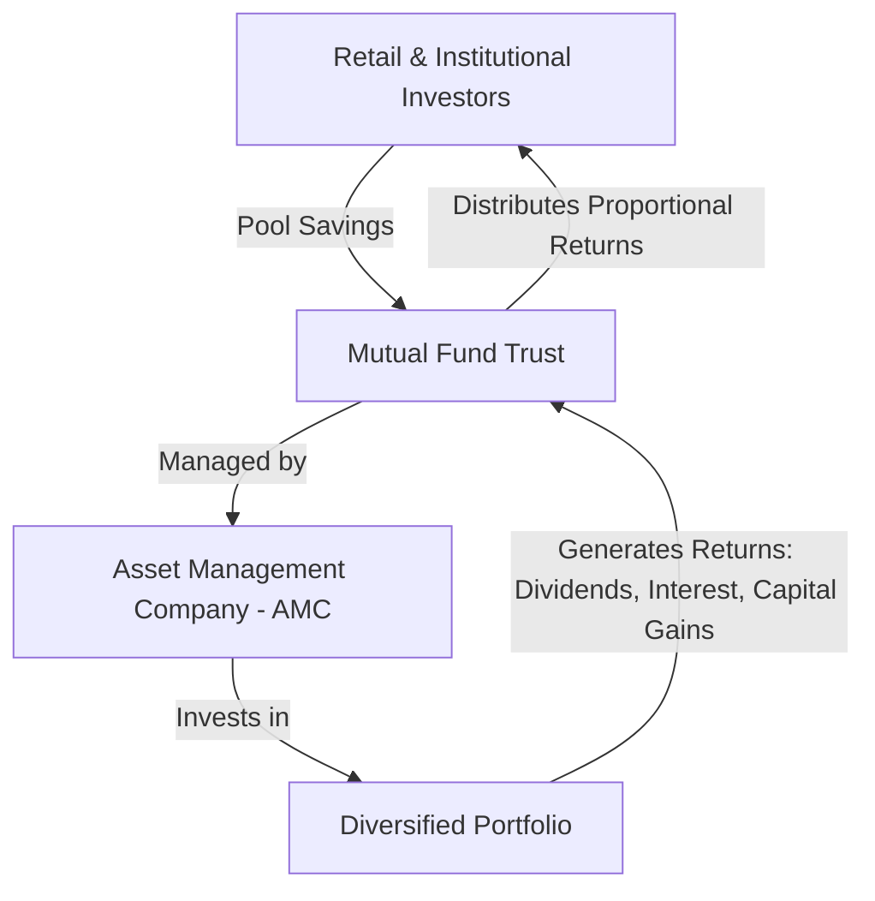

# Mutual Funds

### Learning objectives

- Integrate regulatory structure with scheme design and investor-facing features tested in AFM.
- Apply performance measures (Sharpe, Treynor, Jensen, tracking error) and interpret ranking conflicts.
- Work dividend equalisation, side-pocketing, and ELSS / arbitrage-fund mechanics as per the module.
- Solve multi-step numerical templates commonly set in examination caselets.

---

## 1. Introduction & Theoretical Foundations

### What is a Mutual Fund?
A **Mutual Fund (MF)** is a trust established to pool financial savings from numerous investors who share common investment goals. This collective pool of capital is managed by a professional fund manager who invests it in a diversified portfolio of securities—such as equity shares, debt instruments, bonds, money market instruments, or gold—aligned with the fund's investment objective. The income generated and capital appreciation realized are distributed back to the unit holders in proportion to the number of units they own.



### The Structure of a Mutual Fund in India
Under the SEBI (Mutual Funds) Regulations, 1996, a mutual fund is structured as a **three-tier system** with separate roles for different entities to avoid conflicts of interest and protect investor rights:

1. **The Sponsor:**
   * **Role:** The promoter who sets up the mutual fund and registers it with SEBI.
   * **Requirement:** Must contribute at least 40% of the net worth of the Asset Management Company (minimum AMC net worth requirement is ₹10 crore). The sponsor must possess a sound track record of financial services (at least 5 years of experience).

2. **The Board of Trustees:**
   * **Role:** Holds the property of the mutual fund in trust for the benefit of the unit holders.
   * **Function:** Oversees the operations of the AMC to ensure strict compliance with the Trust Deed and SEBI guidelines. At least two-thirds of the trustees must be independent of the sponsor.

3. **The Asset Management Company (AMC):**
   * **Role:** The investment manager appointed by the trustees to manage the fund's assets.
   * **Function:** Selects securities, builds portfolios, designs schemes, and executes trades. It operates under the supervision of the Trustees and SEBI.

4. **The Custodian:**
   * **Role:** An independent entity registered with SEBI that takes physical custody of the gold, securities, and other assets owned by the fund.
   * **Function:** Ensures that the securities are registered in the name of the mutual fund trust and handles delivery and receipt of securities.

5. **The Registrar and Transfer Agent (RTA):**
   * **Role:** Appointed by the AMC to service investors.
   * **Function:** Processes applications, handles investor queries, maintains investor accounts, issues account statements, and processes redemptions, dividends, and unit allocations.

---

## 2. Comprehensive Classification of Mutual Fund Schemes

Mutual funds are classified based on structure, investment objectives, and specialty assets.

```
                    ┌───────────────────────────────┐
                    │  Mutual Fund Classifications  │
                    └───────────────┬───────────────┘
         ┌──────────────────────────┼──────────────────────────┐
         ▼                          ▼                          ▼
 ┌───────────────┐          ┌───────────────┐          ┌───────────────┐
 │ By Structure  │          │ By Asset Class│          │   Specialty   │
 └───────┬───────┘          └───────┬───────┘          └───────┬───────┘
         ├─ Open-Ended              ├─ Equity                  ├─ ELSS (Tax)
         ├─ Closed-Ended            ├─ Debt                    ├─ ETFs
         └─ Interval                ├─ Hybrid                  ├─ Index Funds
                                    └─ Money Market            ├─ Arbitrage
                                                               ├─ Fund of Funds
                                                               └─ Gold Funds
```

### Classification by Structure
* **Open-Ended Funds:** These schemes are available for subscription and redemption on all business days throughout the year. They do not have a fixed maturity date. The unit capital of the fund changes dynamically as new investors purchase units and existing investors redeem them at NAV-related prices.
* **Closed-Ended Funds:** These schemes have a fixed maturity period (typically 3 to 15 years) and are open for subscription only during the New Fund Offer (NFO). Thereafter, investors can buy or sell units on stock exchanges where they are listed. To provide liquidity, SEBI mandates that closed-ended funds must provide either listing on a stock exchange or a direct periodic repurchase facility at NAV-related prices.
* **Interval Funds:** These combine features of open-ended and closed-ended funds. They are closed-ended for most of the year but open for subscription and redemption during pre-determined intervals (e.g., first 5 days of every quarter) at NAV.

### Classification by Investment Objective
* **Equity/Growth Funds:** Invest predominantly in equity and equity-related securities to generate long-term capital appreciation.
  * *Aggressive Funds:* Prefer high-beta stocks, small/mid-caps, and IPOs, with high portfolio turnover ratios for speculative gains.
  * *Dividend Yield Funds:* Invest in companies with stable cash flows that regularly distribute high dividends.
  * *Contra Funds:* Follow a contrarian strategy, investing in undervalued or temporarily underperforming stocks expected to turn around.
  * *Multi-Cap Funds:* Mandatory allocation of at least 25% each in Large-cap, Mid-cap, and Small-cap stocks.
  * *Flexi-Cap Funds:* Dynamic allocation across Large, Mid, and Small caps with no minimum caps per capitalization category (minimum 65% in equity overall).
* **Debt/Income Funds:** Invest in fixed-income securities like government bonds, commercial paper, debentures, and corporate bonds.
  * *Gilt Funds:* Invest exclusively in central and state government securities, eliminating credit risk but remaining highly sensitive to interest rate risk.
  * *Fixed Maturity Plans (FMPs):* Close-ended debt schemes with a fixed maturity date matched with the maturity of the underlying instruments. They carry negligible interest rate risk if held to maturity.
* **Hybrid Funds:** Invest in a mix of equity and debt to achieve balance.
  * *Capital Protection Oriented Funds (CPOF):* Closed-ended hybrid schemes structured to protect the initial investment. The principal portion is invested in high-quality debt (which grows to match the total principal at maturity), while the remaining portion is invested in equity to generate upside.
* **Money Market/Liquid Funds:** Invest in highly liquid, short-term debt instruments (maturity up to 91 days) like T-Bills, Commercial Paper, and Certificates of Deposit. They feature minimal volatility and high capital preservation.

### Specialized Mutual Funds
* **Index Funds (Passive):** Passively track a specific index (e.g., Nifty 50) by replicating its holdings and weightings. They exhibit low expense ratios but suffer from **tracking error**.
* **Exchange Traded Funds (ETFs):** Similar to index funds but trade continuously on stock exchanges like individual stocks. They require a demat account and brokerage fees.
* **Arbitrage Funds:** Exploit temporary pricing discrepancies between the cash (spot) and derivative (futures) markets. They are categorized as equity funds for taxation but have low-risk profiles similar to liquid funds.
* **Fund of Funds (FOF):** A scheme that invests in the units of other mutual funds rather than direct securities. They offer double diversification but suffer from higher expense ratios (due to double layers of management fees).
* **Gold Mutual Funds:** Open-ended funds that invest in the units of Gold ETFs. Investors do not need a demat account to participate.
* **Quant Funds:** Select securities using quantitative, mathematical, and rule-based computer models, reducing human bias.

---

## 3. Operations, Transaction Costs, and Plan Options

### Mutual Fund Plan Options
An investor can choose between three accounting options within the same scheme:
1. **Growth Option:** All realized income and capital appreciation are reinvested back into the scheme. The NAV rises over time, and no cash payouts are made.
2. **Dividend Payout Option (IDCW):** Realized profits are distributed to the investors periodically as cash. The NAV drops by the amount of dividend declared.
3. **Dividend Reinvestment Option:** Dividends are declared, but instead of cash payout, they are automatically reinvested to purchase additional units at the prevailing NAV.

### Transaction Loads
Loads are charges levied to deter frequent trading and recover distribution costs:
* **Entry Load:** Charged at subscription. (Note: SEBI has banned entry loads in India; schemes now issue units at NAV).
* **Exit (Back-end) Load:** A fee charged when redeeming units before a specified period (e.g., 1% if redeemed within 1 year). It is deducted from the NAV.
  $$\text{Redemption Price} = \text{NAV} \times (1 - \text{Exit Load \%})$$

### Systematic Plans
* **Systematic Investment Plan (SIP):** Disciplined investing of a fixed sum at regular intervals. It benefits from **Rupee Cost Averaging** (buying more units when prices are low, and fewer when prices are high) and the power of compounding.
* **Systematic Withdrawal Plan (SWP):** Allows systematic redemption of a fixed amount at periodic intervals, providing regular income with tax efficiency.

---

## 4. Key Financial Metrics, Expense Ratios, and Valuations

### Net Asset Value (NAV)
The NAV represents the market value of one unit of a mutual fund scheme on a given day.
$$\text{NAV} = \frac{\text{Market Value of Investments} + \text{Receivables \& Cash} - \text{Accrued Expenses \& Liabilities}}{\text{Total Number of Outstanding Units}}$$

### Total Expense Ratio (TER)
The operating expenses of a mutual fund are charged to the scheme and reduce the NAV.
$$\text{TER} = \frac{\text{Total Annual Operating Expenses}}{\text{Average Daily Net Assets of the Scheme}} \times 100$$
SEBI limits the maximum TER (e.g., up to 2.25% or 2.50% for equity schemes under older slabs, currently governed by SEBI Regulation 52).

### Valuation of Non-Traded Securities
If a security is not traded on any exchange for **60 days** prior to valuation, it is classified as non-traded and valued "in good faith" as follows:
* **Equity:** Capitalization of earnings or net asset value methods, applying liquidity discounts based on peer comparisons.
* **Debt (Corporate Bonds):** Valued on Yield-to-Maturity (YTM) basis, adjusting for credit ratings and applying liquidity discounts.
* **Government Securities:** Valued based on YTM benchmarks provided by agencies like CRISIL/ICRA.
* **Short-Term Money Market Instruments:** Valued at cost plus accrued interest (amortization method).

---

## 5. Quantitative Models for Performance Evaluation

To compare mutual funds, returns must be adjusted for the level of risk undertaken.

### 1. Sharpe Ratio (Reward-to-Volatility)
Measures the excess return earned per unit of **total risk** (measured by Standard Deviation, $\sigma_p$).
$$\text{Sharpe Ratio} = $\frac{R_p - R_f}{\sigma_p}$$
Where:
* $R_p$ = Return of the portfolio
* $R_f$ = Risk-free rate of return
* $\sigma_p$ = Standard deviation of the portfolio's return
* *Interpretation:* A higher Sharpe ratio indicates superior risk-adjusted performance. Ideal for evaluating the overall asset allocation.

### 2. Treynor Ratio (Reward-to-Market Risk)
Measures the excess return earned per unit of **systematic/market risk** (measured by Beta, $\beta_p$).
$$\text{Treynor Ratio} = $\frac{R_p - R_f}{\beta_p}$$
Where:
* $\beta_p$ = Systematic risk (Beta) of the portfolio
* *Interpretation:* Appropriate when evaluating a fund that will be added to an already well-diversified portfolio.

### 3. Jensen's Alpha ($\alpha_p$)
Measures the absolute excess return generated by the portfolio manager over and above the return predicted by the Capital Asset Pricing Model (CAPM).
$$\text{Jensen's Alpha } (\alpha_p) = R_p - [R_f + \beta_p(R_m - R_f)]$$
Where:
* $R_m$ = Expected return of the market index
* *Interpretation:*
  * $\alpha > 0$: Manager generated abnormal returns (positive skill).
  * $\alpha = 0$: Fund performed as expected given its systematic risk.
  * $\alpha < 0$: Manager underperformed (poor stock selection or market timing).

### 4. Tracking Error (TE)
Measures the risk of a passive fund diverging from its index.
$$\text{Tracking Error} = \sqrt{\frac{\sum_{t=1}^n (D_t - \bar{D})^2}{n - 1}}$$
Where:
* $D_t = R_{\text{fund}, t} - R_{\text{benchmark}, t}$ (Differential return at time $t$)
* $\bar{D}$ = Mean differential return
* *Interpretation:* A lower tracking error (closer to 0%) is desirable for passive funds, indicating efficient replication.

---

## 6. The Mechanics of Dividend Equalization

### The Problem
When new investors subscribe to an open-ended mutual fund, or existing investors redeem, they enter/exit a pool that already contains undistributed accumulated income. 
* If a new investor enters, the accumulated income is spread over a larger number of units. This dilutes the dividend rate for existing investors.
* If an investor exits, they are entitled to their share of the accumulated income up to that day.

### The Solution: Dividend Equalization Account
To maintain equity, the AMC calculates the **Dividend Equalization Rate (DER)**:
$$\text{DER} = \frac{\text{Accumulated Undistributed Net Income}}{\text{Existing Outstanding Units}}$$

* **At Subscription (Purchase):**
  The new investor pays the NAV plus the DER.
  $$\text{Issue Price} = \text{NAV} + \text{Front-end Load (if any)} + \text{DER}$$
  The DER portion is credited to the **Dividend Equalization Account**.

* **At Redemption (Sale):**
  The redeeming investor is paid the NAV plus the DER.
  $$\text{Repurchase Price} = \text{NAV} - \text{Exit Load (if any)} + \text{DER}$$
  The DER portion is debited from the **Dividend Equalization Account**.

At the end of the distribution period, the total income available for distribution is:
$$\text{Income Available} = \text{Net Operating Income} + \text{Total Equalization Credits} - \text{Total Equalization Debits}$$
This ensures that every unit receives the exact same dividend amount, irrespective of when the investor entered the scheme.

---

## 7. Advanced Portfolio Management: Side-Pocketing

### What is Side-Pocketing?
Side-pocketing is a credit risk mitigation technique introduced by SEBI following credit defaults (like IL&FS and DHFL). 

```
                                  ┌────────────────────────┐
                                  │ Total Mutual Fund Assets│
                                  └───────────┬────────────┘
                                              │ Segregation
                         ┌────────────────────┴────────────────────┐
                         ▼                                         ▼
            ┌─────────────────────────┐               ┌─────────────────────────┐
            │       Main Basket       │               │     Segregated Pocket   │
            │  (Healthy & Liquid Asset)│               │  (Risky/Defaulted Asset) │
            └─────────────────────────┘               └─────────────────────────┘
            - Open for subscriptions                   - Closed for subscriptions
            - Open for redemptions                     - Closed for redemptions
            - Normal NAV calculated                    - NAV drops; realized on
                                                         recovery only
```

### Steps in Side-Pocketing:
1. **Credit Event:** A security in the fund portfolio is downgraded to "default" or "junk" status.
2. **Segregation:** The AMC separates the defaulted debt instrument (Segregated Portfolio) from the liquid assets (Main Portfolio).
3. **Unit Allocation:** Existing unit holders are allocated units in the Segregated Portfolio proportional to their holdings in the Main Portfolio.
4. **Operation:** 
   * The **Main Portfolio** continues normal subscription and redemption.
   * The **Segregated Portfolio** is locked. No transactions are allowed. Its NAV reflects the estimated recovery value of the defaulted paper.
5. **Recovery:** If the AMC recovers money from the defaulted issuer, the funds are distributed directly to the unit holders of the Segregated Portfolio.
