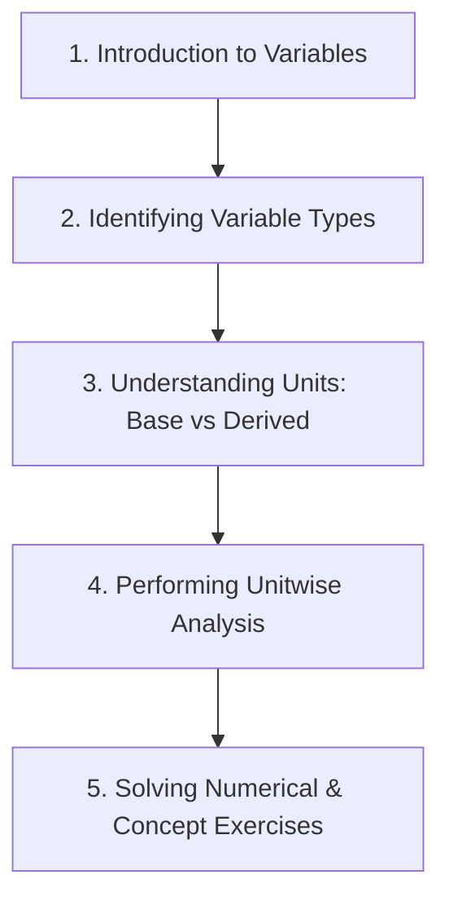

# Learning Path: Scientific Study

Master the fundamentals of scientific methodology, variables, and units step-by-step.

## Milestone 1: Introduction to Variables
- Learn about Cause and Effect in nature.
- Understand what a Variable is.

## Milestone 2: Identifying Variable Types
- Learn to distinguish between Independent, Dependent, and Controlled variables.
- Review practical examples (e.g., plant growth, water taps, electromagnets).

## Milestone 3: Fundamental and Derived Units
- Memorize the 7 SI base units.
- Learn how derived units are composed of fundamental units.

## Milestone 4: Equation Analysis
- Learn the rules of unitwise equation analysis.
- Understand why addition/subtraction requires matching units.
- Verify physical equations.
