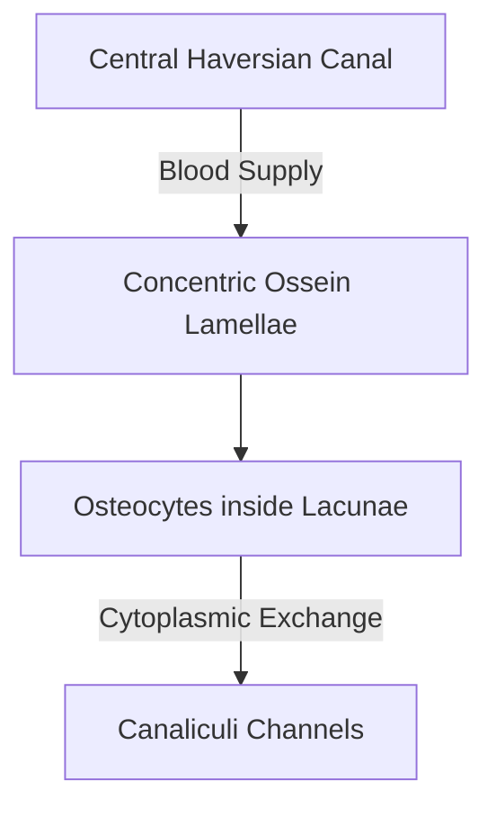

# Detailed Study — 3.2 Supportive Connective Tissue — Cartilage and Bone

**MindmapPath**: `UNIT 6: ANIMAL TISSUE > Connective Tissue > Supportive Connective Tissue`
**Depth Level**: `L-2 Sub-Topic`

---

### 3.2 Supportive Connective Tissue — Cartilage and Osseous Microarchitecture

**Supportive Connective Tissue** (Skeletal Tissue) comprises rigid and semi-rigid connective tissues—Cartilage and Bone—that construct the vertebrate endoskeleton.

#### Cartilage Microarchitecture
Cartilage is a firm, flexible, **avascular** tissue. Its solid matrix consists of **chondrin** (a chondroitin sulfate-protein complex). Mature cartilage cells (**chondrocytes**) occur in groups of 1–4 inside fluid-filled fluid matrix cavities called **lacunae**.

- **Hyaline Cartilage**: Translucent, bluish-white matrix with fine collagen fibrils; forms costal cartilages, tracheal rings, nasal septum, and articular surfaces of long bones.
- **Fibro-cartilage (White Fibrous)**: Dense collagen bundles; toughest cartilage type, forming intervertebral discs and the pubic symphysis.
- **Elastic Cartilage (Yellow Fibrous)**: Rich in branching elastic fibers; highly flexible, forming external ear pinna and epiglottis.
- **Calcified Cartilage**: Hardened by calcium salt deposition; found in head of humerus/femur in elderly individuals.

#### Bone (Osseous Tissue) Microarchitecture
Bone is a hard, rigid, highly **vascularized** skeletal tissue. Its extracellular matrix is composed of **ossein** protein impregnated with inorganic mineral crystals of **hydroxyapatite** [\(	ext{Ca}_{10}(	ext{PO}_4)_6(	ext{OH})_2\)]. Mature bone cells (**osteocytes**) reside within lacunae and extend cytoplasmic processes through microscopic channels called **canaliculi**.

#### Structural Organization of a Long Bone

```
Long Bone (e.g., Femur)
 ├── Epiphysis (Expanded Ends)
 │     ├── Cancellous / Spongy Bone (Trabecular Network)
 │     └── Red Bone Marrow (Active Hemopoiesis / Blood Cell Synthesis)
 └── Diaphysis (Central Shaft)
       ├── Compact Bone (Dense Mineralized Matrix)
       ├── Yellow Bone Marrow (Fat Storage Cavity)
       └── Haversian Systems (Osteons)
             ├── Central Haversian Canal (Blood Vessels & Nerves)
             ├── Concentric Ossein Lamellae
             ├── Osteocytes in Lacunae
             └── Transverse Volkmann's Canals
```


#### Process / Hierarchy Flowchart



### Sub-Topic Infographics & Visual References


*Figure: Cartilage and Bone Comparison Guide*


*Figure: Cartilage Anatomy and Tissue Types (Hyaline, Calcified, Fibro, Elastic)*


*Figure: Architecture of Bone Anatomy and Haversian System (Osteon)*
