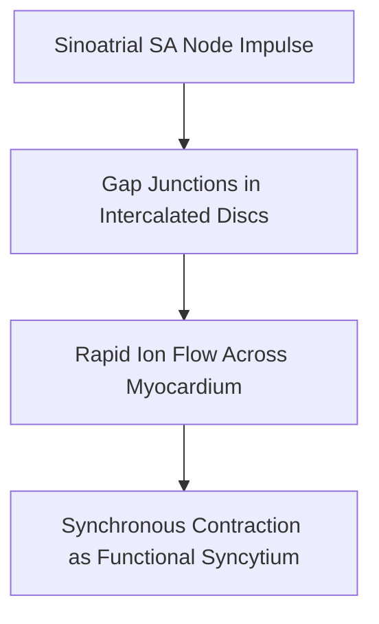

# Detailed Study — 4.3 Cardiac Muscle — Myocardial Architecture

**MindmapPath**: `UNIT 6: ANIMAL TISSUE > Muscular Tissue > Cardiac / Heart Muscle`
**Depth Level**: `L-2 Sub-Topic`

---

### 4.3 Cardiac Muscle — Specialized Myocardial Syncytium

**Cardiac Muscle** (Myocardium) is a specialized involuntary muscle tissue restricted exclusively to the wall of the heart. It combines structural features of skeletal muscle (striations) with physiological characteristics of smooth muscle (involuntary autorhythmicity).

#### Structural Characteristics
- **Branched Cellular Network**: Muscle fibers are short, cylindrical, and form anastomosing branched networks.
- **Uninucleate / Binucleate Central Nucleus**: Unlike peripheral skeletal nuclei, cardiac nuclei are positioned centrally within the muscle fiber.
- **Light Striations**: Contains sarcomeres with A-bands and I-bands, though less distinctly striated than skeletal muscle.

#### Intercalated Discs — Pathognomonic Junctional Complexes
At cell-to-cell boundaries, adjacent cardiac cell membranes interdigitate to form dark transverse bands called **Intercalated Discs**.

```
Intercalated Disc Junctional Complex
 ├── Desmosomes (Macula Adherens)
 │     └── Provide strong mechanical adhesion, preventing cells from pulling apart during contraction
 └── Gap Junctions (Nexus)
       └── Provide low-resistance electrical channels for rapid ionic flow (Na+, Ca2+),
           allowing the myocardium to contract as a functional electrical syncytium
```

#### Physiological Non-Fatiguability
Cardiac muscle contracts rhythmically without fatigue throughout an organism's lifespan. This non-fatiguing property is sustained by an extraordinary density of **mitochondria** (occupying ~40% of cytoplasmic volume), abundant myoglobin, and continuous aerobic perfusion via coronary circulation.


#### Process / Hierarchy Flowchart



### Sub-Topic Infographics & Visual References


*Figure: Cardiac Heart Muscle Overview*


*Figure: Cardiac Muscle — Involuntary, Branched, Non-fatiguing*


*Figure: Intercalated Discs (Desmosomes & Gap Junctions)*
