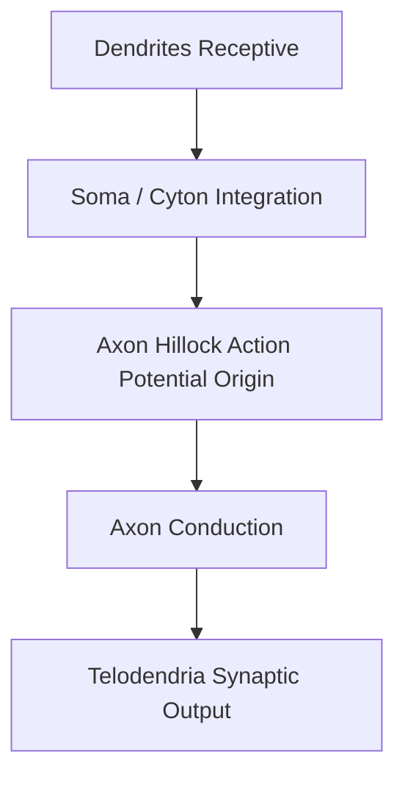

# Detailed Study — 5.2 Neurone — Structural and Functional Neural Architecture

**MindmapPath**: `UNIT 6: ANIMAL TISSUE > Nervous Tissue > Neurone`
**Depth Level**: `L-2 Sub-Topic`

---

### 5.2 Neurone — Structural Anatomy, Myelination, and Classifications

The **Neurone** (Nerve Cell) is the structural and functional unit of nervous tissue. Specialized for electrical excitability, neurons generate and propagate action potentials across synaptic networks.

#### 1. Structural Anatomy of a Neuron

- **Soma / Cyton (Perikaryon)**: The central cell body containing a prominent spherical nucleus and abundant cytoplasmic organelles.
  - **Nissl's Granules**: Large basophilic clumps of rough endoplasmic reticulum (RER) and free polyribosomes responsible for active protein synthesis. Present in cyton and dendrites, but **absent in axon hillock and axon**.
- **Dendrites**: Short, highly branched receptive processes conducting impulses **centripetally** (toward the cyton). Contain Nissl's granules.
- **Axon**: Single long, uniform cylindrical process originating from the **axon hillock**. Conducts impulses **centrifugally** (away from the cyton) to terminal branch buttons (**telodendria**) containing synaptic vesicles filled with neurotransmitters (acetylcholine, norepinephrine).

#### 2. Myelination & Conduction Velocity
- **Myelinated Nerve Fibers**: Axon is enveloped by a lipid-rich **myelin sheath** interrupted at periodic gaps called **Nodes of Ranvier**. Impulse jumps from node to node via **saltatory conduction**, increasing transmission speed up to 100-fold.
- **Non-Myelinated Nerve Fibers**: Enclosed by Schwann cell cytoplasm without spiraled myelin wrapping; impulse conducts continuously at slower velocities.

#### 3. Morphological & Functional Classifications

```
Structural Types of Neurons
 ├── Apolar / Non-polar: No distinct axon/dendrites (e.g. Hydra nerve net)
 ├── Unipolar: Single axon extending from cyton (e.g. embryonic stage)
 ├── Pseudounipolar: Single process splits T-wise into peripheral & central axons (e.g. Dorsal Root Ganglion)
 ├── Bipolar: One axon and one dendrite at opposite poles (e.g. Retina of eye, Olfactory epithelium)
 └── Multipolar: One axon and multiple dendrites (e.g. Cerebral cortex, Motor spinal neurons)
```


#### Process / Hierarchy Flowchart



### Sub-Topic Infographics & Visual References


*Figure: Neurone Overview*


*Figure: Neurone Parts — Soma and Neurites (Axon & Dendrites)*


*Figure: Nissl's Granules in Soma and Dendrites*


*Figure: Node of Ranvier & Myelin Sheath Conduction*


*Figure: Neuronal Direction (Sensory, Motor, Interneuron)*


*Figure: Neuronal Structural Types (Unipolar, Bipolar, Multipolar)*


*Figure: Gray Matter vs White Matter Organization*
