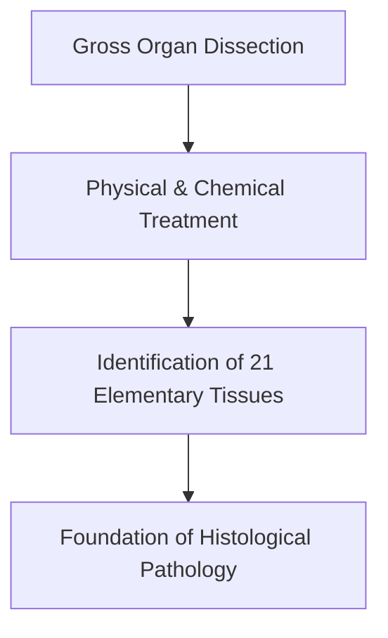

# Detailed Study — 1.1 Xavier Bichat — Architect of Histology

**MindmapPath**: `UNIT 6: ANIMAL TISSUE > History & Overview > Xavier Bichat`
**Depth Level**: `L-2 Sub-Topic`

---

### 1.1 Xavier Bichat — Founder and Architect of Animal Histology

**Xavier Bichat** (1771–1802) was a brilliant French anatomist and physiologist who established the foundational framework of histology. Long before the widespread adoption of high-power compound light microscopes in biological research, Bichat conceptualized that the complex organs of the human body are constructed from simpler, fundamental structural units called **tissues** (*tissu* in French, meaning 'woven fabric').

#### Historical & Scientific Significance
1. **Coining the Term 'Tissue'**: In 1792, Bichat introduced the word *tissu* to describe the distinct structural layers and membrane textures observed during systemic cadaveric dissections.
2. **Identification of 21 Elementary Tissues**: Through meticulous gross anatomical examination, heat drying, chemical reagent exposure, and physical maceration, Bichat successfully identified and categorized **21 elementary tissue types** (including nervous, vascular, fibrous, mucous, and serous tissues).
3. **Foundational Organ-Tissue Concept**: Bichat proposed that organs are not monolithic structures but integrated composites of distinct tissue layers. He argued that physiological functions and pathological disease processes reside within specific tissues rather than entire organs—a principle that revolutionized pathology and clinical medicine.

For his pioneering conceptualization and anatomical classification of body tissues, Xavier Bichat is universally revered as the **Father and Founder of Animal Histology**.

#### Process / Hierarchy Flowchart

### Sub-Topic Infographics & Visual References

*Figure: Xavier Bichat — Founder and Architect of Animal Histology*

*Figure: Animal Histology Overview and Hierarchy*
