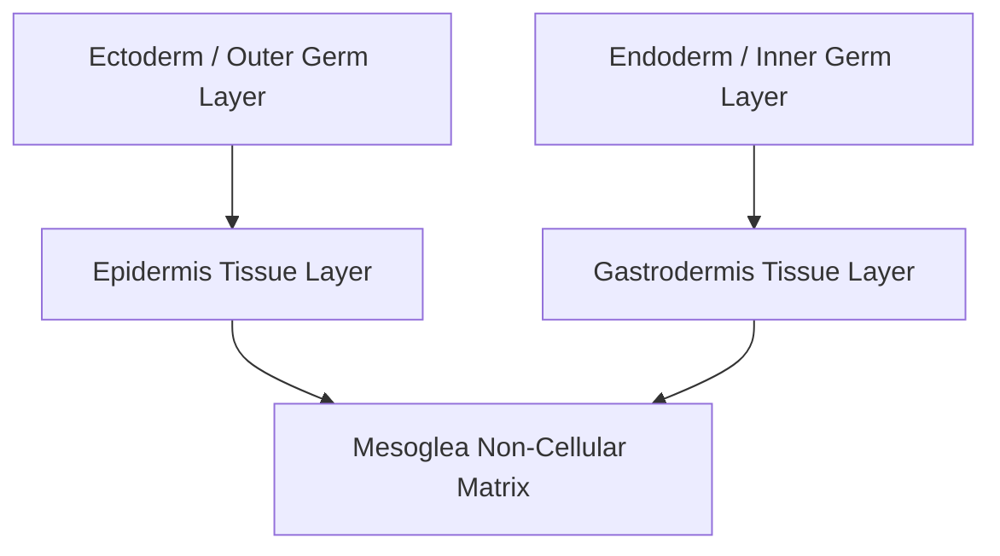

# Detailed Study — 1.4 Phylum Coelenterata — Evolutionary Origin of Animal Tissues

**MindmapPath**: `UNIT 6: ANIMAL TISSUE > History & Overview > Phylum Coelenterata`
**Depth Level**: `L-2 Sub-Topic`

---

### 1.4 Phylum Coelenterata — Evolutionary Emergence of Animal Tissues

In the evolutionary history of Kingdom Animalia, **Phylum Coelenterata** (also known as Cnidaria, including *Hydra*, jellyfish, and corals) marks a paramount evolutionary milestone: the emergence of the **tissue grade of structural organization**.

#### Architectural Features of Coelenterate Tissues
- **Diploblastic Tissue Organization**: Unlike unicellular protozoans or cellular-level sponges (Porifera), coelenterates develop from two primary germ layers:
  1. **Epidermis (Outer Ectoderm)**: Serves protective, sensory, and contractile functions; contains epitheliomuscular cells, interstitial stem cells, sensory cells, and **cnidocytes** (nematocysts for stinging/prey capture).
  2. **Gastrodermis (Inner Endoderm)**: Lines the coelenteron (gastrovascular cavity); composed of nutritive-muscular cells and enzymatic secretory cells for extracellular and intracellular digestion.
- **Mesoglea**: A non-cellular, gelatinous matrix sandwiched between epidermis and gastrodermis providing structural buoyancy and elastic support.
- **Diffuse Nerve Net**: The earliest specialized neural tissue, consisting of interconnected non-polar neurons forming a diffuse nerve net across the body wall.

Phylum Coelenterata established the biological archetype of integrated cell layers functioning as true specialized animal tissues.

#### Process / Hierarchy Flowchart

### Sub-Topic Infographics & Visual References

*Figure: Phylum Coelenterata — Evolution of Tissue Grade of Organization*
