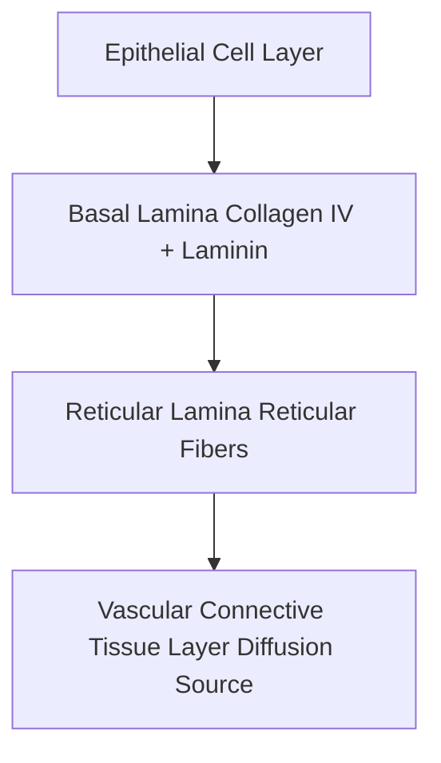

# Detailed Study — 2.1 Surfaces & General Characteristics of Epithelial Tissue

**MindmapPath**: `UNIT 6: ANIMAL TISSUE > Epithelial Tissue > General Features & Surfaces`
**Depth Level**: `L-2 Sub-Topic`

---

### 2.1 Surfaces & General Characteristics of Epithelial Tissue

**Epithelial Tissue** (or Epithelium) is one of the four primary tissue types in animals. Derived from all three embryonic germ layers (ectoderm, mesoderm, and endoderm), epithelium covers external body surfaces, lines internal cavities, and forms glandular structures.

#### Fundamental Characteristics
1. **High Cellularity & Minimal Matrix**: Composed almost entirely of closely packed cells with extremely minimal intercellular substance (*substantia intercellularis*).
2. **Basement Membrane Support**: Rests on a non-cellular **basement membrane** composed of an upper *basal lamina* (secreted by epithelial cells, containing collagen type IV and laminin) and a lower *reticular lamina* (secreted by connective tissue, containing reticular fibers).
3. **Avascular Nature**: Lacks direct capillary blood vessels (**avascular**). Oxygen, glucose, and nutrients diffuse upward from rich vascular networks in the underlying connective tissue through the basement membrane.
4. **Surface Count Distribution**:
   - **Acoelomate animals**: 2 functional surfaces.
   - **Pseudocoelomate animals**: 3 functional surfaces.
   - **Coelomate animals**: 4 functional surfaces.

#### Specialized Intercellular Junctions
- **Tight Junctions (Zonula Occludens)**: Transmembrane occludin and claudin proteins fuse adjacent cell membranes, preventing fluid leakage across epithelial barriers.
- **Adherens Junctions (Zonula Adherens)**: Cadherin links anchored to actin microfilament bundles form continuous adhesion belts.
- **Desmosomes (Macula Adherens)**: Button-like plaques anchored to keratin intermediate filaments provide high tensile mechanical strength.
- **Gap Junctions (Nexus)**: Hexameric **connexon** channel complexes permit direct intercellular transport of ions (\(	ext{Ca}^{2+}, 	ext{cAMP}\)) and small metabolic signaling molecules.

#### Process / Hierarchy Flowchart

### Sub-Topic Infographics & Visual References

*Figure: General Features of Epithelial Tissue*

*Figure: Cell Junctions in Epithelial Tissue (Tight, Adherens, Desmosomes, Gap)*

*Figure: The Epithelial Basement Membrane Gateway*
