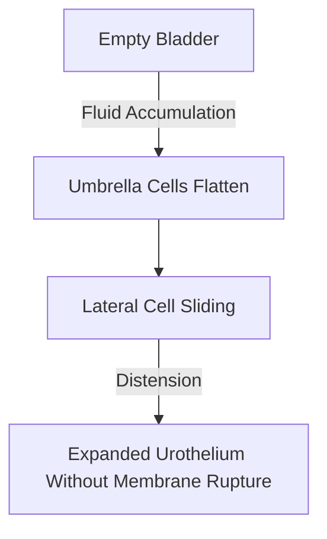

# Detailed Study — 2.3 Compound Epithelium — Multi-Layered & Transitional Epithelia

**MindmapPath**: `UNIT 6: ANIMAL TISSUE > Epithelial Tissue > Compound Epithelium`
**Depth Level**: `L-2 Sub-Topic`

---

### 2.3 Compound Epithelium — Protective Multi-Layered Fabrics

**Compound Epithelium** comprises multiple stacked cellular strata. Because of its multi-layered thickness, its principal physiological role is mechanical protection against physical abrasion, chemical corrosion, and desiccation rather than absorption or filtration.

#### Major Sub-Classifications

1. **Stratified Squamous Epithelium**:
   - **Keratinized Type**: Surface cell layers undergo **cornification**, losing their nuclei and becoming filled with tough, insoluble **keratin** protein filaments. Provides a waterproof barrier on the mammalian skin epidermis.
   - **Non-Keratinized Type**: Surface cells retain living nuclei and cytoplasm. Lines moist mucous membranes subjected to friction, such as the oral cavity, esophagus, pharynx, vagina, and cornea.
2. **Stratified Cuboidal & Columnar Epithelia**:
   - Multi-layered cube or column structures limited to large gland ducts (sweat gland ducts, mammary gland ducts) and portions of the male urethra.
3. **Transitional Epithelium (Urothelium / Plastic Epithelium)**:
   - Specialized 4–6 layer thick expandable epithelium restricted to the urinary system (renal pelvis, ureters, urinary bladder).
   - Surface **umbrella cells** feature specialized rigid protein plaques on their apical membranes. When the bladder fills, umbrella cells stretch and slide laterally, flattening from cuboidal to squamous morphology without breaking intercellular junctions.

#### Process / Hierarchy Flowchart

### Sub-Topic Infographics & Visual References

*Figure: Guide to Compound Epithelial Tissues*

*Figure: Stratified Epithelium Types and Functions (Keratinized vs Non-Keratinized)*

*Figure: Transitional Epithelium (Urothelium) Structure and Function*
