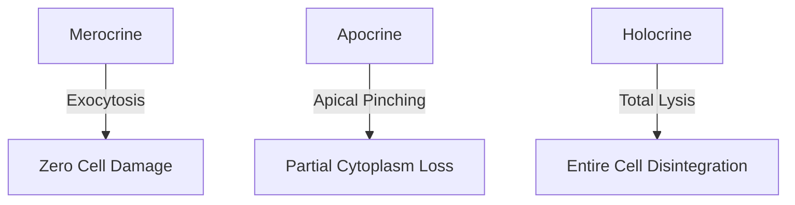

# Detailed Study — 2.4 Modified & Glandular Epithelium

**MindmapPath**: `UNIT 6: ANIMAL TISSUE > Epithelial Tissue > Modified & Glandular Epithelium`
**Depth Level**: `L-2 Sub-Topic`

---

### 2.4 Modified and Glandular Epithelial Specializations

Epithelial cells exhibit remarkable evolutionary plasticity, modifying their cytoplasmic machinery and apical membranes to execute specialized physiological tasks.

#### Modified Non-Glandular Epithelia
- **Ciliated Epithelium**: Apical membrane bears hair-like projections. **Kino-cilia** possess motile 9+2 microtubule axonemes (e.g. respiratory tract), whereas **Stereo-cilia** feature non-motile 0+0 actin core projections (e.g. epididymis, inner ear hair cells).
- **Neuro-sensory Epithelium**: Epithelial cells integrated with sensory nerve endings (e.g. gustatory taste buds, olfactory epithelium).
- **Germinal Epithelium**: Cuboidal layer lining gonads undergoing meiosis to produce gametes (spermatogonia, oogonia).

#### Glandular Epithelium Classification Axes

```
Glandular Epithelium
 ├── By Presence of Ducts: Exocrine | Endocrine | Heterocrine (Mixed)
 ├── By Mode of Secretion: Merocrine (Eccrine) | Apocrine | Holocrine
 ├── By Secretion Type: Serous (Watery) | Mucous (Viscous Mucin) | Mixed
 ├── By Cell Number: Unicellular (Goblet) | Multicellular (Salivary)
 └── By Architectural Complexity:
       ├── Simple Glands: Simple Tubular, Simple Coiled Tubular, Simple Alveolar
       └── Compound Glands: Compound Tubular, Compound Alveolar, Compound Tubulo-Alveolar
```

#### Secretory Mechanisms (Modes of Secretion)
1. **Merocrine (Eccrine)**: Secretory vesicles release products via standard exocytosis with zero cellular damage (e.g. pancreas, salivary glands, eccrine sweat glands).
2. **Apocrine**: Secretory granules accumulate at the apical cytoplasm, which pinches off during release (e.g. mammary glands, apocrine sweat glands).
3. **Holocrine**: The entire cell fills with secretory products, disintegrates, and dies to discharge its contents (e.g. sebaceous cutaneous glands).


#### Process / Hierarchy Flowchart



### Sub-Topic Infographics & Visual References


*Figure: Modified Epithelium Types and Functions Overview*


*Figure: Modified Ciliated Epithelium Specialisations (Kino-ciliated 9+2 vs Stereo-ciliated 0+0)*


*Figure: Specialised Brush-Bordered Epithelium Guide*


*Figure: Glandular Epithelium Classification Overview (Ducts, Consistency, Secretion Mode)*
