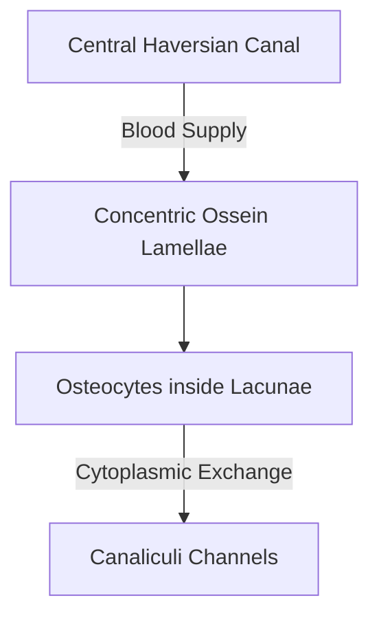

# Quick Study — 3.2 Supportive Connective Tissue — Cartilage and Bone

**MindmapPath**: `UNIT 6: ANIMAL TISSUE > Connective Tissue > Supportive Connective Tissue`
**Depth Level**: `L-2 Sub-Topic`

---

## Must-Know Key Concepts

- **Supportive Framework**: Provides rigid, load-bearing skeletal framework and protection for soft internal organs.
- **Cartilage Architecture**: Avascular, semi-rigid matrix composed of **chondrin** mucoprotein; mature **chondrocytes** reside inside fluid-filled spaces called **lacunae** enclosed by outer perichondrium.
- **Cartilage Subtypes**: **Hyaline** (glassy blue, articular bone ends, trachea), **Calcified** (calcium-deposited), **Fibro-cartilage** (white fibrous, strongest, intervertebral discs), **Elastic** (yellow elastic, pinna, epiglottis).
- **Bone (Osseous) Architecture**: Vascular, highly mineralized rigid matrix containing **ossein** protein and **hydroxyapatite** calcium phosphate crystals; **osteocytes** housed in lacunae interconnected by fine canaliculi.
- **Bone Classification**: Cartilaginous/Replacing (endochondral), Membranous/Dermal (intramembranous skull), Sesamoid (patella in tendon).
- **Long Bone Structure**: Epiphysis (spongy bone with Red Bone Marrow hemopoiesis) vs Diaphysis (compact bone with Yellow Bone Marrow fat storage and structural **Haversian Systems / Osteons**).

### Sub-Topic Process Flowchart

## Key Sub-Topic Infographics

*Figure: Cartilage and Bone Comparison Guide*

*Figure: Cartilage Anatomy and Tissue Types (Hyaline, Calcified, Fibro, Elastic)*

*Figure: Architecture of Bone Anatomy and Haversian System (Osteon)*
